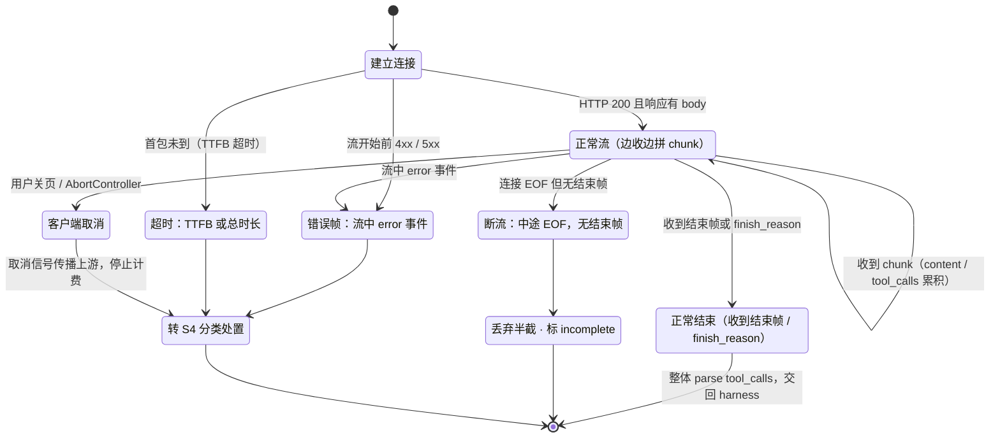
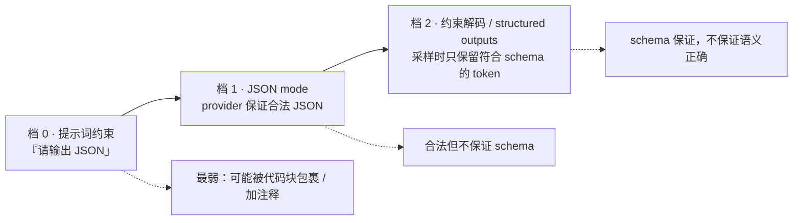
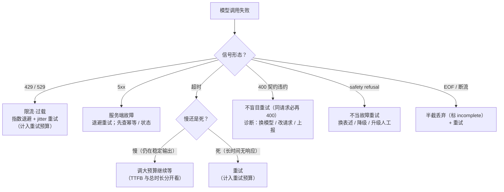
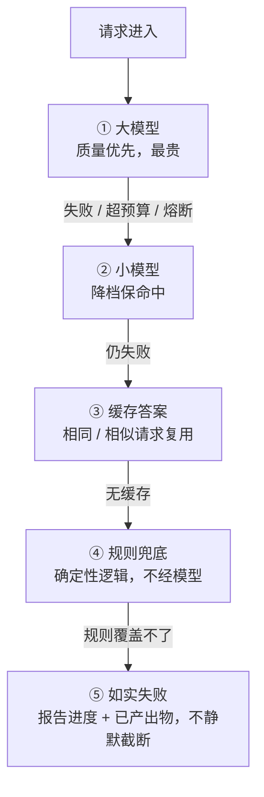

# API 与多模型路由(流式 / 结构化输出 / caching / 路由与成本)

> 优先级 P1 · 状态：📐 讲义已展开，待提问演练
> 前置：从零写 harness §④（SSE 流式，已实测）+ 从零写 harness §⑨（代理故障实录=现成的可靠性故事）
> 生产素材：某 OpenAI 兼容代理（litellm 网关 p50 10s→146s、模型轮换 #41、400 路由错误）+ FinHot 6 次调用结构（#9）
> 目标：把"会调 chat API"升级成"设计过模型调用层"——流式/结构化/caching/重试/路由/归因，六个模块各有取舍
> 用法：S1-S6 是可拆装的调用层模块；**S7 是把它们串成一次真实事故走查**（对着它练时间线）；S8 是常见错误与面试官追问清单；练习题库按 S 编号回查

**本课怎么读**：S1 讲流式在生产里的四条额外路径（从零写 harness §④ 已实测三件必须事）；S2 讲结构化输出的三档强度与"约束解码 ≠ 语义正确"；S3 是全课 ROI 最高的一节——prompt caching 与"前缀稳定性"；S4 把 从零写 harness §⑨ 的代理事故抽象成失败分类学；S5 讲多模型路由的三轴调度；S6 讲成本归因与优化优先级；**S7 是一次完整生产事故走查**（从告警到加固的时间线）；**S8 是常见错误与面试官追问清单**。读完要能回答一句话：*模型调用层不是"调个 API"，是一个有失败分类、预算、降级与归因的可靠性系统。*

---

## 预备知识（这课的门槛，只讲「课程外」要会什么）

- **课程依赖（prereqs）**：`harness-from-scratch`——上完它，`chatStream` 的 SSE 三件事（`\n\n` 分帧 / content 拼接 / tool_calls 按 index 拼接后整体 parse）+ `provider / context 压缩 / validateArgs` 直接复用。
- **技能门槛**：会「HTTP 流式(SSE) / JSON 结构 / 成本 = token×单价」的粗概念即可。
- **不需要提前会**：litellm、vLLM、真实多模型网关、SSE 传输层细节——一律不用。六模块（流式 / 结构化 / caching / 重试分类 / 路由 / 成本）随 `api-demo`（`npm run demo`）边跑边建，全部 mock 零 key。

---

## S1 流式深水区（从零写 harness §④ 的三件必须事已实测，本节补"生产四件额外的事"）

**这一节解决什么问题**：从零写 harness §④ 教你把一条正常的流拼对——`\n\n` 分帧、content delta 拼接、tool_calls 按 index 拼接后整体 parse。但生产里的"流"是一台状态机，"正常走完"只占其中一条路径。这一节把 从零写 harness §④ 的成果放进真实网络环境，补上中途断连、流中错误帧、超时、客户端取消四条提前结束的路径——面试官问"你的流式怎么处理异常"，答的正是这四条。

从零写 harness §④ 已掌握：`\n\n` 分帧、content delta 拼接、**tool_calls 碎片按 index 拼接后整体 parse**。生产还要：

| 事 | 做法 | 教训来源 |
|---|---|---|
| **流中断** | 中途断连=半截 assistant 消息；落日志标记 `incomplete`，重试时丢弃半截（不能拼接续传——大多数 API 无 resume） | FinHot 网关"unexpected EOF 断连"（#11 记忆：52% 文章 failed 期） |
| **错误帧 vs 断流** | 有些错误走 4xx 响应头（流开始前），有些是流中 `error` 事件；两条路径都要接 | — |
| **背压与超时** | 首 token 超时（TTFB）≠ 总时长超时，两个定时器；长生成挂总超时 | p95 20 分钟（#11）→ 总超时必须 > p95 否则误杀，但也不能无限 |
| **客户端断开** | 用户关了页面，流继续烧钱 → 取消要传播到上游（AbortController/取消信号） | 成本纪律 |

**怎么读这张表**：四行是同一台状态机上的四个异常出口，不是四个独立功能。① **断流**是最贵的一类——半截 assistant 消息既不能当完整结果提交，也不能和新流拼接续传（大多数 API 无 resume 语义），只能标 `incomplete` 整条重来；② **错误帧 vs 断流**决定你能不能拿到 HTTP 状态码做分类——流开始前的 4xx/5xx 能从响应头读到状态，流中 `error` 事件通常只有一个不带状态码的 JSON，两者要接进 S4 的同一张分类表（前者可判契约违约，后者只能按连接层故障处置）；③ **TTFB 超时 ≠ 总时长超时**是最常被合并的两个定时器——首 token 慢说明"上游排队/冷启动"，总时长超限覆盖长生成，混用会把"正在稳定输出"的流误杀（#11 的 p95 20 分钟就是这类长生成）；④ **客户端取消**是唯一一条"省钱"路径，前提是取消信号真的传到上游，否则页面关了、token 还在烧。

四条路径的全貌（正常只占左边一条）：



**已实测与代码核对（`harness-demo/src/llm.ts`）**：`chatStream` 确实实现了 从零写 harness §④ 三件事——`\n\n` 分帧（`buf.indexOf("\n\n")` 切帧）、content 拼接（`content += delta.content`）、tool_calls 按 index 分槽拼接后整体 `JSON.parse(s.argsStr)`；usage/model 帧在 `continue` 之前抓取，供 OTel span 的 `gen_ai.response.model` 使用。但"生产四件额外的事"在 demo 里**尚未实现**：没有流中 `error` 事件分支、没有 TTFB/总时长两个定时器、没有把 `AbortController` 的取消信号接到 `fetch`、暂无 `incomplete` 落标。所以本节把它们标成"生产要求"而非"已实测"——这个区分在面试里要守住（见报告"代码一致性"）。

```ts
// harness-demo/src/llm.ts —— chatStream：SSE 三件事（从零写 harness §④ 的实现在这里）
const tcSlots = new Map<number, { id: string; name: string; argsStr: string }>(); // tool_calls 按 index 分槽
let buf = "", content = "";
// …逐 chunk 读 body：
//   buf += chunk；while ((i = buf.indexOf("\n\n")) >= 0) { frame = buf.slice(0,i); buf = buf.slice(i+2); /* parse frame */ }
//   chunk.usage 帧（choices 为空）在 continue 之前抓取 → 供 OTel 的 gen_ai.response.model
//   chunk.delta.content != null → content += delta.content                       // ① content 拼接
//   chunk.delta.tool_calls → tcSlots.get(tc.index)?.argsStr += tc.function.arguments // ② 碎片只拼接、不 parse
// 流结束才整体 parse（③ tool_calls 按 index 分槽拼接后，一次 JSON.parse）：
const tool_calls = [...tcSlots.entries()]
  .map(([, s]) => ({ id: s.id, name: s.name, arguments: s.argsStr ? JSON.parse(s.argsStr) : {} }));
```

**这段在讲什么**：三件事一个都不能拆——① content 是逐帧累加；② tool_calls 的 `arguments` 是**跨帧的不完整 JSON 片段**，只能按 `index` 分槽拼接、**流结束才整体 `JSON.parse`**（对单个碎片 parse 必抛异常，S8 #8）；③ usage/model 帧在 `continue` 之前抓，供 OTel span 回填（observability S2 的成本归因原料）。这一段的"已实现生产差异"——没有 `error` 事件分支、没有 TTFB/总时长双定时器、没有 `AbortController` 取消传播——正是下一任务要建的 `api-demo` 的扩展点（见 notes/process/api-mvp-spec.md）。

**失败模式速记**：把半截流当完整结果提交（下游拿到缺字段的消息）｜对单个 tool_calls 片段 parse（必抛 JSON 异常，从零写 harness §④ 已讲）｜只设总超时导致长生成被误杀或只设 TTFB 导致挂死｜用户取消后仍在后台烧 token。

---

## S2 结构化输出：让模型说"机器能校验的话"

**这一节解决什么问题**：agent 的工具体系完全建立在"模型输出能被程序解析"之上。这一节把"让模型输出 JSON"拆成强度递进的三档，并划清一条最容易混淆的线——**语法合法（schema 通过）不等于语义正确**。这条线决定你还要不要保留 `validateArgs`。

三档（从弱到强）：
1. **提示词约束**（"输出 JSON"）：最弱，偶发代码块包裹/额外注释
2. **JSON mode**（provider 保证合法 JSON）：合法但不保证 schema
3. **约束解码 / structured outputs**（grammar 级：token 采样时只保留符合 schema 的 token）：schema 保证——OpenAI 官方表述是「Structured Outputs 会**总是**生成符合所给 JSON Schema 的响应」（`response_format: json_schema` + `strict: true`），**未公布具体遵循率数字**；**Anthropic = 原生 Structured outputs**（JSON 输出经 `output_config.format` 传 JSON Schema，配合 SDK 的 `parse()`）+ **Strict tool use（`strict: true`）** 保证工具名与入参的 schema 校验；不再是「仅靠 tool_use 模拟」（两家均已提供，2026-10 核实）。

三档的强度阶梯：



**怎么读这张图**：越往右，约束越靠近采样过程本身。档 0 只是"请求"（模型可以不听），档 1 是"格式保证"（一定是合法 JSON），档 2 才是"结构保证"——约束解码把非法 token 的采样概率直接清零，所以官方能直接宣称"**总是**符合所给 schema"（OpenAI **未公布具体遵循率数字**，99.9% 一类的说法查无一手源）；Anthropic 侧用**原生 structured outputs（`output_config.format`）+ strict tool use** 达到同等效果。注意最右那条虚线标注：**schema 保证只覆盖形状，不覆盖内容**——这正是它不能替代 harness 校验的原因。

**agent 场景的正确用法**：工具调用的 arguments 天然是结构化输出（从零写 harness §③ 的 JSON Schema 校验就在这一层之上）——**harness 的 `validateArgs` 是最后一道，约束解码是第一道**，两层都要（约束解码不保证语义正确：`city: "北京"` 拼写成"北惊"照样合法）。
失败处理：schema 违约 → 重试（把违约点反馈进错误信息）→ 2 次失败降级（更弱的 schema/提示词修复）。

**三档各自的崩溃点（失败模式）**：档 0 死于"模型自由发挥"——代码块包裹、加解释性文字、字段名漂移；档 1 死于"合法但不是你要的"——能 parse 成 JSON，但可能是数组而非对象、字段缺失、类型错；档 2 死于"形状对、内容错"——`city` 拼写错、枚举值语义相近但选错、数值量纲错。**面试要能报出这条递进**：档 2 把"解析失败"消灭了，但把"语义错误"完整留给了 `validateArgs` 和业务校验。

FinHot 锚点：analyzeArticle 的 understand/structure 输出都要落结构（方向/板块/scope）——结构化违约=该行 failed（台账里的真实 failed 分布里有这一类）。

---

## S3 Prompt Caching：最便宜的性能优化

**这一节解决什么问题**：这是六个模块里 ROI 最高、也最容易被一行代码毁掉的一个。它的全部机制可以压成一句话——**provider 缓存的不是"内容"，是"前缀"**。理解这一点，命中率的诊断就从玄学变成"谁动了前缀"的排查题。

**机制**：provider 对**请求前缀**的 KV cache 做持久化复用——前缀命中=输入 token 按折扣价计费+首 token 延迟大降。
- Anthropic：显式 `cache_control` 断点（最多 4 个，放稳定内容的末尾）；**读缓存 = 基础输入价 ×0.1；写入 = ×1.25（5 分钟 TTL）或 ×2（1 小时 TTL）**——命中时输入便宜 90%，写入有一次 25%/100% 溢价（官方定价页核实）
- OpenAI：**自动前缀缓存**（≥1024 token 的前缀自动命中，**命中 = 基础输入价 ×0.5**，2024-10 起）；部分模型另支持显式 cache_control。

**工程纪律（面试点：命中率的本质是"前缀稳定性"）**：
1. **稳定内容前置**：system → 工具定义 → few-shot → 会话 → 当前消息。**把变化的东西（时间戳、随机 id、用户消息）全部放后面**——前面任何一个字节变了，整个 cache 断
2. **反模式**：system prompt 里嵌 `current_time: 2026-10-11 14:32:11` → 每次请求全 miss
3. **命中率为一等指标**：按端点/模型统计（可观测归因）；cache 命中带来的 p50 延迟下降是**可量化的产品改进**
4. **agent 场景特别值**：同一会话的 N 步循环，前 N-1 步全部是稳定前缀 → 步数越多命中收益越大（coding agent 长会话=天然高命中）

**怎么读这四条纪律**：第 1 条是构造原则（稳定在前、变化在后），第 2 条是它的反面教材，第 3、4 条回答"值不值得做"。**失败模式有三类**：① **模板注入动态值**——`current_time`、`session_id`、`request_id`、随机 few-shot 顺序，任何一个放在稳定段就会让整条前缀失效；这类 bug 的特征是"命中率断崖式下跌，但请求内容看起来没变"（S8 追问有专门一道）。② **前缀太短**——OpenAI 侧不足 1024 token 的前缀根本不进缓存，所以"把稳定内容合并成一段长前缀"反而更划算。③ **断点放错位置**——Anthropic 的 `cache_control` 标记的是"从这里往前的都可缓存"，放在开头等于只缓存了开头一小段。

**可背面试句**："cache 命中率的本质是前缀稳定性——优化 caching 不是优化缓存，是优化你的 prompt 结构。"

---

## S4 可靠性工程：失败分类学（从零写 harness §⑨ 故事的理论化）

**这一节解决什么问题**：把 从零写 harness §⑨ 的"代理半夜抽风"从一次事故升级成一套可复用的分类学。面试官问"模型调用失败你怎么处理"，如果你只答"重试"，就暴露了没有分类——因为**不同类别的失败，正确处置往往是相反的**：429 该退避重试，400 该立刻停止重试去诊断。

**从零写 harness 实录（现成面试故事）**：该代理 19:33 起持续 400（代理把请求路由到要求旧 functions 格式的 code 后端）+ 工具名带不可见字符（`tc.name.trim()` 防御）+ 模型轮换（qwen3.8-flash 下架 #41）→ 教训三连：**provider 是组件不是基础设施；防御性解析；能力侦察前置**（跑任务前 GET /v1/models）。

失败分类 → 处置（背这张表）：

| 类 | 信号 | 处置 |
|---|---|---|
| 限流/过载 | 429 / 529（Anthropic over-capacity） | 指数退避+抖动重试；**带 jitter 防惊群** |
| 服务端故障 | 5xx | 退避重试（幂等前提！非幂等先查状态——durable execution） |
| 超时 | TTFB/总超时 | 区分"慢"和"死"：慢=可调大预算，死=重试 |
| 契约违约 | 400（schema/格式/能力不匹配） | **不盲目重试**（同一请求 100 次也是 400）→ 诊断：换模型/改请求/上报 |
| 内容拒绝 | safety refusal | 不当故障重试；换表述/降级/升级人工 |
| 连接层 | EOF/断流（S1） | 半截丢弃+重试 |

**怎么读这张表**：先看"信号"列——它是你唯一能确定的事实（HTTP 状态码、finish_reason、异常类型）；再看"处置"列——它由信号近似唯一决定。最危险的错误是把 400 塞进"反正是失败，重试就好了"的通用分支：**同一个请求重试 100 次还是 400**，重试只是把一次清晰错误放大成 100 次成本和一个更长的故障窗口。其次是 5xx 的重试前提——只有幂等操作才能无脑重试，非幂等（转账、发消息）必须先查状态（durable execution）。

失败分类决策树（429 / 5xx / 超时 / 400 契约 / refusal / EOF 各自处置）：



**架构层**：
- 重试预算（每任务总重试上限，防重试风暴烧钱）
- 熔断（某模型错误率 > 阈值 → 一段时间路由绕开）
- **降级阶梯**：大模型→小模型→缓存答案→规则兜底→如实失败（从零写 harness"step-5 不支持 tool calling → 换 qwen3.8-flash"=降级阶梯的第一级，实测过；S6 有完整阶梯图）
- FinHot 锚点：litellm 网关 p50 10s→146s、52% failed（#11）→ 当时的吞吐治理（重试+部分成功+backfill 补跑）就是这张表的手工执行版

**可背面试句**："重试不是错误处理的默认值，是分类之后的动作。400 重试一百次还是 400，把诊断成本拖成故障时长。"

---

## S5 多模型路由：质量-成本-延迟的三轴调度

**这一节解决什么问题**：当单模型无法同时满足质量、成本、延迟三个约束时，路由就是把"取舍"变成"调度"的手段。三种策略的区别不在实现难度，而在**你愿不愿意为每一步付出一次额外的判断成本**。

**三种策略**：
1. **级联（cascade）**：便宜模型先答+自评置信度 → 低置信升级贵模型。适合二分类/短答；agent 场景贵（每步都判置信度）
2. **分类路由**：前置分类器把请求/子任务分型 → 路由到对应模型。适合**任务结构已知的流水线**
3. **角色分工（role-based）**：流水线里不同环节固定用不同模型。**FinHot 的 6 次调用结构就是它**（#9：prefilter（便宜）→ score×2（双模型=一致性/防单点偏见）→ understand → structure → direction（贵，判断重））——"我设计过角色分工的调用结构：80% 的筛选工作量花在便宜模型上，贵模型只做最终判断"

**怎么读这三种策略**：级联把判断放在"**每次回答之后**"（一次自评成本），分类路由把判断放在"**每次请求之前**"（一次分类成本），角色分工把判断放在"**设计期**"（零运行期判断，但流水线结构必须已知）。失败模式也各不相同：级联怕"便宜模型自评系统性过信"（不会升级）；分类路由怕"分错类=全错"（且分类器本身也会漂移）；角色分工怕"环节与模型能力错配"（把需要 tool calling 的步骤派给不支持的模型——从零写 harness step-5 的实测教训）。

**路由决策的输入**：任务类型、上下文长度（长上下文=贵+慢，短了才换短窗模型）、延迟预算、成本预算、模型能力矩阵（tool calling/结构化/视觉/窗口——**能力矩阵要动态侦察**：gpt-load 轮换 #41 证明静态配置必过期）。
**双模型投票**（FinHot score×2）：同一判断两个模型独立打分，分歧=低置信信号（升级/人工）——比单模型自评置信度可靠（自评系统性过信）。

---

## S6 成本工程：归因 + 预算 + 优化优先级

**这一节解决什么问题**：把"省 token"从操作技巧上升成工程纪律。核心判断：**没有归因就没有成本工程，只有总账**——总账只能告诉你这个月贵了，归因才能告诉你贵在哪一层、哪个模型、哪类任务，然后你才能决定动哪一刀。

1. **归因粒度**：成本记到 trace/任务/用户/功能（可观测 span 带 token 属性）——**没有归因就没有成本工程，只有总账**
2. **优化优先级**（按 ROI 排序，面试按这个顺序讲）：
   - ① 压缩上下文（从零写 harness §⑧：少送 token=直接省，还提质量）
   - ② prompt caching（S3：命中部分折扣）
   - ③ 路由/降级（S5：不是所有步都值贵模型）
   - ④ 蒸馏/小模型微调（数据飞轮/ 模型基础，最后手段）
3. **预算机制**：每任务 token 预算（从零写 harness §⑧ 已有）→ 超预算=**有尊严地失败**（报告进度+已产出物，不是静默截断）
4. **FinHot 锚点**：1200 篇/日 → 150-280 篇/日的吞吐事故（#11）= 成本/延迟失控的生产案例；预筛分级（便宜模型挡量）= 成本控制的第一杠杆

降级阶梯（按成本/质量递减，最后一格是"有尊严地失败"）：



**怎么读这张图**：阶梯每一级都是"用质量换可用性"的显式决策，不是兜底代码。关键纪律是**每一级都要能被观测**（降级了多少次、命中缓存多少次、规则兜底多少次）——否则你会把"系统很稳"的假象建立在"大量请求被静默降级"之上。FinHot 的"部分成功 + backfill 补跑"就是这条阶梯在批处理里的手工版。成本公式可以直接写出来：

$$C_{task} = \sum_{i=1}^{N} (tokens_i \times price_i)$$

角色分工（S5）把不同 $i$ 的 $price_i$ 换掉，caching（S3）改的是命中部分的单价，压缩（从零写 harness §⑧）改的是 $tokens_i$——**三条优化路径分别作用在公式的不同项上**，这正是优化优先级的来源。

**可背面试句**："成本工程的第一步不是省钱，是归因——先说清这笔钱花在哪个模型、哪类任务、哪一段上下文上，再谈优化。"

---

## S7 实战走查：一次代理故障从告警到加固的完整时间线

> 素材：从零写 harness §⑨ 代理故障实录（2026-10-10 晚 19:33 起）+ 模型轮换 #41。每一步都标注**用的是 S4 表里的哪一条处置**、当时的根因、以及事后的加固。目标是练**从信号到加固**的节奏，而不是复述知识点。

| 步 | 时刻 | 信号（看到什么） | S4 分类 | 处置（当时做的） | 根因 | 加固（事后加的） |
|---|---|---|---|---|---|---|
| 0 | 19:25-19:33 | demo 四模式全绿（正常/崩溃恢复/审批拒绝/压缩），p50 正常 | — 基线 | 无 | — | 留下正常基线，才能判断"变坏"从哪一刻开始 |
| 1 | 19:33 | 请求开始持续返回 HTTP 400，错误体 `"functions parameter of the code model must be provided"` | **契约违约（400）** | 第一反应是"重试看看"——但同一请求重试仍是 400 | 代理把请求**路由**到了要求旧版 `functions` 格式的 code 模型后端（路由错了，不是我们的请求格式错） | ① 400 一律不重试，直接进诊断分支；② 跑任务前 GET /v1/models 做**能力侦察**；③ 记录 wire 返回的 `model` 字段（span 的 `gen_ai.response.model`）来自证"实际路由到了哪个后端" |
| 2 | 同日 | 工具调用假错：`unknown tool: get_weather`，但该工具明明已注册 | **契约违约（工具名不匹配）** | 起初怀疑模型幻觉调错工具 | 模型返回的工具名带**不可见字符**（尾随空格/零宽字符）→ 注册表查不到 | 防御性解析：`tc.name.trim()`（+ 断言 `name ∈ 注册表`），把"假错"挡在解析层 |
| 3 | 同期 | `qwen3.8-flash` 从代理**下架**，同一 model 名报错或空响应 | **能力/契约不匹配（模型轮换）** | 切到 `qwen3.8-flash-next`（tool calling 已验） | provider 是组件不是基础设施，模型清单会静默变化（#41 gpt-load 轮换的同类事件） | 能力侦察前置 + 降级阶梯（S4/S6）+ 模型版本 pin（沙箱与凭据 §S6） |
| 4 | 恢复 | 换模型 + `trim` 防御后 demo 恢复正常 | 处置生效 | 记录"哪条处置解决了哪类信号" | — | 把这次事故写成 S4 分类表的实证；用 mock provider 让控制层在代理故障期**独立验证**（从零写 harness §⑨） |
| 5 | 加固 | — | — | — | — | 重试预算 + 熔断 + 抖动（防重试风暴）；对 4xx 断言"不重试"；能力矩阵动态侦察 |

**怎么读这条时间线**：三步信号精确对应 S4 表的三行——步 1 走"契约违约（400）"的**不重试**分支，步 2 也走契约违约但处置是**防御性解析**（同名不同因，说明分类之后还要再分因），步 3 走"能力不匹配"、触发**降级阶梯**（换模型支援）。步 4-5 才是价值所在：**事故的产出不是"修好了"，而是长出了三条结构性加固**（侦察/防御/预算），让同类信号下次能自动分流。

```ts
// harness-demo/src/agent.ts —— 防御性解析（S7 步 2：工具名带尾随空白/零宽字符 → 注册表查不到）
// 防御：部分代理返回的工具名带首尾空白（qwen3.8-flash 2026-10-10 实测），不 trim 会注册表查不到
const name = tc.name.trim();
const spec = registry.get(name);                       // trim 后命中注册表
// tools.ts 的 validateArgs(spec.parameters, args)     // 执行层最后一道（schema 合法 ≠ 语义正确，S2）
```

**这段在讲什么**：同一类「契约违约」可以有两种根因——步 1 是**路由错位**（400 不重试、换模型），步 2 是**不可见字符**（`trim` 防御）。这一行 `tc.name.trim()` 就是「防御性解析」的落点：先把 wire 上回来的脏数据挡在解析层，避免「模型幻觉调错工具」的假诊断。它和 `validateArgs` 是两道门——前者治「工具名不匹配」，后者治「参数语义非法」（S2 档 2 之后的最后一道）。

**实跑判据（S7）**：已实现判据 = `cd harness-demo && npm run demo`（正常模式里 `chatStream` 拼流 + `tc.name.trim()` 都生效，`validateArgs` 在 tool 注册路径上）；规划判据 = `cd api-demo && npm run demo` 复现六模块断言（SSE 分帧 / schema 校验 / cache 命中 / 4xx 不重试 / 能力路由 / 成本归因）——克隆判据见 course-structure.ts 的 practicalOutput，实现规格见 notes/process/api-mvp-spec.md。

**30 秒口述版（面试用）**："某次 demo 夜里开始全 400，错误体是 'functions parameter of the code model must be provided'——这不是我们请求的问题，是代理把请求路由到了一个只认旧版 functions 协议的 code 后端。同一请求重试只会继续 400，所以我没重试，而是查 wire 返回的 model 字段确认路由错位、换模型绕开。期间还发现工具名带不可见字符导致 `unknown tool` 假错，加了一行 `tc.name.trim()`。根因是 provider 把模型清单和路由改了我们不知道——所以后来把能力侦察前置（跑任务前先 GET /v1/models）、加了防御性解析和重试预算。"

**面试官可能追问**（对应 S8）："为什么当时不重试？"——因为信号是 400（契约违约），不是 429/5xx；重试同一请求违反 S4 表。｜"你怎么知道是路由问题而不是你格式错？"——错误体点名 code 模型 + wire 返回的 `model` 字段与请求不符，两个证据交叉。｜"不可见字符你怎么发现的？"——工具名在注册表里查不到，但打印长度/字节与预期不符（假错→查编码）。

---

## S8 常见错误与面试官追问

> 这一节是"反向题库"。模型调用层的杀伤力往往不在"你会不会调"，而在"你知道它哪里会崩吗"。每条给错误、为什么危险、正确做法；后面是四条高频深挖。

### 8.1 常见错误速查表

| # | 常见错误 | 为什么危险 | 正确做法 |
|---|---|---|---|
| 1 | **把 400 当 5xx 盲目重试** | 同一请求重试 100 次还是 400；重试把一次清晰错误放大成成本+更长的故障窗口 | 400=契约违约 → 停止重试，进诊断（换模型/改请求/上报），S4 表 |
| 2 | **退避忘了 jitter** | 100 个并发客户端同步退避→同一时刻一起重试，形成惊群/重试风暴，把上游再打挂 | 指数退避 + 抖动；常用 full jitter / equal jitter（出处：AWS Architecture Blog, Marc Brooker,《Exponential Backoff And Jitter》, 2015-03-04, https://aws.amazon.com/blogs/architecture/exponential-backoff-and-jitter/ —— 该文使用 Full Jitter / Equal Jitter / Decorrelated Jitter 三个术语） |
| 3 | **TTFB 与总超时混用** | 只设总超时会误杀正在稳定输出的长生成；只设 TTFB 会让"首包已到但后续卡死"的流挂住 | 两个定时器分开：TTFB 判"上游是否启动"，总时长判"是否会无限拖"，S1 |
| 4 | **system prompt 里嵌时间戳/随机 id** | 前缀每字节变→cache 全 miss，命中率断崖下跌（体感：贵了、慢了，但请求"看起来没变"） | 稳定内容前置，动态值全部后移；时间戳用相对/截断粒度或放进 user 消息，S3 |
| 5 | **用约束解码替代 `validateArgs`** | 约束解码只保证语法/schema 合法，不保证语义正确（"北惊"照样合法）→ 非法语义直达业务 | 两层都要：约束解码是第一道，`validateArgs` + 业务断言是最后一道，S2 |
| 6 | **把"重试"当"幂等"** | 非幂等操作（转账/发消息/写文件）重试会重复副作用；"没报错"不等于"没执行" | 重试前提是幂等；非幂等先查状态再决定（durable execution），或加幂等键 |
| 7 | **把 safety refusal 当故障重试** | 拒绝不是网络故障，重试只会同样被拒；还可能触发更严格的策略 | 换表述 / 降级路由 / 升级人工，S4 表 |
| 8 | **对 tool_calls 碎片逐个 parse** | 不完整 JSON 片段必然抛异常，把正常流误判为故障 | 按 index 拼接、流结束后整体 parse（从零写 harness §④ 已实测） |
| 9 | **无重试预算/熔断** | 单模型持续故障时无限重试，烧钱且拖长故障；下游被上游拖死 | 每任务重试上限 + 错误率熔断 + 降级阶梯，S4/S6 |
| 10 | **只记总账不记归因** | 知道"这个月贵了"，不知道贵在哪个模型/任务/上下文段，无法动刀 | 成本记到 trace/任务/用户/功能（可观测），S6 |

### 8.2 面试官追问：四条高频深挖

**追问 A：「429 重试 3 次成功了。为什么还强调 jitter？不加会怎样？」**
不加 jitter，所有并发客户端会在同一退避窗口结束时**同时**重试，制造一次比原来更大的流量尖峰（惊群），把刚恢复的上游再打挂。jitter 的作用是把重试时刻打散，让上游的恢复曲线平滑。**加分答法**："退避解决'试得太快'，jitter 解决'大家一起试'；100 个并发客户端下，没有 jitter 的指数退避和固定间隔重试的危险程度差不多。"

**追问 B：「你的 cache 命中率从 80% 掉到 30%，没改模型。列四个嫌疑。」**
① **前缀里混进了动态值**：时间戳、`session_id`、`request_id`、随机排序的 few-shot——最常见；② **前缀变短**：压缩/裁剪把稳定段压到 1024 token 阈值以下（OpenAI 侧）；③ **断点/顺序变了**：Anthropic 的 `cache_control` 位置挪了，或工具定义顺序不稳定；④ **请求分布变了**：更多请求走到了缓存未覆盖的新前缀（新会话/新模板）。**排查方法**：先看命中率下跌是"全端点同步跌"（模板问题）还是"某类请求跌"（分布问题）。

**追问 C：「约束解码保证 schema 合法，为什么还要 `validateArgs`？」**
约束解码保证的是"**形状**"——字段存在、类型对、枚举在集合内；它不保证"**语义**"——`city: "北惊"` 是合法字符串但拼写错，`amount: 0` 合法但语义可能是"全额退"。**加分答法**："约束解码是**解析层**的第一道门，`validateArgs` 是**执行层**的最后一道门；前者降低失败率，后者定义什么是非法——两者的失败语义不同，不能互相替代。"（呼应 S2 与 系统设计 §S6 的"在哪一层拦"）

**追问 D：「一次模型调用失败，你按什么顺序处置？」**
先**分类**（信号是什么：429/5xx/超时/400/refusal/EOF），再**对表**（S4），最后才谈重试。顺序本身是考点：跳过分类直接重试，等于把 S4 的六行压成一行"重试"。**加分答法**：报出分类树 + 每类一句处置 + 强调"重试要算进重试预算，4xx 断言不重试，非幂等先查状态"。

**可背面试句**："模型调用层的成熟度，不看你能背多少 API，看你能否把每个失败信号映射到一个不后悔的处置。"

---

## 练习题库（后续提问用）

> 1-8 是原有基础题；9-14 覆盖新增的 S7 实战走查与 S8 常见错误。提问时按"考察"列回查对应小节。

| # | 题目 | 考察 |
|---|---|---|
| 1 | 流式响应收到一半断连。日志里留什么、重试时上下文怎么构造？ | S1 |
| 2 | 你的 cache 命中率从 80% 掉到 30%，没改模型。列四个嫌疑 | S3 |
| 3 | 429 重试 3 次成功。为什么必须加 jitter？不加会发生什么（100 个并发客户端） | S4 |
| 4 | 400 "functions parameter must be provided"——从零写 harness 真事。为什么不重试而要换路？ | S4 契约违约 |
| 5 | FinHot 6 次调用：哪个环节最该降档？为什么 score 要用双模型而不是单模型+阈值？ | S5 |
| 6 | 任务预算 50k token，跑到 49k 还没完。三个处置选项+你选哪个 | S6 |
| 7 | 约束解码保证 schema 合法，为什么还要 validateArgs？举一个合法但错误的例子 | S2 |
| 8 | 长会话 agent 第 30 步成本是第 1 步的 3 倍。哪三层优化能压下来？ | S3+S6 |
| 9 | 实战走查：19:33 起持续 400，你手上有"重试 / 换模型 / trim 工具名 / 查 /v1/models"四个动作。排出顺序，并说明每一步依据 S4 哪一行 | S7+S4 |
| 10 | 流式 200 之后中途 EOF，代码把半截 assistant 消息当完整消息提交了。列三个会出问题的下游，并说明日志该标什么 | S1 |
| 11 | system prompt 加了一行 `now()` 做时间感知，cache 命中率从 90% 掉到 5%。给一个不牺牲时间感知的修法 | S3 |
| 12 | 限流风暴：100 个并发客户端都做指数退避但没有 jitter。会发生什么？给两种抖动方案 | S4 |
| 13 | 约束解码 100% 合法，为什么审计里仍有 failed 行？用 `city: "北惊"` 与量纲错误各举一例 | S2 |
| 14 | 日成本要砍一半，只许动调用层。按 ROI 给前三个动作和预估作用项（tokens / 单价 / 命中率） | S6+S3+S5 |

---

## 来源与锚点（2026-10 核实回填）

- caching 机制与折扣：已核实（docs.anthropic.com 定价/缓存页：0.1×读 / 1.25×、2×写；platform.openai.com prompt caching 指南：≥1024 token、0.5×）；structured outputs 两家现状已核实（OpenAI structured outputs 文档；Anthropic tool_use 文档）
- 我的证据（全是实测）：从零写 harness §④ SSE 三件必须事、从零写 harness §⑨ 代理故障四连（400 路由/不可见字符/模型轮换/降级）、FinHot 6 次调用结构（#9）、litellm 吞吐事故（#11）、gpt-load 模型轮换（#41）
- 接回：从零写 harness §⑧（压缩=成本第一杠杆）、可观测(归因)、沙箱与凭据(重试前提=幂等/durable execution)
- 实战走查（S7）素材：harness-from-scratch §⑨ 代理故障实录（错误原文 `"functions parameter of the code model must be provided"`、`unknown tool: get_weather` 假错、`tc.name.trim()` 防御）+ `harness-demo/src/llm.ts`（SSE 拼接与 `gen_ai.response.model` 埋点）
- ✅ 已核实（2026-10）：退避抖动 `full jitter` / `equal jitter` 出处 = AWS Architecture Blog, Marc Brooker,《Exponential Backoff And Jitter》, 2015-03-04（表内已回填）；S2 两家 structured outputs 现状同轮核实。

<!-- 已核实（2026-10）：S3 caching 折扣（0.1×读 / 1.25×·2×写；≥1024 token / 0.5×）与 S2 structured outputs 两家现状为上一轮一手源核实结果，本轮未改动。 -->
> 补充：本文件为开课版完整讲义（S1-S8）；后续提问演练中暴露的卡壳点，回填到对应 S 节。
