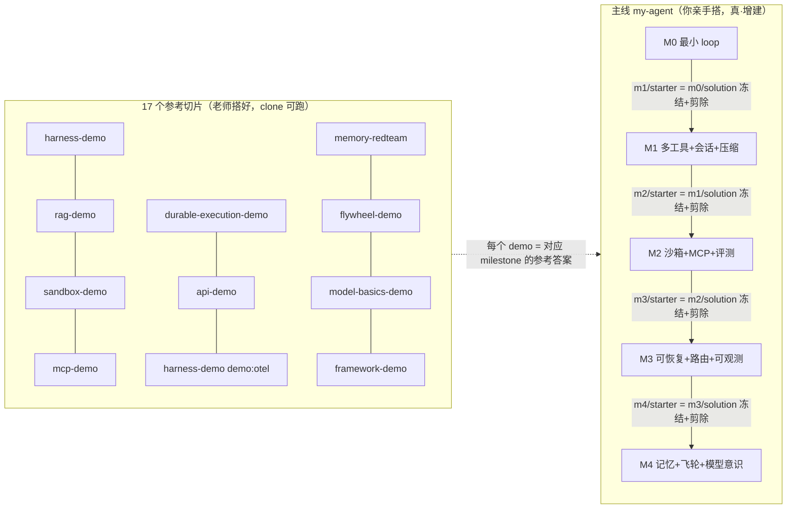

# 增量构建主线蓝图（capstone）

> sprint 4 开题。定位：把站点从「17 个并排切片」升级为「一条我亲手长的线 + 17 个参考切片」。本蓝图只做**设计**，不写练习代码（练习交后续任务）。
> 一句话目标：学员顺着 P0–P4 走完，**自己从零增建出一个能跑、有断言、可恢复、可评测、有记忆的多工具 agent**（`my-agent`），而不是「看懂 17 个老师搭好的 demo」。

## 1. 第一性问题与解法（captain 已定，此处落成设计依据）

- 现状：① 路径清晰（P0–P4 线性 + prereqs）✅；② 内容有效（17 课教学化 + 事实核查）✅；③ **反馈闭环 ✗**（只能看懂确定性 demo，没有「自己补全 → 断言通过」的动手练习）；④ **迁移能力 ✗**（「后段复用前段代码」在学员视角是空的：复用是老师复用 `harness-demo`，学员没搭过）。
- 用户第 5 轮原话「每阶段独占 MVP，后一阶段可用前一阶段构建的代码」的深层含义 = **学员复用自己亲手写的代码**，不是「看老师复用」。
- 解法：新增一条**增量主线**（capstone）——5 个 milestone 对应 P0–P4，每阶段一个动手点；17 个独立 demo 降格为「参考实现 / 对照样本」。

## 2. 主线项目定义：`my-agent`

| 维度 | 定义 |
|---|---|
| 名字 | `my-agent`（目录 `my-agent/`） |
| 形态 | 学员从零逐步增建的**个人 agent**，最终（M4 后）是「多工具 / 多轮 / 带权限沙箱 / 可观测 / 可评测 / 可恢复 / 有记忆」的完整工具 |
| 语言 / 运行 | TypeScript，`tsx` 直接跑，零外部依赖、零 key、全离线（与现有 17 demo 同栈、同确定性纪律） |
| 确定性底座 | mock 模型（预置表 / 逻辑时钟 / 固定 seed），无 `Date.now` / `Math.random` / 墙钟 / pid；断言可机器核对、可重放 |
| 增量性质 | **真·增建**：`mN/starter` = 上一 milestone 完成态 (`mN-1/solution`) 冻结 + 剪除本 milestone 要新增的能力（留 `TODO`）；不是「复制上一版再增」 |

## 3. 五 milestone 映射表（milestone ↔ 阶段 ↔ 增建能力 ↔ 课程 ↔ 参考答案）

工号键统一用小写 `m0`…`m4`，展示名 `M0`…`M4`；「必修课」= 这个 milestone 从哪些课「取机制 / 拿参考答案」，「参考答案 demo」= 学员做完后对照的「搭好后的样子」。

| milestone | 阶段 | 增建能力（真·增建到 `my-agent/src/`） | 必修课（供给机制） | 参考答案 demo |
|---|---|---|---|---|
| **M0 · minimal-loop**（最小 loop） | P0 | 单工具最小循环：确定性 mock model「想」→ 一个工具「做」（如 `read_file`）→ model「说」→ 终止判定 | harness-from-scratch（loop / 工具协议，前段） | harness-demo（最小 loop 段）|
| **M1 · multi-tool-session**（多工具 + 会话 + 压缩） | P0 | 第二工具（检索，接入「检索=打分排序」）+ 多工具命名分发 + JSONL 会话持久化/续跑 + token 上下文压缩 + 默认 deny 权限门（第一道） | harness-from-scratch（后段：恢复 / 压缩 / 多工具）+ agent-harness（分层：权限门·恢复·压缩落位）+ rag（检索工具怎么做）+ system-design（把搭的 agent 讲成系统设计） | harness-demo（5 运行模式）+ rag-demo（打分排序） |
| **M2 · sandbox-mcp-eval**（沙箱 + MCP + 评测） | P1 | 四通道 policy（deny>approve>sandbox>allow，从 M1 默认 deny 升级）+ 沙箱第三通道 + MCP 工具（一个远程工具走 JSON-RPC + 防御）+ 评测套件（golden set + judge 校准） | sandbox（四通道 policy）+ mcp（MCP 原语 / 供应链四层防御）+ evaluation（judge / golden set / CI 门禁）+ multi-agent（写单线程约束，供意识） | sandbox-demo / mcp-demo / rag-demo `demo:eval` |
| **M3 · durable-api-obs**（可恢复 + 路由 + 可观测） | P2 | durable execution（journal 双锚点 / checkpoint 原子写 / 幂等键）+ SSE 流式 + 重试分类（4xx 不盲重试）+ caching + 多模型路由 + 成本归因 + OTel trace/span 埋点 | durable-execution（journal/checkpoint/幂等）+ api-engineering（SSE / 重试分类 / caching / 路由 / 成本）+ observability（trace/span/metric + 成本归因） | durable-execution-demo / api-demo / harness-demo `demo:otel` |
| **M4 · memory-flywheel-model**（记忆 + 飞轮 + 模型意识） | P3+P4 | 四类记忆（写读遗忘 + 四道投毒防线）+ 评测飞轮（label 两轮降噪 + 决策门禁）+ 模型意识（KV cache / 成本走查：该不该上更大模型 / 该不该微调）+ 框架边界对照（把 my-agent 对照 SDK 抽象边界） | long-term-memory（四类记忆 / 投毒防线）+ data-flywheel（两轮降噪 / 门禁）+ model-basics（KV cache / 成本）+ framework-ecosystem（框架抽象边界）+ industry-2026（横向，收口素材） | memory-redteam / flywheel-demo / model-basics-demo / framework-demo |

> 施工时以各课 `notes/*.md` 的实际节号为锚（机制归属是硬的，节号不做死绑定）；本蓝图只定「哪个机制 → 哪个 milestone」的判断，不预写正文节号。

补全这一列 = 每格「增建能力 / 必修课 / 参考答案 demo」三栏都落实（对应验收 ②）；另见 §6 的「复用为主 / 新增为主」关系图。

## 4. 练习闭环机制（半成品 + TODO + 断言，完整协议）

### 4.1 三层结构

```
m<N>/starter/      半成品：上一 milestone 完成态 + 剪除本 milestone 新增能力（留 TODO）
m<N>/solution/     参考答案：补全后的完成态（== 主线 src 在该 milestone 的 freeze）
assert/m<N>.assert.ts  本 milestone 断言（starter 里跑红，solution 里跑绿）
```

### 4.2 「半成品剪除」与「TODO」协议

- **剪除的是「本 milestone 新增的机制」**，不是任意函数：例如 M1 剪掉「第二个工具的注册与分发」+「压缩函数体」，保留 M0 的 loop 骨架。
- 剪除处不写空，写一个**带编号的占位**：`throw new TODOError('m1.2: 实现 token 压缩——超过窗口下限时按「摘要 + 尾部原样」裁剪')`。这样半成品**能编译、能跑、断言红**（不是崩在 import 缺文件）。
- TODO 编号全局唯一：`m<N>.<k>`（milestone + 能力序号），与 README 的TODO 清单一一对应。

### 4.3 断言协议（沿 teaching-style-guide §5/§6 三态，加「半成品三分」）

| 态 | 判据 |
|---|---|
| **确定性** | 输入全部预置常量 / mock 预测表 / 逻辑时钟，无墙钟 / 随机数；同一输入 → 同一输出 |
| **可机器核对** | 每条断言有编号 + `✅` / `❌` 打印行；milestone 末行 `✅ m<N> 验收通过` |
| **可重放** | 补全前后各跑两次，输出逐字节一致（`diff` 为空） |

- **半成品三分**：① starter 中 `TODO` 未补 = 断言**编译通过但长老**（`TODOError` 被断言捕获判 `❌ m<N>.<k> 未实现`）；② 学员补全 = 断言转绿；③ `solution` 跑同断言 = 绿（对照，证明断言可达）。
- clone 判据给「哪个断言打印行 + `node ≥ 18`」，**不给会漂移的 hash/digest 数值**（数值属「来源与锚点」，随版本更新）。
- 过关线 = `cd my-agent && npm run assert:m<N>` 全绿 + 末行 `✅ m<N> 验收通过`、exit 0，且**连跑两次逐字节一致**。

## 5. demo → 「参考实现」定位转换说明

- **原地位**：17 个独立 demo 是「老师搭好、学员能 clone 跑的正确答案」——这没错，但要明确它是**切片**。
- **转换后**：demo 一律标「参考实现 / 对照样本」（reference），主线 `my-agent` 是「你要搭的」（your build）。course 页 / learn 卡把 demo chip 从「作品 / MVP」话术改为「参考样本」（具体话术见 `notes/capstone-site-render-checklist.md`）。
- **边界（不破坏 sprint 1–3）**：不改任何 demo 源码的正确性、不改 `mvps.ts` 三态、不改 17 课正文事实、不改五阶段结构。只做**定位转换**——新增主线，并在呈现层把 demo 标注成「主线某 milestone 的参考答案」。

## 6. 「参考 / 主线」关系图



读法：REF 是并排的「正确答案切片」，LINE 是「你要亲手长的线」；每条 `mN/starter → mN/solution` 的祖先关系使「后一 milestone 复用前一 milestone 代码」在**学员视角**第一次成立——复用的是自己写的。

## 7. 目录结构方案

```
my-agent/
  README.md                 # 主线总览 + 5 milestone 进度 + 每条断言命令
  package.json              # tsx + typescript（与各 demo 同栈，零外部依赖）
  tsconfig.json
  src/                      # 主线真源：学员逐 milestone 增建（最终 == M4 完成态）
    model.ts                # M0：确定性 mock 模型
    loop.ts                 # M0：最小 loop「想→做→说」
    tools/                  # M1：多工具（含检索工具）
    session.ts              # M1：JSONL 会话
    compress.ts             # M1：上下文压缩
    policy.ts               # M2：四通道 policy（从 M1 默认 deny 升级）
    mcp.ts                  # M2：MCP 工具
    eval.ts + golden/       # M2：评测套件
    journal.ts / checkpoint.ts  # M3：durable
    api.ts / router.ts      # M3：SSE / 重试 / caching / 路由 / 成本
    trace.ts                # M3：OTel 埋点
    memory.ts               # M4：长期记忆
    flywheel.ts             # M4：评测飞轮
    costwalk.ts             # M4：模型成本走查
  assert/
    m0.assert.ts … m4.assert.ts   # 每 milestone 断言（starter 红 / solution 绿）
  exercises/
    m0/{starter,solution}/  …  m4/{starter,solution}/
```

- **真增建证据**：`mN/solution` 与 `mN+1/starter` 是同一份字节（前者 freeze 成后者）；`src/` 每 milestone 一个 `git tag`（`m0`…`m4`）做渐进快照，`git diff mN-1 mN` 只应看见「本 milestone 新增机制」。
- 祖先关系写进每个 `starter/README.md` 第一行：「本 starter 继承自 `m<N-1>/solution`（上一 milestone 完成态），本 milestone 需补全的能力见下方 TODO 清单」。

## 8. 与 sprint 1–3 的边界（防破坏）

- 不动：17 课正文事实、`mvps.ts` 三态（13 slug）/ `course-structure.ts` 五阶段与 prereqs、现有 17 demo 源码正确性。
- 新增：`my-agent/`（sprint 4 造）、线条与断言（后续任务逐 milestone 造）、`notes/capstone-style-guide.md` + `notes/capstone-site-render-checklist.md` 三份设计文档。
- 呈现层只加「主线入口 / 主线挂钩」与「作品→参考样本」话术，不改现有卡片路由与 17 课结构。