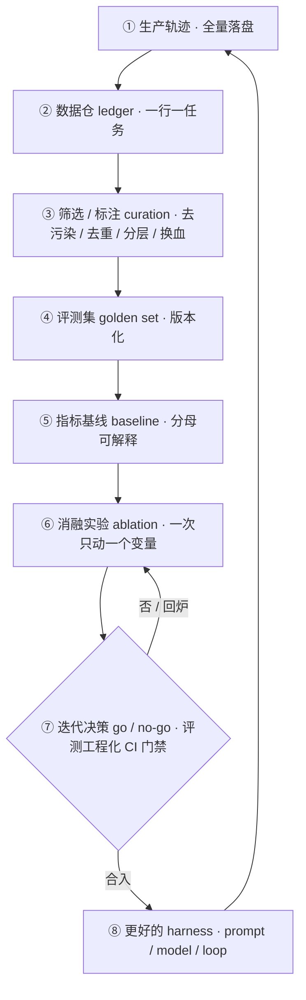
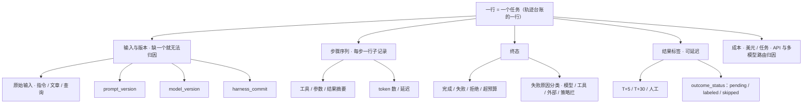
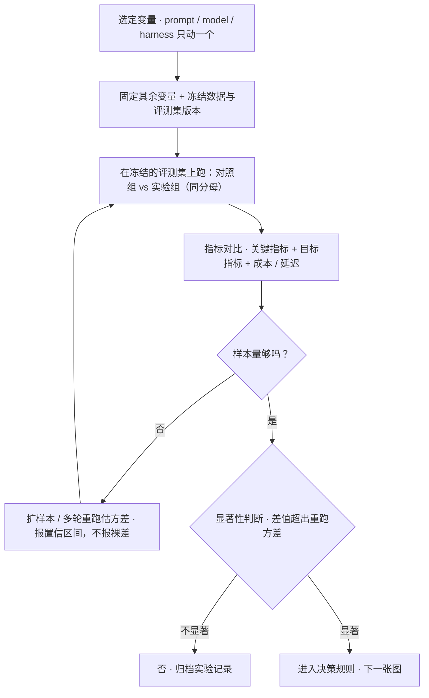
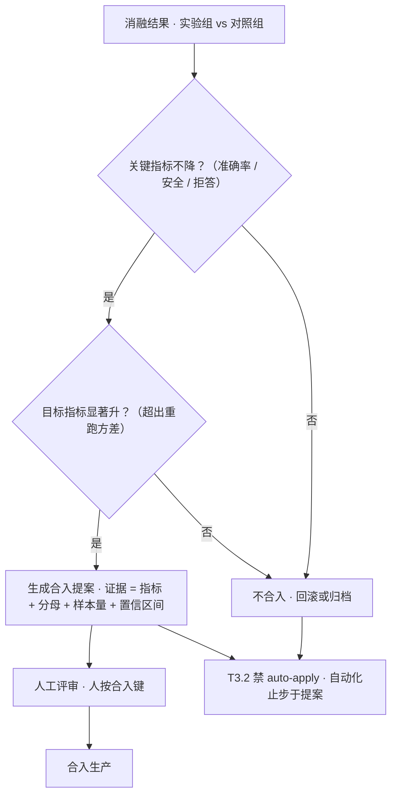

# 数据飞轮(harness 自进化)

> 优先级 P1 · 状态：📐 讲义已展开，待提问演练
> 前置：评测工程化（评测=飞轮的仪表盘）+ RAG 与检索 §⑨（指标体系）
> JD 锚点：腾讯 WorkBuddy 专门研究方向（轨迹数据仓→评测→自动迭代）、OpenAI Codex feedback loops
> **我的差异化王牌**：FinHot 不是"学过飞轮"，是**跑过一轮真实的生产飞轮**（台账 1830 行（`#35` 生产快照、仓外数字）→ T+5 延迟标签 → 指标 → 两轮降噪提示词迭代）
> 用法：S1-S4 是飞轮的四个环节（闭环 / 数据模型 / 筛选 / 消融决策）；S5 是下一档（微调）；**S6 实战走查**把 FinHot 那一圈串成完整时间轴；**S7 常见错误与追问**是反向题库；S8 是背稿。练习题库按"考察"列回查。

---

## 预备知识（这课的门槛，只讲「课程外」要会什么）

- **课程依赖（prereqs）**：`evaluation`——上一课带入「评测 = 飞轮的仪表盘」+「golden set 版本化 / 指标基线 / CI 门禁 / skipped 是一等终态」的对照意识，本课把它从「一次评测」扩成「一圈一圈转」。
- **技能门槛**：只需「训练/评测数据要版本化、标签会有噪声」的粗概念即可。
- **不需要提前会**：真实微调平台、数据平台、FinHot 私有台账——一律不用会。飞轮四环节（闭环 / 数据模型 / 筛选 / 消融决策）+ labeler 两轮降噪闭环随 `flywheel-demo` 的 `npm run demo` 建立（本 sprint 规格先行，目录由下游按 notes/process/flywheel-mvp-spec.md 建成）；生产数据在仓外，课上只用脱敏样本。

---

## S1 定义：什么是 agent 系统的数据飞轮

**这一节解决什么问题**：把"数据飞轮"从口号变成可检验的对象。面试官听到这四个字，心里会追问三件事——它靠什么转（数据从哪来）、每圈产出什么（资产/指标）、什么算坏了（判据）。先把这三件事钉死，后面 S2-S4 才不是流水账。一句话定义：**飞轮 = 把生产轨迹持续转成评测资产、再用评测资产驱动 harness 变更的闭环**；它的燃料是轨迹，它的产出是"更大/更准的评测集 + 被验证过的改进"。

```
        ┌────────────────────────────────────────┐
        ▼                                        │
  生产轨迹 ──▶ 数据仓 ──▶ 筛选/标注 ──▶ 评测集 ──▶ 指标基线
  (全量落盘)    (ledger)   (curation)  (golden set) (baseline)
        ▲                                        │
        │                                        ▼
  更好的 harness ◀── 迭代决策(go/no-go) ◀── 消融实验
  (prompt/model/loop)        (评测工程化 CI 门禁)
```

上面 ASCII 图保留作"最小骨架"；下面是同一套闭环的 **mermaid 版**（八步闭环，面试时按这张讲"每一圈让下一圈更准/更快"）：



**逐环节的一句话**（配上面八步读）：
- ①→② 的关键词是**全量**：采样会漏掉恰好要查的失败模式（S2）；
- ③→④ 的关键词是**版本化**：评测集不版本化，指标就没有可比的分母（S3）；
- ⑤ 的关键词是**对照**：没有 baseline 的准确率是空话（S4）；
- ⑥→⑦ 的关键词是**一次一个变量**：同时动 prompt 和模型，涨了也不知道该归给谁（S4）；
- ⑦→⑧ 的关键词是**过门**：不是"实验涨了就上线"，而是"过评测工程化门禁、人按合入键"（S1 边界段）。

飞轮的判据（面试先立判据再展开）：**每一圈是否让下一圈的评测更准、迭代更快？** 只收数据不迭代=数据沼泽；只迭代不积累=手工调参。
"自进化"的边界（防过度承诺）：**自动的只是实验与评测，apply 必须过门**——FinHot 方案里 T3.2 明确**禁止 auto-apply**（自动改生产提示词=把变更管理交给统计噪声）；自动化止步于"提案"，人是合入者。

**失败模式（这一节要能反向说）**：
1. **空转**：数据进了仓但没人看指标——台账只是日志不是飞轮，判据第一问答不上来（"上一圈让评测更准在哪？"）。
2. **断链**：有实验没有决策门禁——跑了一堆消融，改提示词全凭感觉，等于把 S1⑥⑦ 中间的箭头退了回去。
3. **反向优化**：只评上线样本 → 指标越好、系统越偏（幸存者偏差，展开在 S2/S3）。

**可背面试句**："飞轮不是'收集数据'，是'让每一次生产都变成下一次评测的输入'。判断它转没转，不看数据量，看上一圈有没有让这一圈的评测更准。"

---

## S2 轨迹数据模型：采什么、怎么落

**这一节解决什么问题**：飞轮的输入端。如果落盘时字段缺了，后面 S4 的消融就永远归因不了——**schema 的缺陷会在几圈之后以"指标解释不了"的形式爆炸**。所以这一节不是讲"记日志"，是讲"为将来的对比预留字段"。

**最小轨迹记录（一行=一个任务）**：
- 输入（原始指令/文章/查询）+ 上下文版本（prompt 版本号、模型版本号、harness commit——**三者必须同时记，缺一个=指标无法归因**）
- 步骤序列（每步：工具/参数/结果摘要/token 数/延迟）
- 终态（完成/失败/拒绝/超预算 + 原因分类）
- 结果标签（可延迟：T+5、T+30、人工）
- 成本（$/任务，API 与多模型路由归因）

把"一行=一个任务"的数据结构画出来（面试被问"最小 schema 你怎么定"时，指着这张图说每个字段对应哪一问）：



**三个版本字段为什么必须同时记**：消融的对比公式是"v2 比 v1 好多少"，前提是两次跑的**模型和 harness 完全一样**。只要 model_version 变过，准确率之差里就混进了模型换代，实验结论作废。所以版本字段不是元数据，是实验的**控制变量记录**。

**FinHot 台账=生产级实例（面试直接指着讲）**：
- 1830 行：none 1404 / bullish 316 / bearish 88 / neutral 67（#35 生产快照、仓外数字、不可仓内复核）
- `outcome_status` 状态机：pending / labeled / skipped（带原因）
- **反事实设计**：`published=false` 的 1634 行保留"没发布的判断"——**评测样本不能只含上线的**（幸存者偏差：只评发布的=只评了通过筛选器的，迭代会朝着筛选器偏好优化而不是朝着正确性优化）
- `prompt_version` 字段：两轮降噪迭代各有一个版本——**版本字段是飞轮的齿轮，没有它两轮迭代的对比无从谈起**

**采集纪律**：
- 全量采（采样会漏掉恰好要查的失败模式），存储便宜、标签昂贵
- 标签分层：机器可判的自动打（测试通过/数值对）→ LLM-judge 初筛（评测工程化）→ 人工只标高价值子集
- **失败比成功值钱**：失败轨迹带原因分类（模型错/工具错/外部错/策略拦），每类失败是一个待修缺陷的工单

**失败模式**：
1. **只在内存里算指标、不落盘**：当天看完了，一周后想复现"当时那个 82%"拿不出原始行——飞轮没有燃料。
2. **版本字段随手填**：prompt_version 用了 git 分支名、model_version 用了"latest"——几圈后版本不可比，S4 的消融全废。
3. **只记成功轨迹**：失败/拒绝/超预算的行被丢弃——下一圈看不到该修的缺陷，等于把最贵的信号扔了。

**可背面试句**："轨迹 schema 的检验标准不是'记全了吗'，是'半年后能不能只靠这几列，复现出当时那条结论'。记不出的字段，就是将来解释不了的指标。"

---

## S3 数据筛选（curation）：从"数据"到"评测资产"

**这一节解决什么问题**：仓里的轨迹是原料，不是资产。原料直接当评测集，会被污染、被重复、被简单题灌水。筛选这道工序是把"数据"变成"可信的评测资产"——它的每一步都在防一种让指标失真的偏差。

| 工序 | 做法 | FinHot 实例 |
|---|---|---|
| 去污染 | 剔除注入污染/损坏/重复轨迹 | direction failed 的行单独归因，不混进质量指标 |
| 去重 | 相似任务聚类，保代表（防评测集被"长得像的题"灌水） | 同板块同事件的文章聚类 |
| 分层 | 按任务类型/难度/失败模式分层，固定配额（评测工程化 §S5） | bullish/bearish/none/neutral 四向 + 成功/失败 |
| 换血 | 定期 30% 轮换防污染（评测工程化 §S5） | baseline 窗口滚动（n≈60 交易日，#35⑦） |
| 标签回填 | 延迟标签到了就回填，历史行升级 | T+5 labeler 逐格填 cum_pct_tN |

**筛选产出两样东西**：① golden set（版本化，评测工程化 CI 用）② 迭代语料（若走微调路线，S5）。

**这道工序为什么不能省（失败模式）**：
1. **污染不去**：一条被 prompt injection 或损坏数据带歪的轨迹留在集里，它代表的不是模型能力，是数据事故；混进质量指标后，你会去"优化"一个并不存在的问题。
2. **不去重**：同一天同板块 20 篇几乎一样的文章全进集，指标被这 20 篇主导——评测集被"长得像的题"灌水，区分度反而下降（评测工程化"题目体检"）。
3. **不分层**：简单样本占 90%，模型在简单样本上刷到 95 分，困难子集全灭也看不见（只看总体均值）。
4. **不换血**：评测集固定不变 → 模型多跑几圈就"见过"了，指标虚高、区分度归零（污染）。换血 30% 是结构性防御。

**反事实样本的放置**：`published=false` 的 1634 行不是"废数据"，是筛选器**没让上线**的那部分判断。把它当反事实、和已发布的样本**按同一套标签口径**评，才是在测"判断本身对不对"，而不是"是否迎合了发布筛选器"。这是 S3 最容易被忽略、面试最容易被追问的一条。

**可背面试句**："筛选的目的不是让数据变少，是让评测集的**分布**贴近你真正关心的能力分布——去掉污染、去掉重复、保住困难子集，然后定期换血。"

```js
// flywheel-mvp-spec.md 接口（规划态，flywheel-demo/ 落地后即此形状）——curation 三道门 + 状态机
const STATUS = ['pending', 'labeled', 'skipped'];   // skipped 带 reason（FinHot 858 条），一等终态 ≠ 废数据
function curate(rows) {
  return rows
    .filter((r) => !isPoisoned(r))                  // 去污染：direction failed 的行单独归因，不混进质量指标
    .dedup(byTaskSimilarity)                        // 去重：同板块同事件聚成代表，防「长得像的题」灌水
    .stratify({ label: ['none','bullish','bearish','neutral'], difficulty, failure }); // 分层：固定配额
}
// 反事实样本：published=false 的 1634 行 ≠ 废数据，是「没让上线」的那部分判断——
// 和已发布样本按同一套标签口径评，测的是「判断本身对不对」，不是「是否迎合发布筛选器」
function evaluate(rows) {
  return metrics(rows.filter((r) => r.outcome_status === 'labeled'));  // 分母 = labeled 行（skipped 不进分母）
}
```

**这段在讲什么**：三道门各防一种指标失真——去污染防「把数据事故当模型能力」、去重防「长得像的题灌水」、分层防「简单样本刷分遮挡困难子集全灭」。两条最容易被追问的口径要钉死：① `skipped` 是**一等终态**（带原因、不混进分子也不混进分母），所以分母 = `labeled` 行才可解释；② 反事实样本（`published=false`）不是废数据，是「筛选器没让上线」的判断本身——把判断（而不是上线结果）纳入评测，才不朝筛选器偏好优化。

---

## S4 迭代环：消融与决策

**这一节解决什么问题**：飞轮的发动机舱。前面 S1-S3 把燃料（轨迹）和仪表（评测集/指标）备好了，这一节回答"怎么把仪表上的变化变成一次可信的变更"。核心只有两句：**一次只动一个变量**（不然归因不了）、**过门才合入**（不然变更管理交给噪声）。

**消融实验（ablation）= 飞轮的发动机**：一次只动一个变量（prompt × model × harness），固定其余 → 指标差=该变量的贡献。
- FinHot 实例：两轮降噪提示词（finhot-investment-analysis 分支）= 变量=prompt，其余（模型/结构/数据）固定 → 对比降噪前后指标
- **变量版本化**（S2 的三版本字段）让消融可追溯："v2 比 v1 准确率 +x%，噪声率 -y%，成本 +z%（更长的提示词）"
- 决策规则（评测工程化 §S6 门禁）：关键指标不降 + 目标指标显著升 → 合入；**显著性要看样本量**（n=60 的 +3% 可能是噪声——报置信区间，不报裸差）

消融实验的完整流程（注意"样本量不够"是一条回到跑评测的回路，不是直接下结论）：



决策规则画出来（这是"禁止 auto-apply"这句话的操作版：**自动化能走到提案，走不到合入**）：



**自动化的边界（T3.2 禁 auto-apply 的三条理由，面试加分）**：
1. 统计噪声：小样本上的"提升"会把生产往噪声方向优化
2. 多目标冲突：准确率↑但延迟/成本↑——权衡是人的决策
3. 责任链：自动合入=无人负责的变更（变更管理原则在 LLM 系统同样成立）
→ 自动化止于**提案**（"v3 建议合入，证据：…"），人按按钮。

**失败模式**：
1. **一次动多个变量**：又换 prompt 又换模型，涨了归给谁？——这是消融最常见的造假式结论。
2. **小样本裸差当显著**：n=60 上的 +3% 直接写成"提升 3%"，没置信区间、没重跑方差——把噪声当成果。
3. **先合入再观察**：跳过门禁，把生产当实验场——违反 T3.2，出问题时无法回滚定位。
4. **只看目标指标不看关键指标**：准确率涨了但拒答率/安全指标降了——多目标里丢了一个就是负向变更。

**可背面试句**："消融的可信度取决于两件事：你固定了几个变量、你的显著性有多硬。一次只动一个、差值超出重跑方差，这两条缺一条，结论都不能进生产。"

---

## S5 飞轮的下一档：微调与蒸馏（意识级，模型基础联动）

**这一节解决什么问题**：当提示词优化到天花板、同一类任务的高质量轨迹积累到量级，飞轮可以"升档"——把反复用提示词教的行为烘进权重。这一节是意识级（知道时机与风险即可），面试里用来证明你知道飞轮的下一站在哪，而不是只会调 prompt。

- **SFT 时机**:同一类任务高质量轨迹积累到量级(千级)+ 评测稳定 + 提示词优化到天花板 → 把"提示词里反复教的行为"烘进权重(RAG 与检索 §10 的决策树同样适用:知识外置 vs 权重内化)
- **蒸馏**：贵模型轨迹 → 小模型 SFT → 小模型顶掉流水线里的贵模型环节（FinHot 的 prefilter 就是"小模型顶环节"的现成结构，蒸馏只是把"调小模型"换成"训小模型"）
- **警惕**：微调不修数据偏差（S3 筛歪了=训歪了，且更贵更慢地歪）——**数据飞轮先于微调飞轮**

**失败模式**：
1. **顺序倒置**：还没建评测集就上微调——训完没有可信的对照，涨没涨说不清（且更贵）。
2. **拿脏数据微调**：S3 的污染/偏差被烘进权重，之后连"改提示词"这个便宜的补救手段都没了。
3. **蒸馏了却没评蒸馏**：小模型顶环节后必须重跑同一套评测（同分母、同 baseline），否则"省了钱"可能换来"指标悄悄掉"。

**可背面试句**："微调是飞轮的升档，不是快捷键。它把行为从提示词搬进权重——搬进去之前，先确认你的数据和评测已经干净到值得固化。"

---

## S6 实战走查：FinHot 一轮生产飞轮（从落盘到提案）

**这一节解决什么问题**：把 S1-S4 串成一条**真实时间轴**。面试里最容易被识破的不是"你不知道飞轮"，而是"你没转过飞轮"——讲不出第一圈的方向、标签什么时候回来、baseline 怎么定、改了什么、为什么停在提案。这一节就是照着讲一遍的走查稿：每一步给**数字 + 判断依据**；两轮消融的前后指标已用真实评测记录回填（n=200，见文件末数字核实清单），台账类数字来自生产台账（#35）。

**背景（一句话）**：FinHot = 金融热点分析批处理——多源采集文章 → 6 次模型调用（prefilter → score×2 → understand → structure → direction）→ 产出方向判断（bullish / bearish / none / neutral）→ 落台账。判断对不对要等 T+5 交易日才知道，所以评测天然是"延迟奖励"形态。

### Step 1 · T0 落盘：一行一任务，全量进仓

- **动作**：每篇文章分析完写一行台账，`outcome_status='pending'`；同时落 `prompt_version / model_version / harness_commit`、方向标签、`published` 标记。
- **数字**：台账累计 **1830 行**（#35 生产快照、仓外数字、不可仓内复核）；方向分布 **none 1404 / bullish 316 / bearish 88 / neutral 67**（#35）；其中 `published=false` 的**反事实记录 1634 行**。
  > 口径注：该方向分布属**另一快照口径**——四项之和 1875 与同一段的 1830 行差 **45 行未归类**，源记录未说明差值来源（**待核对**；不自行改数，也不把 1830 改成 1875）。
- **判断依据**：① **全量落盘**（不采样）——采样会漏掉恰好要查的失败模式；② **反事实也留**——只评发布的判断=只评"通过了发布筛选器"的样本，迭代会朝筛选器偏好优化（S3 幸存者偏差）；③ **三版本字段同记**——为 S4 的消融预留控制变量。

### Step 2 · T+5 回填：labeler 逐格填，状态机推进

- **动作**：T+5 labeler 拉行情，把可算的落 `labeled`、不可算的落 `skipped`（带原因）；主 horizon 未到前先逐格回填 `cum_pct_t1 / cum_pct_t3 / cum_pct_t5`，状态保持 `pending`。
- **数字**：**858 条 skipped 带原因**（#35）；不可算原因含 neutral / none / 空 scope / direction failed。
- **状态迁移表**（面试可照画）：

| 时刻 | 从 | 触发 | 到 | 说明 |
|---|---|---|---|---|
| T0 | — | 分析产出落台账 | `pending` | 主 horizon 未到，等行情 |
| T+1…T+4 | `pending` | 部分 horizon 可算 | `pending`（逐格填） | 回填 `cum_pct_t1/t3/t5`，不改主状态 |
| T+5 | `pending` | 主 horizon 行情可算 | `labeled` | 进入指标分母 |
| T+5 | `pending` | 不可算（neutral/none/空 scope/direction failed） | `skipped` | **一等终态，带原因** |
| 终态 | `labeled` / `skipped` | — | 不再迁移 | 两者平级，skipped ≠ 失败 |

- **判断依据**：**skipped 是一等状态不是失败**——评测系统必须能解释"为什么这条没被评"，否则分母不可信；**分母纪律**——指标口径是"labeled 行中的方向准确率"，不是"全部行"（S6 最硬的面试点之一）。

### Step 3 · 建 baseline：n≈60 交易日 + 分母钉死

- **动作**：用 **n≈60 交易日**的窗口回填 baseline（#35⑦），对照的是"未用信息"的判断（如始终押方向分布/历史多数类），不是"上一个提示词版本"。
- **数字**：baseline 窗口 **n≈60 交易日**已回填；指标分母 = `labeled` 行。
- **判断依据**：① **没有 baseline 的准确率是空话**——"方向准确率 58%"只有在"未用信息 baseline = 49%"对照下才有意义；② **分母单独报**——skipped 若从 858 涨到 1400，而分母写"全部行"，准确率会**算术性自己变好**（纯假象）。

### Step 4 · 第一轮降噪消融：只动 prompt

- **动作**：在 `finhot-investment-analysis` 分支上改提示词降噪，**变量 = prompt**，其余（模型 / 6 次调用结构 / 数据 / 评测集版本）**全部固定**；`prompt_version` 记为 v1 → v2。
- **变量与口径**：对照组 = v1，实验组 = v2，同一评测集、同一分母、同一 baseline。
- **“只动一个变量”的确切证据**：评测记录的合成 `promptVersion` 共 12 个提示词文件，三轮跑下来（n=200 / seed=7 / split=all）**只有 `selection-score` 那一段哈希变了**（`5c5a429baa` → `05b5fc85c5` → `cb5fe73225`），其余 11 个（prefilter@92164609eb、understand@4761ac4ac2、structure@d07c6f7bf6、directions@abb1d02ed6 等）全程未动——“一次只动一个变量”在这圈飞轮里是可验证的事实，不是口号。
- **前后指标（真实评测记录，n=200）**：accuracy **0.611 → 0.676**（+0.065）、precision **0.256 → 0.304**（相对 +18.8%）、f1 0.404 → 0.462、recall 0.957 → 0.960；同时 `errors`（模型调用失败）33 → 27、`decisive`（有效判断）167 → 173。
- **判断依据**：**一次只动一个变量**——模型/结构不动，指标差才能归给 prompt；**版本字段可追溯**——“v2 比 v1 准确率 +6.5pt、precision +4.8pt”这句话能说出来的前提，是 S2 的 `prompt_version` 记了（且能列出剩下 11 个文件为何没动）。

### Step 5 · 第二轮降噪消融：再来一圈

- **动作**：第一轮后仍暴露残留噪声模式——**第一轮 55 个 FP 的构成是：34 条例行宏观数据（含外汇/海外央行数据）+ 2 条个股残留（044 公告掘金 81 / 065 战略发布 62）；另有 1 条 FN（002 埃斯顿股权激励 32）**——针对这三类再做一轮 v2 → v3 的 prompt 消融（三处编辑：例行统计数据分层 → 非核心例行数据降权 + 拐点例外；个股噪声补判例 → 公告掘金/战略发布 + 股权激励入节点列表；研报首覆盖/题材式压制），变量与固定项同第一轮。
- **数字**（`selection-score@05b5fc85c5` → `cb5fe73225`，同 n=200/seed=7）：precision **0.304 → 0.272**、recall 0.960 → **0.880**、f1 0.462 → 0.415、accuracy 0.676 → 0.654——**相对第一轮全面退步**；只有 `errors` 27 → 21、`decisive` 173 → 179 升高。
- **⚠️ 混淆变量——这一轮最重要的教训**：第二轮里同时发生了两件事——**提示词编辑** 与 **gold 重标**（同日 owner 拍板“社融例行发布按 reject 口径”，正类从 29/171 翻为 **27/173**，旧版留在 `backup-20261002-1428`）。两处变化叠加，**指标退步无法单独归因给提示词**：这是“一次只动一个变量”的反面教材，也是它停下来的直接原因之一。（另一重判读：召回一直 0.88-0.96 而 precision 只在 0.27-0.30 → 系统**过度入选**，噪声主体是 FP，这正好是 S3 筛选要解决的问题。）
- **判断依据**：飞轮的判据是“**每一圈让下一圈更准/更快**”——第二轮存在的理由必须是第一轮暴露出的、可见的残留失败模式，而不是“再调调看”；而当第二轮**没带来提升反而退步**时，正确的结论不是“再调第三轮”，而是**提示词杆杆已耗尽、瓶颈回到 gold 口径与评测集规模**（所以停在了提案）。

### Step 6 · 决策与边界：为什么自动化停在提案

- **决策规则**（S4 图）：关键指标不降 **且** 目标指标显著升 → 生成**合入提案**；否则回滚/归档。提案里带齐 **指标 + 分母 + 样本量（n≈60）+ 置信区间**——不报裸差。
- **为什么停在提案、不 auto-apply**（T3.2 三条理由）：
  1. **统计噪声**：n≈60 上的"提升"可能只是波动，自动合入=把生产往噪声方向优化；
  2. **多目标冲突**：准确率↑但延迟/成本↑——权衡是人的决策；
  3. **责任链**：自动合入=无人负责的变更。
- **数字/边界**：自动化止步于"v3 建议合入，证据：…"；**人按合入键**（#36 T3.2）。方案里同族的约束还有 T2.4 `priors.regenerate` 要求 `n≥100`、T3.1 A/B 注入——都在同一原则下：**变更要有证据门槛、要有责任人**。

### 走查小结（背这一张表）

| 步 | 关键数字 | 判断依据（一句话） |
|---|---|---|
| T0 落盘 | 1830 行（#35）；none 1404 / bullish 316 / bearish 88 / neutral 67；反事实 1634 | 全量 + 反事实 + 三版本字段 |
| T+5 回填 | 858 skipped（带原因）；pending → labeled / skipped | skipped 是一等终态，分母可解释 |
| baseline | n≈60 交易日；分母 = labeled 行 | 无 baseline 的准确率是空话 |
| 第一轮消融 | precision 0.256→0.304；accuracy 0.611→0.676（12 个提示词文件只动了 selection-score） | 一次只动一个变量才可归因 |
| 第二轮消融 | precision 0.304→0.272；recall 0.96→0.88；errors 27→21（**退步**） | prompt + gold 双变量叠加→不可归因；结论=提示词杆杆耗尽 |
| 决策 | 关键不降 + 目标显著升 → 提案 | T3.2 禁 auto-apply，人按合入键 |

**可背面试句**："这一圈转完，我拿到的不是'提示词变好了'，是一套能复现的过程：1830 行全量台账、858 条可解释的 skipped、n≈60 的 baseline、两轮只动 prompt 的消融、和一个带证据的合入提案。飞轮的价值不在那一版提示词，在这套过程下次还能再用。"

```js
// flywheel-mvp-spec.md 接口（规划态）——指标计算 + 归因证据 + 决策门禁（数字为 FinHot 真实评测记录，n=200/seed=7）
function metrics(rows) {
  const { tp, fp, tn, fn, errors, decisive } = tally(rows);   // decisive = 有效判断（非 skipped 的落判）
  const p = tp/(tp+fp), r = tp/(tp+fn);
  return { precision: p, recall: r, f1: 2*p*r/(p+r), accuracy: (tp+tn)/(tp+fp+tn+fn), errors, decisive };
}
// 第一轮 v1→v2：变量 = prompt（12 个提示词文件只 selection-score 一段哈希 5c5a429baa→05b5fc85c5 变了）。
//   precision 0.256→0.304、accuracy 0.611→0.676、f1 0.404→0.462、errors 33→27、decisive 167→173 —— 归因成立
// 第二轮 v2→v3：prompt 编辑 + gold 重标（正类 29/171→27/173，旧版留 backup-20261002-1428）双变量叠加 → 不可归因（反例）。
//   precision 0.304→0.272、recall 0.960→0.880、errors 27→21 —— 退步，结论 = 提示词杠杆耗尽、瓶颈回到 gold 口径
// 门禁（S4 决策图）：关键指标不降 && 目标指标显著升 → 生成提案；T3.2 禁 auto-apply（自动化止步提案，人按合入键）
```

**这段在讲什么**：指标本身不是武器，**归因证据**才是——第一轮能说「+6.5pt 归给 prompt」，是因为 `selection-score` 是 12 个提示词文件里唯一哈希变了的那个（其余 11 个全程未动，「一次只动一个变量」可验证）；第二轮退步不能归因给 prompt，是因为**同日发生了 gold 重标**（社融例行发布改 reject 口径，正类 29/171 → 27/173），提示词编辑和标签口径两个变量叠加，指标差被污染。这就是「一次只动一个变量」的正反两面，也是它停下来的直接原因之一——飞轮的产出不是「下一版提示词」，是「这一圈有没有让归因更干净」。

**实跑判据（本课，规划态三样，目录由下游建成）**：本 sprint 先产设计规格（notes/process/flywheel-mvp-spec.md），`flywheel-demo/` 尚未存在——clone 判据在规格 §5 定义、下游建成后生效：`cd flywheel-demo && npm i && npm run demo` 复现「脱敏台账样本 → filter/label 两轮 → 指标 precision/f1/errors 单调可解释」断言 + 末尾 `✅ flywheel 验收通过`（全离线零 key、脱敏样本不碰生产数据、确定性）。本课正文的 FinHot 真实数字（1830 行 / 858 skipped / precision 0.256→0.304→0.272 / `selection-score@5c5a429baa` 等）属「来源与锚点」的内部证据（FinHot 私有台账，仓外不可复核），面试讲方法与数字、不号称公开可查；它们**只做教学锚、不冒充可机器核对的 clone 判据**。

---

## S7 常见错误与面试官追问

**这一节解决什么问题**：面试里飞轮问题的杀伤力不在"你会不会建"，在"你知不知道它哪里会崩"。下面每条给**错误 → 为什么危险 → 正确做法**，都是前面 S1-S6 的反面。

### 7.1 常见错误速查表

| # | 常见错误 | 为什么危险 | 正确做法 |
|---|---|---|---|
| 1 | **只收数据不迭代 = 数据沼泽** | 台账只是日志；没有"上一圈让评测更准"的证据，飞轮判据第一条就挂 | 每圈必须有产出（评测集升级 / 被验证的变更）；定期问"最近一圈改了啥" |
| 2 | **评测集只留已发布/成功样本** | 幸存者偏差：只评通过筛选器的，系统朝筛选器偏好优化而非正确性 | 反事实样本也进评测（FinHot `published=false` 的 1634 行） |
| 3 | **缺 `prompt_version`** | 消融无法归因——两轮迭代的对比无从谈起，涨跌说不清是谁的贡献 | 三版本字段（prompt / model / harness）同时记，S2 |
| 4 | **小样本裸差当显著** | n≈60 的 +3% 可能是噪声；把噪声当成果会污染生产 | 报置信区间 / 重跑方差，差值超出噪声才叫显著（S4） |
| 5 | **把 auto-apply 当成熟度标志** | "全自动改提示词"听着先进，实为把变更管理交给统计噪声；出问题无人负责 | 自动化止步于提案，人按合入键（T3.2 三条理由，S4） |
| 6 | **一次动多个变量** | 又换 prompt 又换模型，涨了归给谁？结论无法复用 | 一次只动一个（prompt × model × harness），其余冻结（S4） |
| 7 | **skipped 被当失败或直接从分母删掉** | 分母不可解释；skipped 从 858 涨到 1400 时指标算术性虚高 | skipped 一等终态、带原因、单独报；分母写明"labeled 行"（S6） |
| 8 | **先微调再建飞轮** | 数据没洗干净就固进权重，之后连改提示词这个便宜手段都没了 | 数据飞轮先于微调飞轮；SFT 前先有稳定评测（S5） |
| 9 | **只看目标指标、不看关键指标** | 准确率涨了但安全/拒答指标降了，多目标里丢了一个就是负向变更 | 门禁 = 关键指标不降 **且** 目标显著升（S4） |

### 7.2 面试官四条高频追问

**追问 A：「你们的飞轮转了几圈？」**
诚实报数字，别吹。加分答法："两轮提示词降噪迭代 + 持续 labeler 回填；飞轮的产出是两版 prompt 和一套可复现的评测流程。"——**能把'圈数'说小、把'过程'说清，比说'转了十圈'可信**。

**追问 B：「你怎么证明第二轮比第一轮好？」**
指标名 + 分母 + baseline + 样本量一起报（评测工程化 §S4 分母纪律）："labeled 行上的方向准确率，对照 n≈60 交易日的未用信息 baseline，样本量 n=__，差值超出重跑方差。"——裸报"准确率涨了"必被追穿。

**追问 C：「既然能自动跑实验，为什么不自动合入？」**
T3.2 三条理由（S4）：统计噪声、多目标冲突、责任链。收尾加一句加分："自动化止于提案——我可以自动生成证据，但合入键必须有人按。"

**追问 D：「评测集里只有上线样本，会怎样？」**
走幸存者偏差的完整路径（S2/S3）：只评发布的 → 只评通过了发布筛选器的样本 → 迭代朝筛选器偏好优化 → 指标涨、线上正确性不涨甚至降。正确做法：`published=false` 的反事实样本按同一标签口径进评测。

**追加追问：「你的'提升'会不会只是评测集过拟合？」**
评测集换血 30%（评测工程化 §S5）、私有探针题、时间切分——把"指标突然大涨但线上体感不变"当污染信号先查（评测工程化 §S10）。

**可背面试句**："飞轮的成熟度不看自动化程度，看两件事：每个变更有没有证据门槛、每份证据能不能说清分母和样本量。做不到这两条，自动化越高，崩得越快。"

---

## S8 故事打磨（面试版，背下来）

> "我在 FinHot 上跑过一个生产数据飞轮：**全量轨迹落台账**（1830 行，带 prompt 版本/模型/方向标签），**延迟结果 T+5 自动打标**（状态机 pending/labeled/skipped，858 条 skipped 带原因），**baseline 对照**（n≈60 交易日）。在这个仪表盘上做了**两轮提示词降噪迭代**——每轮=一次消融（只动 prompt），指标对比后合入。
> 三个设计决策是我自己做的：**反事实样本**（没发布的判断也留，防幸存者偏差）、**skipped 一等状态**（评测分母可解释）、**禁 auto-apply**（自动化止于提案，人按合入键）。"

追问预案：
- "飞轮转了几圈？" → 两轮提示词迭代 + 持续 labeler 回填（诚实报数字）
- "怎么证明第二轮比第一轮好？" → 指标名+分母+baseline+样本量（评测工程化 §S4 分母纪律）
- "为什么不自动合入？" → T3.2 三条理由（S4）
- "下一步做什么？" → 失败轨迹自动归因成工单 + 评测集换血机制 + （若走微调）prefilter 蒸馏——**把"下一步"答出来=飞轮思维的证明**

---

## 练习题库（后续提问用）

> 前 8 题对应 S1-S5；9-14 为新增，覆盖 S6 实战走查与 S7 常见错误。提问时按"考察"列回查对应小节。

| # | 题目 | 考察 |
|---|---|---|
| 1 | 为什么评测集只留"已发布/成功"的样本会让系统变差？（幸存者偏差的具体路径） | S2 |
| 2 | 台账里 prompt_version 缺了 200 行（老数据没记版本）。这 200 行还能用于消融吗？怎么处置？ | S2/S4 |
| 3 | n=60 的样本上 v2 准确率 +3%。能合入吗？完整决策流程 | S4 |
| 4 | 失败轨迹里 40% 是外部 API 超时。这类"失败"进 golden set 吗？ | S3 |
| 5 | 团队要求"全自动调提示词，夜间跑 100 组实验"。你同意哪部分、反对哪部分？ | S4 边界 |
| 6 | 蒸馏 prefilter：数据从哪来、评测怎么设、失败模式最可能是什么？ | S5 |
| 7 | 飞轮转了 5 圈，指标不再涨。三种可能+各自的验证方法 | S1 |
| 8 | "轨迹数据仓"的最小 schema 你来定：10 个字段+为什么是这 10 个 | S2 |
| 9 | 实战走查：FinHot 台账 1830 行里 858 条 skipped。有人说"把 skipped 删掉让台账干净点"，你怎么回应？ | S6 分母/一等状态 |
| 10 | 只动 prompt 的消融跑出"目标指标升，但 skipped 从 858 涨到 1000"。这算变好吗？ | S4/S6 分母漂移 |
| 11 | 面试官说"你们既然能自动跑实验，为什么不自动合入提示词？"三条理由 + 一条你愿意自动化的边界 | S4/S7 边界 |
| 12 | 团队想先做 SFT 微调、再补数据飞轮。你的顺序建议和理由 | S5/S7 顺序 |
| 13 | 一条轨迹有 prompt_version 但没有 model_version。能进消融对比吗？为什么？ | S2 归因 |
| 14 | 实战走查：从 T0 落盘到 T+5 回填，pending 的三种去向分别是什么？skipped 为什么不是失败？ | S6 状态机 |

## 来源与锚点

- JD 锚点：WorkBuddy 研究方向 / Codex feedback loops（#15 节调研）
- 我的证据：FinHot 台账 1830 行+反事实 1634（#35）、labeler T+5（#35②）、两轮降噪提示词的**真实前后指标**（precision 0.256→0.304→0.272，n=200，见本文件末数字核实清单）、T2.4 priors.regenerate n≥100 / T3.1 A/B 注入 / T3.2 禁 auto-apply（方案文件 #36）
- 接回：评测工程化(评测/门禁)、API 与多模型路由(成本归因)、RAG 与检索 §⑩（微调决策树）、模型基础(SFT/蒸馏机制)
- 本文件为开课版完整讲义（S1-S8 + 实战走查 + 常见错误）；后续提问演练中暴露的卡壳点，回填到对应 S 节。

### 数字核实清单（已完成回填，2026-10-11）

> 来源：FinHot `.data/eval/selection-all-200-*.json`（n=200 / seed=7 / split=all，三轮同日，唯一变量 = `selection-score` 哈希）。**这属内部证据（FinHot 私有台账/评测产物），无法外部核实**——面试时可讲方法与数字，不要号称“公开可查”。

- ✅ **S6 Step 4 第一轮 v1→v2**：`.data/eval/selection-all-200-1790879127738.json`（`5c5a429baa`，2026-10-02 02:25）→ `…-1790888915222.json`（`05b5fc85c5`，05:08）。precision 0.256→0.304、accuracy 0.611→0.676、f1 0.404→0.462、recall 0.957→0.960、errors 33→27、decisive 167→173（tp 22→24、fp 64→55、tn 80→93、fn 1→1）。
- ✅ **S6 Step 5 第二轮 v2→v3**：`…-1790932226452.json`（`cb5fe73225`，17:10）。precision 0.304→0.272、recall 0.960→0.880、f1 0.462→0.415、accuracy 0.676→0.654、errors 27→21、decisive 173→179（tp 24→22、fp 55→59、tn 93→95、fn 1→3）。残留噪声模式（第一轮 55 FP）= 34 条例行宏观/外汇数据 + 2 条个股残留（044 公告掘金 81 / 065 战略发布 62）+ 1 条 FN（002 埃斯顿股权激励 32）。
- ✅ **评测集版本/样本量**：`gold.jsonl`（2026-10-02 重标，正类 27/173；旧版 `backup-20261002-1428` 为正类 29/171），n=200、seed=7、split=all；baseline 窗口 n≈60 交易日（另一口径，与评测集 n 不是同一件事）。
- ✅ **方向分布口径差**：none 1404 / bullish 316 / bearish 88 / neutral 67 之和 1875 与台账 1830 差 45 行，未说明差值来源；已在 S6 Step 1 加口径脚注，**未自行改数**。
