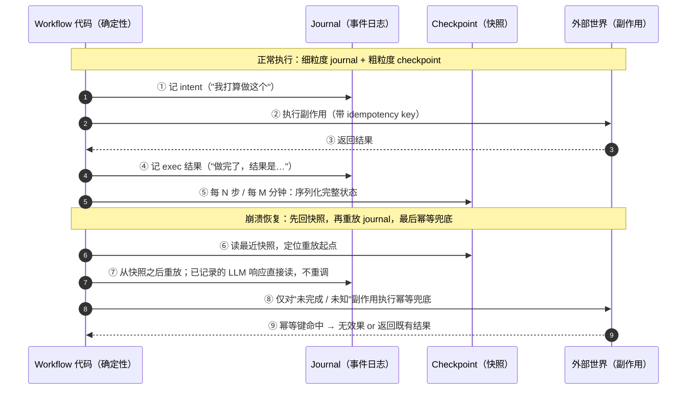
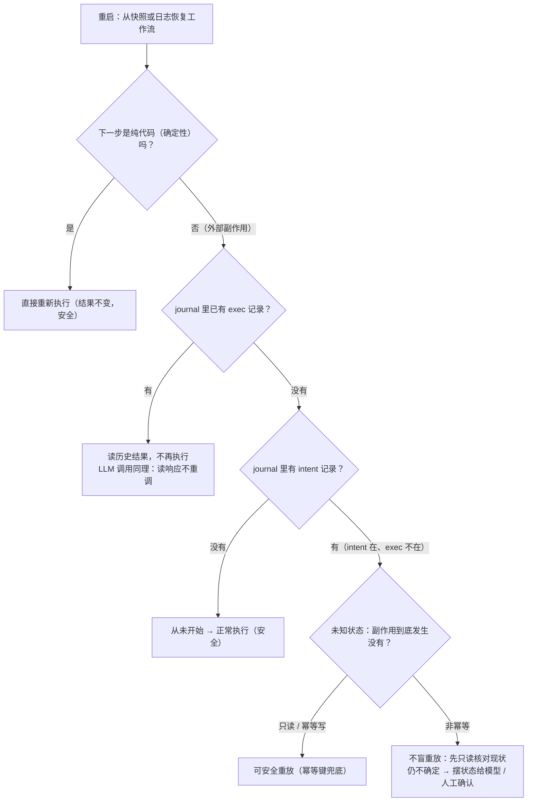
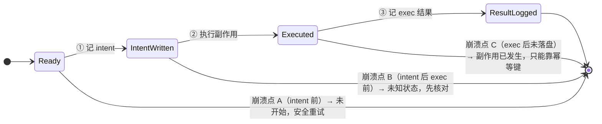
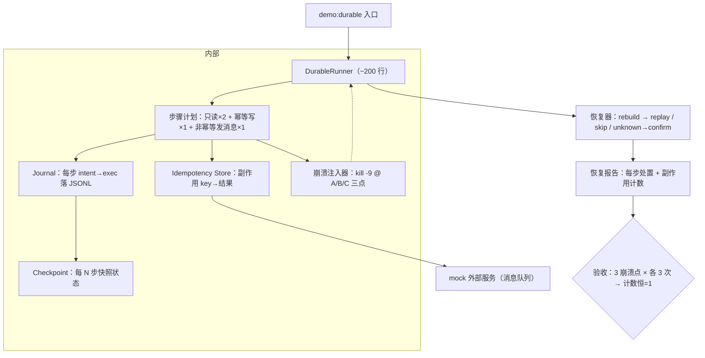

# durable execution(长任务不丢不重)

> 优先级 P1 · 状态：📐 讲义已展开，待提问演练
> 前置：从零写 harness §⑥⑦（harness-demo session.ts = 你已有的最小 durable journal）
> 教学素材：FinHot backfill（1645 行、~10% 失败、断点续跑到次日凌晨）+ labeler（跨天异步）
> 目标：把 从零写 harness"会话恢复"升级为"任务级 durable execution"，能答"设计一个跑 8 小时的 agent 任务，随时可能崩"

**本课怎么读**：S1 先把"长任务的三个随时"定义清楚（为什么 naive 重跑会同时丢和重）；S2 是三个核心机制的地图——journal / checkpoint / 幂等，各自防什么、代价是什么；S3 是全课最深的洞察——**LLM 调用是昂贵、非确定、无幂等的外部副作用，重放时必须当数据读、不能当计算跑**；S4 把幂等从概念落成"工具三分法"的工程规范；S5 讲持久化之上的第二层——long-horizon（不死之后的"长跑不烂"）；S6 给 2026-10 的框架版图与选型句；S7 是已落地的 demo 实录（`durable-execution-demo/`，2026-10-12）；**S8 是一次完整的实战走查**——把 FinHot backfill 的断点续跑逐层摊开，看清每一层在什么时刻起作用；**S9 是常见错误与面试官追问清单**。读完要能回答一句话：*durable execution 不是"能恢复"，是"恢复后副作用不多不少发生一次"。*

---

## S1 问题定义：长任务的三个"随时"

**这一节解决什么问题**：先把失败的定义校准。短任务（一次问答）崩溃了，重跑一遍的成本可以忽略；但 agent 任务可能跑几分钟到几天，重跑的代价是"8 小时白跑 + 副作用重复"。这一节把"长任务为什么是另一类问题"立成坐标系，后面每一层机制都在回答这里暴露的一个失败。

agent 任务可能跑几分钟到几天。期间随时发生：**进程崩 / 机器重启 / 服务发布 / 外部依赖挂**。
naive 做法=从头重跑 → 两个罪：
1. **丢**：已完成的工作蒸发（8 小时白跑）
2. **重**：副作用重复（消息发两遍、钱扣两次、文件写两遍）

**durable execution 的定义句**：工作流的执行状态被持久化，任何时刻崩溃后能从**恰好正确的点**继续，副作用**不多不少发生一次**（工程上=at-least-once 投递 + 幂等消化）。

**怎么拆这两个罪**：它们不是同一个问题的两面，而是两个独立的设计目标。"丢"由**持久化执行状态**解决（知道做到哪了）；"重"由**幂等**解决（即使多执行一次也无害）。只做前者的系统能续跑但会重复副作用；只做后者的系统不重复但不知道从哪续。生产上两者都要。

**反例（面试里真实会出现的坏答案）**：候选人说"我在任务开始前把整个任务状态 dump 到文件，崩了就读回来"。追问"如果 dump 和真正执行副作用之间崩溃了呢"——他答"那就再执行一遍"。这一答就暴露了两个洞：dump 与副作用之间没有记录"意图"，且重复执行没有被幂等保护。正确姿势是 S2 的 intent/exec 双记录，光"存状态"不够。

**面试信号**：先把"丢"和"重"拆成两个独立目标，再说明你分别用什么机制。这一句就把本课和"我只是存了个文件"拉开档次。

---

## S2 三个核心机制（各自防什么）

**这一节解决什么问题**：给出一张"机制 → 防什么 → 代价"的地图。面试官问 durable execution 时，期待的不是一个框架名，而是这三个机制以及它们各自的失败模式。能把"三者缺一会怎样"讲清楚，才算真懂。

| 机制 | 原理 | 防什么 | 代价 |
|---|---|---|---|
| **Journal / 事件日志**（event sourcing） | 每个外部动作前先记 intent、完成后记结果（从零写 harness §⑥⑦ 已实现） | 区分"没执行"vs"执行了没记录"=未知状态 | 日志存储；恢复要读日志 |
| **Checkpoint / 快照** | 定期把完整状态序列化落盘，恢复从最近快照开始 | 日志太长时重放太慢 | 快照一致性（写一半的快照=毒） |
| **幂等设计** | 同一副作用带 idempotency key，重复执行=无效果 | at-least-once 投递下的重复 | 业务层要接受 key 语义 |

**怎么读这张表**：注意三者的**粒度不同**——journal 是细粒度（每步）、checkpoint 是粗粒度（每 N 步/每 M 分钟）、幂等是纵深（管外部世界那一端）。它们不是三选一，是一套三层防御：journal 让你知道"到哪了"，checkpoint 让你不必"从头重放"，幂等让你可以放心"再执行一次"。面试时按"它们各自防的是哪一类失败"讲，而不是按"它们是什么"讲。

**工业标准组合**：细粒度 journal（每步）+ 粗粒度 checkpoint（每 N 步/每 M 分钟）+ 幂等兜底（外部副作用）。三者缺一：
- 无 journal → 崩溃点只能靠猜（从零写 harness §⑦ 的未知状态问题）
- 无 checkpoint → 长任务恢复=从第 0 步重放全部（Temporal 用事件历史重放，任务小时级时不可行，靠快照）
- 无幂等 → 恢复时的"再执行一次"变成真实重复

**三机制如何配合**（正常执行时 journal 记 intent→exec，checkpoint 每 N 步落盘；崩溃后先读快照定位起点、再重放 journal、只对未知状态走幂等兜底）：



**你的锚点**：harness-demo 的 `session.ts`（appendFileSync JSONL：intent→exec）就是机制 1 的最小实现；从零写 harness §⑦ 的"只读重放 / 非只读摆状态给模型"就是机制 3 的 agent 版实现。**面试讲法：我不是背概念，是我 150 行白板 harness 里就有 journal 和幂等分类。**

---

## S3 重放的确定性：LLM 让这件事变难了（本课核心洞察）

**这一节解决什么问题**：这是全课最值钱的一段。传统 durable execution 的整个模型建立在"workflow 代码是确定性的、可以随便重放"这个前提上；LLM 把这个前提打破了。面试官问 durable execution，十有八九会追到"重放时 LLM 要不要重新调"——答错这一题，前面的机制都白讲。

Temporal 类框架的模型：**workflow 代码是确定性的，崩溃后从头重放**——外部副作用（调 API、写 DB）通过"activity"执行，其结果被记录在事件历史里，重放时**直接读记录、不再执行**。

LLM 调用的位置：它是**昂贵+非确定+无幂等**的外部副作用 → 必须当 activity 记录：

```
重放时：
  普通代码        → 重新执行（确定性，结果一样）
  已记录的 LLM 调用 → 从历史读响应（不重调！省钱+省时间+避免漂移）
  已记录的写操作   → 从历史读结果（幂等 key 兜底外部世界）
  未完成的调用    → 真正未知状态 → 按 从零写 harness §⑦ 规则处理
```

**为什么"重新调一遍"是灾难而不只是"慢"**：重放时代码是确定性的，但 LLM 不是——同一个 prompt 在不同时刻返回的内容可能不同。一旦重调，恢复后的任务可能走**完全不同的路径**：前面据此做的决策全部作废，评测不可复现（沙箱与凭据 §S6）、成本翻倍、还可能重复已经做过的动作（对一个已经道歉过的用户再道歉一遍）。把重放成本写成公式更直观：

$$C_{\text{replay}} = \sum_{i \in \text{steps}} \text{cost}(i) \times \big[\, i \text{ 未记录} \,\big]$$

重调 LLM 会让本该为 0 的 `cost(LLM 步)` 重新计入，且 `[i 未记录]` 的选择权落在了实现者手里——这正是最容易被写错的地方。

**重放决策树**（每一步先问"这是不是已记录的外部副作用"，再决定读历史 / 重执行 / 未知状态处置）：



**面试点**："如果重放时重新调 LLM，同一个任务恢复后可能走完全不同的路——评测不可复现（沙箱与凭据 §S6）、成本翻倍、还可能把'已经道歉过的用户'再道歉一遍。所以 LLM 响应是**数据**，不是**计算**。"

**可背面试句**："恢复的正确性不取决于你存了多少状态，取决于你重放时**哪些调用读历史、哪些调用重新跑**——LLM 响应必须归到'读历史'那一类。"

---

## S4 幂等设计：工具三分法（接 从零写 harness §⑦，升级为工程规范）

**这一节解决什么问题**：journal 和 checkpoint 都能告诉你"到哪了"，但管不住"再执行一次"这件事——真正兜住重复副作用的是幂等，而幂等的起点是把工具按"重放安全性"分三类。这一节把 从零写 harness §⑦ 的直觉升级成工程规范，也是面试官最常追问"具体怎么做"的一节。

| 类别 | 例 | 崩溃后处理 |
|---|---|---|
| 只读 | read/grep/query | 安全重放（免费） |
| 幂等写 | `set x=1`、`upsert by id`、`git commit --amend 同一树` | 重放安全（结果收敛） |
| 非幂等 | append、转账、发消息、`docker compose up` | **禁止盲重放**：idempotency key（外部 API 支持时）/ 摆状态给模型 / 人工确认 |

**怎么判定一个工具属于哪一类**：问一个问题——"同一个操作执行两次，对世界的最终状态是否与执行一次相同？"相同=幂等写；不同=非幂等。注意"幂等"是对**最终状态**说的，不是对"是否执行"说的：`upsert` 执行两次，数据库确实被写了两遍，但最终内容一样，所以是幂等的。

**三种崩溃注入点**：同一个副作用，崩溃发生在它的前 / 中 / 后，恢复难度完全不同。最危险的是第三种——副作用已经发生、但结果还没落盘，此时系统既不知道它发生了、也没有幂等兜底可用：



**FinHot 实例（每个都是真实发生过的）**：
- backfill 按 `source_id` 幂等：重跑=跳过已 ok 的行，failed 行重试（~10% 失败率下，幂等=断点续跑的整个基础）
- labeler 的 T+5 拉取：同一 (source_id, horizon) 只落一次（upsert 语义）
- 幽灵事故的反面教材：`compose build+up` **非幂等且无 scope**，重放=再次污染生产

**反例**：把幂等 key 放在"进程内存里的一张 Set"。进程一崩，Set 没了，重启后 key 全部视为新 key，重复副作用照旧发生。幂等 key 必须落在**外部世界能看到的持久层**（数据库唯一索引、外部 API 的请求头、journal）才有意义——这是 S9 里"幂等 key 放错层"那条错误的根源。

---

## S5 Long-horizon：持久化之上的第二层问题

**这一节解决什么问题**：durable execution 解决的是"崩溃后不死"，但一个跑 8 小时、最后跑完了、结果却错了的任务同样失败。long-horizon 处理的是"长跑不烂"——稀疏反馈下模型能力衰减、目标漂移、信用分配、资源泄漏。JD 原词就是"稀疏反馈防能力衰减"。这一节让面试官看到你不止会"续跑"，还知道"续跑之后为什么不烂"。

durable 解决"不死"，**long-horizon** 解决"长跑不烂"（JD 原词：稀疏反馈防能力衰减）：

| 问题 | 现象 | 对策 |
|---|---|---|
| 目标漂移 | 跑到第 40 步忘了第 1 步的约束（"不许动生产"） | 约束锚点：周期性把原始目标重注入上下文（从零写 harness §⑧ 压缩的 head 保留就是最小版）；Harness 架构 §5 |
| 信用分配 | 第 100 步失败，锅在第 37 步？ | 轨迹级评测（评测工程化 §S2）；milestone 检查点+每段验收 |
| 稀疏反馈 | 只有终点有对错信号 | 中间信号：每 milestone 的确定性断言（测试/格式/不变量） |
| 资源泄漏 | 长会话上下文膨胀、句柄/子进程堆积 | 预算+压缩（从零写 harness §⑧）；子任务边界回收（Harness 架构 §8） |

**怎么读这张表**：把 long-horizon 的四个问题记成"四个衰减"——目标衰减、归因衰减、信号衰减、资源衰减。它们都不是崩溃，恰恰相反，它们是"系统一直活着"才会出现的问题。这也是面试里区分"做过短任务"和"真跑过长任务"的分水岭。

FinHot 映射：backfill 1645 行跑一夜=long-horizon 批处理（日志 /tmp/finhot-backfill-direction.log、ETA 跟踪、失败分类）；labeler T+5=**跨天的里程碑**（T0→T+1→T+3→T+5 逐格推进，每格都是中间信号）。

**可背面试句**："durable 保证任务能跑完，long-horizon 保证跑完的任务还是对的任务——前者是存储问题，后者是上下文与信号问题。"

---

## S6 框架版图（2026-10 核实）

**这一节解决什么问题**：面试官常问"你会用 Temporal 还是自己写"。这一节先给四家的定位，再给一句可背的选型原则——**选数据库栈重合的那个**。注意：这里只要求定位级理解，不要求背 API。

| 框架 | 模型 | 一句话定位（2026-10 核实） |
|---|---|---|
| Temporal | 事件历史重放+持久化 workflow | 老牌重型，企业生产；2026 文档明确覆盖 AI/LLM workflow 模式（LLM 调用=外部 activity）（版本以引用日为准（2026-10-11）：Temporal Server v1.32.1 / TS SDK 1.24.0） |
| Restate | REST-first：持久化执行=普通 HTTP endpoint+SDK | 部署最轻，已有服务不想重写 workflow 代码时的选项；2026 有 LLM 集成文档（版本以引用日为准（2026-10-11）：Restate v1.7.13） |
| Inngest | 事件驱动+函数步骤 | 面向已有服务的事件流编排；2026 文档把 AI agent 当一等公民（步骤函数内调 LLM=天然 durable）（版本以引用日为准（2026-10-11）：Inngest TS SDK 4.23.0） |
| DBOS | Postgres 内事务+Durable Functions | **你的锚点最近**：FinHot 就是 Postgres 栈，DBOS=同库加 durable 语义（版本以引用日为准（2026-10-11）：DBOS `dbos` 3.2.0（Python）） |

**共同点比单家更值钱**：四家的 2026 文档都在补"LLM 调用怎么当外部副作用记录"（=S3 的 LLM 响应是数据不是计算）——行业正在把 durable execution 的确定性重放模型适配到非确定组件上，这正是本课 S3 的内容。

选型句：小系统=**自己写 journal（你已有）+ 幂等 + 定期快照**（百行代码）；上了规模=选框架，选**数据库栈重合**的那个（FinHot→DBOS/Postgres；已有 K8s→Temporal）。

**怎么用这张表**：不要背框架名当知识点，把它当成"基础设施复用"的选型题。面试追问"为什么不自研到大规模"时，答"因为 durable execution 的难点不在写 journal，而在分布式一致性、故障注入测试、运维升级——这些是框架用规模换来的，业务量到了就该付这个成本"。

---

## S7 demo 实录（已落地）

**这一节解决什么问题**：把 S2-S4 的机制落成一个可运行的最小 runner，用"三种崩溃点 × 各跑 3 次、副作用计数恒=1"这个可证伪的验收标准来证明自己真懂。这张架构图也是面试时可以画的"我手写过"证据。

durable 任务 runner（设计规格，2026-10-12 已按此落地为 `durable-execution-demo/`，src 821 行）：
1. 任务=多步混合（只读×2 + 幂等写×1 + 非幂等"发消息"×1，mock 外部服务）
2. 中途 `kill -9`（三种注入点：intent 前 / intent 后 exec 前 / exec 后）→ 重启
3. 验证：只读步重放、幂等步重放无副作用、非幂等步**不重放**（摆状态/mock 人工确认）、消息只发一遍（idempotency key）
4. 输出恢复报告：每步的处置（replay / skip / unknown→confirm）
验收：三种崩溃点 × 各跑 3 次，副作用计数恒=1。

runner 架构（步骤计划 → journal/checkpoint/幂等存储 → 崩溃注入器 → 恢复器 → 恢复报告，闭环回到验收）：



**这张图怎么讲**：重点不是"我写了 200 行"，而是"我把每个机制的**失败模式**都设计成了可注入、可观测、可计数的实验"——崩溃注入器对应三类崩溃点，恢复报告对应"每一步到底走了 replay 还是 skip"，副作用计数对应"不多不少一次"这个验收句。这套设计是 从零写 harness §⑦ `demo:crash` 思路的放大版。

### 7.1 跑法（`durable-execution-demo/`）

```bash
cd durable-execution-demo
npm i            # 本机 NODE_ENV=production 会让 npm 跳过 devDeps，tsx/typescript 放 dependencies
npm run demo     # 验收矩阵：3 崩溃点 × 各 3 次（每次清 .state：先崩溃运行 → 再 resume 运行）
npm run typecheck
```

末尾 `✅ durable 验收通过：3 崩溃点 × 各 3 次，副作用计数恒=1` 即本节验收；断言失败退出码为 1（可进 CI）。崩溃/resume 也可手工分步复现：`npx tsx src/worker.ts --mode=crash --crash=C` → `npx tsx src/worker.ts --mode=resume`。运行产物全在 `.state/`（journal JSONL / checkpoint / 幂等存储 / mock 服务 ledger），`rm -rf .state` 即可重来。

### 7.2 src 文件清单（821 行，全离线确定性：mock 外部服务 + 逻辑时钟，不调模型 / 不联网 / 不用墙钟）

| 文件 | 行数 | 职责 |
|---|---|---|
| `src/types.ts` | 85 | 工具三分法 / CrashPoint / Disposition 类型 + JournalEvent + Checkpoint + RecoveryReport |
| `src/state.ts` | 112 | 持久层：journal 同步 append（撕裂行容错）+ checkpoint 原子写与校验和 + 幂等存储 + canonical JSON/sha256 |
| `src/external.ts` | 98 | mock 外部世界：消息队列（账本 / deliver / 只读 lookup）+ 业务库（upsert / get） |
| `src/plan.ts` | 38 | 4 步混合任务计划（只读×2 + 幂等写×1 + 非幂等发消息×1）+ 三种崩溃点定义与预期处置 |
| `src/runner.ts` | 81 | DurableRunner：正常运行 intent→exec→每 2 步 checkpoint + 崩溃注入器 `injectCrash`（SIGKILL 真实自杀） |
| `src/recover.ts` | 128 | 恢复器：`analyze` 纯判定表（S8.2 那张表就是它的实现）+ `runRecovery` 按判定执行并产出恢复报告 |
| `src/selftest.ts` | 107 | 处置规则自检：合成 journal 状态，把 S3 决策树全分支（含只读 replay / 幂等写 replay）都跑到 |
| `src/worker.ts` | 39 | 单次运行子进程入口（`--mode=crash --crash=A|B|C` / `--mode=resume`） |
| `src/demo.ts` | 133 | 入口：任务计划 + 崩溃点 + 规则自检 + 3×3 验收矩阵 + 断言 |

### 7.3 崩溃点 × 预期处置对照表（2026-10-12 实测）

| 崩溃点 | 注入位置 | send 步的 journal 状态 | 恢复处置 | 副作用计数 |
|---|---|---|---|---|
| **A** | intent 前 | 无 intent（从未开始） | **replay**：正常执行，补记 intent→exec | 崩溃前 0 + resume 1 = **1** |
| **B** | intent 后 exec 前 | intent 在、exec 缺 → 未知 | **unknown→confirm→exec**：只读问 mock 服务回报"未送达"→ 才执行 | 崩溃前 0 + resume 1 = **1** |
| **C** | exec 后未落盘 | intent 在、exec 缺 → 未知 | **unknown→confirm→skip**：只读问 mock 服务回报"已送达(msg-0001)"→ 不重放 | 崩溃前 1 + resume 0 = **1** |

（只读×2 + 幂等写×1 三步在三个崩溃点下都走 **skip**：exec 已在 checkpoint / journal，读历史结果不重做。）

### 7.4 验收输出（真实跑出来的，非示意）

每个崩溃点各跑 3 次，每次清 `.state/` 重来：先崩溃运行（子进程 `process.kill(process.pid,'SIGKILL')` 真实自杀，父进程收到 `signal=SIGKILL`），再 resume 运行。

```
[A] run 1/3 自杀=signal=SIGKILL | 处置: 1 skip | 2 skip | 3 skip | 4 replay | 副作用: 崩溃前 0 + resume 1 = 1 ✅ | 报告 sha256=675c17a5cc32
[A] run 2/3 自杀=signal=SIGKILL | 处置: 1 skip | 2 skip | 3 skip | 4 replay | 副作用: 崩溃前 0 + resume 1 = 1 ✅ | 报告 sha256=675c17a5cc32
[A] run 3/3 自杀=signal=SIGKILL | 处置: 1 skip | 2 skip | 3 skip | 4 replay | 副作用: 崩溃前 0 + resume 1 = 1 ✅ | 报告 sha256=675c17a5cc32
[A] 小结 ✅：副作用计数恒=1 ✅ / send 步处置恒=replay（无 intent → 正常执行） ✅ / 真实 SIGKILL ✅ / 恢复报告 3 次逐字节一致 ✅
[B] run 1/3 自杀=signal=SIGKILL | 处置: 1 skip | 2 skip | 3 skip | 4 unknown→confirm→exec | 副作用: 崩溃前 0 + resume 1 = 1 ✅ | 报告 sha256=7bd8f27afdb6
[B] run 2/3 自杀=signal=SIGKILL | 处置: 1 skip | 2 skip | 3 skip | 4 unknown→confirm→exec | 副作用: 崩溃前 0 + resume 1 = 1 ✅ | 报告 sha256=7bd8f27afdb6
[B] run 3/3 自杀=signal=SIGKILL | 处置: 1 skip | 2 skip | 3 skip | 4 unknown→confirm→exec | 副作用: 崩溃前 0 + resume 1 = 1 ✅ | 报告 sha256=7bd8f27afdb6
[B] 小结 ✅：副作用计数恒=1 ✅ / send 步处置恒=unknown→confirm→exec（mock 回报未送达） ✅ / 真实 SIGKILL ✅ / 恢复报告 3 次逐字节一致 ✅
[C] run 1/3 自杀=signal=SIGKILL | 处置: 1 skip | 2 skip | 3 skip | 4 unknown→confirm→skip | 副作用: 崩溃前 1 + resume 0 = 1 ✅ | 报告 sha256=ee239f775d7a
[C] run 2/3 自杀=signal=SIGKILL | 处置: 1 skip | 2 skip | 3 skip | 4 unknown→confirm→skip | 副作用: 崩溃前 1 + resume 0 = 1 ✅ | 报告 sha256=ee239f775d7a
[C] run 3/3 自杀=signal=SIGKILL | 处置: 1 skip | 2 skip | 3 skip | 4 unknown→confirm→skip | 副作用: 崩溃前 1 + resume 0 = 1 ✅ | 报告 sha256=ee239f775d7a
[C] 小结 ✅：副作用计数恒=1 ✅ / send 步处置恒=unknown→confirm→skip（mock 回报已送达） ✅ / 真实 SIGKILL ✅ / 恢复报告 3 次逐字节一致 ✅
✅ durable 验收通过：3 崩溃点 × 各 3 次，副作用计数恒=1
```

恢复报告 = 每步处置 + 副作用计数；同一崩溃点 3 次的报告 sha256 相同，两次独立 `npm run demo` 的整段输出也逐字节一致（报告里没有任何时间戳 / pid / 随机量：逻辑时钟 = 步序号 + journal seq，消息 id 由账本行号派生 `msg-0001`）。

**这条验收为什么不是恒真的**：mock 消息服务**刻意不去重**（真实队列的 at-least-once 语义，服务端按原样落账本）。把 `recover.ts` 的 confirm 改成盲重放（= S9.1 #7 那条错误实现），崩溃点 C 立刻变成 `副作用: 崩溃前 1 + resume 1 = 2 ❌`、处置不符预期、退出码 1——实测过，所以上面的 ✅ 是有牙齿的。

### 7.5 落地时踩到的坑

1. **`console.log` + SIGKILL 会吞日志**：stdout 走管道时是异步的，`process.kill(SIGKILL)` 之前 print 的崩溃行可能整段消失。改成 `writeSync(1, …)` 同步写才拿到"崩溃前最后一行"。
2. **tsx CLI 会中转信号**：用 `node node_modules/tsx/dist/cli.mjs worker.ts` 起子进程时，SIGKILL 打死在 tsx 再包一层的 node 上，父进程只看到 `exit=137`。改成 `node --import tsx worker.ts`，`process.pid` 就是 worker 自己，父进程直接收到 `signal=SIGKILL`。
3. **恢复报告想逐字节一致，就不能带任何墙钟量**：第一版报告里放了 `Date.now()` 和 pid，跨次 sha256 必然不同。逻辑时钟（步序号）+ 派生 id（账本行号）之后才成立。

---

## S8 实战走查：FinHot backfill 的断点续跑时间线

> 这一节把 S2 的三个机制放进一条真实的生产时间线。素材=FinHot backfill（**1645 行**、**~10% 失败**、断点续跑到次日凌晨，`#35`）；原日志锚点=`/tmp/finhot-backfill-direction.log`（已随临时目录清理**不可取得**）。下面时间线是按机制**重建的走查**：行号 `N`、精确时刻、失败分类的现场字符串均为**示意值，不可当作逐字证据引用**（可观测同口径）。

### 8.1 时间线（从启动到跑完）

| 阶段 | 事件 | 日志证据形态 | 系统在做哪件事 | 哪一层在起作用 |
|---|---|---|---|---|
| T0 | 启动 backfill，1645 行待处理 | `.../1645 ... ETA ...` | 建立进度基线 + ETA 估计 | journal 起点（记 init） |
| T0→崩溃 | 逐行正常处理 | `row i: ok / failed(class)` | 每行：记 intent（按 `source_id`）→ 执行 → 记 exec 结果 | **journal** 细粒度记录 |
| 崩溃时刻 | 跑到**第 N 行**，进程被杀（发布/超时/重启） | 最后一条 `tool_intent` **无**对应 `tool_exec` | 第 N 行进入"结果未知"状态 | **journal 的 intent/exec 缺口** |
| 重启 | 重新加载日志 / 快照 | resume 日志行 | 从最近 checkpoint 定位重放起点，而不是从第 0 行 | **checkpoint**（粗粒度） |
| 逐行判定 | 对每一行判定 replay / skip / unknown→confirm | `row i: skip / replay / confirm` | 已 ok 的跳过；failed 的重试；intent 无 exec 的先核对 | **journal + 幂等** 联合 |
| 收敛 | 1645 行跑完，failed 行进重试队列 | 最终进度 + 失败分类汇总 | ETA 重算、部分成功可见、失败分类 | **幂等兜底 + long-horizon** |

> 日志原文（待回填）示意形态，**不是**实测字符串：`[backfill] 12xx/1645 ok | failed 12% | ETA ...` / `[backfill] crash: last intent id=..., no exec` / `[backfill] resume from checkpoint @ row N-50`。（注：原始 /tmp 日志已随临时目录清理不可取得；讲义中的行号 / ETA / 失败串为示意值，**不可当作逐字证据引用**）

### 8.2 逐行判定规则（这一步到底在判定什么）

重启后，backfill 对**每一行**读 journal 的状态，然后分派四种处置之一。这张表是整节的核心——它把"断点续跑"拆成一条条可判定的规则：

| 日志状态 | 判定 | 处置 | 哪一层在起作用 |
|---|---|---|---|
| 无 intent | 从未开始 | **replay**（正常执行） | journal（缺失=可安全开始） |
| intent 在、exec=ok | 已完成 | **skip**（直接读结果，不重做） | journal + 幂等（防重写） |
| intent 在、exec=failed / timeout | 执行过但失败 | **replay**（幂等重试） | 幂等兜底（失败行重试不产生重复） |
| intent 在、**exec 缺失** | **结果未知** | **unknown→confirm**（先只读核对现状；非幂等才升级人工） | journal 缺口 + 幂等 |
| checkpoint 之后无任何记录 | 快照点未推进 | 从快照重放 | checkpoint |

**逐层标注（对照 S2 三机制）**：
- **journal 层**：唯一一次"崩到第 N 行"能被精确定位，靠的是"intent 在、exec 不在"这个缺口——没有 journal，第 N 行只能靠猜，要么跳过（丢）要么重做（重）。
- **checkpoint 层**：让重启不必从第 0 行重放全部 1645 行。日志越长重放越慢，快照是"重放加速器"；它不改变"哪行做了什么"的判定，只改变"从哪开始看"。
- **幂等层**：判成 replay 的那些行（failed 重试、未知核对后确认未发生）能安全重做，是因为写操作按 `source_id` 幂等——同一行重跑最终状态收敛，不会出现一行两个结果。

### 8.3 ETA 跟踪与失败分类（long-horizon 的中间信号）

- **ETA 跟踪**：跑一夜的任务必须能回答"还剩多久、卡在哪"。ETA 来自"已完成行数 ÷ 单位时间"的滚动估计，配合日志的进度行。它的价值不在数字准不准，而在于**让"任务是否在推进"可判定**——ETA 长时间不动就是挂了或卡在某个失败类别上（S5 资源泄漏 / 稀疏反馈）。
- **失败分类**：~10% 失败率为**超时 + 订阅异常**为主。分类决定处置——超时类可退避重试；订阅异常类重试无益、应标 failed 进人工/次日续跑。**不分类就无法决定 replay 还是升级人工**，这是 S3 决策树在生产上的样子。
- **部分成功可见**：1645 行不会"要么全成要么全败"，而是每一行有独立终态。面试讲这句："我的长任务设计的是**部分成功模型**，不是 all-or-nothing。"

**可背面试句**："断点续跑不是'把脚本再跑一遍'，是先读日志判定每行的状态，再对 replay / skip / unknown 分别处置——判定的正确性靠 journal，重做的安全性靠幂等，重启的速度靠 checkpoint。"

---

## S9 常见错误与面试官追问

> 这一节是"反向题库"。durable execution 的杀伤力不在"你会不会说三个机制"，而在"你知道它哪里会崩"。每条给错误、为什么危险、正确做法；后面是几条高频深挖追问。

### 9.1 常见错误速查表

| # | 常见错误 | 为什么危险 | 正确做法 |
|---|---|---|---|
| 1 | **把 at-least-once 说成 exactly-once** | 偷换前提：投递层永远给不了"恰好一次"，说成 exactly-once 等于宣称一个不存在的保证，面试官一追到底 | 说"at-least-once 投递 + 幂等消化 = 业务上恰好一次效果"；**exactly-once 是效果不是投递语义** |
| 2 | **checkpoint 毒快照** | 快照序列化到一半进程被杀，落盘的是半截状态；从这个快照恢复 = 从错乱状态重放 | 写快照用"写临时文件 + 原子 rename"；快照带版本号 / 校验和；恢复时校验失败则退回上一个完好快照 + 重放 journal |
| 3 | **重放时重新调 LLM** | 成本翻倍、路径漂移、评测不可复现；甚至重复已经做过的动作 | LLM 响应是**数据不是计算**：已记录的从历史读，绝不重调（S3） |
| 4 | **幂等 key 放错层** | 放在进程内存 / 会话上下文里，一崩就没了，重启后重复副作用照旧 | key 落在外部可见的持久层：数据库唯一索引 / 外部 API 请求头 / journal |
| 5 | **长任务目标漂移** | 跑到第 40 步忘了第 1 步的约束，任务跑完了但违规或跑偏 | 周期性把原始目标/约束重注入上下文（从零写 harness §⑧ head 保留）；milestone 验收（S5） |
| 6 | **只有 checkpoint、没有 journal** | 快照只保"最近状态"，丢中间历史；崩溃点落在快照之后就无法精确判定 | 细粒度 journal 是唯一事实源，checkpoint 只是重放加速器 |
| 7 | **把"未知状态"当"失败"直接重放** | intent 在、exec 不在时，副作用可能已发生；盲重放=重复副作用 | 先只读核对现状；非幂等才升级人工（从零写 harness §⑦ / S3 决策树） |
| 8 | **重试与恢复混为一谈** | 重试是"这次调用失败再试一次"；恢复是"进程崩溃后重建状态"——两者语义、代价、幂等要求都不同 | 分开设计：重试管单次调用，恢复管任务级状态重建 |

### 9.2 面试官追问：五条高频深挖

**追问 A：「你说你的系统 exactly-once，怎么实现的？」**
这是最经典的措辞陷阱。正解不是"我用了一个很厉害的框架"，而是拆开讲："投递层我只能给 at-least-once，恰好一次是**幂等消化**后的业务效果——同一条消息消费两次，最终状态和执行一次相同。"**加分答法**："我从不承诺投递层 exactly-once，我承诺的是副作用按 idempotency key 收敛。"

**追问 B：「重放时那个写操作会不会执行两次？」**
区分三种情况回答：已记录 exec → 不执行，读历史；intent 在 exec 不在（未知）→ 不盲重放，先核对；非只读且无法核对 → 升级人工。**加分答法**：指出"会不会执行两次"问的其实是幂等设计，不是重放逻辑——即使逻辑上重放了一次，幂等键也让世界只变一次。

**追问 C：「快照写到一半崩了怎么办？」**
答"毒快照"防御三件套：原子写（临时文件 + rename）、完整性校验（版本号 / 校验和）、失败回退（退回上一个完好快照再重放 journal）。**加分答法**：强调"快照永远不是唯一事实源"，所以毒快照的代价只是"多重放一段日志"，不会导致数据错乱。

**追问 D：「跑 8 小时的任务，第 6 小时开始重复前 2 小时的探索，怎么诊断、怎么修？」**
诊断：先看轨迹——是上下文里丢了约束（目标漂移），还是任务重新启动（恢复把已完成的步又跑了一遍）。修复分两层：durable 层检查 journal 是否漏记/错判导致重放；long-horizon 层加约束锚点重注入 + milestone 验收。**加分答法**：指出"重复探索"可能是**恢复 bug**（重放了已完成的步）而非模型变笨——先排除工程层，再谈模型层。

**追问 E：「能不能只用 checkpoint、不要 journal？」**
不能。checkpoint 只保最近状态，中间历史丢失，崩溃点落在两个快照之间时无法精确判定；且覆盖式快照没有"intent 在、exec 不在"这种缺口信息。**加分答法**：journal 是真相，checkpoint 是缓存——可以省缓存，不能省真相。

> **可背面试句**："durable execution 的面试题，最后都会落到一句：**你的副作用是怎么做到不多不少一次的？**——答案永远是'投递 at-least-once + 持久化的 intent/exec 记录 + 外部可见的幂等键'，三样缺一不可。"

---

## 练习题库（后续提问用）

| # | 题目 | 考察 |
|---|---|---|
| 1 | "exactly-once"为什么是幻觉？给你系统的投递保证是什么？ | S2 |
| 2 | 重放时 LLM 响应从历史读 vs 重新调用，各破什么？（评测/成本/一致性） | S3 |
| 3 | 工具"发飞书通知"没有 idempotency key 支持。设计防重复方案 | S4 |
| 4 | checkpoint 写盘写到一半崩了。恢复逻辑怎么处理这个毒快照？ | S2 |
| 5 | 8 小时任务跑到 6 小时，模型开始重复前 2 小时的探索。诊断+两个修复 | S5 目标漂移 |
| 6 | FinHot backfill 的"断点续跑"用哪三个机制实现的？各自对应哪行代码逻辑？ | S2+S4 |
| 7 | 为什么 labeler 的 T+5 不直接"跑批时 sleep 5 天"？ | S5 |
| 8 | 给你 Temporal 和自己写 journal 两个选项，什么任务量/团队规模下切换？ | S6 |
| 9 | backfill 某一行日志是"intent 在、exec 不在"。先判定什么？如果这一步是"发飞书通知"呢？ | S3+S4 |
| 10 | 快照序列化到 80% 时进程被杀，磁盘上是半截文件。恢复逻辑怎么保证不会从毒快照重放？ | S2 |
| 11 | runner 重放时重新调了一遍 LLM，任务恢复了但成本翻倍、且走了不同路径。哪一层设计错了？怎么修？ | S3 |
| 12 | 幂等 key 放在进程内存 / journal / 外部服务请求头 / 数据库唯一索引，分别防什么、漏什么？ | S4 |
| 13 | 一个跑 8 小时的任务，前 6 小时正常、后 2 小时开始重复早期探索。durable 视角和 long-horizon 视角各给一条修复 | S5 |
| 14 | 面试官说"at-least-once + 幂等 = exactly-once"。这句话对哪一半、错哪一半？ | S2+S4 |

## 来源与锚点

- 框架现状：Temporal/Restate/Inngest/DBOS 与 LLM 适配方向——2026-10 已核实（各家 docs 站 LLM 章节），S6 已回填
- 我的证据：harness-demo session.ts（从零写 harness §⑥⑦）、FinHot backfill（1645 行/~10% 失败/断点续跑，#35）、labeler T+5 状态机、幽灵事故=非幂等无 scope 的代价
- 接回：从零写 harness §⑥⑦（journal/未知状态）、沙箱与凭据(可复现)、评测工程化(轨迹评测)

### 待办核实清单（S7 demo 已于 2026-10-12 落地）

- （注：原始 /tmp 日志已随临时目录清理不可取得；讲义中的行号 / ETA / 失败串为示意值，**不可当作逐字证据引用**）
- 「at-least-once + 幂等 = 业务上恰好一次效果」是业界面试口径，但**不是任何官方文档的原词**。引用时用官方措辞更稳：**Temporal**——Activity 可能被多次执行，但 Temporal 保证它**「被观察为恰好完成一次」（observed as completed exactly once）**，因此要求 Activity 幂等（docs.temporal.io/activity-definition#activity-retry-policy）；**Google Cloud Dataflow**——记录**「至少处理一次，结果恰好提交一次」**（cloud.google.com/dataflow/docs/concepts/exactly-once）。若用 “effectively-once”，须标注为业界口语。
- 已核实（2026-10）：术语无厂商一手源，按上述官方措辞引用
- S7 demo 已落地（2026-10-12）：`durable-execution-demo/`（src 821 行），3 崩溃点 × 各 3 次真实 SIGKILL 恢复，副作用计数恒=1、恢复报告跨次逐字节一致；本节 S7 已从设计稿改写为实录（含跑法 / 文件清单 / 实测输出 / 崩溃点对照表）
