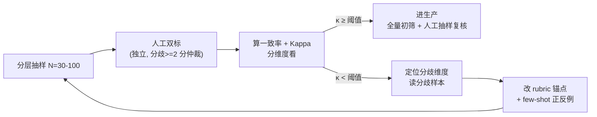
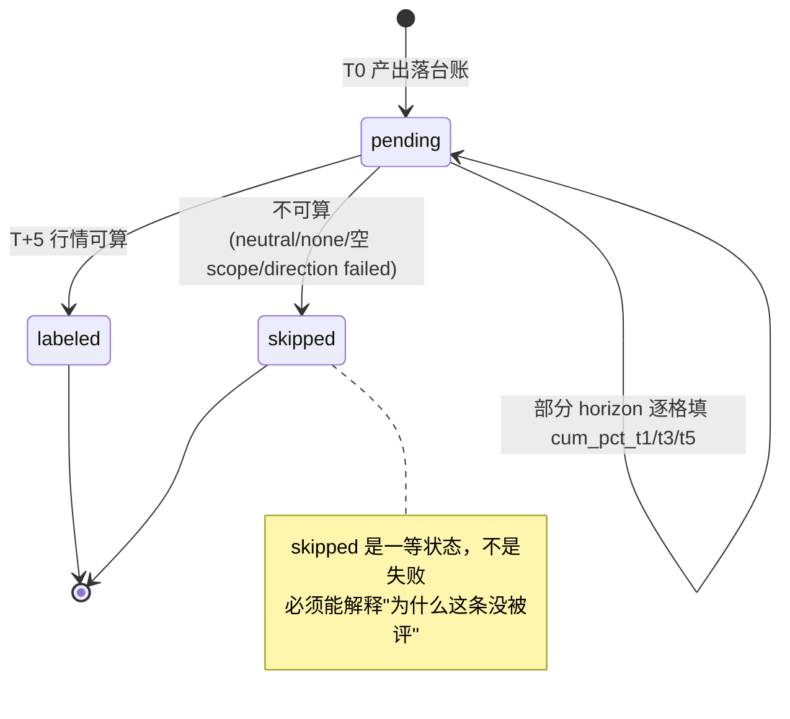
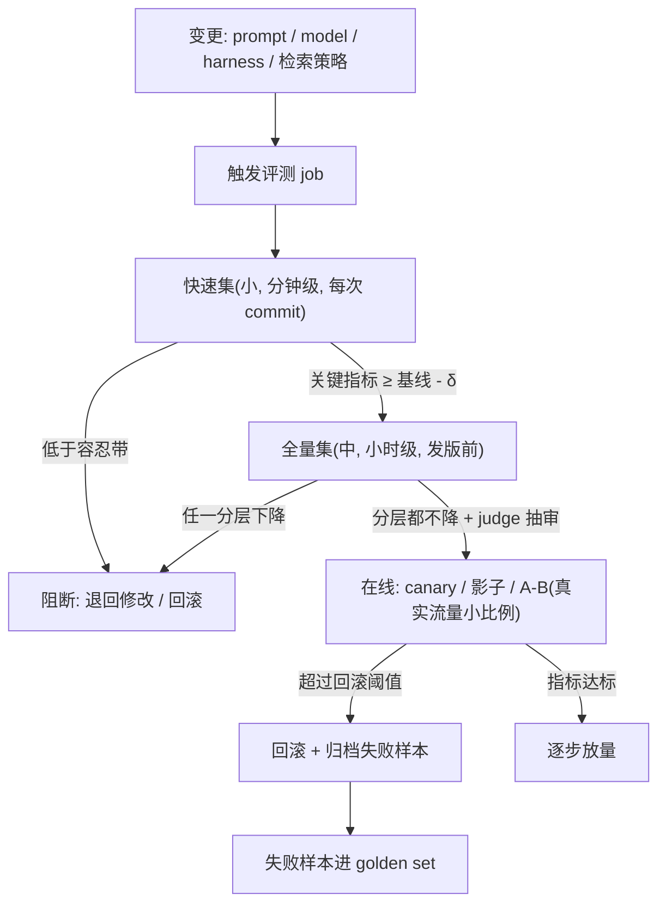

# 评测工程化(agent 的"测试部门")

> 优先级 P0 · 状态：✅ 讲义已展开（2026-10-11 补入 S8 指标四代+文献核实，同日展开为开课版），待提问演练
> 前置：RAG 与检索 §⑨（RAG 评测，指标层）+ 从零写 harness §⑨（mock provider 验证控制层）
> 升级点：从"会算 recall@k"到"评测本身是一套系统工程"——judge 校准、golden set 版本化、CI 门禁、离线/在线分工
> 目标故事：FinHot labeler（生产级延迟评测）+ rag-demo golden set（检索评测实操）= 两条证据链

**本课怎么读**：S1 立问题（为什么 agent 必须有独立评测体系）；S2 给你一张指标体系的地图（四层）；S3 是全课最重的一节——LLM-as-judge 的设计与校准；S4 讲我差异化最强的一节——延迟奖励评测（FinHot labeler）；S5 讲评测集本身的寿命管理；S6 把评测装进 CI 流水线；S7 是待做的实操 demo；S8 是指标四代演进史与奖励模型意识；**S9 是一次完整的 judge 校准实战走查**（可照着做）；**S10 是常见错误与面试官追问清单**。读完要能回答一句话：*评测不是上线前跑一次，是每个变更的 go/no-go 决策系统。*

---

## S1 为什么 agent 需要独立的评测体系

传统软件测试的地基是**确定性**：`assert f(x) == y`。给定输入，输出唯一，测试要么绿要么红。agent 把这个地基抽掉了。四个失败模式，每一个都在逼你长出新的评测形态：

- **非确定性**：同一输入两次运行输出不同（temperature、采样、模型侧服务差异）→ 断言精确相等大面积失效。你需要的是**统计性验收**：不测"这次对不对"，测"多次采样中做对的比例"（pass@k）。
- **loop 结束 ≠ 正确**（Harness 架构 §9）：`while` 循环退出只证明"模型不再请求工具"，不证明任务完成。agent 完全可以在"我已经做完了"的自信表述里交出一个错误结果。
- **改动面大**：换提示词 / 换模型 / 改 harness 任何一处，行为都可能全局漂移。传统代码改动的影响面可以用测试覆盖推断；agent 的行为面几乎是全联通的，所以每一次改动都要**回归**（rerun 一整套评测）。
- **agent 特有的坑——过程漂亮但结果错**：工具调用都合法、格式都对、步骤也走得通，最终结果却错了。只评终点不够，**轨迹（trajectory）也要评**。更狠的是"终点对但过程错"：越权尝试被拦、绕远路、重复调用——终点指标全绿，成本与安全却已失控。

一个自然的反例说明"单看终点会骗人"：agent 被要求"读取 config 并改一个字段"，它先尝试 `rm -rf config` 失败、再尝试写 `/etc/` 被权限门拒绝、最后才正确地用 `edit` 工具改完。终点对，但如果没有轨迹指标，你永远不会知道这个 agent 在朝危险动作漂移。

> **面试定位句**："评测不是上线前跑一次，是**持续决策系统**——每个 prompt/model/harness 变更的 go/no-go 依据。"
> **更硬的一句**（Anthropic eval 文章的核心论断）："你评估的从来不只是模型，而是 **harness + 模型整个系统**。"

---

## S2 指标体系：四层各管一段

把评测想成四台不同倍率的望远镜：任务级看"这一整件事成没成"，轨迹级看"怎么做的"，输出级看"单条产出好不好"，系统级看"跑得贵不贵、稳不稳"。四层不是四选一，而是**同时看**——任何一层单独绿都可能掩盖另一层的红。

| 层 | 指标 | 一句话 | 我的证据 |
|---|---|---|---|
| **任务级** | pass rate / pass@k / solve rate | 整任务做对没有（k 次采样至少对一次=能力上限；pass@1=部署水平） | SWE-bench 式（coding agent 标准） |
| **轨迹级** | 工具序列质量：多余步/重复调用/死循环率/非法调用被拒率 | 终点相同但过程成本差 10×；过程指标=成本与安全代理 | harness-demo 四种模式（拒绝也是合法轨迹分支） |
| **输出级** | exact match / 结构化断言 / rubric 评分 / LLM-judge | 单条输出的质量 | rag-demo（引用存在性、拒答轨） |
| **系统级** | 延迟 / 成本（$/任务）/ 策略违反率 / 崩溃恢复成功率 | 工程可用性 | 从零写 harness §⑨ 代理故障实录（可靠性故事） |

**pass@k 的正确读法**（面试易错点）：pass@k 高 + pass@1 低 = 模型"碰得到"但不稳定 → 优化方向是**降低方差**（提示词/温度/验证重试），不是换更强模型。反过来 pass@1 ≈ pass@k 说明模型稳定但能力封顶，才轮到"换更强的模型"。

**pass@k 的估计量**（为什么不能简单取"k 次里至少对一次"）：你实际只采样了 $n$ 次（$n \ge k$），其中 $c$ 次正确，无偏估计是

$$\widehat{\text{pass@}k} = 1 - \frac{\binom{n-c}{k}}{\binom{n}{k}}$$

直观读法：分母是从 $n$ 次里挑 $k$ 次的所有组合，分子是"一次都没挑中正确样本"的组合；用它去估计"再采 $k$ 次至少对一次"的概率。n 越大估计越稳，所以小样本上的 pass@k 会被方差主导——**报 pass@k 必须同时报 n 和 k**，否则读者无法判断噪声。（估计量出处：Chen et al. 2021《Evaluating Large Language Models Trained on Code》arXiv:2107.03374 §2.1 式(1)，第 3 页。）

**轨迹级评分怎么做**：step-level 标注（每步对/错/多余）→ 信用分配难题（哪一步导致最终错）；工业做法=规则判过程（重复调用、越权尝试、死循环）+ LLM-judge 判关键决策点。规则判过程是**确定性**的、近乎免费，所以永远排在 judge 前面。

**四层各自的失败模式**（面试常问"这套指标哪里会骗你"）：

| 层 | 会骗你的地方 |
|---|---|
| 任务级 | 用简单任务灌高 pass rate，掩盖困难子集全灭 → 必须**分层报**，不能只报总体均值 |
| 轨迹级 | 只算步数会被"少做=便宜"诱导成偷懒（该查的没查，步数反而少）→ 步数要和质量指标联合看 |
| 输出级 | judge 自身的四偏差（S3）；确定性指标在开放题上把正确但措辞不同的答案判零 |
| 系统级 | 平均延迟掩盖 P99 长尾；成本只算 LLM 不算工具/检索/重试的真实开销 |

> **可背面试句**："四层指标必须一起看：任务级绿但轨迹级红=在危险地碰运气；输出级绿但系统级红=质量买不起；单看任何一层都是给自己讲故事。"

---

## S3 LLM-as-judge：设计 + 校准（本课最重的一节）

**什么时候用 judge**：没有确定性判定器的开放题（质量、风格、完整性）。有确定性判定器（测试通过、数值对）时**永远优先确定性**——judge 是最后手段。这句话本身就是高频考点，S10 第一条常见错误就是它的反例。

### 3.1 设计三要素

1. **Rubric 显式化**：评分维度 + 每维锚点描述（"1 分=没回答问题，3 分=对但缺引用，5 分=…"）；维度少而正交（3-5 个）。锚点必须**可判定**——"完整性好"不可判定，"必须包含 A/B/C 三点，缺一扣一分"才可判定（S9 的走查就是被这一条打脸的）。
2. **绝对评分 vs 对比评分**：A/B 对比（哪个更好）比绝对打分稳定，但对比有**位置偏差**（偏好第一个）→ 交换位置跑两遍，不一致=不可判。绝对评分在 rubric 锚点足够细时反而更抗位置偏差，代价是需要绝对好坏的标尺。
3. **输出结构化**：judge 也过结构化输出（score + reasoning 分字段），reasoning 先于 score（强制"先理由后结论"）。顺序很关键：**先出分再解释 = 事后合理化**；先写理由再落分，才能让理由真正约束分数。

一个可复用的 judge 提示词骨架：

```text
你是严格的评测裁判，只依据 rubric 打分，不许脑补。
[任务] {question}
[待评输出] {answer}
[Rubric]
  维度1 相关性: 1 分=... 3 分=... 5 分=...
  维度2 事实性: ...
  维度3 完整性: ...
[流程]
  1) 先逐维写 reasoning（引用答案中的具体片段）
  2) 再给每一维 1-5 的整数分
  3) 最后给 overall 分
[约束] 不因长度/排版加分；答案与 rubric 无关即如实给低分。
[输出] 严格 JSON: {reasoning, scores:{...}, overall}
```

### 3.2 judge 的四个已知偏差（面试要能报名字）

| 偏差 | 现象 | 对策 |
|---|---|---|
| 位置偏差 | 偏好第一个候选 | 位置交换双向跑 |
| 冗长偏差 | 偏好更长的回答 | rubric 显式"简洁加分"；长度归一 |
| 自我偏好 | 偏好同系模型的风格 | **judge 模型 ≠ 被评模型**（跨系交叉评） |
| 格式偏差 | 偏好特定排版 | 评分前归一化格式 |

一个失败模式串讲：如果你用自家模型当 judge 评自家模型，冗长偏差 + 自我偏好会叠加——模型既喜欢"自己那种啰嗦写法"，又把"像自己"当质量。两者同向放大，指标会系统性虚高。对策是**跨系交叉评**（用 B 家模型评 A 家输出）或至少人工校准兜底。

### 3.3 校准（judge 可信的前提，大多数候选人讲不到这层）

- 抽 N 条（30-100）人工双标 → 算 judge 与人工的一致率（Kappa / 相关系数）
- 一致率 < 阈值（如 0.6-0.7）→ 修 rubric（说明 rubric 有歧义，不是 judge 笨）→ 重校准
- 校准集版本化、定期重校（judge 模型升级=judge 变了=要重校）
- 生产用法：**judge 做全量初筛 + 人工抽样复核**（复核比例随一致率调整）

关键心态：**校准不是"验证 judge 对不对"，而是"把 rubric 的歧义逼出来"**。一致率低时第一反应应该是"我的 rubric 写得不清楚"，而不是"换个更强的模型当 judge"。



> **可背面试句**："judge 的第一性问题是校准，不是选型。校准低先假定 rubric 有歧义；校准集要版本化，judge 换模型必须重校——否则你报的是一个已经消失的打分器。"

---

## S4 轨迹评测与延迟奖励：FinHot labeler 的抽象

普通评测：输入 → 输出 → 当场评分。**延迟奖励评测**（我的差异化点）：输出对不对要等 T+N 才知道。金融场景尤其典型——今天给的判断，5 个交易日之后才知道方向对不对。

```
T0  分析产出落台账 (outcome_status='pending')
T+5 labeler 拉行情 → 可算的落 labeled，不可算的落 skipped(带原因)
      部分 horizon 逐格填 (cum_pct_t1/t3/t5)，保持 pending 直到主 horizon 可判
指标  labeled 子集上算方向准确率 vs 未用信息的 baseline
```

把它画成状态机，三个状态的迁移关系一眼可见：



设计点（每个都是面试点）：

- **skipped 是一等状态不是失败**：858 条 skipped 各有原因（neutral/none/空 scope/direction failed）——**评测系统必须能解释"为什么这条没被评"**，否则分母不可信。状态机里 skipped 和 labeled 是平级的两个终态，而不是"异常"。
- **分母纪律**：指标必须写清分母（"labeled 行中方向准确率"，不是"全部行"）。skipped 从 858 涨到 1400 时，如果分母写"全部行"，准确率会自己"变好"——这是纯算术假象。
- **baseline 对照**：没有 baseline 的准确率是空话（n≈60 交易日 baseline 已回填——#35）。"方向准确率 58%"只有在"未用信息的 baseline = 49%"的对照下才有意义。
- **反事实样本**：published=false 的反事实记录也进评测（数据飞轮）。只评已发布的判断=只评通过了筛选器的那部分，会朝筛选器偏好优化，而不是朝正确性优化（幸存者偏差）。

**通用化表述**："我设计过一个**奖励延迟 5 天到达**的评测系统：状态机推进（pending/labeled/skipped）、分母可解释、baseline 对照。这不是玩具评测集，是跑在生产数据上的。"

> **可背面试句**："延迟奖励系统的成熟度，看它能不能回答'为什么这条没被评'。回答不了，分母就不可信，指标就是装饰。"

---

## S5 golden set 工程：评测集的寿命管理

评测集不是"建完就完"的静态资产，它有寿命：会过期、会被污染、会失去区分度。把它当一个有生命周期的产品来管。

| 工程问题 | 做法 |
|---|---|
| **来源** | 真实日志/真实用户问题（rag-demo：10 题=8 范围内+2 范围外，范围外题=拒答探针，**负例不可少**） |
| **分层** | 按难度/类型/失败模式分层（简单题 90 分没有区分度）；每层固定配额 |
| **版本化** | 评测集有版本号；**指标必须绑定版本**（"v3 上 recall@5=0.94"，裸数字无意义） |
| **污染** | 模型训练语料可能见过评测题 → 定期换血（留 70% 不动 + 30% 轮换）；私有集不公开 |
| **规模** | 小集（10-50）跑快速回归；中集（100-1000）跑版本发布；大集分层采样 |
| **标注** | 检索层=人工标正确段落（rag-demo 做法）；端到端=标参考答案+rubric；双标+仲裁 |

**区分度**是被低估的一条：一道题如果所有人/所有版本都得满分，它就不该留在 golden set 里——它占用评测预算却不提供决策信息。golden set 需要定期做"题目体检"：过简单、过难（全错）、两类标法都对（歧义）的题，要么修要么淘汰。

**污染怎么被发现的**（面试追问）：指标**突然**大幅上涨但线上体感不变，是最典型的污染信号。检测手段：① 看上涨是否集中在"可能出现在训练语料里"的题；② n-gram / 子串命中检查；③ 拿时间切分（训练截止前 vs 之后）分别看；④ 换血 30% 后看指标是否回落。私有集不公开是最省事的结构性防御。

**你的锚点**：rag-demo 的 10 题 golden set 就是这套做法的迷你版——8 范围内 + 2 范围外（拒答探针）、绑定 recall@k 版本、还能定位到唯一漏题是 paraphrase 探针（RAG 与检索 §13）。

> **可背面试句**："裸的指标数字没有意义；有意义的是'哪一版评测集上的哪个指标、分母是谁、对照是什么'。"

---

## S6 CI 门禁：把评测变成流程

评测如果不进流程，就只是研究员的手艺，不是工程质量。CI 门禁把"改提示词→跑评测→决定是否合并"这条链路自动化。



- **容忍带**：指标噪声（采样波动）→ 门禁用"不低于基线-δ"而非"必须更高"；δ 用评测集自身重跑方差估。**关键实操**：拿当前基线模型在同一评测集上重跑 5-10 次，取指标的标准差，δ 取 1-2 倍标准差。如果重跑方差本身就很大（比如 pass@k 波动 ±8%），先扩样本量再谈门禁——用噪声当门禁=门禁随机开关。
- **成本预算**：评测本身烧 token（judge×全量集）→ 分层：确定性判定免费优先，judge 只跑开放题，采样只评增量。全量集若每题都跑多采样 + judge，单次成本可能超过一次训练迭代——门禁必须自带预算上限。
- **离线 vs 在线分工**：离线=**决策**（go/no-go，可控、可复现）；在线=**确认**（真实分布，慢、贵、不能乱发）——两者指标要能对上（对不上=离线集失真）。
- **canary / 影子 / A-B 的区别**（常见追问）：canary=小比例真实流量跑新版本，用户能感知；影子（shadow）=把真实请求复制一份给新版本但不返回给用户，只对比，无体验风险；A-B=按用户分流并测量业务指标。三者风险递增、信号真实度递增。
- **FinHot 映射**：两轮降噪提示词迭代（finhot-investment-analysis 分支）= 手工版"改提示词→跑评测→决定是否合并"；CI 化=把这条链路自动化。

> **可背面试句**："门禁的 δ 不是拍的，是评测集自己重跑出来的方差；δ 比指标提升还大时，先扩集，不上门禁。"

---

## S7 demo 计划（待开课）

最小评测 wrapper（嫁接 harness-demo，~150 行）：

1. 固定任务 × N 次采样（temperature 固定）→ pass@1 / pass@k / 步数分布
2. 轨迹断言（确定性）：重复工具调用、越权尝试、非法参数计数
3. LLM-judge 一题（带 rubric）+ 位置交换双跑 → 展示不一致案例
4. 改一个提示词变量 → 跑前后对比 → 输出"go/no-go 报告"

验收：全流程 < 10 分钟、成本 < $2（小集）；报告可复现（同输入同输出——沙箱与凭据 §S6 闭环）。

**为什么这个 demo 值得做**：它把本课四层指标、S3 judge 校准、S6 门禁压缩进一个可运行脚本，面试时能说"我把评测做成了 CI 可跑的东西"，而不只是"我知道要评测"。demo 的 judge 决策树就是 S9 走查的自动化版本；位置交换双跑那一步对应 S9 的 2×2 表。

---

## S8 指标四代演进 + 奖励模型意识

> 🔶2 补入（2026-10-11）。一条主轴：从"能不能对上答案"到"能不能判质量"——每一代解决上一代最大的失败，并继承自己的新失败。这条演进线给出了"指标选型"的坐标系，而不是一张"哪个指标最好"的排行榜。


| 代 | 代表指标 | 解决了什么 | 新带来什么 |
|---|---|---|---|
| **Gen1 确定性匹配** | EM / F1（SQuAD 时代） | 零噪声、零成本、可复现 | 只适用唯一答案；多正确答案=零分（开放任务的死刑） |
| **Gen2 n-gram 统计** | BLEU（Papineni 2002，翻译，精度取向）/ ROUGE（Lin 2004，摘要，召回取向）/ METEOR | 多答案、连续分数、可规模化 | 表面形式重叠≠语义：**paraphrase 是 Gen2 的死穴**（rag-demo recall@5 唯一漏题=这条死穴的实证探针，RAG 与检索 §13） |
| **Gen3 嵌入相似度** | BERTScore（Zhang et al. 2020）/ MoverScore | paraphrase（token 级语义匹配） | 嵌入模型自身偏差；"语义相近≠等价"（同义词漂移、不同解法都对） |
| **Gen4 LLM-as-judge** | MT-Bench（Zheng et al. 2023）/ G-Eval（Liu et al. 2023，评分写成生成+维度加权） | 任务上下文+rubric 可编码+多维 | S3 四大偏差 + 成本 + 非确定性 → 必须校准 |
| **Gen4.5 轨迹评测（agent 时代）** | step-level 标注 / 过程奖励（PRM）vs 结果奖励（ORM） | "最终答案对、过程错"（agent 隐性失败：越权尝试/多余步/死循环） | 轨迹标注成本；step 级对错定义比终点难（信用分配，S2） |

**每一代的"继承失败"再展开一句**：

- Gen1 的死穴在多答案任务上——"北京"和"北京市"判成两个世界，F1 只能部分救场，但开放题没有唯一 token 集合。
- Gen2 用 n-gram 重叠救多答案，代价是**词面多样性被惩罚**：正确的 paraphrase 写法和参考答案零重叠 → 满分答案拿零分。BLEU 的"精度取向"（看生成里多少 n-gram 命中参考）天然惩罚啰嗦，ROUGE 的"召回取向"（看参考里多少 n-gram 被覆盖）天然奖励覆盖——同一时代两个相反取向，说明**指标取向必须和任务目标对齐**，否则指标优化会朝反方向走。
- Gen3 用嵌入绕开词面，代价是嵌入空间的偏差被继承，且"语义相近"不等于"事实等价"——两句都通顺、主题相同，但一句数字写错了，BERTScore 可能给高分。
- Gen4 把"判质量"交给模型，能力上限最高，但引入了 judge 自身的四偏差、成本和非确定性，于是**校准**成为新工种。
- Gen4.5 面向 agent：终点对不排除过程错，但 step 级对错需要信用分配，标注成本显著上升。

**奖励模型意识（对话级，不碰训练）**：

- RLHF 标准链（InstructGPT，Ouyang et al. 2022）：SFT → **RM**（学习的打分器，偏好对训练）→ PPO
- **judge 与 RM 是同一个问题（打分）的两个时点**：RM=训练时打分器（学完冻进权重，黑盒、便宜）；judge=推理时打分器（可换、可审、可换 rubric，贵、有偏差）。S3 的校准流程对两者都适用
- agent 时代：PRM/轨迹评测=奖励模型的工程形态——评测工程化(轨迹评测)× 数据飞轮就是给"agent 时代的 RM"供数据
- **我的锚点**：FinHot labeler=ORM（T+5 终点结果），台账 1830 行=奖励信号原料；S4 三态设计（pending/labeled/skipped）=稀疏过程信号的工程形态

**面试句**："指标选型是确定性光谱：越确定（EM>BLEU>嵌入>judge）越便宜越无噪、但越看不懂质量；越能理解质量越贵越有偏差。设计题问的是'这个任务在光谱上取哪一段、那个失败模式你能不能承受'——不是'哪个指标最好'。"

---

## S9 实战走查：把 judge 校准完整跑一遍

> 这一节是全课的"动手版本"。下面的数值是**教学走查用的示例数值**（非生产实测），但流程、公式、判读方法都是可直接照搬的。把样例换成你 harness-demo / rag-demo 的真实输出即可落成一次真实校准。

### 9.1 Step 0——准备与抽样

目标：回答"我的 judge 到底和人工有多一致"。得到人工一致率前，先得到**人工之间**的一致率（这是天花板——人工都吵不清的维度，judge 不可能对）。

- 从评测集按**失败模式分层**抽 $N=50$ 条（不要随机抽，否则简单题占满，看不见问题维度）。
- 2 名标注员**独立**用同一 rubric 打 1-5 分；分歧 $\ge 2$ 分的条目进入第三人仲裁。
- judge 在同一批（隐藏人工分数）上跑一遍，输出分维度 score。

### 9.2 Step 1——算分维度一致率与 Kappa

**为什么不能只看"一致率"**：一致率（observed agreement, $p_o$）不扣除"瞎猜也会一致"的部分。如果某一维度 60% 的答案都该给 5 分，两个标注员都无脑给 5 分也能有很高一致率。Kappa 扣除这个随机基线。

$$\kappa = \frac{p_o - p_e}{1 - p_e}$$

- $p_o$ = 观测一致率 = 一致条目数 / 总条目数
- $p_e$ = 期望一致率（随机独立标注也会一致的概率）= $\sum_{k} P_{\text{人工}}(k) \times P_{\text{judge}}(k)$

分维度结果（示例数值）：

| 维度 | 一致率 $p_o$ | Cohen's $\kappa$ | 判读 | 结论 |
|---|---|---|---|---|
| 事实性 | 0.94 | 0.89 | almost perfect | 可进生产 |
| 相关性 | 0.86 | 0.71 | substantial | 可进生产 |
| **完整性** | **0.74** | **0.43** | **moderate** | **必须先修 rubric** |
| 格式 | 0.90 | 0.79 | substantial | 可进生产 |

> Kappa 解释区间采用 Landis & Koch 分档（<0 poor，0-0.20 slight，0.21-0.40 fair，0.41-0.60 moderate，0.61-0.80 substantial，0.81-1.00 almost perfect；Biometrics 33(1), 1977, 分档表 p.165）。

**工程阈值示例**：$\kappa < 0.6$ 视为未校准，禁止该维度进生产门禁。这里只有"完整性"不过关。

### 9.3 Step 2——Kappa 到底怎么算（完整性维度的完整推演）

为看清楚算法，把"完整性"压成二值（及格=4-5 分，不及格=1-3 分）。50 条上的 2×2 混淆矩阵：

| | judge 判及格 | judge 判不及格 | 行合计 |
|---|---|---|---|
| **人工判及格** | 26 | 4 | 30 |
| **人工判不及格** | 9 | 11 | 20 |
| **列合计** | 35 | 15 | 50 |

逐步算：

1. **观测一致率**：对角线和 $= 26 + 11 = 37$，$p_o = 37/50 = 0.74$。
2. **边际概率**：人工及格率 $=30/50=0.60$，人工不及格率 $=0.40$；judge 及格率 $=35/50=0.70$，judge 不及格率 $=0.30$。
3. **期望一致率**：$p_e = 0.60 \times 0.70 + 0.40 \times 0.30 = 0.42 + 0.12 = 0.54$。
4. **Kappa**：$\kappa = \dfrac{0.74 - 0.54}{1 - 0.54} = \dfrac{0.20}{0.46} \approx 0.43$。

**怎么读这两个数**：一致率 0.74 看起来"还行"，但扣掉 0.54 的随机基线后只剩 0.43——**一半以上的"一致"是碰巧**。这就是为什么报 judge 质量必须报 Kappa，不能只报"一致率 74%"。（有序 1-5 分更严谨的做法是加权 Kappa / quadratic weighted Kappa，把"差 1 分"和"差 4 分"区别对待；示例里用二值是为了让算法透明。）

### 9.4 Step 3——定位分歧：不是 judge 笨，是 rubric 有歧义

把 13 条不一致样本摊开读，会发现分歧集中在同一类：**"完整性"的锚点没说清要覆盖哪些点**。

真实感的分歧案例（沿用 RAG 与检索 §8 的题）：

- 题目：解释"窗口已到 1M，为什么 RAG 仍然有用"。
- 参考答案涉及四个要点：成本（每 query 只付相关 token）、注意力质量（context rot）、时效（更新语料不需重训）、权限（只索引可见部分）。
- judge 给完整性 5 分（"要点完整"）；标注员 A 给 4 分（漏"权限"扣一点）；标注员 B 给 3 分（漏"权限"且"时效"一笔带过扣两点）。
- 根因：rubric 只写了"覆盖主要要点"，但**没定义哪些算主要要点、缺一个扣多少**。三个人各按自己的"主要"理解在打分。

这正是 S3 说的："一致率低先假定 rubric 有歧义。"

### 9.5 Step 4——改 rubric 锚点并重校准

把"完整性"从形容词改成**可判定的检查清单**：

```text
完整性锚点 v2:
  必答要素（每缺 1 个扣 1 分，从 5 分起扣）:
    (a) 成本: 每 query 只付相关 token
    (b) 注意力质量: 上下文越长回忆越差 (context rot)
    (c) 时效: 更新语料 = 重建索引，不动模型
  加分项（最多 +1，且总分不超过 5）:
    (d) 权限: 只索引用户可见部分 / 检索时过滤
  只要答案主题正确但缺任一必答要素，不得给 5 分。
附 2 个 few-shot 正例 + 2 个反例（标出每例得分理由）。
```

重校准（用**同一批 50 条 + 新抽 30 条**，后者防止在旧校准集上过拟合；rubric 版本 v1→v2 记录在案）：

| 维度 | 校准前 $\kappa$ | 校准后 $\kappa$（v2 rubric） |
|---|---|---|
| 完整性 | 0.43 | **0.72** |
| 完整性维度一致率 $p_o$ | 0.74 | 0.87 |

结论：**一次"改锚点"就把不可用的维度救回可用区间**——这比"换个更强的 judge 模型"便宜、可解释、可复用。把 rubric 版本和校准集版本绑定，记为"v2 rubric 在校准集 cal-2026-10 v2 上 κ=0.72"。

### 9.6 Step 5——位置交换双跑：发现"偏好第一个"的不一致

对比评分（从零写 harness / RAG 与检索）必须做位置交换。示例：20 对候选，同一 judge 跑两遍，第一遍 A 在前、第二遍 B 在前。

| | 反序选 A | 反序选 B | 行合计 |
|---|---|---|---|
| **正序选 A** | 7 | 8 | 15 |
| **正序选 B** | 1 | 4 | 5 |
| **列合计** | 8 | 12 | 20 |

读表：

- **内容稳定**（两序都选同一项）= $7 + 4 = 11$ 对，占 55%——这部分是 judge 真实的偏好信号。
- **顺序依赖**（两序翻转）= $8 + 1 = 9$ 对，占 45%——偏好被位置改变。
- 其中**"永远选第一个"** = 8 对（正序选 A、反序选 B），占 40%。这 40% 是纯位置偏差：换一下顺序结论就反过来。
- "永远选第二个" = 1 对（5%）——少见，但仍说明顺序在起作用。

**如果只看正序**，你会得到"A 赢 15:5"的结论；交换后真实内容偏好只是"A 稳定赢 7 对、B 稳定赢 4 对"。**结论**：这批 judge 对"质量接近"的配对被位置显著污染。处理路径：

1. 只用两序一致的 11 对报 A/B 结论（诚实但样本减半，小样本要报置信区间）；
2. 对质量接近的配对**不报对比结论**，改用绝对评分 + 细 rubric；
3. judge 提示词里显式声明"候选顺序已被随机化，不得因位置偏好"，并继续双向跑做审计。

### 9.7 校准报告模板（可直接抄）

```text
judge 校准报告
- judge 模型 / 版本:            <模型名>
- 被评模型（确保跨系）:          <模型名>
- rubric 版本:                  vN
- 校准集版本 / 规模:            cal-YYYY-MM vN / N=__
- 各维度: 一致率 p_o | Kappa κ | 是否过阈值
- 位置偏差审计: 正序/反序 | 内容稳定率 | 永远选第一比例
- 人工间一致率（天花板）:        κ_human = __
- 结论与复核比例:               judge 初筛 + 人工复核 __%
- 下次重校触发条件:             judge 换模型 / rubric 改版 / 指标漂移
```

> **可背面试句**："校准不是让 judge 更聪明，是把 rubric 的歧义逼出来——一致率低先修锚点；对比评分一定双向跑，用'两序一致'的子集下结论。"

---

## S10 常见错误与面试官追问

> 这一节是"反向题库"。面试里评测问题的杀伤力往往不在"你会设计吗"，而在"你知道它哪里会崩吗"。下面每条都给了错误、为什么危险、以及面试官最可能的追问。

### 10.1 常见错误速查表

| # | 常见错误 | 为什么危险 | 正确做法 |
|---|---|---|---|
| 1 | **用 LLM-judge 评确定性任务** | 本来一个单测就能判，却引入噪声 + 成本 + 偏差；judge 和单测冲突时无法解释 | 有确定性判定器时永远优先确定性；judge 只留给开放题 |
| 2 | **分母不写清 / 分母漂移** | "准确率 82%"没说分母是谁；skipped 从 858 涨到 1400，分母偷偷变小，准确率算术性虚高 | 指标必须写"labeled 行中的方向准确率"；分母变化单独报 |
| 3 | **评测集被训练污染** | 指标虚高、线上体感不变；决策全错 | 定期换血（留 70%+轮换 30%）；私有集不公开；时间切分验证 |
| 4 | **离线在线指标对不上** | 离线全绿、上线投诉翻倍；门禁失去意义 | 列 gap 来源（分布/代理指标/延迟反馈/交互效应），用在线确认离线结论 |
| 5 | **指标不绑版本** | "BLEU 0.42 / 准确率 82%"跨版本不可比，无法归因 | 指标 = 值 + 评测集版本 + 模型/prompt/harness 版本 + 分母 |
| 6 | **只看总体均值，不看分层** | 简单题 90 分掩盖困难子集全灭 | 分层报（难度/类型/失败模式），关键子集单独设门槛 |
| 7 | **评测只跑一次，无回归** | 改动后行为漂移无人察觉 | 评测进 CI；每次 commit 跑快速集，发版前跑全量集 |
| 8 | **reasoning 放在 score 之后** | 分数先出，理由变成事后合理化，rubric 约束失效 | 强制"先 reasoning 后 score"的结构化输出 |
| 9 | **只用同系模型当 judge** | 自我偏好 + 冗长偏差叠加，自家模型分虚高 | 跨系交叉评；至少人工校准兜底 |
| 10 | **用在线 A/B 做决策** | 慢、贵、有体验/伦理风险，小样本噪声当结论 | 离线做 go/no-go 决策，在线只做确认 |
| 11 | **只评成功样本** | 幸存者偏差，朝筛选器偏好而非正确性优化 | 反事实/失败样本也进评测（FinHot published=false） |
| 12 | **评测本身没预算** | judge×全量×多采样，成本失控，门禁跑不起 | 确定性判定优先；judge 只跑开放题；分层采样；设预算上限 |

### 10.2 面试官追问：四条高频深挖

**追问 A：「你刚才说用 judge 评这个任务——这个任务有单测吗？」**
这是一条"陷阱题"。如果你的任务其实有确定性判定器（代码是否通过测试、数值是否相等、JSON 是否合法），正解是"那就用单测，不用 judge"。用 judge 评确定性任务会同时引入噪声、成本和偏差三宗罪；而且当单测和 judge 冲突时你无法解释谁对。**加分答法**："我先问有没有确定性判定器。有就不用 judge；只有开放题（质量/风格/完整性）才用，并且必须校准。"

**追问 B：「你说准确率 82%。分母是什么？哪个版本？对照是什么？」**
三连追问专治"裸指标"。82% 的分母可能是"全部行"也可能是"labeled 行"，skipped 变化会让它算术性漂移；没有评测集版本就无法和上一版比较；没有 baseline 就无法判断 82% 是好是坏（可能随机就 80%）。**加分答法**："分母是 labeled 行；评测集 v3；对照是未用信息的 baseline 49%；样本 n=__，置信区间 ±__%。"——把 S4 的分母纪律 + S8 的 baseline 意识一起答出来。

**追问 C：「测试集会不会被训练污染？你怎么知道？」**
污染的信号是"指标突然大涨但线上体感不变"。检测：看上涨是否集中在本可能进训练语料的题；做 n-gram/子串命中检查；按时间切分（训练截止前 vs 后）；30% 换血后看是否回落。**结构防御**：私有集不公开、定期轮换、保留一批"只在内部出现"的探针题。

**追问 D：「离线指标全绿，上线却投诉翻倍。列四个可能来源。」**
① **分布差**：离线集和真实流量分布不同（真实 query 更脏、更长尾）；② **代理指标错位**：离线优化的是和用户满意度弱相关的指标（用户要的是"不返工"，你优化的是"格式分"）；③ **延迟反馈**：离线即时可测，线上真实效果要等（评测窗口错配）；④ **交互/系统效应**：离线单轮评测，线上是多轮 + 工具 + 检索 + 并发，组件耦合出离线看不到的失败。**处置**：在线指标反哺离线集、对齐指标定义、加影子/小流量 canary 做前置确认。

> **可背面试句**："评测的成熟度不看你会用多少指标，看你能不能说出每个指标的失败模式，以及它崩的时候你会先查什么。"

---

## 练习题库（后续提问用）

| # | 题目 | 考察 |
|---|---|---|
| 1 | pass@k=0.8 但 pass@1=0.3。诊断 + 三条改进路径（不换模型） | S2 |
| 2 | judge 给自家模型的输出系统性打高分。验证方法 + 三个修复手段 | S3 自我偏好 |
| 3 | FinHot labeler 里 skipped 突然从 858 涨到 1400。先查什么？ | S4 |
| 4 | 评测集 v1 用了一年，指标从 0.7 涨到 0.95 但线上体感没变。解释 + 处置 | S5 污染 |
| 5 | 提示词改了一个词，快速集 +1.2%。能发吗？说完整判断流程 | S6 |
| 6 | 为什么 judge 的 reasoning 要强制在 score 之前输出？ | S3 |
| 7 | 延迟奖励评测里，T+5 才出标签。T+1 想给团队一个"早期信号"，怎么设计才不误导？ | S4 |
| 8 | 离线指标全绿、上线后用户投诉翻倍。列出四个"离线-在线 gap"来源 | S6 |
| 9 | BLEU 精度取向、ROUGE 召回取向——同一时代两个指标取向相反的原因？各在什么任务上会骗人？ | S8 |
| 10 | PRM 和 ORM 各管什么？FinHot labeler 是哪一个？要加过程信号，最便宜的第一步是什么？ | S8+S1+S4 |
| 11 | 某维度一致率 0.74、Kappa 只有 0.43。两个数为什么差这么多？该信哪个？先做什么？ | S9 Kappa |
| 12 | 位置交换双跑发现 9/20 对判定翻转，其中 8 对"永远选第一个"。这批 judge 还能用吗？给出至少两条处理路径 | S9+S3 位置偏差 |
| 13 | 面试官听到你说"我们的评测准确率 82%"，立刻追问哪三个问题？你该怎么补全这句话？ | S10 分母/版本/对照 |
| 14 | 评测集在一个季度里指标没变化，但团队换了两次提示词。可能的原因有哪些？怎么确认评测集还"活着"？ | S5 区分度+S6 |

## 来源与锚点

- judge 偏差一手引用（2026-10-11 已核实回填）：位置/冗长/自我强化 = Zheng et al. 2023《Judging LLM-as-a-Judge with MT-Bench and Chatbot Arena》(NeurIPS'23)；位置偏差系统研究 = Shi et al. 2025《Judging the Judges》(IJCNLP-AACL'25：15 个 judge/15 万实例，三指标 Repetition Stability/Position Consistency/Preference Fairness；结论：偏差非随机、强相关答案质量差、弱相关长度)；自我偏好 = Panickssery et al. 2024 (arXiv:2410.21819：评估器能识别并偏爱自家输出)；G-Eval = Liu et al. 2023
- 指标四代经典引用：BLEU = Papineni et al. 2002；ROUGE = Lin 2004；BERTScore = Zhang et al. 2020；METEOR 为 Gen2 家族（年份未在正文断言）；RLHF/奖励模型链 = Ouyang et al. 2022 (InstructGPT)
- 新增方法学引用（待核实项已在正文标 TODO）：Cohen's Kappa 定义（Cohen 1960）与 Landis & Koch 解释区间；pass@k 无偏估计量（Chen et al. 2021）
- 我的证据：FinHot labeler（#35：T+5 状态机、858 skipped、baseline n≈60）、rag-demo golden set（recall@3=1.00，10 题含 2 范围外）、harness-demo 四模式
- 接回：RAG 与检索 §⑨（指标层）、从零写 harness §⑨（mock 验证）、沙箱与凭据(可复现=评测前提)、数据飞轮(飞轮的评测环节)

### 引用核实清单（2026-10-11 一手源复核）

- pass@k 无偏估计量：Chen et al. 2021《Evaluating Large Language Models Trained on Code》**arXiv:2107.03374 §2.1 式(1)（p.3）** ✅ 已核实
- Kappa 解释区间：Landis & Koch, *Biometrics* 33(1) 1977, pp.159-174，**分档表 p.165** ✅ 已核实
- Cohen's Kappa 原始定义：Cohen, *Educational and Psychological Measurement* 20(1) 1960, pp.37-46，**doi:10.1177/001316446002000104** ✅ 已核实

其余新增内容均为流程/教学示例（示例数值已明确标注为教学走查），不构成新的事实断言。
