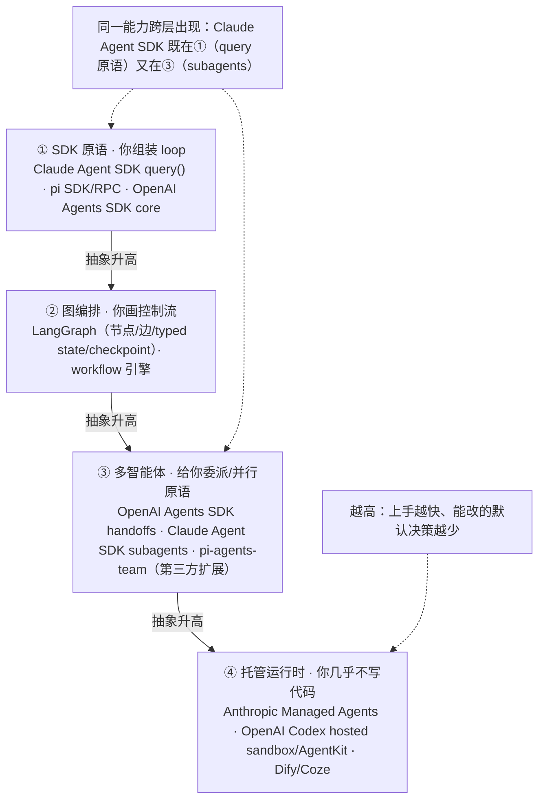
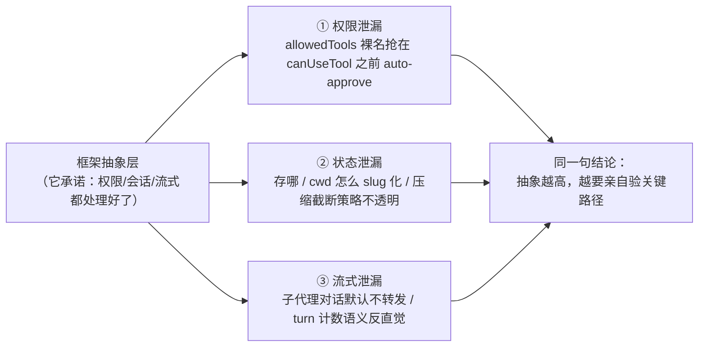
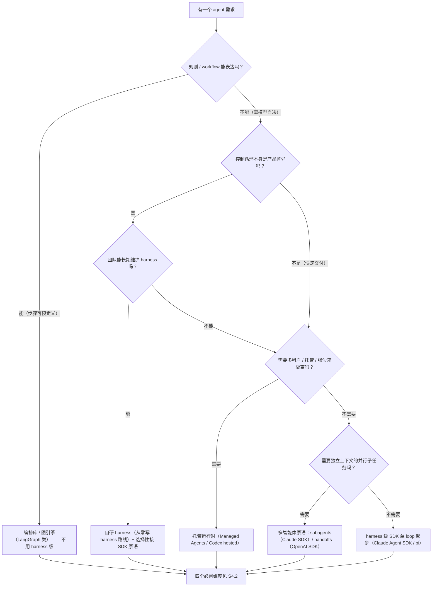
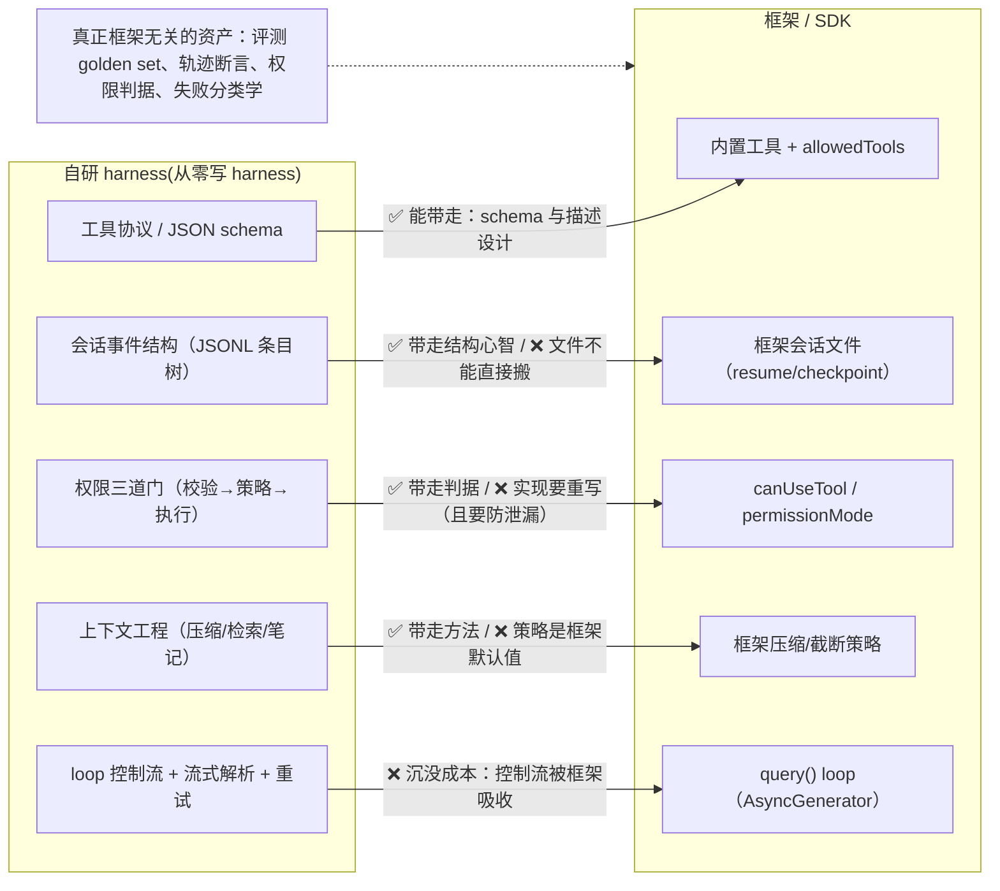

# 框架生态(懂原理不背 API)

> 优先级 P2 · 状态：🔄 讲义已展开（待脱稿复述演练）
> 深度定位：路线图原话"懂原理即可，不背 API"——目标是**选型判断力 + 框架边界感**
> **我的独特资产**：pi 是**日常在用+读过文档+跑过 RPC 模式（pi-agents-team workers）的框架**——多数读者对框架只有 API 级认知

**本课导读**（链接口径：本站点只发布 `site/public/**`，`framework-demo/docs/` 等仓内 demo 子目录不走站点路由，故相关链接一律给 GitHub 绝对 URL）：框架课不是"API 速查"，而是回答三个问题——**它替我做了从零写 harness 的哪几层？它把那几层的决策藏去了哪里？什么时候该把决策权抢回来？** 只要你能用从零写 harness 的语言拆任何框架，读者就判定你"懂原理"；只说得出一串 `import` 和配置项，就是"背 API"。本课全程用真实资产 `framework-demo/`（**三家 SDK 同任务离线 mock 对照** + Claude Agent SDK 四能力）当实证，凡标"已实测"的结论都能指着代码复现（对照口径与命令见 [三家 SDK 五维对照](https://github.com/zo0043/learn-agent-harness/blob/main/framework-demo/docs/sdk-comparison.md)）。

**本课地图**（每节回答一个问题）：

| 节 | 回答的问题 |
|---|---|
| S1 框架三族 | 有哪些物种？坐标系怎么立？ |
| S2 框架版图 | 按抽象层级排，各层给什么、藏什么？ |
| S3 抽象泄漏 | 框架承诺的抽象会在哪三个方向漏？ |
| S4 选型决策树 | 任务形态 + 团队约束下该选什么？ |
| S5 迁移路径 | 自研 ↔ 框架，哪些知识能带走、哪些是沉没成本？ |
| S6 pi 深潜 | 我的差异化：源码级用户故事 |
| S7 实战走查 | 一次完整选型：需求 → 候选 → 断言验 → 发现泄漏 → 结论 |
| S8 常见错误与自查追问 | 陷阱区 |

---

## 预备知识（这课的门槛，只讲「课程外」要会什么）

- **课程依赖（prereqs）**：`agent-harness`（从零写 harness 的底座）——上一课带入「loop / 工具 / 权限 / 会话是四层可拆卸预制件」的拆解语言，本课用它拆任何框架（框架给你什么 = 它替你焊死了哪几层；藏什么 = 那几层的默认决策进了黑盒）。
- **技能门槛**：只需会读 TS 接口签名 + CLI 输出即可。
- **不需要提前会**：Python / 背任何框架 API——三家 SDK 的调用形状 / 权限钩子 / 恢复语义随 `framework-demo` 的 `npm run compare` + `compare:assert` 边跑边建（离线 mock，无 key）。

---

## S1 框架三族（坐标系）

**这一节解决什么问题**：先立坐标系。实战中问"你用过什么框架"时，真正被评估的不是名单长度，而是你**按什么轴给框架分类**。本课的轴只有一条：**它替你拿走了从零写 harness 十节里的哪几层**。按这条轴，市面上的东西分成三族——不是按 star 数、不是按厂商，也不是按"是不是 LLM 原生"。

| 族 | 代表 | 给的是什么 | 藏的是什么 |
|---|---|---|---|
| **Harness 级**（完整 agent 运行时） | pi、Claude Code（及其 SDK 化） | loop+工具+会话+权限+子代理+技能+TUI/RPC——**整个 Harness 架构 §10的现成实现** | 每层的默认选择（loop 形态/压缩策略/恢复规则）——用得不深=知其然 |
| **编排库**（代码里组装 agent） | LangGraph（图/状态/checkpoint）、OpenAI Agents SDK（handoffs/guardrails/sessions）、Claude Agent SDK | 原语：状态机/节点/边、agent 交接、会话持久化 | 抽象层的默认假设（状态怎么序列化、恢复语义）——图模型不是万能的 |
| **平台**（低代码/托管） | Dify/Coze/n8n 等 | 拖拽流程+托管 | 几乎全部（自定义 loop 行为难） |

**怎么读这张表**：三族的差别是**"拿走多少"**，不是"好不好"。Harness 级拿走整个 loop（你几乎不写控制流）；编排库拿走"控制流怎么建模"（你写节点，它管调度与持久化）；平台拿走从部署到运维的一切（你点配置）。拿走越多 = 上手越快，也 = 能改的默认决策越少——这是本课后续所有取舍的总公式。

**三族各自的失败模式**（实战中"你为什么不用 X"就答这些）：

- **用平台做需要自定义 loop 的任务**：coding agent 的核心是"模型自决下一步"，拖拽画不出不可预知的分解；用平台等于把自由度退化成配置项，最后卡在"这个 if 分支平台不支持"。
- **用 harness 级做固定 workflow**：FinHot 那种"6 次调用固定结构"是 workflow 不是 agent loop（S2 详述），套 harness 级框架=买了一个用不到的 loop 自由度，还要跟它的安全默认值（默认 allow 的工具面）反复打架。编排库就够。
- **把编排库当 harness**：LangGraph 给你图、状态、checkpoint，**不给你工具执行、权限门、会话重建**——这些仍然要自己写。很多人以为用了 LangGraph 就"有框架兜底了"，结果权限层还是裸的。

**实战定位句**："框架=**预制件+默认决策**。选框架是选一组你不用重新论证的决策；放弃框架是你发现某个默认决策错了，且你愿意为它付整个自研的成本。"

---

## S2 框架版图：按抽象层级排 + 给什么/藏什么

**这一节解决什么问题**：S1 的三族还太粗。真实选型面对的是"抽象层级"——同一个厂商的 SDK 可能既是最底层的原语，又顺手给了多智能体。把版图按**抽象层级**画出来，你才知道自己站在哪一层、上一层替你决定了什么。

### S2.1 框架版图（按抽象层级）

从低到高四层：**SDK 原语 → 图编排 → 多智能体 → 托管运行时**。抽象越高，你写的越少、能改的默认决策也越少。注意"同一种能力会跨层出现"（Claude Agent SDK 既是最底层 `query()` 原语，又内置 subagents 多智能体），所以这张图是**视角**不是**货架**。



**怎么读这张图**：选型的第一句话不是"用哪个框架"，而是"**我站在哪一层、要爬到哪一层**"。站在①：控制权最大、工作量最大；爬到④：交付最快、几乎不可定制。多数人的错误是**跳层**——任务其实只需要②的图编排，却直接上了③多智能体，白付一层协调成本。

### S2.2 框架给你什么 vs 框架藏什么（核心辨析题）

**给**：正确的默认值（流式解析/重试/会话持久化——从零写 harness 手写的每一层都是框架的"藏"）+ 生态（MCP 支持/工具市场/社区）+ 演进（安全补丁/新模型适配）。
**藏**：从零写 harness 十节的每一层决策都藏在某行框架代码里——**读源码才能把"藏"变"给"**。

`framework-demo` 就是"藏"的活样本：从零写 harness harness-demo 手写的 6 个文件（loop/工具/权限/会话/子代理/端点），SDK 各用一个选项替代，代价是**规则优先级、持久化位置、后台行为都进了 CLI 黑盒**（对照表见 `framework-demo/README.md`）。可背结论：**"选框架=选一组不用重新论证的决策"**——要改某个默认决策，要么找 env/选项撬，要么退回自写 loop。

**"什么时候不用框架"（标准反问，要能答）**：
- 控制循环本身是产品差异（如 FinHot 的 6 次调用固定结构+状态机=workflow 不是 agent loop，编排库够用，harness 级框架反而重）
- 框架的默认恢复/权限语义与你的安全模型冲突（如默认 allow 的工具面 vs 你的默认 deny）
- 依赖锁定（框架 API 漂移/停更）> 自维护成本
- 教学/实战白板场景（从零写 harness 本身就证明了 178 行能覆盖核心层）

### S2.3 各家要点（定位级，2026-10 已核实）

| 框架 | 一句话架构 | 实战要点 |
|---|---|---|
| **pi**（earendil/badlogic 谱系，1.1.0） | 极简核心+扩展系统（extensions/skills/TUI）；会话=JSONL（同 从零写 harness §⑥ 设计）；RPC 模式可当 worker 进程 | **我日常用它+用它跑多 agent（pi-agents-team）**；扩展机制=JS/TS 直接进运行时（skill 加载、工具扩展）——框架即文档 |
| **Claude Agent SDK** | Claude Code 的编程化：把完整 harness 当库用（subagents/hooks/MCP/权限模式/skills/sessions） | **2025-09 由 Claude Code SDK 改名而来**（Python+TypeScript，Apache 2.0）；"Claude Code 的机制=官方参考实现"，SDK=机制的可编程面 |
| **OpenAI Agents SDK** | **Swarm 的官方后继**（官方公告口径 2025 GA，Apache 2.0——**该时点本轮未能取得一手源，标"无法确认"**；registry 实测 2026-10-12 仍为 0.x 线：latest 0.20.0，即 registry 版本号未背书 1.0，见 industry-2026.md 核实台账）：agents+handoffs（交接）+guardrails（输入/输出校验）+sessions（内置记忆）+tracing | handoffs=多 agent 的"函数调用"形态，与 orchestrator-worker 对比着讲（系统设计 §S3）；guardrails=MCP 与供应链安全 Guardrails 的框架版 |
| **LangGraph** | 1.x 系（2025-10 出 1.0 alpha，随后稳定 1.0.x（历史）；~~当前 1.0.1~~ ~~1.4.21~~ **截至 2026-10-13 全新缓存复核：npm registry latest = 1.5.0**（time.modified 2026-10-12T23:19:38.982Z；历史：2026-10-12 独立新缓存 `npm view` 复核 = 1.4.21（time.modified 2026-10-07），命令见 industry-2026.md 核实台账）；唯一 breaking 面=create_react_agent 废弃、迁入 langchain.agents.create_agent）：显式图：节点（函数）+边（条件）+状态（typed schema）+checkpoint 持久化 | 图=把 系统设计 §S3 的 workflow 模式显式化；checkpoint=durable execution 的框架版；"为什么不用图"=自由 agent 任务分解不可预知，画不出图 |
| **AAIF**（Agentic AI Foundation，Linux 基金会旗下）[2026现行] | 中立基金会治理主场：2025.12 Anthropic 将 MCP 捐给 AAIF；**A2A 入 AAIF 是另一件事、时点为 2026-08-27**（a2a-protocol.org 博文，非同期）——两者**不可合并成一句话**（评审 `FAC-F7`）。A2A **TSC 共 8 席**：Google、Microsoft、Cisco、AWS、Salesforce、ServiceNow、SAP、**IBM Research**（AAIF 自身技术委员会另为 8 家） | "MCP 完成事实标准→基金会治理跃迁——应用端唯一有真实规模的互操作标准"；https://modelcontextprotocol.io/specification/versioning + https://a2a-protocol.org/latest/ |
| **MCP Registry**（官方 registry）[2026现行] | 官方 registry 仍在 **preview**（未 GA）：DNS 命名空间 + server.json + REST 发现；Anthropic/GitHub/Microsoft/PulseMCP 背书 | 生态规范化真实但早期；registry≠安全保证（MCP 与供应链安全 §S3/S4 同一原则）；https://modelcontextprotocol.io/registry |
| **computer use / GUI agent** [2026现行] | 升为一等（高重要度候选域信号）：Claude Code 扩到 desktop/mobile/cloud/computer use；OpenAI 设 Computer Use/Context Research 专岗 | 实战要点："GUI agent 不再是边角方向"；追问见 系统设计 §S7（权限与观察）；https://code.claude.com/docs/en/agent-sdk/overview（OpenAI 专岗据 2026-10-11 归档抓取快照 `jd-research/ashby_openai.json`——历史研究数据，非现行招聘页） |
| **OpenAI Codex** [2026现行] | 由 CLI 转向 **agent 基础设施**：hosted/self-hosted sandbox+预热、workspace agents、Secure MCP Tunnel、SandboxAgent（Agents SDK：handoffs/guardrails/100+ 模型）；**AgentKit=低代码入口** | "OpenAI 在把 Codex 做成平台而不是产品"；https://developers.openai.com/codex |

**共同点（比单家更值钱的要点）**：四家都在解同一组问题——会话持久化（JSONL/checkpoint）、子代理边界（上下文隔离）、工具标准化（MCP）、权限/护栏（guardrails/hooks/policy）。**框架生态的收敛=行业问题定义的收敛**——我在从零写 harness 里从零写过这些层，所以能看出四家在做同一件事。

### S2.4 三家 SDK 同任务离线对照（2026-10-12 新增 · 亲手实现，非文档复述）

**入口**：`cd framework-demo && npm run compare`（一条命令跑完三家并打印结构化对照）+ `npm run compare:assert`（16 条断言，不符即非 0 退出）。
**逐维结论表（每格带 `file:line` + 官方文档 URL）**：[`framework-demo/docs/sdk-comparison.md`](https://github.com/zo0043/learn-agent-harness/blob/main/framework-demo/docs/sdk-comparison.md)。
**口径声明（不得省略）**：模型是**本地 mock 端点**（`framework-demo/src/mock-model.ts`，默认 `127.0.0.1:8791`，双格式：Anthropic `/v1/messages` + OpenAI `/v1/chat/completions`，响应=请求的纯函数）——**离线 mock 模型、非真实模型实跑**；无外网、无任何 key。因此本对照证明的是**三家的调用形状（loop 归属/工具声明/权限钩子/中断恢复/可观测钩子）**，不是模型能力。版本：Claude Agent SDK `0.3.296` / OpenAI Agents SDK `0.20.0` / LangGraph `1.4.21`。

五维结论摘要（可直接引用，详表见上）：

| 维度 | Claude Agent SDK | OpenAI Agents SDK | LangGraph |
|---|---|---|---|
| ① loop 归属 | SDK 内置（`query()` 起 CLI 子进程，loop 在 CLI 内） | SDK 内置（`run(agent, input)`） | **你拥有**（StateGraph 节点+边自己连） |
| ② 工具与 schema 声明 | 不声明函数工具，用内置工具市场 + `allowedTools` 过滤 | `tool({name, description, parameters, execute})` 显式声明 | ToolNode + 工具数组（须传完整 ToolCall） |
| ③ 权限与 HITL 钩子 | `canUseTool` 预执行回调（**注意 `allowedTools` 裸名会 shadow 它**；`permissionMode` 必须显式） | 工具级 `needsApproval` → 中断 → 批准后续跑 | 图内 `interrupt()` + checkpointer（**唯一默认就带"挂起"语义的**） |
| ④ 状态与中断恢复 | 落盘 JSONL 会话转录（`$CLAUDE_CONFIG_DIR/projects/<cwd-slug>/`，刷盘时机不可控）+ `resume: session_id` | RunState（可序列化） | checkpointer 线程状态 + `new Command({resume})` |
| ⑤ 可观测钩子 | `AsyncGenerator<SDKMessage>` 事件流 | Agent 实例 EventEmitter（`agent.on(...)`）+ tracing（对照中禁用 exporter 以保持离线） | `streamMode` 流（`updates`/`values`/`messages`） |

**与"定位级/文档级"的差别**：这三段实现都是本仓库可跑代码（`framework-demo/src/sdks/{claude,openai,langgraph}.ts`），断言逐条对应上面的维度；被问"你用过哪几家、区别在哪"时给的是**同任务三实现 + 代码级对照**，不是复述文档。踩坑（`allowedTools` 抢跑、`permissionMode` 缺省 bypass、项目 slug 规则、trace exporter 必须禁用、LangGraph 须传完整 ToolCall）见 `framework-demo/README.md`。

---

## S3 抽象泄漏的三个方向（权限、状态、流式）

**这一节解决什么问题**：框架卖给你的是一组"抽象"——"你只管调 `query()`，权限/会话/流式我们处理"。但 Joel Spolsky 的**抽象泄漏定律**（*The Law of Leaky Abstractions*, 2002）说：**非平凡的抽象总会漏**。框架选型真正会翻车的地方，不是 API 好不好用，而是**某个抽象在关键路径上漏了，而你没有准备**。这一节把泄漏归纳成三个方向，每个方向配 `framework-demo` 的实证。



### 方向一：权限泄漏（最危险，等于你的安全模型被静默绕过）

**漏法**：`framework-demo` 实测——把工具**裸名**放进 `allowedTools`（如 `["Read", "Bash"]`）会**抢在 `canUseTool` 回调之前 auto-approve 整个工具**，回调根本不触发（SDK 会打印 `CLAUDE_SDK_CAN_USE_TOOL_SHADOWED` 警告，见 `framework-demo/README.md` 踩坑 #2）。于是"我加了逐调用权限回调"这个抽象，和"我允许了这个工具"这个抽象，**优先级不透明**——你以为审批在管，其实审批被跳过了。

**代码实证**：`src/capabilities.ts` 的 step3 **故意不把 Bash 放进 `allowedTools`**，就是为了让 Bash 落进 `canUseTool`，才演示得成"每次调用前过权限"（源码注释原话："裸名 auto-approve 会抢在 canUseTool 之前"）。也就是说：**这个 demo 的权限能力能成立，前提是先绕开框架的一个泄漏。**

**为什么致命**：HITL（人工审批）是生产分界线。如果权限抽象在"允许工具"这一路径上静默泄漏，你交付的是一个"看起来有审批、实际有豁免通道"的系统——比没有审批更危险，因为你会据此降低人工复核。

### 方向二：状态泄漏

**漏法**：会话到底存哪、`cwd` 怎么 slug 化、压缩/截断策略是什么，SDK 只露出 `resume` / `resumeSessionAt` 一角。`framework-demo` 实测：会话落在 `~/.claude/projects/<cwd 的 slug>/` 下的 JSONL，`resume` = 从文件重建历史（与 从零写 harness §⑥ 手写 JSONL 同构）——但**文件位置、slug 规则、压缩策略都不在你的代码里**。

**对照组**：pi 的会话是**条目树**、按活动分支重建；LangGraph 的 checkpoint 是**图状态的序列化**。三者都叫"持久化"，恢复语义却不同——这正是 S4 选型的第②层要问的。**状态泄漏的后果**：跨版本升级、迁移机器、审计取证时，你会发现恢复依赖一个你控制不了的框架内部格式。

### 方向三：流式泄漏

**漏法**：`query()` 把 `AsyncGenerator<SDKMessage>` 给你（"流式事件模型全免费"），但**内部语义不透明**。`framework-demo` 两个实测坑：① **子代理对话默认不出主流**，只有 tool_use/tool_result 心跳，要 `forwardSubagentText: true` 才拿到带 `parent_tool_use_id` 的完整嵌套对话——所以"子代理上下文隔离"这个抽象，默认是**不让你看**的；② `maxTurns: 1` 直接 `error_max_turns`——turn 计数包含轮次边界，别按"1 次回答=1 turn"想。

**后果**：想接自己的可观测（OTel/可观测）时会发现，框架给的事件不够、也不保证稳定；"可观测出口"必须在选型第④层单独问。

### 失败模式小结

| 方向 | 典型错误 | 正确做法 |
|---|---|---|
| 权限 | 假设"加了权限回调=每次调用都过审" | **亲自验优先级**：对该工具不放 allowedTools 裸名；把权限判据留在自己可控的执行层；用回归断言锁死 |
| 状态 | 假设"框架持久化=可审计可迁移" | 先读框架的存储格式与恢复语义，再决定是否接受；关键系统自留事件日志 |
| 流式 | 假设"有事件流=可观测" | 选型时问"OTel 出口/原始轨迹导出在哪层"；不够就自建埋点 |

---

## S4 选型决策树（任务形态→团队约束→该用什么）

**这一节解决什么问题**：把 S1-S3 收成一张可执行的决策树。它有两个输入维度：**任务形态**（控制流能不能预定义、要不要长任务/审批/并行）和**团队约束**（能不能长期维护 harness、是否多租户托管、要不要快速上线）。先走任务形态，再叠加团队约束——**顺序不能反**：先看团队会不会维护，容易把"我们没人"当成技术理由，选错层。



**怎么读这棵树**：它逼你先回答"这任务是 workflow 还是 agent"（系统设计 §S3 的分水岭），再回答"这个 loop 是不是我的差异化"。**只有"需要模型自决 + loop 是差异化 + 团队养得起"三条同时成立，才轮到自研 harness。** 任何时候能用 workflow 表达，就往①走——自由度是成本。

### S4.1 选型四层（可背话术）

不管树走到哪个叶子，落选项之前过这四层（**顺序就是优先级**）：

1. **控制循环模型**：自由 loop vs 图 vs 固定 workflow——先匹配任务形态（系统设计 §S3）。
2. **持久化/恢复语义**：durable execution 三机制（journal/checkpoint/幂等）各做了多少？恢复的粒度、位置、可迁移性。
3. **权限/护栏模型**：默认 allow 还是默认 deny？审批粒度是"按工具"还是"按调用"？会不会像 `allowedTools` 那样泄漏（S3 方向一）？
4. **可观测出口**：OTel？原始轨迹导出？事件是否稳定、够用（S3 方向三）？

**API 顺手度最后才看**——前四层错了，API 再好是走错路。原话："选框架我看四层……前四层错了，API 再好是走错路。"

### S4.2 团队约束补充（常被忽略，但常被进一步追问）

| 约束 | 后果 | 选型动作 |
|---|---|---|
| 升级破坏性 | 框架大版本改 API/行为（如 LangGraph 1.0 把 `create_react_agent` 迁走） | pin 版本 + 升级前跑回归断言（framework-demo 的断言矩阵就是模板） |
| 锁定成本 | 状态格式/权限语义进框架黑盒，迁移要重写 | 关键状态自留事件日志（S5）；选状态/权限语义透明的实现 |
| 维护人力 | harness 假设会随模型升级腐烂（industry-2026 §一.3） | 没人维护就别自研；有人维护也要为"尚不存在的模型"写稳定接口 |
| 生态/标准 | MCP 支持、工具市场、社区 | 只把 MCP 当"工具接入面"，权限边界仍在自己执行层（MCP 与供应链安全） |

---

## S5 迁移路径（自研 harness ↔ 框架：哪些能带走、哪些是沉没成本）

**这一节解决什么问题**：最常爱追的"你换过框架吗"，考的其实是**你知不知道哪些资产是框架无关的**。迁移决策做错，最常见的原因是"把实现当资产"——手写的 loop 代码是沉没成本，手写的**判据与评测**才是能带走的东西。



**能带走的三类**：① **接口设计知识**（工具 schema/描述=ACI，从零写 harness §③）；② **权限判据**（默认 deny、风险分级、审批粒度——实现要按框架重写，但要防 S3 方向一的泄漏）；③ **评测与可观测资产**（golden set、轨迹断言、失败分类学）——**这些永远框架无关，且是选型/迁移时唯一能判断"换完到底是好是坏"的尺子**。

**沉没成本**：自研 loop 的控制流、手写流式 SSE 拼接、手写重试/退避。`framework-demo` 的对照表显示，这些正是 SDK 一个 `query()` 就吸收掉的层——迁移时**不心疼**，心疼的是没把这些层的**判据**沉淀成评测。

**迁移最小动作清单**（可背）：① 冻结当前系统的 golden set + 轨迹断言；② 在新框架上重跑，指标对不齐别迁；③ 关键状态自留事件日志，避免被框架格式锁死；④ pin 框架版本，升级前跑断言回归。

---

## S6 pi 深潜（我的差异化章节：源码级用户故事）

别人讲框架："我用过 LangGraph 做了个 demo。"
我讲框架："**pi 是我每天干活的主力 harness**，我能讲到实现层：
- 会话=JSONL 事件日志，上下文由日志确定性重建（=从零写 harness §⑥ 的设计，harness-demo 是我按它复现的）
- 扩展系统：TS 扩展直接进运行时（quiz/md-log 扩展是我装过的）；skill=按需加载的指令包
- **RPC 模式**：pi-agents-team 的 worker 就是 `pi --mode rpc` 子进程——我跑过 orchestrator+7 类 profile 的多 agent 编排（路径范围/final_answer 契约/relay 问答）
- Magic Context：压缩/归档/检索的上下文工程实装（Harness 架构 §5的活教材，长期记忆系统的活教材）"

**失败模式**：把 pi 当成"一个 CLI"讲——读者关注不出你和普通用户的差别。正确的讲法是**每句话都落到从零写 harness 的某一层**：JSONL=会话层、扩展=定制资源层、RPC=宿主接口层、Magic Context=上下文工程层。

**这个故事的实战价值**：把"框架使用者"升级成"harness 机制的活样本"——每个框架话题都能落回自己的日常实操。.pi-agents-team 里 orchestrator+workers 的路径范围、`<final_answer>` 摘要、relay 问答，正好对应 系统设计 §S3 的 orchestrator-workers 与 Harness 架构 §8 的上下文隔离（多智能体编排 §S6 框架对照可交叉引用）。

**边界声明（要主动说）**：pi-agents-team 是**第三方扩展机制**，不是 pi 核心默认；pi核心默认不提供 sub-agent（Harness 架构 §8.3）。

---

## S7 实战走查：一次框架选型走查

> 这一节把 S1-S5 串成一次完整选型。目标不是再讲知识点，而是练**顺序**：先问该不该用框架 → 列候选 → 用断言矩阵逐项验 → 抓抽象泄漏 → 给结论与迁移成本。数字与断言都是 `framework-demo`（2026-10-11 本机实测）的真实产出。

**给定需求**："要做一个能跑 30 分钟、需要人工审批、有子任务并行的 coding agent。"

### 步骤 0 · 先问"该不该用框架"

三个问题，缺一不可：
1. **规则式方案/固定 workflow 能表达吗？** 不能——coding agent 的下一步不可预知（系统设计 §S3），必须有自由 loop。
2. **控制循环本身是产品差异吗？** 不是——目标是交付一个能跑的 agent，loop 形态可复用现成实现。
3. **团队养得起自研 harness 吗？** 短期养不起，走框架起步。

→ 结论：**进入 harness 级框架**（自研留作后续演进）。若第 2 问答"是"，就直接跳到 S5 迁移路径评估。

### 步骤 1 · 列出 3 个候选

| 候选 | 层级 | 为什么进候选 | 本地证据 |
|---|---|---|---|
| **A. Claude Agent SDK** | ①原语 + ③多智能体 | 目标岗"参考实现"（Claude Code harness 的产品化），且本仓库有实测 | `framework-demo/src/sdks/claude.ts`（离线 mock 跑通） |
| **B. LangGraph（latest 截至 2026-10-13 复核 = 1.5.0；2026-10-12 当时现行 1.4.x 已再升一版）** | ②图编排 | 30 分钟长任务需要显式状态 + checkpoint；HITL 在图内可控 | `framework-demo/src/sdks/langgraph.ts`（离线 mock 跑通，**不再是文档级**） |
| **C. OpenAI Agents SDK** | ①原语 + ③多智能体 | 若团队走 Codex 系，sessions/tracing 开箱 | `framework-demo/src/sdks/openai.ts`（离线 mock 跑通，**不再是文档级**） |

### 步骤 2 · 用 `framework-demo` 的断言矩阵逐项验

需求拆成四条可验证能力，逐一对照本地实测断言（`src/capabilities.ts`；`npm run demo` 退出码 0）：

| 需求 | 必须证明的能力 | 实测断言（真实输出） |
|---|---|---|
| 自由 loop | 模型真的调工具、结果进上下文 | ① `agent 真的调用了 Read 工具`；`最终回答包含文件标题`（turns=2） |
| 子任务并行 | 有子代理委派 + 上下文隔离 | ② `subagent 委派发生`（Task tool_use）；`子代理消息带 parent_tool_use_id`（1 条） |
| 人工审批 | 每次调用前能拦截、拒绝是合法结果 | ③ `deny 拦截真的发生了`（命中 1 次 `rm -rf`）；`被拦截后 agent 没有崩`；`最终回答说明处理方式`（deny 回写上下文） |
| 30 分钟恢复 | 会话可 resume、历史可重建 | ④ `第一次产出 session_id`；`resume 后同一 session_id`；`回答带出代号 Nebula-7` |

**断言口径**：A 家的能力断言 = 代码里 10 条 `ok()`（①2 / ②2 / ③3 / ④3，行号 13/14/37/38/62/63/64/73/75/76）+ demo 末行 1 条**整体判定**（"4 个能力全部 ✅"、退出码 0/1）——前 10 条是断言，末 1 条是汇总判定，**不合成「11 条断言」**（U-24 口径统一，2026-10-12）。B/C 两家此前标"文档级待验"，现已由 `framework-demo/src/sdks/` 的**离线 mock 实测**补齐（命令 `npm run compare` / `npm run compare:assert`，逐维结论见 `framework-demo/docs/sdk-comparison.md`）。

### 步骤 3 · 发现抽象泄漏（关键一步）

需求含"人工审批"，对应 S3 方向一。**如果不小心把 `Bash` 放进 `allowedTools`**，`allowedTools` 裸名会抢在 `canUseTool` 之前 **auto-approve 整个 Bash**，审批回调根本不触发（`CLAUDE_SDK_CAN_USE_TOOL_SHADOWED` 警告）——于是 `rm -rf` 会和 `df -h` 一起被放行，HITL 名存实亡。demo 的 step3 之所以能拦到 `rm`，正是因为它**故意不把 Bash 放进 allowedTools**（源码注释即证据）。

```ts
// framework-demo/src/capabilities.ts —— step3_permissions()：权限钩子的正反两面（可跑）
// 反面（注释即证据）：allowedTools 裸名会抢在 canUseTool 之前 auto-approve——
//   若把 Bash 放进 allowedTools，canUseTool 回调根本不触发，rm -rf 与 df -h 一起被放行
// 正面：故意**不**把 Bash 放进 allowedTools，让 Bash 落入 canUseTool，才能演示「每次调用前过权限回调」
canUseTool: async (toolName, input) => {
  if (toolName === "Bash" && /(^|;|&&|\|)\s*rm\b/.test(String(input.command ?? "")))
    return { behavior: "deny", message: "安全策略禁止 rm 类命令（这条 deny 来自 canUseTool 回调）" };
  return { behavior: "allow" };
},
// 断言（有牙）：deny 真的发生 + 被拦后 agent 没崩 + deny 消息回进上下文
ok(denied.length >= 1, "deny 拦截真的发生了（canUseTool 返回 deny）", `命中 ${denied.length} 次`);
ok(!r.isError, "被拦截后 agent 没有崩，正常跑完（is_error=false）", `turns=${r.numTurns}`);
ok(/拒绝|被拒|不许|禁止|不能|无法|政策|策略|denied/i.test(r.finalText), "最终回答里说明了被拒操作的处理方式（deny 消息回进了上下文）");
```

**这段在讲什么**：抽象泄漏最危险的一档 = **权限**。框架给你 `allowedTools`（按名字白名单）和 `canUseTool`（逐调用回调）两个钩子，但两者的优先级是反直觉的——`allowedTools` 裸名一旦命中，会**抢在 `canUseTool` 之前 auto-approve**，你的审批回调静默失效。所以正确写法是「白名单只管该放行的，把需要人工审批的工具**留在名单外**让它走回调」。这条是 S4.1 第 3 问（权限/护栏模型）的实操判据，也是 S8.1「把框架当能力」的反面——**框架给你的是钩子，不是替你做了安全决策**。

→ 选型动作：**把"逐调用审批"当作自己执行层的职责，不依赖框架的 allowedTools 优先级**；对该工具只用 `canUseTool`/`disallowedTools`/`permissionMode`（具体组合待验），并用回归断言锁死"审批必触发"。

### 步骤 4 · 选型结论与迁移成本估算

**结论**：以 **A（Claude Agent SDK）** 起步——它在本仓库有最完整的本地断言（10 条 `ok()` + 1 条整体判定），loop/session/subagent/审批钩子齐全；但**权限语义要自持**（防泄漏）、**可观测要自建出口**。B（LangGraph）留作"控制流稳定成图之后"的迁移目标，C（OpenAI Agents SDK）仅当团队走 Codex 系时替换——**两家的定位现在都有本地代码背书**（不再是纯文档级），逐维差异见 `framework-demo/docs/sdk-comparison.md`。

**迁移成本估算**（教学走查值，非既成事实，仅用于练"怎么估"）：

| 项目 | 判定 | 粗估 |
|---|---|---|
| 工具 schema/描述、权限判据、评测 golden set | 能带走 | 适配 1-2 人日 |
| 权限门重写（防 allowedTools 泄漏）+ OTel 出口 + 子代理预算策略 | 要新写 | 3-5 人日 |
| 自研 loop 控制流 + 流式解析 + 重试（harness-demo ~600 行） | 沉没成本 | 不迁移 |
| 升级回归（每次 SDK 升级跑 A 家 10 条断言 + 三家对照 + eval） | 持续成本 | 每次 0.5 人日 |

**走查一句话收口**："选 A 是因为它的能力面被本地断言验过；我知道它会在权限优先级上泄漏，所以审批由我的执行层兜底——这就是'懂原理不背 API'。"

---

## S8 常见错误与自查要点
这一节是陷阱区，每条配一个读者可能的追问。

### S8.1 把框架当能力

**错误**：以为"用了 Claude Agent SDK / LangGraph"就等于拥有了能力。
**现象**：拿框架名当卖点，讲不出它替你做了从零写 harness 的哪几层、藏了什么默认决策。
**对策**：用 S1/S2 的语言拆解——框架=预制件+默认决策；每个能力指到具体层。
**自查追问**："用框架和自研，你团队的能力差别在哪？"——答：框架省的是**实现**，不省**判断**；判断（权限判据/评测/失败分类）仍然要自己建。

### S8.2 只看 star 数不看抽象边界

**错误**：按 GitHub star 或热度选框架。
**现象**：选了一个 star 高但权限/状态语义与安全模型冲突的框架，上线后才发现默认 allow。
**对策**：用 S4 四层（循环/持久化/权限/可观测）逐项打分；star 只是生态信号，不是边界保证。
**自查追问**："你选框架的第一标准是什么？"——答：**抽象边界与我的安全/恢复模型的匹配度**，API 顺手度最后看。

### S8.3 把"支持多智能体"当优点

**错误**：因为框架"支持多智能体"就选它，甚至一上来就多 agent。
**现象**：为几个百分点烧掉 ~15× token（多智能体编排 §S1）；协调与调试成本陡增。
**对策**：多智能体买的是**上下文隔离 + 并行**，不是"更聪明"；先证明单 agent + 检索打不满需求（系统设计 §S3 / 多智能体编排 §S1）。
**自查追问**："框架内置 subagents，是不是就该用？"——答：内置只是**更容易**，不是**更该用**；值不值取决于任务可拆分性与预算。

### S8.4 忽略框架的升级破坏性

**错误**：不 pin 版本、不跑升级回归。
**现象**：框架大版本改 API/行为（LangGraph 1.0 迁 `create_react_agent`），或模型升级后 harness 里为旧模型打的补丁变成死重（industry-2026 §一.3）。
**对策**：pin 版本 + 冻结 golden set/轨迹断言；升级前先回归（S5 迁移清单④）。
**自查追问**："框架升级把你功能搞挂了，怎么办？"——答：先跑断言回归定位；关键状态自留事件日志避免格式锁死；必要时用适配层隔离。

### S8.5 用框架重写一遍自己的 harness

**错误**：迁移时把自研 harness 的每个内部结构照搬进框架，硬凑"架构一致"。
**现象**：把框架当"换皮的自研"，既没省实现，又和框架默认值反复打架。
**对策**：迁移只带走**框架无关资产**（评测/判据/接口设计），实现层接受框架默认；不该带走的（loop 控制流）就让它成为沉没成本（S5）。
**自查追问**："换框架时你会重写多少？"——答：重写实现、保留判据；以 golden set 对齐决定是否迁移。

### S8.6 把可观测性交给框架

**错误**：以为"框架有 tracing/事件流"就等于可观测闭环。
**现象**：S3 方向三——子代理对话默认不转发、事件语义不透明；结果定位不了失败归因。
**对策**：选型第④层单问"OTel/原始轨迹导出在哪层"；不够就在自己执行层埋点（可观测），并像 `framework-demo` 一样做**确定性断言**当验收。
**自查追问**："框架自带 tracing 够用吗？"——答：够不够取决于你要的失败归因粒度；能重放事件日志 + 逐轨迹 eval 才是闭环（industry-2026 §四.6）。

---

## 来源与锚点（2026-10 核实回填）

- 各家现状：Claude Agent SDK（2025-09 改名，Python+TS）/ OpenAI Agents SDK（Swarm 后继；**"2025 GA"为官方公告口径、本轮未能取得一手源 → 标"无法确认"**，registry 2026-10-12 实测仍 0.x 线：0.20.0）已核实（Anthropic/OpenAI 官方博客+仓库）；LangGraph 1.0 已核实（2025-10 alpha → 稳定 1.0.x，GitHub releases + langchain 官方博客；2026-10-11 复核）；**2026-10-12 registry 复核：`@langchain/langgraph` latest = 1.4.21（time.modified 2026-10-07，独立新缓存 `npm view`），原「当前 1.0.1」为过期口径——已就地更正（S2.3 表）；2026-10-13 全新缓存复核：latest = 1.5.0（time.modified 2026-10-12T23:19:38.982Z，`npm view @langchain/langgraph version time.modified --cache $(mktemp -d)`），1.4.21→1.5.0 为版本演变、非口径错误——逐条命令与来源见 `notes/industry-2026.md` §已知缺口/待复核 的核实台账**——S2.3 已回填
- 我的锚点：pi 1.1.0 日常（#38/#39 环境实践）、pi-agents-team 多 agent（orchestrator/worker/RPC，本会话正在用）、从零写 harness（"框架藏什么"的实证）
- 实操已落地：`framework-demo/`——① Claude Agent SDK 四能力（agent/subagent/权限/会话，指向本地双格式代理）：`npm run demo` 退出码 0，**10 条 `ok()` 断言 + 1 条整体判定**（SDK 版本 `@anthropic-ai/claude-agent-sdk@0.3.296`；历史表述「11/11」即此 10+1 口径，**已按 U-24 统一，不再合成 11 条断言**）；② **三家 SDK 同任务离线 mock 对照**（Claude Agent SDK 0.3.296 / OpenAI Agents SDK 0.20.0 / LangGraph 1.4.21，**对照实跑快照=2026-10-12；截至 2026-10-13 复核 registry latest 已升 1.5.0**）：`npm run compare` 一条命令结构化对照、`npm run compare:assert` 16 条断言退出码 0；逐维结论（loop 归属 / 工具与 schema / 权限与 HITL / 状态与中断恢复 / 可观测钩子，每格带 `file:line` + 官方 URL）见 [`framework-demo/docs/sdk-comparison.md`](https://github.com/zo0043/learn-agent-harness/blob/main/framework-demo/docs/sdk-comparison.md)。**离线 mock 模型、非真实模型实跑**（本地 `127.0.0.1:8791`，无外网无 key）——这是本轮补的实操证据，B/C 两家因此从"定位级/文档级"升为"有亲手实现与对照"。
- 对照 harness-demo 的踩坑实证见 framework-demo/README.md（2026-10-11：allowedTools 裸名会抢在 canUseTool 之前、子代理对话默认不出主流、maxTurns 语义反直觉）
- 抽象泄漏定律：Joel Spolsky, *The Law of Leaky Abstractions*（2002）——S3 的理论锚点
- 2026 行业上下文：Anthropic Managed Agents / token 经济学（agent ≈4×、多智能体 ≈15×）见 industry-2026.md §一；框架收敛=行业问题定义收敛（多智能体 S6 同源）
- 接回：系统设计(形态选型)、durable execution(checkpoint)、可观测(可观测出口)、MCP 与供应链安全(MCP 支持面)、长期记忆(Magic Context)、多智能体编排(多智能体原语三条路)

<!-- ✅ 已核实（2026-10-12，t3 离线 mock 实测）：LangGraph 的 HITL = 图内 `interrupt()` + checkpointer，恢复用 `new Command({ resume })`——实现与断言见 framework-demo/src/sdks/langgraph.ts，不再只作定位级引用 -->
<!-- ✅ 已核实（2026-10-12，t3 离线 mock 实测）：OpenAI Agents SDK 有工具级人工审批原语（`needsApproval` → run 返回 interruption → 批准后续跑）——实现与断言见 framework-demo/src/sdks/openai.ts -->
<!-- TODO 核实: 托管运行时（Anthropic Managed Agents / OpenAI Codex hosted）的公开定价与限额——本课只讲定位，不引数字 -->
