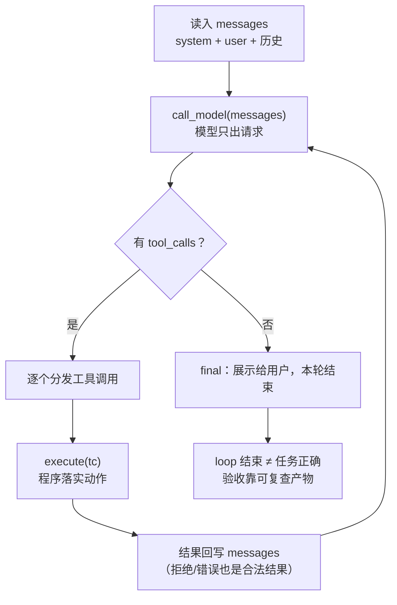
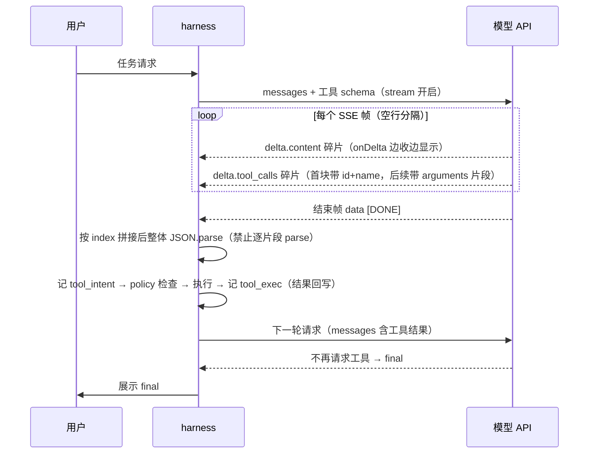
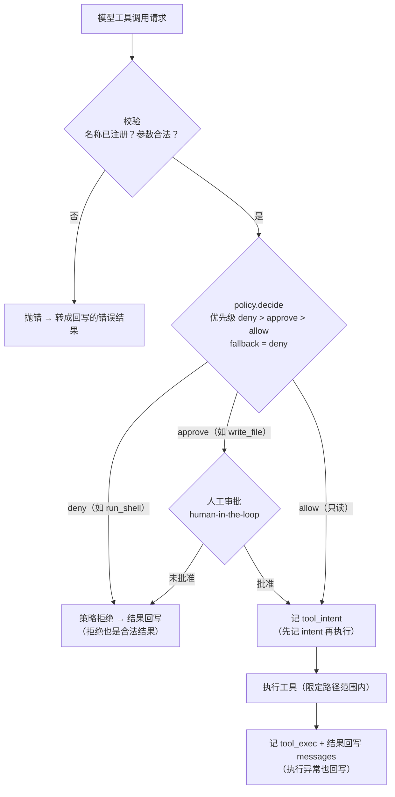
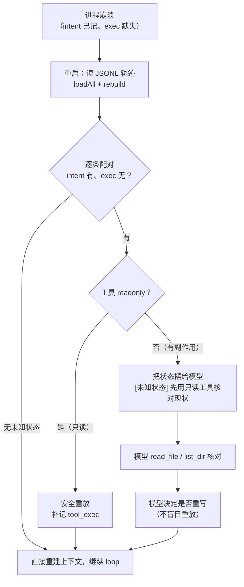

# 从零写 harness(最小 Agent Harness 完整教程)

> 课程日志 · 2026-10-10 开课 · 从零写 harness（面试导向：coding agent 方向）
> 目标：把"会讲架构"变成"能写出来"——手写一个可运行的最小 harness + 20 分钟白板版
> 探测结论：TS+Python 双版本；流式从零讲
> 作品位置：`harness-demo/`（TS 可运行版）+ `whiteboard/agent_whiteboard.py`（~150 行纯标准库）

---

## 探测与计划

| # | 问题 | 回答 |
|---|------|------|
| 1 | 作品语言 | TS（主，可运行）+ Python（白板版） |
| 2 | 流式熟悉度 | 没处理过 → ④ 节从零讲 SSE |

依赖图：① one-shot → ② loop → ③ 工具协议 → ④ SSE 流式 → ⑤ 权限门 → ⑥ 会话持久化 → ⑦ 恢复/未知状态 → ⑧ 预算/压缩 → ⑨ 轨迹/演示 → ⑩ 白板蒸馏。每节 = naive 版的一个坏法长出一层。

模型选择侦察（2026-10-10 实测某 OpenAI 兼容代理）：`step-5-preview` 不支持 tool calling（直接回"无法调用工具"）；`qwen3.8-flash` 支持（tools + SSE 均验证）→ demo 用 qwen3.8-flash。**面试点：模型能力参差，harness 必须能降级。**

---

## ① One-shot：15 行还不够

```ts
const res = await chat({ messages: [{role:"user", content:"读 README 并总结"}] });
```

一次调用、一个答案。问题：模型说"我需要读文件"，然后呢？**模型不能行动**（地基），必须有个循环接住它的请求。

## ② Loop：while 在模型外面

```python
while True:
    r = call_model(messages)
    messages.append(r)
    if not r.tool_calls: break        # 不再请求工具 = 本轮结束
    for tc in r.tool_calls:
        messages.append(execute(tc))   # 结果必须回写
```

三处要害：`call_model`（模型只出请求）、`execute`（程序落实动作）、`append`（把刚发生的事交给下一次调用）。**loop 正常结束 ≠ 任务正确**（Harness 架构 §9）。

主循环流程：



## ③ 工具协议：注册表 + 校验 + 执行（`src/tools.ts`）

```ts
export interface ToolSpec {
  name: string;
  description: string;                          // 模型读的 API 文档（ACI）
  parameters: Record<string, unknown>;          // JSON Schema
  readonly?: boolean;                           // ⑦ 恢复时判断能否安全重放
  execute(args: Record<string, unknown>): Promise<string>;
}

export function validateArgs(schema, args): string[] {
  // 面试手写三层：required / type / enum（生产用 zod/ajv）
}

function scoped(p: string): string {            // 路径范围 = 沙箱的执行层实现
  const abs = resolve(WORKSPACE_ROOT, p);
  if (abs !== WORKSPACE_ROOT && !abs.startsWith(WORKSPACE_ROOT + "/"))
    throw new ToolError(`路径越出 workspace：${p}`);
  return abs;
}
```

**任何失败（校验错/越界/执行异常）都抛错 → agent 层转成回写的错误结果。** 实测：模型调用未注册工具 `city` → "未知工具: city" 回写 → 模型自己改调 `get_weather`。**拒绝/错误也是合法结果。**

## ④ SSE 流式（`src/llm.ts`）

```
data: {"choices":[{"delta":{"content":"北京"}}]}
data: {"choices":[{"delta":{"tool_calls":[{"index":0,"id":"call_1","function":{"name":"get_"}}]}}]}
data: {"choices":[{"delta":{"tool_calls":[{"index":0,"function":{"arguments":"{\"cit"}}]}}]}
data: [DONE]
```

三件必须处理的事（面试口述版）：
1. 帧以 `\n\n` 分隔，每行 `data: {json}`，结束帧 `data: [DONE]`
2. content 碎片边收边拼（`onDelta` 回调实时显示）
3. **tool_calls 也是碎片**：首块带 id+name，后续块带 arguments 的**不完整 JSON 片段**——按 index 拼接、流结束后整体 `JSON.parse`（绝不能对单片段 parse）

流式全过程（client → server → model，含轨迹事件）：



## ⑤ 权限门（`src/policy.ts`）

```ts
decide(tool) → 优先级 deny > approve > allow；fallback = "deny"
```

**默认 deny**（没写规则的工具一律不放行——安全默认，面试点）。检查发生在**执行路径上**，不在提示词里（Harness 架构 §7）。demo 策略：`run_shell`→deny、`write_file`→approve（human-in-the-loop）、只读→allow。

权限门判定流程（对照 `src/policy.ts`）：



## ⑥ 会话持久化（`src/session.ts`）

```ts
append(ev)  // 同步 appendFileSync：kill -9 时已写的行不丢
// JSONL 一行一条：init / model_response / tool_intent / tool_exec / compaction / final
```

**日志是唯一事实源，上下文由日志确定性派生**（可重复 rebuild）。日志 ≠ 上下文（Harness 架构 §5）。

## ⑦ 恢复与未知状态（`src/agent.ts` 的 guarded_tool_step）

```
记 tool_intent → 执行 → 记 tool_exec
```

崩溃点落在两步之间 = **intent 在、exec 不在 = 结果未知**。恢复策略（不盲目重放）：
- **只读工具**（`readonly: true`）→ 安全重放
- **非只读** → 把状态摆给模型：`[未知状态] 执行结果未知，先用只读工具核对现状再决定` → **模型自己用 read_file 核对**

崩溃恢复流程：



**实测输出（真实崩溃 + 真实恢复）**：
```
[崩溃演示] 模拟进程崩溃（日志里有 intent，没有 result）   ← 第一次运行 exit 137
[恢复] 从日志重建 7 条消息，未知状态工具调用 1 个         ← 第二次运行
  [工具] read_file 错误：执行异常: ENOENT: ... out/summary.md   ← 模型先核对（文件不存在）
  [策略] write_file → 已批准（demo 自动批准）                 ← 核对完才重写
  [工具] write_file ok
✅ 已完成第 1/2/3/5 项；第 4 项 run_shell 被策略拒绝
```

**FinHot 幽灵事故映射**：那次是"动作合理但范围失控"（缺 scope）；这里是"结果未知时不盲目重放"（缺 recovery）——权限层与恢复层是两道独立的门。

## ⑧ 预算与压缩（`src/context.ts`）

```ts
estimateTokens = JSON长度 / 3.5   // 预算检查用估算；精确计数只为计费
compactIfNeeded: 保 head(system+首user) + 尾 keepTail 条，中间 LLM 摘要替换
```

mock 模型验证（`src/test-compact.ts`，本地 HTTP mock——**面试点：mock provider 后每个控制层都能独立验证**）：`压缩前 tokens≈2423 → 摘要 4 条 → 压缩后 5 条，tokens≈871` ✅。日志永远保留全量，压缩只改"送模型的视图"。

## ⑨ 完整 demo（`src/demo.ts`，真实模型 qwen3.8-flash）

任务：查北京天气 → 列 docs → 读 README → 写 out/summary.md（需审批）→ 试 run_shell（会被拒）→ 总结。

**四种运行模式全部实测通过**：

| 模式 | 命令 | 验证的机制 | 结果 |
|---|---|---|---|
| 正常 | `npm run demo -- --fresh` | loop/工具/策略/流式 | ✅ 5 步全过，run_shell 被拒后模型继续 |
| 崩溃恢复 | `demo:crash` → `npm run demo` | ⑥⑦ intent/exec/未知状态 | ✅ 恢复后模型先 read 核对再重写 |
| 审批拒绝 | `demo:reject` | ⑤ approve 路径 + 拒绝也是结果 | ✅ 跳过写入、不重试、如实报告（out/ 空） |
| 压缩 | `demo:compact` | ⑧ 预算/摘要 | ✅ mock 验证（代理故障期） |

**代理不稳定实录（真实可靠性故事）**：19:25-19:33 全部正常，19:33 起该代理持续 400（`"functions parameter of the code model must be provided"`——代理把请求路由到了要求旧版 functions 格式的 code 模型后端）；期间还出现工具名带不可见字符（`unknown tool: get_weather` 假错）→ 加了一行防御 `tc.name.trim()`。**面试点：provider 也是不可靠组件；重试/降级/防御性解析属于 API 层职责。**

## ⑩ 白板蒸馏（`whiteboard/agent_whiteboard.py`，~150 行纯标准库）

与 TS 版 1:1：`llm()` 一次调用 → `TOOLS` 注册表+校验 → `check()` 权限门（deny>approve>allow 默认 deny）→ `log_append`/`rebuild` 会话恢复（未知状态=只读重放/非只读摆状态）→ `est_tokens` 预算。白板讲解 60 秒骨架：

> "模型是无状态函数，只能出请求不能行动。所以我写一个 while 循环：调模型 → 有工具请求就过三道门（校验/权限/执行）并把结果回写 → 没有就结束。三个关键设计：**先记 intent 再执行**（崩溃后能区分'没执行'和'执行了没记录'）；**默认 deny**（没规则的工具不放行）；**结果永远回写**（拒绝也是结果，模型才能调整）。"

---

## 练习题库（后续提问用）

| # | 题目 | 考察 |
|---|---|---|
| 1 | 为什么 tool_calls 流式解析要"拼接后整体 parse"而不能逐片段 parse？ | ④ |
| 2 | intent/exec 之间崩溃，工具是"转账"（非只读、非幂等）。恢复时该怎么办？如果工具是"查余额"呢？ | ⑦ |
| 3 | policy 默认 allow 会怎样？举一个"默认 allow + 模型被注入"的事故链 | ⑤ |
| 4 | 压缩后模型忘了最初目标的约束（"不许改生产目录"），会发生什么？压缩策略怎么改？ | ⑧ |
| 5 | 日志里有 3 条 tool_intent 都没有 exec，其中 2 个是只读工具。恢复流程具体怎么走？ | ⑥⑦ |
| 6 | 为什么"loop 正常结束"不能当验收？你 demo 里的 final 消息证明了什么、没证明什么？ | ⑨（Harness 架构） |
| 7 | 模型连续 3 次调用同一被拒工具，harness 该在哪一层拦？ | ⑤ |
| 8 | 白板 20 分钟版你会砍掉哪三样、保留哪三样？为什么？ | 综合 |

## 来源

- 实测环境：某 OpenAI 兼容代理（qwen3.8-flash 支持 tools+SSE；step-5-preview 不支持 tools）
- 接回 Harness 架构：③=第三节工具协议、⑤=第七节权限、⑥⑦=第五六节会话与恢复、⑧=第五节上下文工程、⑨=第九节验证
- FinHot 生产事故（幽灵事故=scope 缺失；本 demo 崩溃恢复=recovery 缺失）是同一个主题的两半
