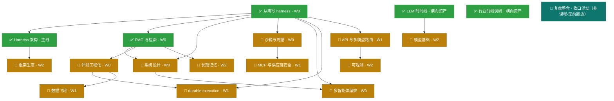

## 知识点总地图(实战导向:coding agent)

> 建立：2026-10-11 · 依据：handoff.md 路线图（2026-10-10）+ 仓库最新实况（10-11）
> 用途:全部知识点的一次性盘点——每课的知识结构在各自课程文件里,本文件是**索引 + 状态 + 依赖**。
> 命名(2026-10-11 起):课程一律以**知识域名**引用,弃用 A–N 字母代号与课程顺序编号(历史文档已批量改齐)。
> 状态记号：✅ 完成 / 🔄 讲义已展开（待脱稿复述演练）/ ⏳ 规划中（旧记号 📐 与「进行中」已于 2026-10-19 并入前两档，全仓不再单独使用）
>
> **四次整理（2026-10-11，系统时钟）：🔶1-5 五个缺口项全部写入**——系统设计 `system-design.md` S8 范式速查 / 评测工程化 `evaluation.md` S8 指标四代+奖励模型意识（judge 偏差三篇一手文献已核实）/ MCP 与供应链安全 `mcp.md` S4 升级为 Agent 安全全景（OWASP LLM Top 10 **2026 版**（2026-08-04 发布）+ Agentic Top 10（2026）全文核实）/ 模型基础 `model-basics.md` S7 八股速查表 16 题 ；LangGraph 1.0.x 已核实；各课题库同步补题。**注意：本条提到的 `interview-bank.md` 与各课「练习题库」已于 2026-10-19 移除、`interview-bank.md` 已删除**（现行站点不含题目，见下方「题目」条），此处保留只为记录当时做了什么。
> ✅ 日期口径（2026-10-11 确认）：前两轮记录误标 "10-17"（未来日期），已按机器时钟 + 文件 mtime 证据归一到系统时钟 2026-10-11，共 11 文件 27 行 28 处修正（handoff/notes/代码注释）；文中残留的 "10-17" 均为引用原始错误写法的元记录引文。
>
> **计数口径（2026-10-12 冻结，全仓唯一参照，其余位置只引用本块、不另起数）**：
> · **知识域 15** = 课程总表 14 编号课 + Harness 架构主线 `agent-harness.md`；`llm-timeline` / `industry-2026` / `details/` 为横向资产，不计入门数（2026-10-19 去面试化：`interview-bank` 已整体删除）。
> · **课程页 17** = 站点 `/c/<slug>/` 实生成路由数（notes 顶层 18 − knowledge-map）。**18 = 17 个课程页 + `knowledge-map.md`**（17 个 `/c/` 页含 2 个横向资产路由：`llm-timeline` / `industry-2026`）（2026-10-19 去面试化前为 19，少的那份是已删除的 `interview-bank.md`）；20 份设计/过程文档（15 capstone 设计 + 3 MVP 规格 + 2 施工规范）在 `notes/process/`，被 `site/src/content/config.ts` 的 `pattern:'*.md'` 挡在 courses 集合外，故不计入 19（2026-10-14 结构重组：迁移前顶层为 39，算式左端与实数不符，现首次自洽）。取证：`ls notes/*.md \| wc -l` → **18**（2026-10-19 实测）；`ls notes/process/*.md \| wc -l` → 20。
> · **顶层数的溯源（2026-10-14 git 考古，可独立复现；下列「19」为**当时**的值，2026-10-19 去面试化后为 18）**：**19 是当时的正确状态，不是那一轮新造的数字**。① 2026-10-11 ~ 10-13 长期稳定：`5a04da0` 顶层 = **19**、`EXCLUDED_FROM_COURSE_ROUTE` = **2**；② **`cc1b906`（2026-10-14 11:08:58，提交信息「refactor: 五阶段课程体系 + 增量主线 my-agent(M0-M4) + 生成层毕业项目」）单次提交把恰好 20 份过程文档加入 notes/ 顶层 → 顶层 39、`EXCLUDED` 被迫从 2 膨胀到 22**；经 `diff` 比对，该提交新增的 20 个文件与本轮移入 `notes/process/` 的 20 份**逐名一致**；③ 本轮结构重组把这 20 份移入 `notes/process/`，**是恢复原架构而非发明新布局**，`EXCLUDED` 随之收回 2 条，`19 − 2 = 17` 首次自洽（旧 22 条是**对症绕过**——不修目录布局，改用排除清单兜住，故算式左端与实数长期不符）；④ 机制结论：**大功能提交会静默破坏「课程目录纯度」这类不变量，只因当时没有任何机器校验**——这正是 `site/tools/check-counters.mjs` 存在的理由。复现：`for rev in 5a04da0 cc1b906 ea277ab; do echo "$rev 顶层=$(git ls-tree -r --name-only $rev -- notes/ \| awk -F/ 'NF==2 && /\.md$/' \| wc -l)"; done` → 19 / 39 / 39；`git show --name-status --format="" cc1b906 -- notes/ \| grep '^A'` → 20 个新增。
> · **课程卡 18** = `site/src/data/courses.ts` 全部条目；含 `whiteboard` 白板卡（无独立 notes 文件与课程页，链向 /works/#whiteboard），故课程卡比课程页多 1。
> · **可运行 demo 作品 6** = harness-demo / rag-demo / sandbox-demo / mcp-demo / durable-execution-demo / framework-demo（六个**具名作品**目录——作为作品列在 README 作品表与站点 `/works/` 页）；`whiteboard` / `viz` / `site` 为配套资产；`memory-redteam/`（2026-10-12 起有 `npm run demo`）按**回归套件/自研实操证据**计，同样不计入作品数。即"6"指上列六个具名目录，**不是"所有带 demo 脚本的目录"**（该措辞在 memory-redteam 加上 demo 脚本后已不成立，就地更正）。
> · **题目（2026-10-19 已全部移除）**：按产品决定「站点专注讲义与知识库详解」，本轮删除了各课的「练习题库」小节（原 205 题）与题库页（原 37 题）。**当前站点不含任何题目**；`check-counters.mjs` 的题数判据随之删除，改为两条守卫判据：**① 用户面残留 = 0**（`notes/`、`notes/details/`、`site/src/`、`README.md`、`AGENTS.md` 不得再出现 `面试|题库|interview`）；**② 死引用 = 0**（全仓不得再指向已删除的 `interview-bank.md` / `/interview/`）。`handoff.md` 与 `notes/process/` 属内部历史，**允许**出现该词，但 handoff.md 文首必须声明当前定位（正向判据，非禁词）。
> · **站点 html 32**（2026-10-19 去面试化后实测：删掉 `/interview/` 页，静态页由 8 降为 7）= **7 静态页（index / learn / works / map / nav / 404 / details/index）+ 17 课程页（见上条）+ 8 专题页（details/[slug]）= 32**（三个桶**互斥且穷尽**、成员逐一枚举；等价写法：7 顶层页含 404 + 1 `details/index` + 17 + 8。⚠️ 禁止把 404 在静态页之外**再计一次**——历史上曾写成未枚举成员的「7 静态页」另外再加一个 404，那种写法会被读成 404 重复计数，且与 `ls site/src/pages/*.astro` 的 7 个文件集混淆）。实测取证（由源派生，不手工复述分解）：`site/src/pages/` 递归下**非动态**页 **7** 个（`index.astro` / `learn.astro` / `works.astro` / `map.astro` / `nav.astro` / `404.astro` / `details/index.astro`）+ `c/[slug].astro` 渲染 **17** + `details/[slug].astro` 渲染 **8**（`notes/details/` 8 篇）= **32**（`interview.astro` 已于 2026-10-19 删除）；构建产物侧为**同一划分**（`index.html` / `learn/index.html` / `works/index.html` / `map/index.html` / `nav/index.html` / `404.html` / `details/index.html` + `c/` 17 + `details/` 8 篇专题）。**本机 `astro build` 不稳定**——曾成功产出「33 page(s) built in 484.44s」，也曾复跑在 `client (vite) transforming` 阶段被杀，故**构建产物数以 CI 为准**，本机成或败均不代表 CI 结果。历史链（不得省略）：① 旧口径「站点 html 32」**当初是凑数**——404.html 加数当时并不存在（audit 侧「静态页 7 含 timeline」同样不存在，两套算式互相矛盾且均未对照构建产物，且那套「7 静态页」漏的其实是 nav、不是 timeline）；② 审计（U-22/C-13）查出后，本条 2026-10-13（t16）曾就地更正 32 → 31（依据：CI 绿 run [38282562346](https://github.com/zo0043/learn-agent-harness/actions/runs/38282562346) 日志「dist HTML 文件数 = 31」+ 当时 `ls site/src/pages/404.astro` 不存在 + 线上 `/404.html` 返回 HTTP 404）；③ 2026-10-13 用户决定**实际实现**自定义 404 页（t20），404 这个加数从此真实存在（CI run [38350151634](https://github.com/zo0043/learn-agent-harness/actions/runs/38350151634) 日志「dist HTML 文件数 = 32」）——但**「6 静态页」的枚举始终漏了 `nav`**，CI 的 `test "$count" -ge 32` 是**下界**断言，结构上不可能发现「少枚举一个页面」（多一页仍 ≥32），故 32 这个数一直未暴露缺口；④ 2026-10-14（notes/ 结构重组）实测 `ls site/src/pages/*.astro` = 7 个顶层页（含 `nav.astro`：`Header.astro` 导航栏指向 `/nav/`、`index.astro` 有卡片链接，其渲染 LLM 时间线/演进/阶段计数全量内容），并以本机全量构建产出 **33** 定值，本条与 `.github/workflows/verify.yml` 同步更正。**一句话：32 是「404 缺口已补但 nav 缺口未发现」的状态，33 是 2026-10-14（`interview-bank` 尚在、`/interview/` 页未删）时「加数完整」的真值——2026-10-19 去面试化删 `/interview/` 后真值回到 32**。构建产物数以 CI 为准（现行 CI 等值断言 32；若 CI 报 33 说明 `/interview/` 页复活，须查 `interview.astro` 是否被重新加回）。
> · **rag-demo 评测口径**（以 `notes/rag.md §13` 为唯一数字源；2026-10-19 外部对标轮复测）：recall@3 = 0.31 / recall@5 = 0.38 / recall@10 = 0.56，PASS 3/8，语料 134 chunks；旧值 recall@3=1.00 / @5=0.94 出自已废止的「行号指针」golden set（旧语料口径同时作废，全仓禁用旧值）。

## 命名总表(唯一真源)

> 规则(2026-10-11 起):
> ① 每份材料只有一个**规范名**,所有交叉引用 / 站点卡片 / handoff / demo 注释一律用它;
> ② 规范名**不带「课」字后缀**,不写 A–N 字母代号;
> ③ 节号引用写作 `§Sn`(如 `沙箱与凭据 §S2`)。

| 规范名 | 文件 | 类别 |
|---|---|---|
| Harness 架构 | `agent-harness.md` | 主线 |
| 从零写 harness | `harness-from-scratch.md`(`harness-demo/`) | 编号课 |
| RAG 与检索 | `rag.md`(`rag-demo/`) | 编号课 |
| 系统设计 | `system-design.md` | 编号课 |
| 沙箱与凭据 | `sandbox.md`(`sandbox-demo/`) | 编号课 |
| 评测工程化 | `evaluation.md` | 编号课 |
| durable execution | `durable-execution.md`(`durable-execution-demo/`) | 编号课 |
| MCP 与供应链安全 | `mcp.md`(`mcp-demo/`) | 编号课 |
| API 与多模型路由 | `api-engineering.md` | 编号课 |
| 数据飞轮 | `data-flywheel.md` | 编号课 |
| 可观测 | `observability.md` | 编号课 |
| 长期记忆 | `long-term-memory.md` | 编号课 |
| 模型基础 | `model-basics.md` | 编号课 |
| 框架生态 | `framework-ecosystem.md`(`framework-demo/`) | 编号课 |
| 多智能体编排 | `multi-agent.md` | 编号课 |
| LLM 时间线 | `llm-timeline.md` | 横向资产 |
| 行业前线调研 | `industry-2026.md` | 横向资产 |
| 资深分水岭 1–8 | `details/*.md` | 横向资产 |
| 知识点总地图 | `knowledge-map.md` | 索引 |

## 课程总表

| 主题 | 内容权重 | 状态 | 课程文件 | 完成后你能做到 |
|---|---|---|---|---|
| 从零写 harness | W0 | ✅ | `harness-from-scratch.md` | 白板 20 分钟写出可运行 agent loop（含恢复/权限/压缩） |
| RAG 与检索 | W0 | ✅ | `rag.md`（含 13 实操复盘） | 讲清 pipeline 每层为什么存在 + 跑过 134-chunk 评测（recall@3=0.31，2026-10-12 锚点式复测） |
| Agent 系统设计模板 | W0 | 🔄 | `system-design.md` | 30 分钟结构化答“设计一个 X agent” |
| Agent 可观测 | W2 | 🔄 讲义已展开（2026-10-11） | `observability.md` | 画 agent tracing 模型 + OTel GenAI 属性 + 成本归因（出口判据：能脱稿讲清本课三条核心机制，并能指出一个自己实现里踩过的坑） |
| 沙箱与凭据·可复现 | W0 | 🔄 讲义已展开（2026-10-11） | `sandbox.md` | 讲清“权限层 ≠ 沙箱” + 隔离技术选型 + 幽灵事故完整故事 |
| 长期记忆 | W2 | 🔄 讲义已展开（2026-10-11） | `long-term-memory.md` | 设计跨会话 memory（写/读/遗忘/安全）（出口判据：能脱稿讲清本课三条核心机制，并能指出一个自己实现里踩过的坑） |
| durable execution | W1 | 🔄 | `durable-execution.md`(`durable-execution-demo/`,S7 demo 已落地) | 讲清长任务不丢不重（journal/checkpoint/幂等） |
| 评测工程化 | W0 | 🔄 | `evaluation.md` | 设计 LLM-judge + golden set 版本化 + 评测 CI 门禁 |
| MCP 协议 + 供应链安全 | W1 | 🔄 | `mcp.md` | 讲清 MCP 架构/原语/认证 + 四类投毒攻击与防御 |
| API 实操 + 多模型路由 | W1 | 🔄 | `api-engineering.md` | 讲清流式/结构化输出/caching/重试分类/路由成本 |
| 数据飞轮 | W1 | 🔄 | `data-flywheel.md` | 把 FinHot 台账+labeler 讲成“生产数据飞轮”故事 |
| 模型基础 | W2 | 🔄 讲义已展开（2026-10-11） | `model-basics.md` | KV cache/推理成本/微调意识——够用不深挖（出口判据：能脱稿讲清本课三条核心机制，并能指出一个自己实现里踩过的坑） |
| 框架生态 | W2 | 🔄 讲义已展开（2026-10-11） | `framework-ecosystem.md` | 讲清框架给你什么/藏什么 + pi 源码级实操故事（出口判据：能脱稿讲清本课三条核心机制，并能指出一个自己实现里踩过的坑） |
| 多智能体编排 | W0 | 🔄 讲义已展开（2026-10-11） | `multi-agent.md` | 讲清何时多智能体 + orchestrator-worker/单线程写 + 给自己 harness 设计子代理方案 |

> **第 2 列口径（2026-10-19 二度改名）**：`W0/W1/W2` 现为**内容权重**——`W0` = 主必修（不懂它后面都悬空）、`W1` = 重要、`W2` = 扩展。**它不是教学阶段、不是阅读序**——阶段标签 `P0–P4` 与线性阅读序见站点 `/learn/`（唯一真源 `site/src/data/course-structure.ts` 的 `stage` 与数组序）。沿革：2026-10-19 之前该列叫「岗位权重」（由更早的「优先级 / P0-P2」改名而来），语义是**按目标 JD 的备考优先级**；随面试定位一并移除后改为内容权重，**列名与语义同步换，不再有 JD 派生含义**。

横向资产:`llm-timeline.md`(LLM 时间线 12 节点)· `industry-2026.md`(2026-10 行业前线调研,MCP 与供应链安全 / 框架生态 / 系统设计 / 多智能体编排 一手源)· `details/`(资深分水岭 8 细节页)

> 口径：课程总表 14 行 = 14 个编号课；另加 1 条主线 `agent-harness.md`（Harness 架构），合计 15 个知识域。

> 2026-10-11 前线回填（industry-2026 → 课程）：MCP 与供应链安全 §S2.1（AAIF 治理/spec 2026-07-28/协议三分）· 框架生态 §S3 表 +4 行 · 系统设计 §S2 两个必答题模块 + 1 追问 · 从零写 harness §8 → 多智能体编排入口。课程状态(⏳/📐/✅)指"开课/实操"进度，不含内容回填。

## 依赖图（实线 = `course-structure.ts` 的 `prereqs`，2026-10-19 对齐）

> 本图实线只表示「先修课 → 后修课」，与 `site/src/data/course-structure.ts` 的 `prereqs` 字段**逐条一致**（取值源只读，比对命令与输出见本轮修复日志 `reviews/2026-10-19/fix-knowledge-map.md` 的 P2 条）。
> `SYNTH`（复盘整合）是**收口活动、不是课程**，无 `prereqs`，因此不画前置边；原「加深 / 进设计题」的虚线语义改为图下文字（勿读成依赖）。2026-10-19 去面试化前该节点叫 `INTERVIEW`（实战演练），随题库与面试叙事一并移除后改名。
> 阶段标签 `P0–P4` 与线性阅读序不在本图呈现，见站点 `/learn/`。

图外补充（**非前置边**，勿读成依赖）：可观测加深评测工程化（指标的数据管道上游）；长期记忆进系统设计设计题（`long-term-memory.md §S9` 收口系统设计）；复盘整合（SYNTH）是全部课程之后的收口活动。

**建议修读顺序（唯一真源 = 站点 `/learn/` 线性阅读序）**：即 `course-structure.ts` 数组序 #1→#17（llm-timeline → 从零写 harness → Harness 架构 → RAG 与检索 → 系统设计 → 沙箱与凭据 → MCP 与供应链安全 → 评测工程化 → 多智能体编排 → durable execution → API 与多模型路由 → 可观测 → 长期记忆 → 数据飞轮 → 模型基础 → 框架生态 → 行业前线调研）。
理由：线性序满足全部 `prereqs`（拓扑序已校验，见上依赖图），且每门课带「前置 / 参考样本 / 主线挂钩」；单链阅读不打散跨课依赖。若想换深入方向，只调整**本表内容权重**的侧重，不改 `/learn/` 线性序。

## 横切知识点（多课重复出现，讲解时按"一个主题三个锚点"讲）

| 横切主题 | 出现位置 | 三个锚点（证据链） |
|---|---|---|
| 失败恢复 | 从零写 harness §⑦、沙箱与凭据、durable execution | intent/exec 日志(harness-demo)→ 幽灵事故 scope 缺失(FinHot)→ durable journal(durable execution demo) |
| 权限与信任 | 从零写 harness §⑤、沙箱与凭据、MCP 与供应链安全、长期记忆 | 三道门(harness-demo policy)→ 沙箱=执行环境层(沙箱与凭据)→ MCP 不解决权限(MCP 与供应链安全)→ 记忆投毒四道防线(`memory-redteam/` 可执行实测) |
| 评测与验证 | RAG 与检索 §⑨、评测工程化、数据飞轮 | golden set(rag-demo recall@3=0.31,2026-10-12 复测)→ CI 门禁(评测工程化)→ 飞轮迭代(数据飞轮,FinHot 两轮降噪) |
| 成本工程 | 从零写 harness §⑧、API 与多模型路由、可观测 | 压缩(context.ts)→ 路由/caching(API 与多模型路由)→ token 归因(可观测) |
| 上下文工程 | 从零写 harness §⑧、RAG 与检索 §⑧、长期记忆 | 压缩/预算 → query 侧分布差/窗口≠RAG → 跨会话记忆 |

## 资产 ↔ 课程映射

| 资产 | 证明的能力 | 被哪些课引用 |
|---|---|---|
| `harness-demo/`(13 源文件 = 9 运行时 + 3 OTel 离线判据/断言(`otel-mock.ts`/`otel-assert.ts`/`otel-mock-scenario.ts`) + 1 压缩自测；+ trajectories 落盘，覆盖 harness-from-scratch ①-⑩ 十节；5 种运行模式实测) | loop/工具协议/流式/权限/恢复/压缩 | 系统设计(coding agent 设计)、沙箱与凭据(policy 层)、durable execution(session.ts=最小 journal)、评测工程化(mock 评测)、多智能体编排(§S7 子代理设计练习) |
| `whiteboard/agent_whiteboard.py`(178 行，2026-10-19 统一，原写 ~180 行) | 白板手写 | 系统设计、复盘整合（SYNTH） |
| `rag-demo/`(16 文件 + golden set) | 检索全 pipeline + 评测 | 系统设计(KB 设计题)、评测工程化(检索层评测)、数据飞轮(指标驱动) |
| `durable-execution-demo/`(9 src 文件/831 行,3 崩溃点×各 3 次真实 SIGKILL 恢复:副作用恒=1、恢复报告逐字节一致,含负向测试) | journal/checkpoint/幂等三机制 + 未知态处置实操 | durable execution §S7、沙箱与凭据(崩溃恢复)、系统设计(长任务设计题) |
| `sandbox-demo/`(7 个 src 文件 + README,3 次重放逐字节一致) | 四通道 policy + 事故重放 | 沙箱与凭据 §S2 |
| `mcp-demo/`(投毒 + 四层防御 + 消融，全离线确定性) | MCP 协议原语 / 供应链投毒 / 四层 defense-in-depth 与重放断言方法论 | MCP 与供应链安全 §S6/S7、评测工程化(消融方法) |
| `framework-demo/`(Claude Agent SDK 四能力 + 三家 SDK 同任务离线 mock 对照) | 框架抽象边界 / 权限钩子 / 恢复语义 / 三族坐标系 | 框架生态 §S3/S4、系统设计、多智能体编排(§S6 框架对照)、可观测(出口选型) |
| `api-demo/`(六模块最小闭环 + 15 条断言自测，全离线零 key) | SSE 分帧 / schema 校验 / caching / 重试分类 / 多模型路由 / 成本归因 | API 与多模型路由 §S1-S6、可观测(成本归因埋点)、模型基础(成本公式底座) |
| `flywheel-demo/`(脱敏台账样本 → filter/label 两轮降噪 → 指标 → 门禁，四模块 + 10 断言自测，全离线零 key) | 数据版本化 / 两轮降噪 / 可归因门禁 | 数据飞轮 §S3/S4、评测工程化(门禁) |
| `model-basics-demo/`(KV cache / 推理成本数值走查脚本，四模块 + 10 断言 + S8 六步走查，纯计算不调模型) | KV cache / prefill-decode / 推理成本拆分 | 模型基础 §S1/S4/S8、API 与多模型路由(成本理论底座) |
| `memory-redteam/`（9 src 文件，零依赖；16 条探针 + 逐层消融 18/18 层 + `npm run demo` 端到端走查 + JSONL 跨进程重建断言） | **自研长期记忆**：写/读/遗忘三路径 + 冲突消解/时效/血缘传播 + 四道投毒防线 + 跨会话持久化 | 长期记忆 §S3/S4/S5/S6/S7/S10（§S7 回归框给出逐条映射表） |
| `my-agent/`(增量主线起点：M0 minimal-loop starter，`npm run assert:m0` 过关) | 主线 capstone 的**动手对象**（学生自建，不是参考样本） | /learn/ 增量主线（capstone） |
| `final-project/`(毕业项目：生成层收口——grade.mjs / rubric.mjs + 自由命题 subjects) | 从模糊需求独立设计并实现 agent 的终局判据 | /learn/ 增量主线「毕业项目」卡 |
| FinHot(生产) | 长任务/批量评测/事故/数据飞轮 | 沙箱与凭据、durable execution、评测工程化、API 与多模型路由、数据飞轮 |
| pi + pi-agents-team(日常在用) | 多 agent 编排/框架源码级 | 系统设计、框架生态 |

> 本表是索引；**「课程 → 参考样本」的权威映射与现况三态在 `site/src/data/mvps.ts`**（13 个 mvpSlug，含 owner/reuse/状态）。`my-agent/` 与 `final-project/` 是**主线 capstone 的动手对象与终局判据**，不是「参考样本」，因此**不计入「可运行 demo 作品 6」**（作品 6 = harness-demo / rag-demo / sandbox-demo / mcp-demo / durable-execution-demo / framework-demo，见上方计数口径）。2026-10-19 补登 mcp-demo / framework-demo / api-demo / flywheel-demo / model-basics-demo / my-agent / final-project 七行（原表漏登，其中 5 个已有课程在用它们的实操证据）。

## 术语表（中英对照与首选写法，2026-10-19 新增）

> 用途：全站口径统一。**首选写法**一列是写课件/README/实战口径时的统一说法；同义词只列一次，不再另造。

| 术语 | 英文 | 首选写法与备注 |
|---|---|---|
| harness | harness | 保留英文（不译「马具」）；指「模型外面那层 agent 运行环境」。相关：`agent-harness` 写「Harness 架构」（主线课） |
| agent 循环 | agent loop | 首选「agent loop」；写「最小 loop」时指 `my-agent` M0 的最小骨架 |
| 轨迹 | trajectory | 首选「轨迹 trajectory」；文件名为 `trajectories/*.jsonl`，引用入库样本时写 `demo.example.jsonl` |
| 权限门 | policy gate | 首选「权限门」；四通道 policy = `deny > approve > sandbox > allow`，默认 deny |
| 沙箱 | sandbox | 首选「沙箱」；与权限门是**两道独立的门**（权限管「能不能做」、沙箱管「做了能炸多大」） |
| 拒绝 | deny / rejection | 首选「拒绝」；「拒绝也是合法结果」指 policy 判定 deny 后回写轨迹 |
| 拒答 | refusal / abstention | 首选「拒答」，指检索/回答层主动回答「不知道」（与权限「拒绝」不同义，勿混用） |
| 评测 | evaluation | 首选「评测」；四层指标体系、LLM-as-judge、golden set、CI 门禁均归此域 |
| 检查点 | checkpoint | 首选「检查点 checkpoint」；与「journal（意图/执行双锚点）」配合实现长任务不丢不重 |
| 幂等 | idempotency | 首选「幂等」；幂等键（idempotency key）是断点续跑不重复的判据 |
| 倒数排序融合 | RRF（Reciprocal Rank Fusion） | 首选「RRF 融合」；混合检索 `BM25 ∥ 向量` 的融合算子 |
| 词频检索 | BM25 | 首选「BM25」；词法路检索，与向量路互补 |
| 人工审批 | HITL（human-in-the-loop） | 首选「人工审批 HITL」；`approve` 通道=挂起等人工批准 |
| 可观测性 | observability / OTel | 首选「可观测」；`OTel GenAI` 语义约定（trace/span/metric） |
| 模型上下文协议 | MCP（Model Context Protocol） | 首选「MCP」；与 A2A、agent 身份等并列时注明「协议」以免与产品混 |
| 数据飞轮 | data flywheel | 首选「数据飞轮」；指标变化须可归因（一次只动一个变量） |
| 幽灵事故 | phantom incident | 首选「幽灵事故」，指 2026-10-09 并行会话污染生产容器事件；时长口径 **25 分钟**（18:00–18:25） |

## 未结事项（非课程，来自 handoff）

> **本清单是全站待办的唯一事实源**（2026-10-12 合并）：原散在三处的待办——`handoff.md` §三 待办 3/5、`interview-bank.md` §7 未结清单——已全部并入此处，另两处只保留一行引用。**2026-10-19 去面试化**：`interview-bank.md` 已删除，原带 `[interview-bank]` 标注的条目与 JD 补盲 / 岗位方向三条随面试定位一并作废；带 `[handoff]` 标注的条目是合并时带入。同事项不同表述的已归并（实战模拟、JD 补盲、岗位方向三处重复各留一条）。完成判据与口径块同源，改待办只改这一节。

- [x] 讲义展开（2026-10-11）：系统设计 / 多智能体编排 / 沙箱与凭据 / 评测工程化 四课从"结构建成"→"开课版讲义"（各 4 张 mermaid、实战走查节、当时的练习题库 12-16 题——该题库已于 2026-10-19 移除）；引用一手源复核修正 4 处
- [x] 讲义展开（2026-10-11 Phase 2）：durable execution / MCP 与供应链安全 / API 与多模型路由 / 数据飞轮 四课 →"开课版讲义"（各 4-5 张 mermaid、实战走查节、当时的练习题库各 14 题——已于 2026-10-19 移除）；引用一手源复核修正 8 处；数据飞轮回填 FinHot 真实三轮评测指标
- [x] 讲义展开（2026-10-11 Phase 3）：可观测 / 长期记忆 / 模型基础 / 框架生态 四课 →"开课版讲义"（各 4 张 mermaid、实战走查节、当时的题库扩充——已于 2026-10-19 移除）
- [x] 开课式提问自测已随题库移除而退役（2026-10-19）：站点不再含题面，自测改为按上方知识域表逐条**脱稿复述**（每域三条核心机制 + 一个自己实现里踩过的坑）；原「2 场 60 分钟模拟」并入 handoff 待办 5，纯口头复盘、无配套题面
- [ ] 开课顺序确认（**唯一真源 = 站点 `/learn/` 线性阅读序**，即 `site/src/data/course-structure.ts` 数组序 #1→#17；本文件不再另列顺序清单——原此处与「依赖图」节各有一份重复列表，2026-10-19 已删并为上方单一指针）
- [x] 旧课遗留确认题自测已关闭（2026-10-19）：题面随题库一并移除且不再补，自测动作并入上一条脱稿复述，不另排时间
- [x] 项目打磨（2026-10-12）：rag-demo / harness-demo README 补齐（harness-demo 模型名同步为 qwen3.8-flash-next）；durable-execution S7 demo 落地（durable-execution-demo/，3 崩溃点×3 次真实 SIGKILL 验收）
- [x] 实操补强 ×4（2026-10-11 完成）：sandbox-demo 四通道 policy+幽灵重放（600 行，3 次重放逐字节一致）/ harness-demo OTel 埋点（demo:otel 离线 mock 实测 **15 spans/1 trace**，2026-10-12；历史活端点「11 spans」未验证、不作判据）/ mcp-demo 投毒+四层防御+消融 / framework-demo Claude Agent SDK（10 条 `ok()` 断言 + 1 条整体判定；「11/11」混口径已按 U-24 废弃）
- [x] 记忆投毒红队回归（2026-10-12）：`memory-redteam/` 零依赖可执行套件——11 条探针全部守住、10/10 对防线敏感（消融自检），编码自长期记忆 §S7 四道防线与 §S10 步骤 6-7；首次运行即抓出"scope 缺省字段按 `undefined` 比较致冲突检测静默失效"的真 bug。原 interview-bank 补强项 4「未做」已闭环。**（同日原地升级：现为 16/16 守住、15 条探针/18 层逐层承重——见下条；本条保留为当时的验收记录，不再是当前能力描述）**
- [x] **自研长期记忆子系统**（2026-10-12，`memory-redteam/` 原地升级，**不新增作品目录**）：从"投毒回归脚本"补全为可演示的自研记忆子系统——写路径 7 项能力（信任分级/注入扫描/高危独立审批/审计留痕/冲突消解/时效窗口/遗忘传播）、读路径（scope 过滤 + BM25∥字符三元组 hash 向量 → RRF 融合 + 逐条注入理由审计）、跨会话持久化（JSONL 事件日志 → 新进程重建，写入进程/重建进程/本进程三方 digest 逐字节一致）、`npm run demo` 端到端走查（§S10 步骤 1-7）。`node test.mjs` 16/16 守住（单元级 R1-R11 + 端到端 E1-E5）、`--ablate` 15 条探针/18 层逐层关防线全部失败（runner 对多防线探针改为**逐层**验证）、`--persist` 4/4 通过。实现期还修掉四处真缺陷：污染率口径把"命中签名"当污染（虚报 33%）、遗忘后派生物状态仍 `active`、原 R7 声称的 `ttlWindow` 从未被触发、`write()` 缺省走墙钟 `new Date()` 破坏可复现性——逐条记在 `memory-redteam/README.md`
- [x] 作品口径就地更正（2026-10-12）：`memory-redteam/` 加了 `npm run demo`，计数口径块原措辞"（有 `npm run demo` 的目录）"随即失真——已改为"六个**具名作品**目录"，**数字 6 不变**，并显式声明 memory-redteam 按回归套件计、不计入作品数（site 作品页与 README 作品表均未改动）
- [x] 日期口径确认（2026-10-11）：归一到系统时钟，11 文件 27 行 28 处修正
- [x] 站点建设：Astro 站（site/）+ GitHub Pages 部署——已上线 [https://blog.zero43.top/learn-agent-harness/](https://blog.zero43.top/learn-agent-harness/)（**32 个 html**，构成见上方计数口径「站点 html 32」条——2026-10-19 去面试化删 `/interview/` 页后为 32；历史链：旧「32」当初是凑数（404.html 不存在）→ 审计查出后 2026-10-13 曾就地更正为 31（t16）→ 用户决定实现自定义 404 页后 32 真正成立（t20，CI run [38350151634](https://github.com/zo0043/learn-agent-harness/actions/runs/38350151634)「dist HTML 文件数 = 32」）→ 2026-10-14 随 `/interview/` 加入曾为 33 → 2026-10-19 去面试化回到 32）
- [x] CI 结构与几何回归（W4/t5，2026-10-12；2026-10-13 t16 按 t12 评审加固 F3 搜索断言 + F2 fault 失败现场截图；t20 新增自定义 404 页并纳入断言——8 页×3 视口=24、sanity 下界 ≥32）：`Verify site (structure + 3-viewport)` 作业（`.github/workflows/verify.yml` + `site/tools/visual-check.mjs`）——CI（ubuntu-latest）构建站点 → headless Chromium 3 视口（375/768/1280）× 8 页（含自定义 404 页）：① 无横向溢出（容差 4px）② 关键元素可见（header 导航/页标题/卡片容器/课程正文+meta 栏；404 页=标题+3 个引导卡片）③ 无 console error + 搜索入口交互（**入口必须存在、缺失即失败**；点击开 dialog/Esc 关）+ 负路径自证（注入 overflow/missing-element 必须被检出且作业必须失败）。绿基线 [run 38282562346](https://github.com/zo0043/learn-agent-harness/actions/runs/38282562346)（21/21 + selftest）/ 注入负路径 [run 38282852860](https://github.com/zo0043/learn-agent-harness/actions/runs/38282852860)（按设计失败）/ 加固后 [run 38345995909](https://github.com/zo0043/learn-agent-harness/actions/runs/38345995909)（21/21，dist HTML=31）/ 含 404 页后 [run 38350151634](https://github.com/zo0043/learn-agent-harness/actions/runs/38350151634)（24/24，dist HTML=32）。**边界：只断言结构+几何，不覆盖视觉审美——像素级仍留浏览器人工目检**
- [x] **外部对标 P0 内容补充（A1 工具发现 / A2 evals 结构化学，2026-10-19）**：四路只读子代理并行对标 20 个 GitHub 来源 + 12 个教学设计仓库 + 2025H2–2026-10 新主题，报告见 `reviews/2026-10-19/05-外部对标与补充建议.md`。落地三处：`agent-harness.md` §3.4 工具发现三形态（含"每次调用都带工具定义"的边界条件就地划改）、`mcp.md` S2.2 协议给全量/裁剪是 host 的事、`evaluation.md` 七词词汇 + pass^k + capability/regression 分离 + eval saturation + judge 三条校准纪律。全部数字经 Anthropic 一手源 2026-10-19 复核（-98.7% / -85% / -37% / 49%→74% / 72%→90%）。
- [ ] 外部对标 P1（A3 跨窗口 harness / A4 time horizon / A5 Managed Devins / A6 nemesis 表 / A7 成本实证）+ B1 demo 进 CI + B2 出口自测可执行化 + B3 预备知识块补 5 篇——用户已批准的先做，其余待排期（同报告 §6）
