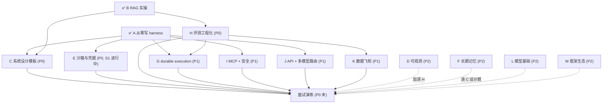

# 知识点总地图（面试导向：coding agent）

> 建立：2026-10-17 · 依据：handoff.md 路线图（2026-10-10）+ 仓库最新实况（10-17）
> 用途：全部知识点的一次性盘点——每课的知识结构在各自课程文件里，本文件是**索引 + 状态 + 依赖**。
> 状态记号：✅ 已完成 / 🔄 进行中 / ⏳ 未开始（已建知识结构，待开课）
>
> **四次整理（2026-10-11，系统时钟）：🔶1-5 五个缺口项全部写入**——C `system-design.md` S8 范式速查 / H `evaluation.md` S8 指标四代+奖励模型意识（judge 偏差三篇一手文献已核实）/ I `mcp.md` S4 升级为 Agent 安全全景（OWASP LLM Top 10 **2026 版**（2026-08-04 发布）+ Agentic Top 10（2026）全文核实）/ L `model-basics.md` S7 八股速查表 16 题 / `interview-bank.md` §8 行为面 5 题；LangGraph 1.0.x 已核实。每课题库 +2 题（共 20 题）。
> ⚠️ 日期口径：前两轮记录标为 "2026-10-17"，但机器时钟 = 2026-10-11（周日，星期自洽；rag-demo 文件 mtime=10-11 00:06）。本轮起用系统时钟，口径待用户确认。

## 课程总表

| 课 | 主题 | 优先级 | 状态 | 课程文件 | 完成后你能做到 |
|---|---|---|---|---|---|
| A | 从零写最小 harness | P0 | ✅ | `harness-from-scratch.md` | 白板 20 分钟写出可运行 agent loop（含恢复/权限/压缩） |
| B | RAG 与检索 | P0 | ✅ | `rag.md`（含 §13 实操复盘） | 讲清 pipeline 每层为什么存在 + 跑过 85-chunk 评测 |
| C | Agent 系统设计模板 | P0 | ⏳ | `system-design.md` | 30 分钟结构化答"设计一个 X agent" |
| D | Agent 可观测 | P2 | ⏳ | `observability.md` | 画 agent tracing 模型 + OTel GenAI 属性 + 成本归因 |
| E | 沙箱与凭据·可复现 | P0 | 🔄 S1 进行中 | `sandbox.md` | 讲清"权限层 ≠ 沙箱" + 隔离技术选型 + 幽灵事故完整故事 |
| F | 长期记忆 | P2 | ⏳ | `long-term-memory.md` | 设计跨会话 memory（写/读/遗忘/安全） |
| G | durable execution | P1 | ⏳ | `durable-execution.md` | 讲清长任务不丢不重（journal/checkpoint/幂等） |
| H | 评测工程化 | P0 | ⏳ | `evaluation.md` | 设计 LLM-judge + golden set 版本化 + 评测 CI 门禁 |
| I | MCP 协议 + 供应链安全 | P1 | ⏳ | `mcp.md` | 讲清 MCP 架构/原语/认证 + 四类投毒攻击与防御 |
| J | API 实操 + 多模型路由 | P1 | ⏳ | `api-engineering.md` | 讲清流式/结构化输出/caching/重试分类/路由成本 |
| K | 数据飞轮 | P1 | ⏳ | `data-flywheel.md` | 把 FinHot 台账+labeler 讲成"生产数据飞轮"故事 |
| L | 模型基础 | P2 | ⏳ | `model-basics.md` | KV cache/推理成本/微调意识——够用不深挖 |
| M | 框架生态 | P2 | ⏳ | `framework-ecosystem.md` | 讲清框架给你什么/藏什么 + pi 源码级实操故事 |

横向资产：`interview-bank.md`（模拟面试结构 + 交叉题库 + JD 关键词覆盖矩阵）

## 依赖图（按 handoff 优先级）

**建议开课顺序**：C → E（续 S2）→ H → G → I → J → K →（P2 四课按目标岗位权重排）。
理由：C 把 A/B 收口成"设计能力"；E 续进行中且 demo 骨架已备；H 是 P1 三课（G/I/K）的公共地基。

## 横切知识点（多课重复出现，面试时按"一个主题三个锚点"讲）

| 横切主题 | 出现位置 | 三个锚点（证据链） |
|---|---|---|
| 失败恢复 | A⑥⑦、E、G | intent/exec 日志（harness-demo）→ 幽灵事故 scope 缺失（FinHot）→ durable journal（G 课 demo） |
| 权限与信任 | A⑤、E、I、F | 三道门（harness-demo policy）→ 沙箱=执行环境层（E）→ MCP 不解决权限（I）→ 记忆投毒（F） |
| 评测与验证 | B⑨、H、K | golden set（rag-demo recall@3=1.00）→ CI 门禁（H）→ 飞轮迭代（K，FinHot 两轮降噪） |
| 成本工程 | A⑧、J、D | 压缩（context.ts）→ 路由/caching（J）→ token 归因（D） |
| 上下文工程 | A⑧、B⑤⑧、F | 压缩/预算 → query 侧分布差/窗口≠RAG → 跨会话记忆 |

## 资产 ↔ 课程映射

| 资产 | 证明的能力 | 被哪些课引用 |
|---|---|---|
| `harness-demo/`（8 文件 + 4 运行模式实测） | loop/工具协议/流式/权限/恢复/压缩 | C（coding agent 设计）、E（policy 层）、G（session.ts=最小 journal）、H（mock 评测） |
| `whiteboard/agent_whiteboard.py`（~150 行） | 白板手写 | C、面试演练 |
| `rag-demo/`（11 文件 + golden set） | 检索全 pipeline + 评测 | C（KB 设计题）、H（检索层评测）、K（指标驱动） |
| `sandbox-demo/`（package 已备，src 待写） | 四通道 policy + 事故重放 | E 课 S2 |
| FinHot（生产） | 长任务/批量评测/事故/数据飞轮 | E、G、H、J、K |
| pi + pi-agents-team（日常在用） | 多 agent 编排/框架源码级 | C、M |

## 未结事项（非课程，来自 handoff）

- [ ] 面试模拟问（题库已备 → `interview-bank.md`，开课式提问另约时间）
- [ ] 项目打磨（sandbox-demo src 未写；harness-demo/rag-demo 可补 README 与运行说明）
- [ ] 日期口径确认：笔记中 "2026-10-17" 系 vs 机器时钟 2026-10-11（详见顶部四次整理注）
- [ ] JD 关键词覆盖：见 `interview-bank.md` 矩阵
- [ ] 人工抽字节/百度 20-30 条 JD 补盲（反爬绕不过）
- [ ] 确认目标岗位方向（coding agent / 企业工作流 / 平台）→ 调 P1/P2 权重
