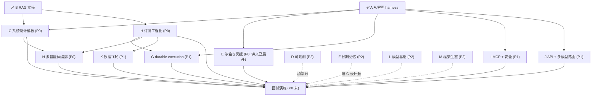

# 知识点总地图（面试导向：coding agent）

> 建立：2026-10-11 · 依据：handoff.md 路线图（2026-10-10）+ 仓库最新实况（10-11）
> 用途：全部知识点的一次性盘点——每课的知识结构在各自课程文件里，本文件是**索引 + 状态 + 依赖**。
> 状态记号：✅ 已完成 / 🔄 进行中 / 📐 讲义已展开（待提问演练） / ⏳ 未开始（已建知识结构，待开课）
>
> **四次整理（2026-10-11，系统时钟）：🔶1-5 五个缺口项全部写入**——C `system-design.md` S8 范式速查 / H `evaluation.md` S8 指标四代+奖励模型意识（judge 偏差三篇一手文献已核实）/ I `mcp.md` S4 升级为 Agent 安全全景（OWASP LLM Top 10 **2026 版**（2026-08-04 发布）+ Agentic Top 10（2026）全文核实）/ L `model-basics.md` S7 八股速查表 16 题 / `interview-bank.md` §8 行为面 5 题；LangGraph 1.0.x 已核实。每课题库 +2 题（共 20 题）。
> ✅ 日期口径（2026-10-11 确认）：前两轮记录误标 "10-17"（未来日期），已按机器时钟 + 文件 mtime 证据归一到系统时钟 2026-10-11，共 11 文件 27 行 28 处修正（handoff/notes/代码注释）；文中残留的 "10-17" 均为引用原始错误写法的元记录引文。

## 课程总表

| 课 | 主题 | 优先级 | 状态 | 课程文件 | 完成后你能做到 |
|---|---|---|---|---|---|
| A | 从零写最小 harness | P0 | ✅ | `harness-from-scratch.md` | 白板 20 分钟写出可运行 agent loop（含恢复/权限/压缩） |
| B | RAG 与检索 | P0 | ✅ | `rag.md`（含 §13 实操复盘） | 讲清 pipeline 每层为什么存在 + 跑过 85-chunk 评测 |
| C | Agent 系统设计模板 | P0 | 📐 | `system-design.md` | 30 分钟结构化答"设计一个 X agent" |
| D | Agent 可观测 | P2 | 📐 讲义已展开（2026-10-11） | `observability.md` | 画 agent tracing 模型 + OTel GenAI 属性 + 成本归因（出口判据：提问演练 + 题库 14 题通过） |
| E | 沙箱与凭据·可复现 | P0 | 📐 讲义已展开（2026-10-11） | `sandbox.md` | 讲清"权限层 ≠ 沙箱" + 隔离技术选型 + 幽灵事故完整故事 |
| F | 长期记忆 | P2 | 📐 讲义已展开（2026-10-11） | `long-term-memory.md` | 设计跨会话 memory（写/读/遗忘/安全）（出口判据：提问演练 + 题库 14 题通过） |
| G | durable execution | P1 | 📐 | `durable-execution.md` | 讲清长任务不丢不重（journal/checkpoint/幂等） |
| H | 评测工程化 | P0 | 📐 | `evaluation.md` | 设计 LLM-judge + golden set 版本化 + 评测 CI 门禁 |
| I | MCP 协议 + 供应链安全 | P1 | 📐 | `mcp.md` | 讲清 MCP 架构/原语/认证 + 四类投毒攻击与防御 |
| J | API 实操 + 多模型路由 | P1 | 📐 | `api-engineering.md` | 讲清流式/结构化输出/caching/重试分类/路由成本 |
| K | 数据飞轮 | P1 | 📐 | `data-flywheel.md` | 把 FinHot 台账+labeler 讲成"生产数据飞轮"故事 |
| L | 模型基础 | P2 | 📐 讲义已展开（2026-10-11） | `model-basics.md` | KV cache/推理成本/微调意识——够用不深挖（出口判据：提问演练 + 题库 14 题通过） |
| M | 框架生态 | P2 | 📐 讲义已展开（2026-10-11） | `framework-ecosystem.md` | 讲清框架给你什么/藏什么 + pi 源码级实操故事（出口判据：提问演练 + 题库 14 题通过） |
| N | 多智能体编排 | P0 | 📐 讲义已展开（2026-10-11） | `multi-agent.md` | 讲清何时多智能体 + orchestrator-worker/单线程写 + 给自己 harness 设计子代理方案 |

横向资产：`interview-bank.md`（模拟面试结构 + 交叉题库 + JD 关键词覆盖矩阵）· `llm-timeline.md`（LLM 演化时间线 12 节点）· `industry-2026.md`（2026-10 行业前线调研，I/M/C/N 课一手源）· `details/`（资深分水岭 8 细节页）

> 2026-10-11 前线回填（industry-2026 → 课程）：I 课 S2.1（AAIF 治理/spec 2026-07-28/协议三分）· M 课 S3 表 +4 行 · C 课 S2 两个必答题模块 + 1 追问 · A 课 §8 → N 课入口。课程状态（⏳/）指"开课/实操"进度，不含内容回填。

## 依赖图（按 handoff 优先级）

**建议开课顺序**：C → N → E（续 S2）→ H → G → I → J → K →（P2 四课按目标岗位权重排）。
理由：C 把 A/B 收口成"设计能力"；N 依赖 C 模板 + A 子代理概念，2026 行业实践已收敛（单线程写），开课成本低；E 讲义已展开且 demo 已落地；H 是 P1 三课（G/I/K）的公共地基。

## 横切知识点（多课重复出现，面试时按"一个主题三个锚点"讲）

| 横切主题 | 出现位置 | 三个锚点（证据链） |
|---|---|---|
| 失败恢复 | A⑥⑦、E、G | intent/exec 日志（harness-demo）→ 幽灵事故 scope 缺失（FinHot）→ durable journal（G 课 demo） |
| 权限与信任 | A⑤、E、I、F | 三道门（harness-demo policy）→ 沙箱=执行环境层（E）→ MCP 不解决权限（I）→ 记忆投毒（F） |
| 评测与验证 | B⑨、H、K | golden set（rag-demo recall@3=1.00）→ CI 门禁（H）→ 飞轮迭代（K，FinHot 两轮降噪） |
| 成本工程 | A⑧、J、D | 压缩（context.ts）→ 路由/caching（J）→ token 归因（D） |
| 上下文工程 | A⑧、B⑤⑧、F | 压缩/预算 → query 侧分布差/窗口≠RAG → 跨会话记忆 |

## 资产 ↔ 课程映射

| 资产 | 证明的能力 | 被哪些课引用 |
|---|---|---|
| `harness-demo/`（8 文件 + 4 运行模式实测） | loop/工具协议/流式/权限/恢复/压缩 | C（coding agent 设计）、E（policy 层）、G（session.ts=最小 journal）、H（mock 评测）、N（S7 子代理设计练习） |
| `whiteboard/agent_whiteboard.py`（~150 行） | 白板手写 | C、面试演练 |
| `rag-demo/`（11 文件 + golden set） | 检索全 pipeline + 评测 | C（KB 设计题）、H（检索层评测）、K（指标驱动） |
| `sandbox-demo/`（7 个 src 文件 + README，3 次重放逐字节一致） | 四通道 policy + 事故重放 | E 课 S2 |
| FinHot（生产） | 长任务/批量评测/事故/数据飞轮 | E、G、H、J、K |
| pi + pi-agents-team（日常在用） | 多 agent 编排/框架源码级 | C、M |

## 未结事项（非课程，来自 handoff）

- [x] 讲义展开（2026-10-11）：C/N/E/H 四课从"结构建成"→"开课版讲义"（各 4 张 mermaid、实战走查节、题库 12-16 题）；引用一手源复核修正 4 处
- [x] 讲义展开（2026-10-11 Phase 2）：G/I/J/K 四课 →"开课版讲义"（各 4-5 张 mermaid、实战走查节、题库各 14 题）；引用一手源复核修正 8 处；K 课回填 FinHot 真实三轮评测指标
- [x] 讲义展开（2026-10-11 Phase 3）：D/F/L/M 四课 →"开课版讲义"（各 4 张 mermaid、实战走查节、题库扩充）
- [ ] 面试模拟问（题库已备 → `interview-bank.md`，开课式提问另约时间）
- [ ] 项目打磨（sandbox-demo src 已写完并验收；harness-demo/rag-demo 可补 README 与运行说明——rag-demo 尚无 README）
- [x] 实操补强 ×4（2026-10-11 完成）：sandbox-demo 四通道 policy+幽灵重放（600 行，3 次重放逐字节一致）/ harness-demo OTel 埋点（demo:otel 11 spans/1 trace）/ mcp-demo 投毒+四层防御+消融 / framework-demo Claude Agent SDK（11/11 断言）
- [x] 日期口径确认（2026-10-11）：归一到系统时钟，11 文件 27 行 28 处修正
- [x] 站点建设：Astro 站（site/）+ GitHub Pages 部署——已上线 https://blog.zero43.top/learn-agent-harness/（8 页面）
- [ ] JD 关键词覆盖：见 `interview-bank.md` 矩阵
- [ ] 人工抽字节/百度 20-30 条 JD 补盲（反爬绕不过）
- [ ] 确认目标岗位方向（coding agent / 企业工作流 / 平台）→ 调 P1/P2 权重
