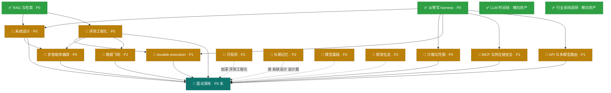

# 知识点总地图(面试导向:coding agent)

> 建立：2026-10-11 · 依据：handoff.md 路线图（2026-10-10）+ 仓库最新实况（10-11）
> 用途:全部知识点的一次性盘点——每课的知识结构在各自课程文件里,本文件是**索引 + 状态 + 依赖**。
> 命名(2026-10-11 起):课程一律以**知识域名**引用,弃用 A–N 字母代号与课程顺序编号(历史文档已批量改齐)。
> 状态记号：✅ 已完成 / 🔄 进行中 / 📐 讲义已展开（待提问演练） / ⏳ 未开始（已建知识结构，待开课）
>
> **四次整理（2026-10-11，系统时钟）：🔶1-5 五个缺口项全部写入**——系统设计 `system-design.md` S8 范式速查 / 评测工程化 `evaluation.md` S8 指标四代+奖励模型意识（judge 偏差三篇一手文献已核实）/ MCP 与供应链安全 `mcp.md` S4 升级为 Agent 安全全景（OWASP LLM Top 10 **2026 版**（2026-08-04 发布）+ Agentic Top 10（2026）全文核实）/ 模型基础 `model-basics.md` S7 八股速查表 16 题 / `interview-bank.md` §8 行为面 5 题；LangGraph 1.0.x 已核实。每课题库 +2 题（共 20 题）。
> ✅ 日期口径（2026-10-11 确认）：前两轮记录误标 "10-17"（未来日期），已按机器时钟 + 文件 mtime 证据归一到系统时钟 2026-10-11，共 11 文件 27 行 28 处修正（handoff/notes/代码注释）；文中残留的 "10-17" 均为引用原始错误写法的元记录引文。
>
> **计数口径（2026-10-12 冻结，全仓唯一参照，其余位置只引用本块、不另起数）**：
> · **知识域 15** = 课程总表 14 编号课 + Harness 架构主线 `agent-harness.md`；`interview-bank` / `llm-timeline` / `industry-2026` / `details/` 为横向资产，不计入门数。
> · **课程页 17** = 站点 `/c/<slug>/` 实生成路由数（notes 顶层 19 − knowledge-map − interview-bank）。
> · **课程卡 18** = `site/src/data/courses.ts` 全部条目；含 `whiteboard` 白板卡（无独立 notes 文件与课程页，链向 /works/#whiteboard），故课程卡比课程页多 1。
> · **可运行 demo 作品 6** = harness-demo / rag-demo / sandbox-demo / mcp-demo / durable-execution-demo / framework-demo（有 `npm run demo` 的目录）；whiteboard / viz / site 为配套资产，不计入。
> · **题目**：课内嵌 **205** 题（13 课练习题库 176 + agent-harness §13 八题 + rag S1 五题 + model-basics S7 十六题）+ 面试题库精选 **37** 题（interview-bank §3 22 + §4 10 + §8 5）。
> · **rag-demo 评测口径**（2026-10-12 锚点式 golden set 复测，以 `notes/rag.md §13` 为唯一数字源）：recall@3 = 0.31 / recall@5 = 0.44 / recall@10 = 0.50，PASS 3/8，语料 132 chunks；旧值 recall@3=1.00 / @5=0.94 出自已废止的「行号指针」golden set（旧语料口径同时作废，全仓禁用旧值）。

## 命名总表(唯一真源)

> 规则(2026-10-11 起):
> ① 每份材料只有一个**规范名**,所有交叉引用 / 站点卡片 / handoff / demo 注释一律用它;
> ② 规范名**不带「课」字后缀**,不写 A–N 字母代号;
> ③ 节号引用写作 `§Sn`(如 `沙箱与凭据 §S2`)。

| 规范名 | 文件 | 类别 |
|---|---|---|
| Harness 架构 | `agent-harness.md` | 主线 |
| 从零写 harness | `harness-from-scratch.md`(`harness-demo/`) | 编号课 |
| RAG 与检索 | `rag.md`(`rag-demo/`) | 编号课 |
| 系统设计 | `system-design.md` | 编号课 |
| 沙箱与凭据 | `sandbox.md`(`sandbox-demo/`) | 编号课 |
| 评测工程化 | `evaluation.md` | 编号课 |
| durable execution | `durable-execution.md`(`durable-execution-demo/`) | 编号课 |
| MCP 与供应链安全 | `mcp.md`(`mcp-demo/`) | 编号课 |
| API 与多模型路由 | `api-engineering.md` | 编号课 |
| 数据飞轮 | `data-flywheel.md` | 编号课 |
| 可观测 | `observability.md` | 编号课 |
| 长期记忆 | `long-term-memory.md` | 编号课 |
| 模型基础 | `model-basics.md` | 编号课 |
| 框架生态 | `framework-ecosystem.md`(`framework-demo/`) | 编号课 |
| 多智能体编排 | `multi-agent.md` | 编号课 |
| 面试题库 | `interview-bank.md` | 横向资产 |
| LLM 时间线 | `llm-timeline.md` | 横向资产 |
| 行业前线调研 | `industry-2026.md` | 横向资产 |
| 资深分水岭 1–8 | `details/*.md` | 横向资产 |
| 知识点总地图 | `knowledge-map.md` | 索引 |

## 课程总表

| 主题 | 优先级 | 状态 | 课程文件 | 完成后你能做到 |
|---|---|---|---|---|
| 从零写 harness | P0 | ✅ | `harness-from-scratch.md` | 白板 20 分钟写出可运行 agent loop（含恢复/权限/压缩） |
| RAG 与检索 | P0 | ✅ | `rag.md`（含 13 实操复盘） | 讲清 pipeline 每层为什么存在 + 跑过 132-chunk 评测（recall@3=0.31，2026-10-12 锚点式复测） |
| Agent 系统设计模板 | P0 | 📐 | `system-design.md` | 30 分钟结构化答“设计一个 X agent” |
| Agent 可观测 | P2 | 📐 讲义已展开（2026-10-11） | `observability.md` | 画 agent tracing 模型 + OTel GenAI 属性 + 成本归因（出口判据：提问演练 + 题库 14 题通过） |
| 沙箱与凭据·可复现 | P0 | 📐 讲义已展开（2026-10-11） | `sandbox.md` | 讲清“权限层 ≠ 沙箱” + 隔离技术选型 + 幽灵事故完整故事 |
| 长期记忆 | P2 | 📐 讲义已展开（2026-10-11） | `long-term-memory.md` | 设计跨会话 memory（写/读/遗忘/安全）（出口判据：提问演练 + 题库 14 题通过） |
| durable execution | P1 | 📐 | `durable-execution.md`(`durable-execution-demo/`,S7 demo 已落地) | 讲清长任务不丢不重（journal/checkpoint/幂等） |
| 评测工程化 | P0 | 📐 | `evaluation.md` | 设计 LLM-judge + golden set 版本化 + 评测 CI 门禁 |
| MCP 协议 + 供应链安全 | P1 | 📐 | `mcp.md` | 讲清 MCP 架构/原语/认证 + 四类投毒攻击与防御 |
| API 实操 + 多模型路由 | P1 | 📐 | `api-engineering.md` | 讲清流式/结构化输出/caching/重试分类/路由成本 |
| 数据飞轮 | P1 | 📐 | `data-flywheel.md` | 把 FinHot 台账+labeler 讲成“生产数据飞轮”故事 |
| 模型基础 | P2 | 📐 讲义已展开（2026-10-11） | `model-basics.md` | KV cache/推理成本/微调意识——够用不深挖（出口判据：提问演练 + 题库 14 题通过） |
| 框架生态 | P2 | 📐 讲义已展开（2026-10-11） | `framework-ecosystem.md` | 讲清框架给你什么/藏什么 + pi 源码级实操故事（出口判据：提问演练 + 题库 14 题通过） |
| 多智能体编排 | P0 | 📐 讲义已展开（2026-10-11） | `multi-agent.md` | 讲清何时多智能体 + orchestrator-worker/单线程写 + 给自己 harness 设计子代理方案 |

横向资产:`interview-bank.md`(模拟面试结构 + 交叉题库 + JD 关键词覆盖矩阵)· `llm-timeline.md`(LLM 时间线 12 节点)· `industry-2026.md`(2026-10 行业前线调研,MCP 与供应链安全 / 框架生态 / 系统设计 / 多智能体编排 一手源)· `details/`(资深分水岭 8 细节页)

> 口径：课程总表 14 行 = 14 个编号课；另加 1 条主线 `agent-harness.md`（Harness 架构），合计 15 个知识域。

> 2026-10-11 前线回填（industry-2026 → 课程）：MCP 与供应链安全 §S2.1（AAIF 治理/spec 2026-07-28/协议三分）· 框架生态 §S3 表 +4 行 · 系统设计 §S2 两个必答题模块 + 1 追问 · 从零写 harness §8 → 多智能体编排入口。课程状态(⏳/📐/✅)指"开课/实操"进度，不含内容回填。

## 依赖图（按 handoff 优先级）

**建议开课顺序**:系统设计 → 多智能体编排 → 沙箱与凭据(续 §S2)→ 评测工程化 → durable execution → MCP 与供应链安全 → API 与多模型路由 → 数据飞轮 →(P2 四课按目标岗位权重排)。
理由:系统设计把「从零写 harness / RAG 与检索」收口成"设计能力";多智能体编排依赖系统设计模板 + 从零写 harness 的子代理概念,2026 行业实践已收敛(单线程写),开课成本低;沙箱与凭据讲义已展开且 demo 已落地;评测工程化是 P1 三课(durable execution / MCP 与供应链安全 / 数据飞轮)的公共地基。

## 横切知识点（多课重复出现，面试时按"一个主题三个锚点"讲）

| 横切主题 | 出现位置 | 三个锚点（证据链） |
|---|---|---|
| 失败恢复 | 从零写 harness §⑦、沙箱与凭据、durable execution | intent/exec 日志(harness-demo)→ 幽灵事故 scope 缺失(FinHot)→ durable journal(durable execution demo) |
| 权限与信任 | 从零写 harness §⑤、沙箱与凭据、MCP 与供应链安全、长期记忆 | 三道门(harness-demo policy)→ 沙箱=执行环境层(沙箱与凭据)→ MCP 不解决权限(MCP 与供应链安全)→ 记忆投毒(长期记忆) |
| 评测与验证 | RAG 与检索 §⑨、评测工程化、数据飞轮 | golden set(rag-demo recall@3=0.31,2026-10-12 复测)→ CI 门禁(评测工程化)→ 飞轮迭代(数据飞轮,FinHot 两轮降噪) |
| 成本工程 | 从零写 harness §⑧、API 与多模型路由、可观测 | 压缩(context.ts)→ 路由/caching(API 与多模型路由)→ token 归因(可观测) |
| 上下文工程 | 从零写 harness §⑧、RAG 与检索 §⑧、长期记忆 | 压缩/预算 → query 侧分布差/窗口≠RAG → 跨会话记忆 |

## 资产 ↔ 课程映射

| 资产 | 证明的能力 | 被哪些课引用 |
|---|---|---|
| `harness-demo/`(9 源文件 + trajectories 落盘，覆盖 harness-from-scratch ①-⑩ 十节；5 种运行模式实测) | loop/工具协议/流式/权限/恢复/压缩 | 系统设计(coding agent 设计)、沙箱与凭据(policy 层)、durable execution(session.ts=最小 journal)、评测工程化(mock 评测)、多智能体编排(§S7 子代理设计练习) |
| `whiteboard/agent_whiteboard.py`(~180 行) | 白板手写 | 系统设计、面试演练 |
| `rag-demo/`(15 文件 + golden set) | 检索全 pipeline + 评测 | 系统设计(KB 设计题)、评测工程化(检索层评测)、数据飞轮(指标驱动) |
| `durable-execution-demo/`(9 src 文件/821 行,3 崩溃点×各 3 次真实 SIGKILL 恢复:副作用恒=1、恢复报告逐字节一致,含负向测试) | journal/checkpoint/幂等三机制 + 未知态处置实操 | durable execution §S7、沙箱与凭据(崩溃恢复)、系统设计(长任务设计题) |
| `sandbox-demo/`(7 个 src 文件 + README,3 次重放逐字节一致) | 四通道 policy + 事故重放 | 沙箱与凭据 §S2 |
| FinHot(生产) | 长任务/批量评测/事故/数据飞轮 | 沙箱与凭据、durable execution、评测工程化、API 与多模型路由、数据飞轮 |
| pi + pi-agents-team(日常在用) | 多 agent 编排/框架源码级 | 系统设计、框架生态 |

## 未结事项（非课程，来自 handoff）

- [x] 讲义展开（2026-10-11）：系统设计 / 多智能体编排 / 沙箱与凭据 / 评测工程化 四课从"结构建成"→"开课版讲义"（各 4 张 mermaid、实战走查节、题库 12-16 题）；引用一手源复核修正 4 处
- [x] 讲义展开（2026-10-11 Phase 2）：durable execution / MCP 与供应链安全 / API 与多模型路由 / 数据飞轮 四课 →"开课版讲义"（各 4-5 张 mermaid、实战走查节、题库各 14 题）；引用一手源复核修正 8 处；数据飞轮回填 FinHot 真实三轮评测指标
- [x] 讲义展开（2026-10-11 Phase 3）：可观测 / 长期记忆 / 模型基础 / 框架生态 四课 →"开课版讲义"（各 4 张 mermaid、实战走查节、题库扩充）
- [ ] 面试模拟问（题库已备 → `interview-bank.md`，开课式提问另约时间）
- [x] 项目打磨（2026-10-12）：rag-demo / harness-demo README 补齐（harness-demo 模型名同步为 qwen3.8-flash-next）；durable-execution S7 demo 落地（durable-execution-demo/，3 崩溃点×3 次真实 SIGKILL 验收）
- [x] 实操补强 ×4（2026-10-11 完成）：sandbox-demo 四通道 policy+幽灵重放（600 行，3 次重放逐字节一致）/ harness-demo OTel 埋点（demo:otel 11 spans/1 trace）/ mcp-demo 投毒+四层防御+消融 / framework-demo Claude Agent SDK（11/11 断言）
- [x] 日期口径确认（2026-10-11）：归一到系统时钟，11 文件 27 行 28 处修正
- [x] 站点建设：Astro 站（site/）+ GitHub Pages 部署——已上线 https://blog.zero43.top/learn-agent-harness/（32 个 html）
- [ ] JD 关键词覆盖：见 `interview-bank.md` 矩阵
- [ ] 人工抽字节/百度 20-30 条 JD 补盲（反爬绕不过）
- [ ] 确认目标岗位方向（coding agent / 企业工作流 / 平台）→ 调 P1/P2 权重
