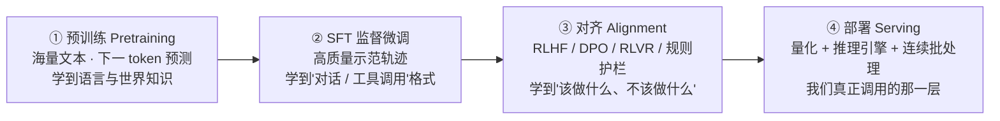
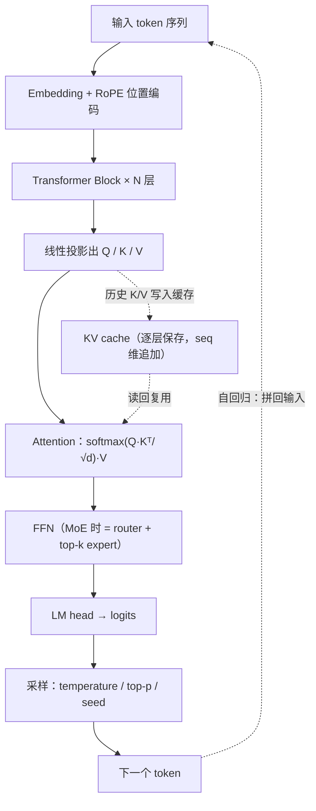
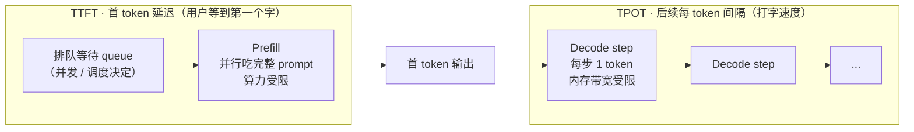
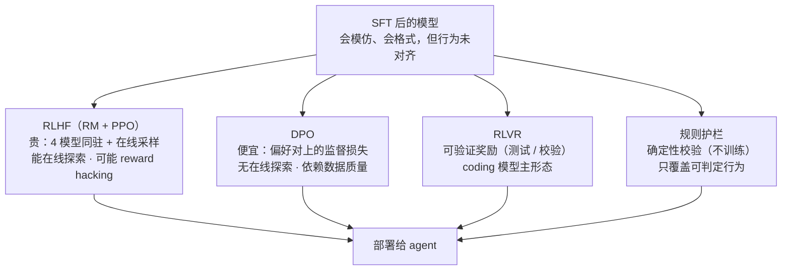

# 模型基础(够用不深挖)

> 优先级 P2 · 状态：🔄 讲义已展开（待脱稿复述演练）
> 深度定位：原路线图口径"按使用者深度，基础够用"——目标是**讲解时能对话不露怯**，不是转 ML 研究
> 前置：无硬前置；与 API 与多模型路由(成本工程)、数据飞轮(微调/蒸馏)双向引用
> 用法：S1-S3 是"模型怎么跑"的最小机制；S4-S5 是成本与微调的意识层；S6 是实测差异化；S8 是延迟归因实战走查；S9 是常见错误与自查清单。（原 S7「八股速查表」已随练习题库移除）

**这一页解决什么问题**：定位。这门课不教你训模型、不教你推导 attention，只回答一个问题——**当模型是你 harness 里的一个组件时，它的哪些性质会泄漏成工程约束**。常见问法是你模型基础，不是在招 ML 研究员，是在确认你知不知道自己调用的东西为什么有延迟、为什么贵、为什么会漂移。所以每一节都按"机制 → 工程后果 → 失败模式"三段写；凡是超出"实战能对话"的深度，主动停手并说明边界。

---

## 预备知识（这课的门槛，只讲「课程外」要会什么）

- **课程依赖（prereqs）**：`llm-timeline`（横向导航页，位于 P0 之前）——上一课带入「模型是会持续换代的组件」时间轴（GPT 系 / o1 推理模型 / 开源系的代际差异），本课把它从「一代代更替」落到「每一代在 harness 里有什么工程后果」。
- **技能门槛**：只需「矩阵乘法 = 行列点积、softmax = 归一化成概率」的粗直觉即可。
- **不需要提前会**：PyTorch / attention 数学推导 / 真实微调 / 推理引擎调优——一律不用会。KV cache 机制、prefill-decode 两阶段、推理成本构成、微调谱系随 `model-basics-demo` 的 `npm run demo` 边跑边建（本 sprint 规格先行，目录由下游按 notes/process/model-basics-mvp-spec.md 建成）。

---

## S1 推理管线：一次生成的两个阶段

**这一节解决什么问题**：先把"模型从哪来、到你这儿时是什么形态"钉死，再讲一次生成内部发生了什么。很多工程现象（TTFT 为什么高、并发为什么上不去、前缀缓存为什么能省钱）都能在这一节找到根。

### S1.0 模型从哪来：训练管线（实战只需知道每一环留下什么指纹）



对 agent 工程师而言，这条管线只需要记住四个"指纹"：

- **预训练决定知识边界**：知识截止、语言能力、幻觉倾向都在这里定型。你在 prompt 里教不会它没学过的世界知识——那要 RAG（RAG 与检索）。
- **SFT 决定行为格式**：会不会调工具、JSON 稳不稳、是不是 Assistant 口吻，主要是 SFT 的产物。"让模型学会用我的工具"最省事的路径不是微调，而是把工具 schema 放进上下文（从零写 harness aci）。
- **对齐决定"该不该做"**：拒答、安全、指令遵循强度来自对齐层。这也是为什么"提示词里写绝不删文件"不等于执行层会拦截（Harness 架构 §4）。
- **部署层才是你按 token 付费的那层**：量化、批处理、推理引擎全在这一环，S1 余下内容与 S4 都讲它。

**失败模式**：把"模型不行"当成"prompt 没写好"反复调提示词，其实是知识截止/SFT 格式/对齐强度的问题——这时该换模型或换数据路径，不是继续拧 prompt。

### S1.1 一次生成的两个阶段

```
prefill（吃 prompt）→ decode（逐 token 吐）
  计算受限                内存带宽受限（每步只生成 1 token，
  （大矩阵乘，GPU 算力打满）  但要把整个 KV cache 搬一遍）
```

**为什么 prefill 与 decode 要分开算钱（agent 工程视角）**：

- **prefill 是算力受限**：一次性把整段 prompt 的矩阵乘做完，GPU 的 FLOPS 打满。它的成本**随 prompt 长度线性增长**，而且可以并行——所以"送进去多少上下文"直接决定首 token 要等多久。
- **decode 是内存带宽受限**：每步只生成 1 个 token，算力用不满，但每步都要把模型权重 + 全部 KV cache 从显存搬到计算单元。它的成本**随输出 token 数线性增长**，而且极难并行（自回归，下一步依赖上一步）。
- **两个推论直接决定两家账单**：输入 token 便宜（prefill 可并行、可批处理）、输出 token 贵（decode 串行、每步全模型前向），所以"少送上下文"和"少说废话"是两条独立的省钱路径（S4）。前缀缓存（prefix caching）之所以有计费折扣，正是因为被命中的那一段 prefill 可以跳过。

**KV cache（必问，要能推导）**：
- Transformer 自回归生成时，前面所有 token 的 K/V 矩阵可以缓存复用，不必每步重算 → 内存占用 ≈ `2 × layers × kv_heads × head_dim × seq_len × bytes`（2=key+value）
- **两个直接推论（实战推导题）**：
  1. 上下文越长 → 每步 decode 越慢、显存越多（为什么 1M 窗口又贵又慢；为什么长会话要压缩——从零写 harness §⑧ 的模型侧理由）
  2. 同模型并发多请求 → KV cache 总量受限 → 吞吐瓶颈在**显存不在算力**（为什么推理服务按显存规划容量，API 与多模型路由延迟/成本的底层原因）
- 相关优化（意识级）：GQA/MQA（减少 KV head 数）、PagedAttention（vLLM：KV 分页管理，减少碎片）、量化（FP8/INT8，省带宽）、FlashAttention（分块计算 attention，减少显存读写，不改变 O(n²) 计算量；Dao et al., NeurIPS 2022, arXiv:2205.14135）

**失败模式**：把 KV cache 当"缓存命中就免费"。它省的是重算，不省显存——并发 8 路、每路 8K 上下文时，KV cache 可能比模型权重还占显存；这时加并发先撞显存墙，而不是算力墙。（量级参照：LLaMA-2 70B 为 80 层 / 64 注意力头 / 8 个 KV head（GQA）/ head_dim=128，来源 Meta 官方 config）

```js
// model-basics-mvp-spec.md 接口（规划态，model-basics-demo/ 落地后即此形状）——KV cache 显存估算
const kvBytesPerToken = (layers, kvHeads, headDim, bytes) => 2 * layers * kvHeads * headDim * bytes; // 2 = K + V
// 实例（S8 走查的 Mistral-7B 量级：32 层 / 8 KV heads / head_dim=128 / FP16 即 bytes=2）：
//   kvBytesPerToken(32, 8, 128, 2) = 131072 B/token ≈ 0.13 MB/token
//   8K prompt = 8192 × 0.13MB ≈ 1.0 GB/路；并发 8 路 ≈ 8 GB 只放 KV（还没算权重）
```

**这段在讲什么**：这条公式要能当场推——`2×layers×kv_heads×head_dim×bytes` 里只有 `seq_len` 是运行时变量，其余四项是模型固定结构。两个直接推论：① 上下文越长 → 每步 decode 越慢、显存越多（长会话要压缩的模型侧理由）；② 同模型并发多请求 → KV 总量受限 → 吞吐瓶颈在显存不在算力（容量按显存规划）。GQA 的价值就是砍 `kv_heads` 这一项（LLaMA-2 70B 从 64 头砍到 8 个 KV head），代价是 KV 表达能力下降——这就是「为什么 GQA 成为主流而非 MQA」的机制底。

---

## S2 解码与采样：参数如何改变 agent 行为

**这一节解决什么问题**：采样参数是 agent 手里最便宜、也最容易被误用的旋钮。先补一次前向的数据流（知道 KV cache 长在哪、采样发生在哪），再讲参数怎么改行为。

### S2.0 一次前向的数据流（含 KV cache 位置）



**从图里要能读出三件事**：① KV cache 是在 Q/K/V 投影之后、Attention 之前写入的，它省的是"重算历史 token 的 K/V"；② 采样只发生在最后一步（LM head 之后），所以 temperature 改不了模型"想什么"，只改"从分布里挑哪个"；③ MoE 只替换 FFN 那段，attention 与 KV cache 结构不变——这解释了 MoE「总参数大、单 token 计算小」的特性。

| 参数 | 作用 | agent 场景设定 |
|---|---|---|
| temperature | 软 softmax：高=分布平=更随机 | **结构化输出/工具调用=低温**（0 附近）：参数拼错=整步失败；开放生成（摘要/文案）可适度高 |
| top-p / top-k | 截断候选集 | 与 temperature 二选一主用即可 |
| seed | 可复现（支持的 provider） | **评测/回放必用**（沙箱与凭据 §S6、可观测 §S5：同 seed 同温度才能 diff） |

**要点**："温度不是质量旋钮，是**分布平度旋钮**——任务要确定性（代码/参数/JSON）就压低，要多样性（头脑风暴/自我采样 self-consistency）才抬高。"
self-consistency（系统设计 §S3 的 parallelization）= 高温多采样+多数表决，用成本换稳定性（FinHot 双模型评分=跨模型版的自洽）。

**失败模式**：为了"提高成功率"把 temperature 调低到 0，然后发现 agent 陷入重复循环——低温不是万能药，它提高确定性但降低探索；重复循环要靠 harness 层的停止条件/循环检测兜，不是靠采样参数。另一个反向失败：为了"让回答更丰富"把 temperature 拉高，结果工具调用 JSON 里多出非法字段，整步报错。

---

## S3 上下文窗口 vs 有效上下文

**这一节解决什么问题**：这一节是"长上下文不是免费的"的模型侧依据。读者常拿"我们有 1M 窗口，还要不要 RAG"来试探——答案的分水岭就在"窗口 ≠ 有效长度"。

- **窗口**（hard limit，128K/1M…）≠ **有效长度**（注意力质量随长度衰减，"context rot"/lost-in-the-middle——Harness 架构 §5已建立）
- 推论：
  1. 窗口大≠可以全塞（RAG 与检索 §⑧：成本/注意力/时效/权限四理由）
  2. 重要信息**位置**有讲究（开头/结尾好，中间差）→ 压缩策略保 head+tail（从零写 harness §⑧ 的模型侧依据）
  3. 长上下文评测要按"信息在什么位置"分层（大海捞针按深度分层的做法）

**为什么长上下文 ≠ 有效上下文（机制层）**：attention 在长序列上是"softmax 归一化后分蛋糕"——token 越多，每个 token 分到的注意力权重越薄；位置外推只把可处理的窗口撑大，没有增加模型"关注哪里的能力"。所以"塞进去"是容量问题，"用得上"是注意力质量问题，两者要分开谈。

**失败模式**：把关键约束（如"输出必须是 JSON"）放在超长 prompt 的正中间，然后抱怨模型不遵守——这不是模型不听话，是把指令埋进了注意力洼地。工程动作：关键约束前置或重复在尾部（head+tail），中间放大段资料。

---

## S4 推理成本模型（API 与多模型路由的理论底座）

**这一节解决什么问题**：把 S1 的机制翻译成钱。这一节要能当场手推，因为 API 与多模型路由、系统设计的"步数是成本乘数"都从这里长出来。

### S4.0 推理延迟分解（TTFT 与 TPOT）



**公式（实战可白板写）**：

- `TTFT = t_queue + t_prefill + t_network`，其中 `t_prefill ≈ prompt_tokens / prefill_throughput`（prefill 吞吐由算力与 batch 决定）
- `TPOT ≈ (weight_bytes + B × kv_bytes_per_seq) / HBM_bandwidth`，其中 `B` 是并发 batch 大小（decode 每步读一次权重，但要读 B 份 KV）
- 用户感知：TTFT 决定"卡不卡"，TPOT 决定"打字快不快"。**两段的瓶颈不同，优化手段也不同**——这是下一节实战走查的全部依据。

### S4.1 成本模型

- **输入 token 与输出 token 不同价**：输出通常是输入的 3-5×（decode 慢+每 token 全模型前向）→ 优化"少说废话"和"少送上下文"同等重要
- **caching 折扣**：命中前缀按折扣价（API 与多模型路由 §S3）
- **每任务成本公式**（实战能手推）：`Σ over steps (input_t × p_in + output_t × p_out) × 步数`——agent 成本=单步成本×**步数**，步数是唯一能乘数放大的项 → 少步比省字值钱（系统设计"能用 workflow 不用 agent"的成本注脚）
- 长上下文的非线性：KV cache 显存↑ → 并发↓ → 单位成本↑（S1 推论 2 的定价版）

**失败模式**：只优化单步 prompt 长度，不看步数。步数从 8 涨到 12 会吃掉你省下的所有 token；反过来，如果你能砍掉两次不必要的工具往返，比把 prompt 缩短 20% 更值钱。

```js
// model-basics-mvp-spec.md 接口（规划态）——成本拆分 + TTFT/TPOT 估算
const stepCost = (inputT, outputT, pIn, pOut) => inputT * pIn + outputT * pOut;  // 输出常是输入 3-5×（decode 串行 + 每 token 全模型前向）
const taskCost = (steps) => steps.reduce((sum, c) => sum + c, 0);                // 总成本 = Σ 单步 × 步数（步数是唯一乘数放大项）
// TTFT  = t_queue + t_prefill + t_network，t_prefill ≈ prompt_tokens / prefill_throughput   （算力受限、可并行）
// TPOT ≈ (weight_bytes + B × kv_bytes_per_seq) / HBM_bandwidth  （B=并发；decode 每步读一次权重、读 B 份 KV）
```

**这段在讲什么**：成本模型要能白板手推——`stepCost` 两刀独立（输入吃 prefill、输出吃 decode），而 `taskCost` 的 `× 步数` 是唯一能**乘数放大**的项，所以「少步 > 省字」。caching 折扣只打在「命中前缀」那一段 prefill 上（动态字段放 prompt 最前 = 前缀每轮都变 = 缓存永远 miss，S8 步骤 3 的 0.13MB/token 全重算）；TTFT/TPOT 两段瓶颈不同，优化手段不同（quantization/speculative 只能救 TPOT，二者作用阶段不同）。

---

## S5 微调意识（什么级别：时机+类型+取舍，不碰训练）

**这一节解决什么问题**：知道"什么时候该上微调"，以及"不上微调还能怎么办"。目标是能设计数据飞轮、能判断取舍，不假装会训模型。

| 技术 | 一句话 | agent 场景位置 |
|---|---|---|
| SFT | 用示范轨迹教行为 | 高质量轨迹积累后（数据飞轮 §S5）：把提示词里反复教的行为烘进权重 |
| LoRA/PEFT | 只训低秩增量 | 小团队微调的实际形态（成本/存储可负担） |
| 蒸馏 | 大模型轨迹训小模型 | 顶掉流水线贵环节（数据飞轮 prefilter 蒸馏） |
| RLHF/DPO/RLVR | 从偏好/可验证奖励学 | 意识级：RLVR（可验证奖励，如测试通过）是 coding 模型的主要 RL 形态；SWE-bench 类=RLVR 的评测 |

### S5.1 对齐三法的关系与取舍



**怎么读这张图**：前三条是"训练侧对齐"，差别只在**省掉了什么**（该谱系记法见本文件开头的对齐方法总表）；第四条是"推理侧对齐"，不训练、在 harness 的执行层做确定性校验。它们不是替代关系——真实系统是三层叠的：RLVR 训出来的行为打底、DPO/RM 管偏好、规则护栏兜住"可判定但模型可能违反"的硬约束。

**取舍决策树（收口 RAG 与检索 §⑩）**：知识频繁更新→RAG/长上下文；行为要稳定内化→微调；两者都要=知识外置+行为内化。
**实战边界句**："我理解到'知道什么时候该上微调、数据从哪来、怎么评测"——不假装会训模型，但能设计数据飞轮喂给训练（数据飞轮）。

**失败模式**：把"对齐"全押在训练侧，忘了推理侧护栏。RLHF/DPO 降低的是违规概率，不是归零；涉及删除、转账、发外网这类不可逆动作，必须由执行层的确定性门兜底（Harness 架构 7.2）。

---

## S6 模型能力差异 = harness 设计约束（我的实测强项）

**这一节解决什么问题**：把"模型"从静态规格书还原成会漂移的外部依赖。这是我把模型课讲出差异化的地方——别人背参数，我讲运维。

代理模型能力矩阵（全部实测，#41/#39）：
- step-5-preview：不支持 tool calling（直接回"无法调用工具"）→ 跑 harness 时被迫换 qwen3.8-flash
- qwen 系：下架/轮换（qwen3.8-flash 下架→flash-next）→ **能力矩阵必须动态侦察**（GET /v1/models + 冒烟测试）
- 视觉：代理模型不支持图像输入（#39 实测）→ "看图验证"必须有非视觉降级
**要点（harness 视角讲模型课，这是读者差异化）**："模型不是规格书，是**会漂移的外部依赖**——能力会下架、格式会变（400 路由事故）、延迟会 15 倍劣化（#11）。harness 的每个设计（降级阶梯 API 与多模型路由 §S4、能力侦察、结构化重试）都是在给这个不可靠组件上保险。"

**失败模式**：把"能力矩阵"写死在代码里。模型厂商会静默换版本、下架模型、改响应格式；侦察必须动态（启动时 + 定期冒烟），降级路径必须预先存在，而不是等 400 事故时临时修。

---

## S8 实战走查：一次推理延迟归因（TTFT 3.2s / TPOT 40ms / 并发 8）

**这一节解决什么问题**：把 S1 与 S4 的机制串成一次真实排查。读者给一组现象，让你当场定位瓶颈并给优化——这就是模型基础从"背概念"变成"会工程"的分水岭。

**给定现象**：某 agent 服务，**首 token 3.2s、后续每 token 40ms、并发 8 路**。假设模型 FP16、prompt 含系统提示 + 工具 schema + 历史，约 8K token。下面是可照抄的六步走查。

### 步骤 1 · 拆 TTFT / TPOT

| 指标 | 数值 | 公式 | 说明 |
|---|---|---|---|
| TTFT | 3.2s | `t_queue + t_prefill + t_net` | 用户等第一个字的体感 |
| TPOT | 40ms | `≈ (weight_bytes + B × kv_bytes) / HBM_bw` | 打字速度（1/TPOT = 25 tok/s/路） |

**先要一个基线对照**：向同一模型发**单请求、同 prompt**，测到 TTFT ≈ 1.0s（示例）。则 `t_queue ≈ 3.2 − 1.0 = 2.2s`——**排队占了七成**。若单请求也 3.2s，则转向步骤 3 查 prefill。**这一步只做一件事：分清是排队还是 prefill**，不要一上来就调参数。

### 步骤 2 · 判断是排队还是 prefill

- **排队的证据**：并发从 8 再升到 16，TTFT 近似线性上升而 TPOT 基本不变 → 请求在队列里积压。可用 Little's law 估队列：`L = λ × W`（到达率 × 等待时间）。
- **prefill 的证据**：TTFT 随 prompt 长度近似线性上升、且与并发无关 → `t_prefill ≈ prompt_tokens / prefill_throughput`。
- **示例**：若 prefill 吞吐 ≈ 3000 tok/s，8K prompt → `8000/3000 ≈ 2.67s`，那 prefill 就是主因；若 prefill 吞吐 ≈ 8000 tok/s → `≈1.0s`，则 2.2s 是排队，与单请求基线一致。

### 步骤 3 · 看 prompt 长度与 KV cache 命中

KV per token 用 S1 公式估（示例：32 层、8 个 KV head、head_dim=128、FP16）：

`2 × 32 × 8 × 128 × 2 = 131,072 bytes/token ≈ 0.13 MB/token`

- 8K prompt → **≈ 1.0 GB/路**；并发 8 → **≈ 8 GB 只放 KV**（还没算权重）。（示例取 Mistral-7B 量级：32 层 / 8 KV heads / head_dim=128，来源 Mistral 官方 config）
- **前缀缓存**：agent 的系统提示 + 工具 schema 每轮不变，本应命中 prefix cache，只算新增 token 的 prefill。若 miss，每轮重算整个 8K → 每轮都付 2.67s。**常见 miss 原因**：把时间戳、session id、随机 few-shot 放在 prompt **最前面**，导致前缀每轮都不同，缓存永远失效。
- **示例收益**：把动态字段移到 prompt 末尾后，命中前缀缓存，每轮只 prefill 新增的 ~500 token → `500/3000 ≈ 0.17s`。

### 步骤 4 · 看 batch / 并发

- 连续批处理下，decode 每步**读一次权重**但读 B 份 KV：并发升高 → 吞吐上升，但单路 TPOT 可能轻微上升（争带宽）。判断饱和看 **HBM 带宽利用率**（不是 SM 利用率——decode 是内存受限）。
- **示例**：若 8 路合计吞吐 ≈ `8 / 0.040 = 200 tok/s`，而该卡峰值带宽已被吃到 90%+，则再加并发只会堆排队。此时"扩容"的正确对象是**显存 / 带宽**（或降精度），不是无脑加卡。

### 步骤 5 · 量化与 speculative decoding 能救什么

- **量化（FP8/INT8）**：减少 weight_bytes（必要时也量化 KV），缓解 decode 的带宽压力 → **救 TPOT**。代价：精度/校准、以及 prefill（算力受限）阶段收益有限，还可能被反量化开销吃掉。<!-- TODO 核实: 量化对 prefill 与 decode 的收益差异，需以具体引擎/硬件实测为准 -->
- **speculative decoding**：draft 模型先写 k 个 token、大模型并行验证 → **救 TPOT**（业界实测普遍为 2-3× 量级），对 TTFT 几乎无帮助，因为首 token 仍要走完整 prefill。
- **结论对照**：本例的主矛盾是 TTFT=3.2s，而 speculative decoding 只能改 TPOT——**先别上它**。

### 步骤 6 · 三条可执行优化（收口）

1. **修前缀缓存**：把所有动态字段（时间戳 / session id / 随机内容）移到 prompt 末尾，保证系统提示 + 工具 schema 是稳定前缀 → prefill 从 2.67s 降到 ~0.17s，TTFT 有望回到 1s 内。
2. **做准入与排队控制**：按 HBM 带宽而非并发数定容量；交互式请求高优先级、批处理任务低优先级；确认 HBM 已饱和就先量化权重/KV 或换 GQA/MoE 模型，而不是硬加并发。
3. **压 prompt + 补 decode 手段**：用 just-in-time 检索只送必要上下文、压缩历史（从零写 harness §⑧ head+tail）→ prefill 与 KV 同时下降；decode 侧若要再快，再用 speculative decoding 或更小的模型分级。

**讲解思路**：先说"先拆 TTFT/TPOT，再接一个单请求基线"——这一句就能把"调参型"读者和"归因型"读者分开。然后按队列 → prefill → KV → batch → 量化的顺序排除，最后给三条动作。全程用公式和数值说话。

---

## S9 常见错误与自查要点
**这一节解决什么问题**：这些是实战中最常见的"露怯点"——概念都听过，一追问就错。每一条按"错误说法 / 真相 / 追问 / 怎么答"写。

**① 把上下文窗口当记忆力**
- 错误："窗口 128K，就等于能记住 128K。"
- 真相：窗口是 hard limit，注意力质量随长度衰减（context rot / lost-in-the-middle，S3）；有效上下文通常远小于标称窗口。
- 追问："有 1M 窗口还要不要 RAG？" 答：要——成本、注意力、时效、权限四理由（RAG 与检索 §⑧）；且中间位置召回差，长上下文评测要按位置分层。

**② 把 MoE 总参数量当显存占用**
- 错误："MoE 单 token 只激活 13B，显存按 13B 算。"
- 真相：所有 expert 权重必须常驻显存（否则每 token 换入换出就是灾难），**显存按总参数算、算力/带宽按激活参数算**。以 Mixtral 8x7B 为例：总参数约 47B、每 token 激活约 13B（官方口径 46.7B / 12.9B；"8x7B"不是 56B，来源 Mistral 官方 blog）。
- 追问："MoE 到底省了什么？" 答：省每 token 的 FLOPs（算力），不省权重显存；它换的是"用更大总容量换更低单 token 计算"（MoE 的核心交换）。

**③ 把量化当免费加速**
- 错误："INT8/FP8 直接加速 2×/4×。"
- 真相：量化主要省**权重显存与带宽**；加速幅度取决于瓶颈是不是内存带宽——decode 是、prefill 不一定；还要算精度代价与反量化开销。
- 追问："W4A16 什么意思？什么时候不省？" 答：权重 4bit、计算 16bit；算力受限的 batched prefill 阶段收益小，甚至变慢（量化对算力受限阶段收益小）。

**④ 把 temperature 当"创造力"**
- 错误："调高 temperature 让模型更聪明、更有创造力。"
- 真相：temperature 只改变 softmax 分布平度（S2），是方差旋钮不是能力旋钮。
- 追问："代码/工具调用怎么设？" 答：0 或接近 0（结构化输出要确定性）；头脑风暴、self-consistency 才抬高。

**⑤ 混淆 RLHF 与 DPO 的成本**
- 错误："DPO 就是 RLHF 换个名字。"
- 真相：DPO 把 RL 目标闭式化成偏好对上的监督损失，省掉显式 RM 训练和在线采样；代价是失去在线探索、更依赖偏好数据质量。
- 追问："为什么很多团队选 DPO？" 答：工程成本低（不必同时驻 policy/reference/reward/critic + 在线采样）；但数据质量要求高，且 coding 场景更常走 RLVR（可验证奖励）。

**⑥ 把"推理模型"当新架构**
- 错误："o1/R1 类模型是全新架构。"
- 真相：主要差异在**后训练（RL 让模型生成长 CoT）与推理时算力（test-time compute）**，不是新的 Transformer 结构；对 agent 的影响是设计从"多调用/重试/投票"转向"少而深"（llm-timeline 2024.09 o1 节点）。
- 追问："那 agent 架构要怎么改？" 答：减少无谓的自洽投票与重试，把预算给一次深推理；但可验证任务仍要靠 evaluator/测试闭环，不迷信"模型自己会想"。

**读者一般怎么追**：他不会重复问定义，而是拿一个维度把你逼到边界——"并发 10× 时 KV 先炸还是算力先炸"（S1/S4）、"这个优化救 TTFT 还是 TPOT"（S8）、"MoE 省显存吗"（S9-②）。答法固定：先报机制（带公式），再报工程后果，最后给一个可执行的验证动作。

**实跑判据（本课）**：`model-basics-demo/` 已存在（当前状态以站点参考样本为准）；`cd model-basics-demo && npm run demo` 复现「KV cache 显存估算（Mistral-7B 量级 0.13MB/token）+ 前缀缓存命中 savings（prefill 8K→500 token）+ TTFT/TPOT 估算（3.2s / 40ms）+ 总成本拆分（token×单价×步数）」断言 + 末尾 `✅ model-basics 验收通过`（全离线零 key、纯计算脚本不调模型、确定性）。正文里的数值（0.13MB/token、输出 3-5×、decode 加速 2-3× 等）是**量级参考**（S8 示例模型量级），不是精确承诺——规格把「期望测试值」用预置输入手算后写死，不给会随模型/硬件漂移的精确数。

---

## 来源与锚点

- 我的实测锚点：能力矩阵四连（#39/#41/在从零写 harness 里的模型侦察）、litellm 劣化 15×（#11）、从零写 harness §⑧ 压缩（位置效应）、FinHot 双模型评分（self-consistency 跨模型版）
- 概念为经典稳定知识（Transformer/KV cache/采样/微调谱系/BPE/注意力变体/RL 谱系/推理优化），无版本敏感；训练细节不在本课程范围；S7 中 2-3×/2-5× 等为量级参考非精确承诺
- 接回：API 与多模型路由(成本公式/caching)、数据飞轮(微调时机)、系统设计(步数=成本乘数)、沙箱与凭据(seed/可复现)
- 本批新增（2026-10-11 展开为开课版）：S1.0 训练管线图、S2.0 前向数据流图、S4.0 TTFT/TPOT 图、S5.1 对齐三法图、S8 实战走查、S9 常见错误
- 新增内容中未十足把握的具体引用/数值已就地标 `<!-- TODO 核实 -->`；清单见下

### 待核实清单（本轮新增，逐条）

<!-- 已核实: FlashAttention = Dao et al., NeurIPS 2022, arXiv:2205.14135 -->
<!-- 已核实: LLaMA-2 70B = 80 层 / 64 头 / 8 KV heads（GQA）/ head_dim=128（Meta 官方 config） -->
<!-- 已核实: S8 示例 KV cache 取 Mistral-7B 量级（32 层 / 8 KV heads / head_dim=128） -->
<!-- TODO 核实: 量化对 prefill 与 decode 的收益差异——S8 步骤 5，需以具体引擎 / 硬件实测为准 -->
<!-- 已核实: Mixtral 8x7B = 46.7B 总参数 / 12.9B 激活（Mistral 官方 blog；"8x7B"不是 56B） -->

> 2026-10-19：原「S7 八股速查表（16 题标准答案）」已随练习题库整体移除，站点不再含任何题目。
