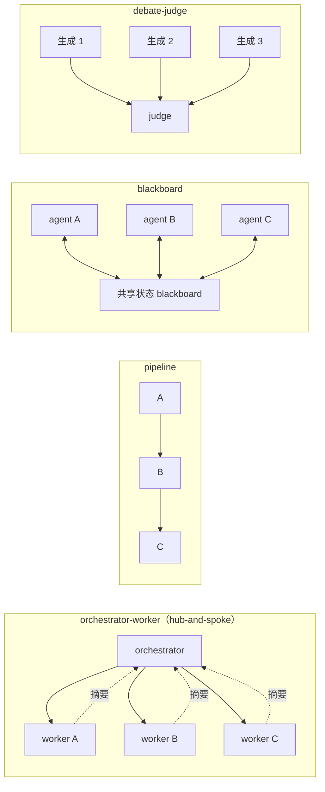
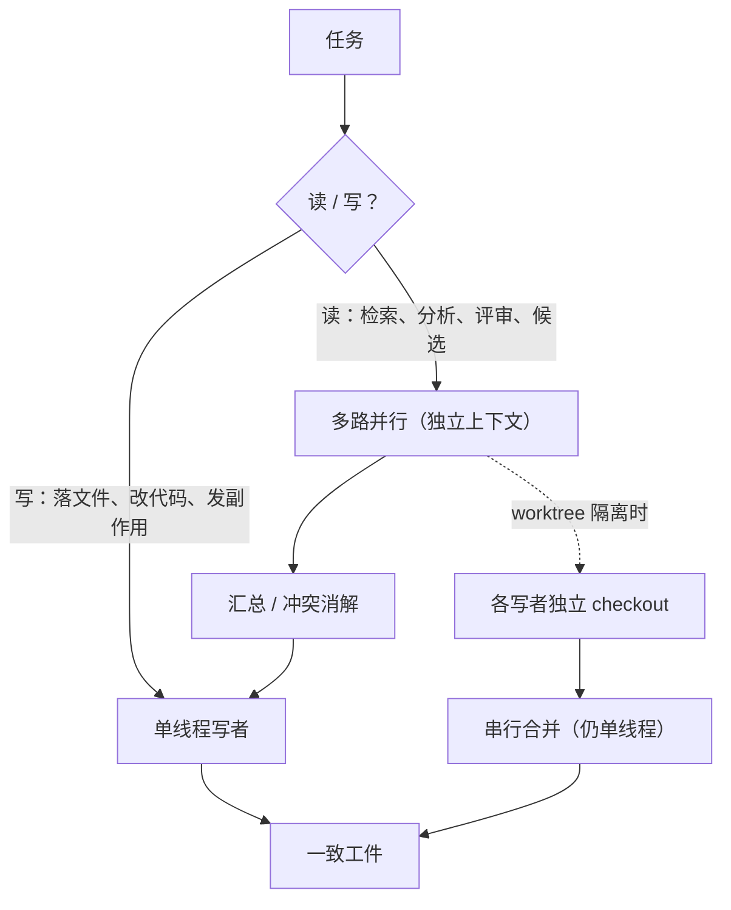
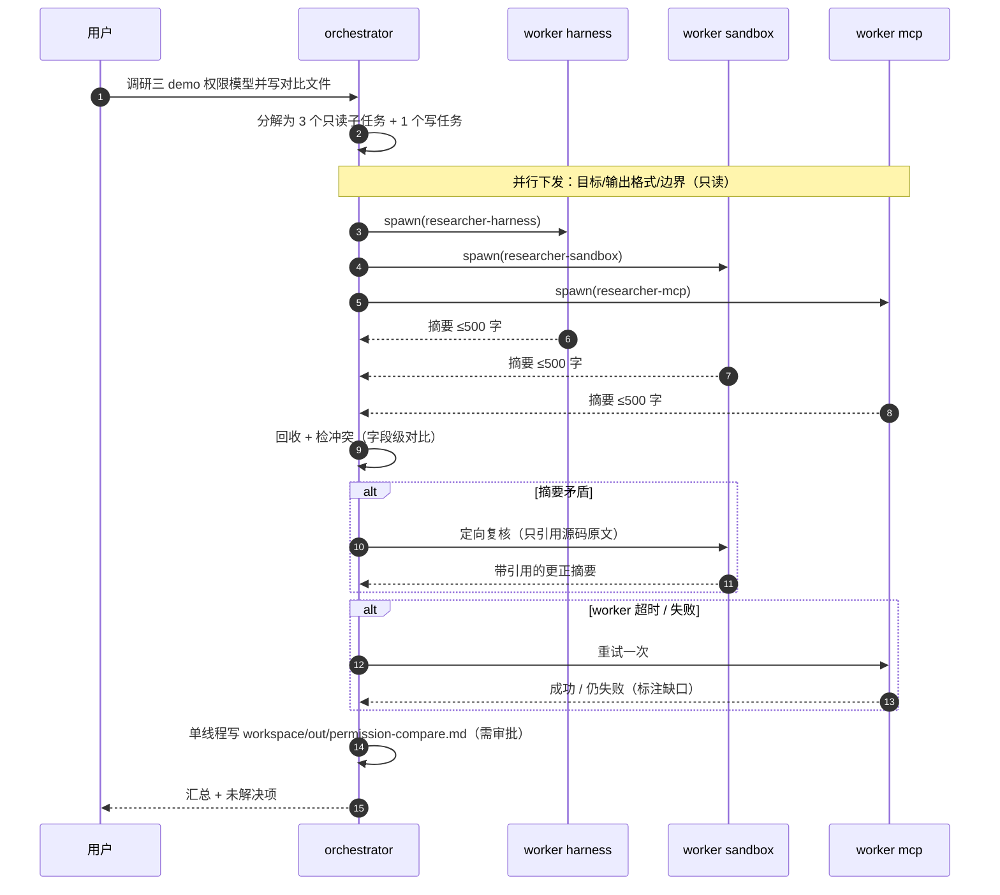
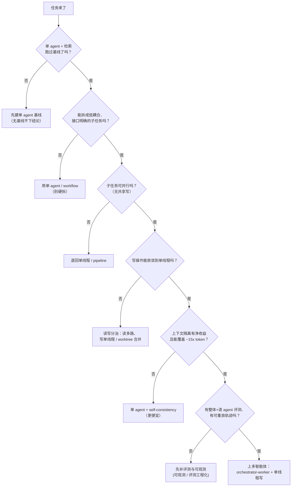

# 多智能体编排

> P0 · 📖 讲义已展开、待提问演练（2026-10-11）· 前置：系统设计 §S3 + Harness 架构 §8 + 从零写 harness §⑥⑧
> 定位：一等知识域；标注 [稳定历史]/[2026现行]，URL 见文末

---

## 本课导读：多智能体到底在买什么

多智能体不是"更聪明的模型"，它是一套**工程手段**：把一个大任务拆成多个各自独立上下文的 agent，换取两样东西——

1. **上下文隔离**：子 agent 可以烧掉上万 token 做深度检索/分析，只把 1-2k token 的浓缩摘要还给主 agent；脏活被封在子上下文里，主 agent 只保留结论（Harness 架构 §8.1 动机 1）。
2. **并行**：彼此独立的子任务同时跑，省的是墙钟时间，不是 token；不同角色还能配不同工具集/提示词（探索者只读、写者只能改某个路径）。

它**不**带来推理能力提升。同一个模型、同样的 token，拆成 5 个 agent 不会比 1 个 agent 更聪明，只会更贵、更难调、更容易不一致。这是本课总纲：**判断"该不该上多智能体"，就是判断"这个任务是否真的需要上下文隔离、是否真的可并行、是否值得付 ~15 倍的 token 和额外的协调/调试成本"。**

2026 年行业给出的收敛答案（Cognition）：**多智能体出智力（读、搜、评、候选），写操作保持单线程。** 记住这句话，S4/S9 都在展开它。

**本课地图**（每节回答一个问题）：

| 节 | 回答的问题 |
|---|---|
| S1 三层判断 | 该不该上？ |
| S2 架构模式 | 上哪种拓扑？ |
| S3 通信与上下文隔离 | agent 之间传什么？ |
| S4 一致性与写 | 并行写怎么不冲突？ |
| S5 成本与评测 | 代价多大、怎么评？ |
| S6 框架对照 | 三条实现路线怎么选？ |
| S7 设计练习 | 给自己的 harness 加子代理 |
| S8 实战走查 | 一次任务的完整轨迹与失败分支 |
| S9 什么时候不要用 | 反方证据 + 决策清单 |

---

## S1 何时多智能体（何时不用）

**三层判断，每层可答"不"——三层都答"是"，才轮到多智能体。** 大多数人一上来就问"用几个 agent"，正确顺序是先证明单 agent 不够。

1. **要不要 agent**：OpenAI 指南 [稳定历史]——只在**规则式方案失效**时（复杂判断/规则难维护/非结构化数据）才建 agent；失败必须**停机、把控制权交还用户**。
   - 为什么：agent 的"自由度"是成本，不是特性。规则能表达的事，用 workflow（预定义路径）更便宜、更可复现、更能验证。
   - 失败模式：把规则式问题做成 agent——主动把确定性换成概率性，还多付 token；出错后没有确定性的兜底。

2. **单还是多**：Anthropic [稳定历史]——从**最简单的可组合模式**起步，多数任务"单次调用+检索"就够；workflow（预定义路径）与 agent（模型自决）是**不同物种**。
   - 为什么：多智能体是 agent 之上的又一层；先证明"单 agent + 检索"打不满需求，再谈拆分。没做过单 agent 基线就上多 agent，说不清收益到底来自"拆分"还是"更多算力"。
   - 失败模式：把本可以用一次检索解决的任务，拆成 orchestrator + 5 个 researcher。

3. **值不值**：≈**15x** chat token、token 解释 **80%** 性能方差 [稳定历史]——"多=好"的大头是 token 买来的，只对**高价值、可并行**任务划算。
   - 为什么：Anthropic 研究系统的 +90.2% 提升，要在 15x token 的账本上读（S5）；内部评测口径不代表你的任务。
   - 失败模式：用多智能体跑低价值任务——为几个百分点烧掉 15 倍预算。

> **判断句**：先单后多，可并行且高价值才并行。

**两个真实动机，别记成"更聪明"**（Harness 架构 §8.1）：多智能体买的是 **① 上下文隔离** 与 **② 并行 + 角色分工**。所以"更多 agent 不是自动更好"——协调有成本、预算是共享的；只在任务可拆分、职责明确、有并行收益时引入（Harness 架构 §8.2）。完整的"不要用"清单与决策树见 **S9**。

---

## S2 架构模式

先看拓扑，再谈实现。五种模式，谱系从"中央控制"到"无中心涌现"：

| 模式 | 结构 | 适用 |
|---|---|---|
| **orchestrator-worker**（hub-and-spoke） | 中央 agent 分解派工汇总 | 分解不可预知 |
| **pipeline** | 固定序列 A→B→C | 步骤可确定拆分 |
| **层级** | 多层 orchestrator | 需二次分解 |
| **blackboard** | 共享状态读写、互相触发 | 强耦合、涌现 |
| **debate-judge** | 独立生成、judge 裁决 | 要一致性 |

**逐个展开（是什么 / 为什么 / 失败模式）**：

- **orchestrator-worker**：中央 agent 动态分解、派工、汇总，worker 之间不直接通信。用在**分解本身不可预知**的任务（多文件代码修改、多源检索）——你没法预先画出流水线，只能边看边拆。失败模式：orchestrator 是单点，委派描述含糊时 worker 会朝错方向做**很深**的工作（贵且难回收）；orchestrator 又当裁判又当汇总，容易成为上下文瓶颈。Anthropic 的解法是把"委派"当成一项要显式教的能力。

- **pipeline**：固定序列 A→B→C，中间可加 gate。用在步骤**可确定拆分**的任务（例：FinHot 的 6 次固定调用结构）。失败模式：中间一步错，全链路错且错误向下游传播；当步骤其实不可预知时，pipeline 逼你把不确定性硬塞进固定槽位。

- **层级（hierarchical）**：多层 orchestrator，用于需要**二次分解**的大任务。失败模式：每加一层，协调成本与端到端延迟叠加，错误和上下文损失逐层放大，归因（"哪一层的锅"）越来越难。

- **blackboard**：多个 agent 读写同一份共享状态、互相触发。适合强耦合、需要涌现的协作。失败模式：状态竞争（谁先写）、无界循环（A 触发 B 触发 A）、轨迹难复现（共享状态让"这一步为什么这样"变模糊）。

- **debate-judge**：多个独立生成，judge 裁决（self-consistency 的多 agent 版）。用于需要**一致性/多视角**的场景。失败模式：judge 自身偏差（自偏好/位置/冗长，评测工程化 §S3）；成本 ×N；多个 agent 犯**同一个**错时投票无效（相关性抵消多样性收益）。

**一句话选型**：分解能预先写死 → pipeline/workflow；分解不可预知 → orchestrator-worker；需要全局规划与人审 → 层级；强耦合共享状态 → blackboard（慎用）；答案可验证且要稳 → debate-judge。真实系统几乎都是**叠的**：外层 orchestrator-worker，worker 内部是 ReAct loop，关键决策点叠 self-consistency（与 系统设计 §S8 范式正交："谁和谁说话" × "怎么想"）。



**Anthropic 研究系统解剖** [稳定历史]：orchestrator + 并行 researchers（**独立上下文**）+ lead 汇总；内部评测高 **+90.2%**（但 **15x** token）；编排者必须"教"委派——三要素 = **目标 / 输出格式 / 边界**。注意这 90.2% 是 Anthropic 内部研究任务口径，不是通用定理；换任务要重跑基线（S5）。

---

## S3 通信与上下文隔离

agent 之间的"通信"有两种形态：**传上下文**（把别的 agent 的完整思路/轨迹带进来）与**传产物**（只带一个结果/摘要）。默认选择传产物——依据是一个反直觉发现。

反直觉发现 [稳定历史→2026现行]：评审 agent 与编码 agent **零共享上下文**时评审效果最好——独立上下文 = 独立判断，不被编码者的思路锚定。Devin Review：平均每 PR 抓 **2 个 bug**、**58%** 严重级。

**为什么"不共享"反而更好**：如果把编码者的完整推理轨迹交给评审者，评审者会顺着编码者已经走过的路走，编码者没想到的边界，评审者大概率也想不到；独立上下文让评审者从产物（diff）出发重新判断。这条结论对整个多智能体设计都成立——**共享的是产物，不是过程**。

**设计规则**：

> "通信"默认传**产物**，不传上下文。

- **下行（委派）**：只传契约三要素——**目标 / 输出格式 / 边界**（S2 教委派）。不传父的全量轨迹。
- **上行（返回）**：传**约束摘要**（约 1-2k token），不是工作日志；子 agent 的完整轨迹落独立文件供审计（S7、从零写 harness §⑥）。

**失败模式**：

- 下行传父全量轨迹 → token 爆炸 + 子 agent 被父的错误假设锚定，独立思考被污染。
- 上行传无结构长文 → 汇总层上下文爆炸，orchestrator 反而成了瓶颈（原本开子 agent 就是为了省它的上下文）。
- 为了"求共识"而共享上下文 → 独立判断被磨平，评审/投票失去意义（debate-judge 的多样性收益来自独立）。

**A2A 一句话卡** [2026现行]：由 Linux Foundation 的 **Agentic AI Foundation（AAIF）** 托管（与 MCP、goose、AGENTS.md、agentgateway 同列，见 aaif.io/projects）；规范最新正式发布 **v1.0.1（2026-05-28，前版 v1.0.0 2026-03-12）**；官方定位"不规定子 agent 通信与工具调用"，面向企业互操作、采用早期。治理名单别混淆两套：**AAIF 技术委员会现列 8 家**（Anthropic、Microsoft、Block、OpenAI、Google、Cloudflare、Bloomberg、AWS），**A2A 另设自己的 TSC**（Google、Microsoft、Cisco、AWS、Salesforce、ServiceNow、SAP、IBM）。面试一句："AAIF 治理下与 MCP 互补（agent↔agent vs agent↔工具），企业采用早期——我们尚未引入，但调研过。"

---

## S4 一致性与写：单线程写

**为什么并行写必然冲突**：Cognition 的论证是——每个行动都携带**隐式决策**（implicit decisions）：这个变量叫什么、错误怎么处理、边界条件取哪一端。写者没把这些写进任务描述，但都做了选择。两个并行写者各自做了一套隐式决策，合并时就是两套风格/边界/语义的碰撞。

Cognition 立场演化 [稳定历史→2026现行]：

- 2025《Don't Build Multi-Agents》：每个行动携带隐式决策，并行写者必然冲突。
- 2026 确认：唯一能工作的模式是"**多智能体出智力、写操作保持单线程**"。

**分水岭**：并行只在"**写单线程、读多路**"时产出一致工件。读写分治——**读**（检索/分析/评审/候选）多路并行；**写**收敛单一 agent，或用 worktree 隔离后**串行合并**（Harness 架构 §8.2：独立上下文 ≠ 文件隔离；子 agent 共享同一个文件系统）。git worktree 给每个写者独立 checkout，最后单一 serial merge——这是"单线程写"的空间版。



**失败模式**：

- 并行写同一文件 → 后写覆盖先写；或语义冲突（两个改动各自成立，合并后不成立）。
- 评审者与编码者共享上下文 → 被编码者思路锚定 → 漏 bug（S3）。
- 把"写"也并行化，再用一个"合并 agent"兜底 → 合并 agent 要理解所有人的隐式决策，等于把冲突推到最后一步，且它自己也是概率组件。

---

## S5 成本与评测

**Token 经济学**：agent ≈ **4x** chat、多智能体 ≈ **15x**；token 解释 **80%** 方差 → "更大模型 vs 更多 agent"本质是 token 经济学问题；预算是一等公民（从零写 harness §⑧）。面试时把这三个数字和"预算是一等公民"一起说，比背架构图更显资深。

**为什么多智能体评测更难**：多一层**组合问题**——**逐 agent 局部指标加不出系统指标**。举例：3 个 researcher 各自的检索准确率都 0.9，但 orchestrator 分解时漏了一个子问题、或汇总时把矛盾摘要强行平均，系统级答案仍然错。worker 都好、汇总照样错。

评估的对象始终是 **harness + 模型整个系统**（Harness 架构 §9.1），所以分层看：

- **整体级**：任务级 pass@k + 轨迹级（系统设计 §S4）。
- **逐 agent 级**：成本归因 + 失败归因（**分解错**还是**执行错**——这是多智能体独有的归因维度）。
- **纪律**：先端到端评测，再拆逐 agent——没有基线分不清"多智能体差"还是"任务本身难"。

**数值口径提醒**：+90.2% / 15x / 80% 都来自 Anthropic 内部研究系统评测；它们是**证据**（说明这个模式在某些任务上有效），不是**保证**（说明你的任务也会好）。引用时要带口径。

---

## S6 框架对照（多智能体原语的三条路）

| 维度 | Claude Agent SDK | OpenAI Agents SDK | LangGraph |
|---|---|---|---|
| 原语 | subagents | handoffs（交接） | supervisor（图节点） |
| 会话 | sessions continue/resume/fork | sessions（内置记忆） | checkpoint（持久化/回放） |
| 定位 | harness 当库用（Claude Code 产品化） | Swarm 后继（guardrails） | 编排库（1.0.1，图+HITL） |

**读法**：三条路 = **子循环（垂直分叉）/ 交接（水平移交）/ 图调度（显式控制）**。

- **subagents**（Claude Agent SDK）：给你"进程内子代理"原语，藏了子循环的上下文隔离与 session 语义（continue/resume/fork）。
- **handoffs**（OpenAI Agents SDK）：水平**移交控制权**，不是并行分解——一次只有一个活跃 agent，适合"分诊→专门链路"，不适合 orchestrator-worker 的并行扇出。
- **supervisor**（LangGraph）：把调度画成显式图（节点+边+typed state），藏的是 checkpoint/状态序列化语义；好处是控制流可见、可测、可回放。

三家的**问题集相同**（持久化/子代理边界/工具标准化/权限护栏）——"框架收敛 = 行业问题定义收敛"是面试高分句（框架生态 §S3）。也就是说：选哪家不是重点，**这四类问题你怎么答**才是重点（框架生态 §S5 四层选型：控制循环模型 / 持久化恢复语义 / 权限护栏模型 / 可观测出口）。

---

## S7 设计练习：给 harness-demo 加子代理

把 S1-S6 落到自己的作品上：给 harness-demo(从零写 harness 的单 loop)加一个只读"研究子代理"——并行检索文件、只回摘要。目标不是真做出完整系统，而是把**四个必答决策**讲清楚（它们正好对应 Harness 架构 §8.2 的两个误区）。

1. **loop 嵌套 vs 新进程**：首选**进程内嵌套**（独立上下文，复用 从零写 harness §⑥ 会话机制——每个子代理有自己的 JSONL）；要权限隔离/独立崩溃域才升级新进程（pi RPC 模式，框架生态 §S4）。

2. **轨迹记录**：复用 demo.jsonl 事件类型（`init / model_response / tool_intent / tool_exec / compaction / final / crash`），子段加 `subagentId`；父进程只记"委派请求 + 摘要返回"（1-2k token），完整子轨迹落独立文件（从零写 harness §⑥）。这样父轨迹保持小、子轨迹可审计。

3. **权限继承**：子 policy ⊆ 父 policy——**父为上界，只允许收紧**（如 researcher 只读工具）；policy 是进程级门（Harness 架构 §7），子代理不豁免。这点在 S8 走查里会具体体现（worker 只读、写由父单线程做）。

4. **上下文传递**：只传"目标 + 输出契约"（S2 教委派三要素），不传父全量轨迹；返回 = 约束摘要（S3 上行规则）。

四题的共同内核：**子代理是"上下文隔离 + 权限收紧"的容器，不是"更聪明的小助手"**。任何一条答成"给子代理更多信息/更多权限会更好"，都违背了 Harness 架构 §8.2。

---

## S8 实战走查：一次 orchestrator-worker 任务的完整轨迹

> **说明（准确性）**：下面的事件 schema 取自 harness-demo 已实现并实测的类型定义与轨迹文件——`harness-demo/src/types.ts` 的 `TrajectoryEvent`，以及 `harness-demo/trajectories/demo.jsonl` 的真实运行记录（`trajectories/demo.jsonl` 实测含 `init / model_response / tool_intent / tool_exec / final`；`compaction`、`crash` 见 `src/types.ts` 的 schema 定义，尚未出现在 demo 轨迹中）；子代理复用同一 schema 并加 `subagentId`（S7 决策 2）。仓库里可运行的**双 agent demo 仍在 Roadmap「规划中」**（`site/src/pages/works.astro`），所以本节是一次**设计走查**：每一步用到的控制层（权限门、intent/exec、未知状态核对、单线程写）都在 从零写 harness/harness-demo 中已实现，只是还没有拼成多 agent 的可运行版。

**任务**：调研本仓库三个 demo（harness-demo / sandbox-demo / mcp-demo）的权限模型，输出一页对比 `workspace/out/permission-compare.md`。这个任务可拆、子任务只读、汇总需要一致性 → 适合 orchestrator-worker + 单线程写。

### 8.1 时序总览



### 8.2 父轨迹（orchestrator 的 JSONL）

```json
{"kind":"init","system":"你是编排者。工具：spawn_subagent(只读调研)、read_file、write_file(需审批)。约束：worker 只读；写操作由你单线程完成；预算=步数/token。","user":"调研 harness-demo / sandbox-demo / mcp-demo 的权限模型，写 workspace/out/permission-compare.md","startedAt":1791702925036}
{"kind":"model_response","assistant":{"role":"assistant","content":"分解为 3 个只读子任务；每个只回答：默认通道、通道集合、审批触发点，且每条带文件:行。","tool_calls":[{"id":"call_r1","name":"spawn_subagent","arguments":{"subagentId":"researcher-harness","goal":"提取 harness-demo 权限模型","outputFormat":"≤500字：default/channels/approve触发点，每条带 文件:行","boundary":"只读 harness-demo/**，禁止写"}},{"id":"call_r2","name":"spawn_subagent","arguments":{"subagentId":"researcher-sandbox","goal":"提取 sandbox-demo 权限模型","outputFormat":"同上","boundary":"只读 sandbox-demo/**"}},{"id":"call_r3","name":"spawn_subagent","arguments":{"subagentId":"researcher-mcp","goal":"提取 mcp-demo 权限模型","outputFormat":"同上","boundary":"只读 mcp-demo/**"}}]},"finishReason":"tool_calls","ms":3120,"usage":{"prompt_tokens":820,"completion_tokens":180}}
{"kind":"tool_intent","id":"call_r1","name":"spawn_subagent","args":{"subagentId":"researcher-harness","boundary":"harness-demo/**","readonly":true}}
{"kind":"tool_exec","id":"call_r1","name":"spawn_subagent","status":"ok","result":{"subagentId":"researcher-harness","summary":"harness-demo：default=deny（src/policy.ts:19 fallback）；channels=allow/approve/deny，优先级 deny>approve>allow（src/policy.ts:3）；approve 触发点=write_file；只读工具 allow。"},"ms":18400}
{"kind":"tool_intent","id":"call_r2","name":"spawn_subagent","args":{"subagentId":"researcher-sandbox","boundary":"sandbox-demo/**","readonly":true}}
{"kind":"tool_exec","id":"call_r2","name":"spawn_subagent","status":"ok","result":{"subagentId":"researcher-sandbox","summary":"sandbox-demo：default=deny（src/policy.ts:12）；四通道 allow/approve/deny/sandbox，冲突 deny>approve>sandbox>allow（src/policy.ts:3）；未写规则默认 deny。"},"ms":21050}
{"kind":"tool_intent","id":"call_r3","name":"spawn_subagent","args":{"subagentId":"researcher-mcp","boundary":"mcp-demo/**","readonly":true}}
{"kind":"tool_exec","id":"call_r3","name":"spawn_subagent","status":"ok","result":{"subagentId":"researcher-mcp","summary":"mcp-demo：只读到 allow、egress/write 到 approve、未分级到 deny（src/defense.ts:46-50）；L2 黑名单命中 attacker 地址→deny。"},"ms":19780}
{"kind":"model_response","assistant":{"role":"assistant","content":"r3 未回答『未分级工具的默认返回』是否就是 deny 的原文依据，且与 r1/r2 的 default=deny 表述口径不一。定向复核（只引用源码原文），不靠猜。","tool_calls":[{"id":"call_r3b","name":"spawn_subagent","arguments":{"subagentId":"researcher-mcp-verify","goal":"引用 mcp-demo 未分级工具的默认返回原文","outputFormat":"一行原文 + 文件:行","boundary":"只读 mcp-demo/src/defense.ts"}}]},"finishReason":"tool_calls","ms":2410,"usage":{"prompt_tokens":1360,"completion_tokens":96}}
{"kind":"tool_intent","id":"call_r3b","name":"spawn_subagent","args":{"subagentId":"researcher-mcp-verify","boundary":"mcp-demo/src/defense.ts","readonly":true}}
{"kind":"tool_exec","id":"call_r3b","name":"spawn_subagent","status":"ok","result":{"subagentId":"researcher-mcp-verify","summary":"defense.ts:50 `return \"deny\"; // 未分级 = 默认 deny（安全默认，面试点）`"},"ms":7300}
{"kind":"tool_intent","id":"call_write","name":"write_file","args":{"path":"workspace/out/permission-compare.md"}}
{"kind":"tool_exec","id":"call_write","name":"write_file","status":"ok","result":"已写入 workspace/out/permission-compare.md（三 demo 均为默认 deny，差异在通道集合与审批/egress 触发点）","ms":6}
{"kind":"final","content":"三 demo 的共同点=默认 deny；差异：harness-demo 三通道、sandbox-demo 四通道(+sandbox)、mcp-demo 按风险分级+黑名单+egress 白名单。已单线程写入对比文件。未解决项：无。","totalMs":72140}
```

### 8.3 子轨迹（worker 的 JSONL，带 subagentId）

```json
{"kind":"init","subagentId":"researcher-harness","system":"你是只读调研子代理。只能 read/list。返回 ≤500 字结构化摘要，每条带 文件:行。","user":"提取 harness-demo 权限模型：default / channels / approve 触发点","startedAt":1791702925036}
{"kind":"model_response","subagentId":"researcher-harness","assistant":{"role":"assistant","content":null,"tool_calls":[{"id":"h1","name":"read_file","arguments":{"path":"src/policy.ts"}},{"id":"h2","name":"read_file","arguments":{"path":"README.md"}}]},"finishReason":"tool_calls","ms":1220}
{"kind":"tool_intent","subagentId":"researcher-harness","id":"h1","name":"read_file","args":{"path":"src/policy.ts"}}
{"kind":"tool_exec","subagentId":"researcher-harness","id":"h1","name":"read_file","status":"ok","result":"// 优先级 deny > approve > allow；默认 = deny（fallback）","ms":1}
{"kind":"final","subagentId":"researcher-harness","content":"default=deny（src/policy.ts:19）；channels=allow/approve/deny，优先级 deny>approve>allow（src/policy.ts:3）；approve 触发点=write_file；只读工具 allow。"}
```

**关键点**：worker 只读（policy 收紧，S7 决策 3）、只回摘要（S3 上行规则）、完整子轨迹独立落盘（S7 决策 2）、父轨迹只记"委派 + 摘要"（保持父上下文小）。

### 8.4 分步输入/输出/失败分支

| 步 | 事件（kind） | 输入 | 输出 | 失败分支与处理 |
|---|---|---|---|---|
| 1 接收任务 | `init` | system 约束 + user 任务 | 父会话建立 | — |
| 2 分解派工 | `model_response` | 任务 + 工具 schema | 3 个 `spawn_subagent`（目标/输出格式/边界） | 委派边界写不清 → worker 做深做错；须在派工前检查三要素齐全 |
| 3 并行执行 | `tool_intent` + `tool_exec`（每 worker） | 契约三要素 | ≤500 字摘要 | worker 超时/报错 → 重试 1 次，仍失败则标注"该子问题未解"，**不编造** |
| 4 结果回收 | `model_response` | 3 份摘要 | 字段级对比 | 摘要超长/缺字段 → 要求重摘要或截断+标注 |
| 5 冲突消解 | `tool_intent` + `tool_exec`（定向复核） | 矛盾字段 | 带源码原文的更正 | 不让 judge"凭感觉挑一个"（judge 有偏差，评测工程化 §S3）；要引用一手原文 |
| 6 单线程写 | `tool_intent` + `tool_exec`（write_file） | 汇总内容 | 一致工件 | 审批拒绝 → 保持原样、如实报告（从零写 harness `demo:reject` 行为，**拒绝也是合法结果**） |
| 7 收尾 | `final` | 全部结果 | 汇总 + 未解决项 | 预算耗尽 → 保存状态、可恢复续跑，不包装成成功（从零写 harness §⑧ / harness §9） |

**崩溃分支**(复用从零写 harness 的实测机制)：若父进程在 `tool_intent` 与 `tool_exec` 之间崩溃，日志里就是 **intent 在、exec 不在 = 结果未知**。恢复时只读工具可安全重放；非只读工具**不盲目重放**，先把 `[未知状态]` 摆给模型，让它先只读核对现状再决定（`harness-demo/src/agent.ts` 的 `guardedToolStep`，以及 `harness-demo/src/session.ts:50` 的 `rebuild`；从零写 harness §⑦ 实测输出）。

**成本账**：3 个 worker 各自烧掉上万 token 检索，但只回 ≤500 字（约 400-700 token）摘要；父上下文保持小。代价在总量：总 token 仍会逼近 **15x chat**（S5）。所以这一步的收益不是"省 token"，是"父上下文不被撑爆 + 三个子任务并行省墙钟时间"——面试时要把这句说清，否则会被追问"你不是说多智能体很贵吗"。

---

## S9 什么时候不要用多智能体

**默认答案应该是"不用"**——除非 S1 三层全过。下面把反方证据摊开，最后给决策清单与决策树。

**证据 1 · 单线程写（Cognition）**：2025《Don't Build Multi-Agents》指出并行写者携带互不兼容的隐式决策，必然冲突；2026 确认唯一可行模式是"多智能体出智力、写保持单线程"。凡任务主体是"写"（改代码、落库、发副作用），多智能体的默认答案就是**不**——除非能把它改造成"读多路 + 写单线程"（S4）。

**证据 2 · 共享上下文成本**：给 agent 之间共享上下文有两笔账——token（共享内容要重复进各自的上下文）和判断质量（独立判断被锚定，S3）。而"零共享"往往效果最好（Devin Review 反直觉发现）。想靠共享上下文"对齐"多个 agent，通常是在用更贵的方式复制单 agent 的上下文。

**证据 3 · 调试难度**：多智能体把一条轨迹变成多棵轨迹 + 消息竞态 + 共享状态。失败归因从"这一步错了"升级为"是分解错、委派错、某个 worker 错、还是汇总错"——这是信用分配问题（评测工程化 §S2/S8）。没有**可重放的轨迹**（可观测）和**逐 agent 失败归因**（评测工程化），多智能体系统会变成黑盒：每个局部指标都绿，整体就是不对。**调试能力不足时，多智能体是负资产。**

**证据 4 · 成本倍率**：agent ≈4x chat、多智能体 ≈15x；token 解释 80% 性能方差。多智能体把成本推高一档，只有高价值/高并行/高延迟敏感的任务才收得回。

**什么时候不要用（反方清单）**：

- 单 agent + 检索还没跑过基线（无基线，无法证明拆分有净收益）。
- 任务本质是低耦合都不成立的"一坨"（拆分接口本身就不清）。
- 子任务之间**必须**共享同一份实时状态才能推进（blackboard 类强耦合，慎用）。
- 任务是"写"为主，且无法收敛到单线程写。
- 低价值/低并行任务（成本收不回）。
- 只想让答案"更稳"——那该用 self-consistency（采样投票）或验证/重试，不是拆 agent。
- 还没有可重放轨迹与逐 agent 评测（无法归因、无法迭代）。

**决策清单**（任一"不"，先不上多智能体，或先补该能力）：

- [ ] "单 agent + 检索"的端到端基线跑过了吗？（无基线不下结论）
- [ ] 任务能拆成**低耦合、接口明确**的子任务吗？
- [ ] 子任务真的**可并行**吗（没有共享写、没有强制实时共享状态）？
- [ ] **上下文隔离有净收益**吗（子任务要处理的 token 远多于要返回的摘要）？
- [ ] 价值/延迟收益能覆盖约 **15x** token 吗？
- [ ] 有评测能**同时**评整体级与逐 agent 级吗（评测工程化）？
- [ ] 有**可重放轨迹**能对失败做归因吗(可观测 / 评测工程化)？
- [ ] 写操作能收敛到**单线程**（或 worktree 隔离 + 串行合并）吗？



**面试句**："多智能体的默认答案是'不用'，它买的是上下文隔离和并行，不是聪明。我会先跑单 agent 基线，再检查四级——可拆、可并行、写可单线程、评测能同时看整体和逐 agent；四级都过才上。这也是 Cognition 2026 的结论：多智能体出智力，写保持单线程。"

---

## 与已有知识的衔接

- 系统设计 §S8（范式速查）：ReAct 等是**单 agent** 范式——"怎么想"（C S8）×"谁和谁说话"（本课），两维正交。
- Harness 架构 §8（子代理：最后才选）：本课 = 它的外部验证与升级（15x / 零共享评审 / 单线程写）。
- 从零写 harness §⑥⑧：JSONL 轨迹 = 子代理记录地基；预算/压缩 = token 经济学执行层。本课 S8 的轨迹 schema 直接复用 从零写 harness/harness-demo。
- 评测工程化（评测）：整体 vs 逐 agent 接 H S4 轨迹评测、H S6 CI 门禁。
- 框架生态 §S3（各家要点）：S6 三列对照 = "子代理边界"共同点展开；框架生态 §S4 = pi RPC 子进程模式。
- 沙箱与凭据（沙箱）：子代理共享文件系统 → 并行写要 worktree/沙箱隔离；本课 S4 的"独立上下文≠文件隔离"与本课同源。

---

## 练习题库（后续提问用）

| # | 题目 | 考察 |
|---|---|---|
| 1 | "上 5 个 agent 为何又慢又贵"——三句话答 | S1+S5 |
| 2 | 评审 agent 为何零共享上下文最好？最小输入？ | S3 |
| 3 | 设计评审循环：哪写单线程、哪读多路 | S4+S7 |
| 4 | handoffs/subagents/supervisor：各对什么任务形态 | S6 |
| 5 | orchestrator-worker 里某个 worker 返回的摘要明显比另两个短、信息少。返工前先查哪三件事？ | S8 失败分支 |
| 6 | 两个 worker 摘要矛盾，为什么"让 judge 挑一个"是坏默认？给出更好的流程 | S3+S8 |
| 7 | 为什么"独立上下文≠文件隔离"？子代理并行写同一工作区，给出两种可行隔离方案 | S4+harness §8.2 |
| 8 | Anthropic 说多智能体内部评测 +90.2%，但这个数字不能直接作为上多智能体的理由。给出三个限定条件 | S1+S5 |
| 9 | 把固定 workflow（FinHot 6 次调用）改成 orchestrator-worker，买到了什么、放弃了什么？何时值得改？ | S2+S5 |
| 10 | 给 S8 走查加"定向复核"子任务后，token 账本怎么变？什么指标能证明它值？ | S5+S8 |
| 11 | 多智能体系统里，子 agent 的权限、凭据、trace 分别怎么管？ | S7+S8（接 interview-bank E4+M4+C3） |
| 12 | 团队第 3 次遇到"多智能体跑得慢且结果不一致"。作为负责人，先要求哪三个验证再决定是否继续投入？ | S9 决策清单 |

---

## 来源与锚点（自 industry-2026.md 复制，一手源已实抓）

- Anthropic [稳定历史]：最简单起步/workflow vs agent；4x/+90.2%/15x/80%/教委派（研究系统口径 §1.2/§4.4） → anthropic.com/engineering/{building-effective-agents, multi-agent-research-system}
- Cognition [稳定历史→2026现行]：隐式决策/并行写冲突→单线程写；Devin 2 bug/58% → cognition.ai/blog/{dont-build-multi-agents, multi-agents-working}
- OpenAI [稳定历史]：规则式失效才建 agent/失败停机 → cdn.openai.com/business-guides-and-resources/a-practical-guide-to-building-agents.pdf
- 框架 [2026现行/稳定历史]：code.claude.com/docs/en/agent-sdk/overview（subagents/sessions continue-resume-fork） · developers.openai.com/codex（handoffs） · github.com/langchain-ai/langgraph（1.0.1） · a2a-protocol.org/latest/（A2A v1.0.1；AAIF 治理）
- 本课 S8 轨迹 schema：`harness-demo/src/types.ts`（`TrajectoryEvent`）+ `harness-demo/trajectories/demo.jsonl`（实测）；恢复机制见 `harness-demo/src/agent.ts`（`guardedToolStep`）与 `harness-demo/src/session.ts:50`（`rebuild`）
- 三个 demo 的权限模型（S8 走查取材，源码核验）：`harness-demo/src/policy.ts`（deny>approve>allow，默认 deny）、`sandbox-demo/src/policy.ts`（四通道，默认 deny）、`mcp-demo/src/defense.ts`（风险分级，未分级默认 deny）
