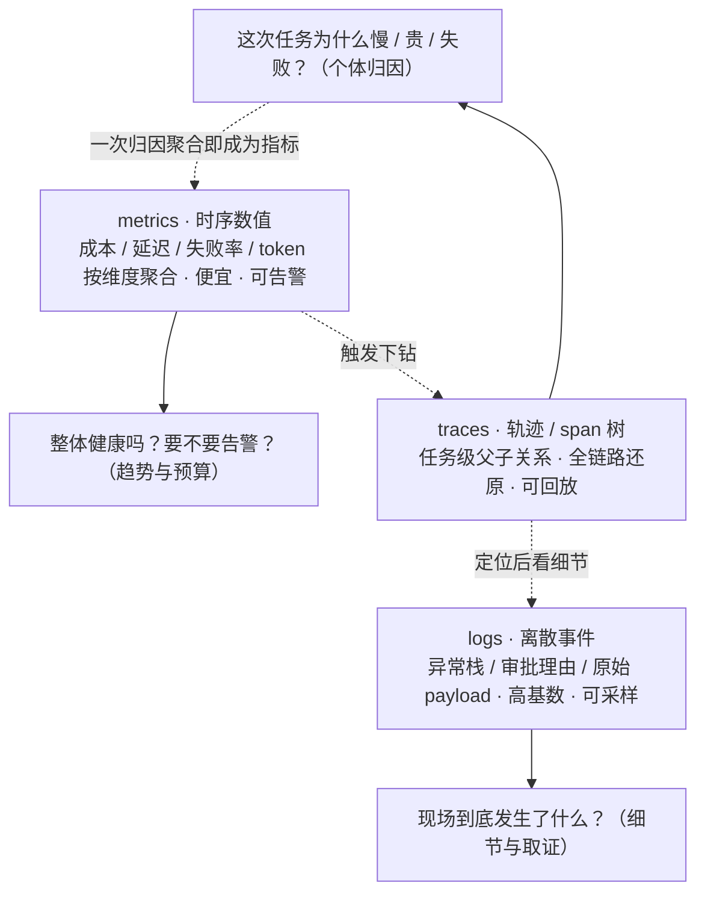
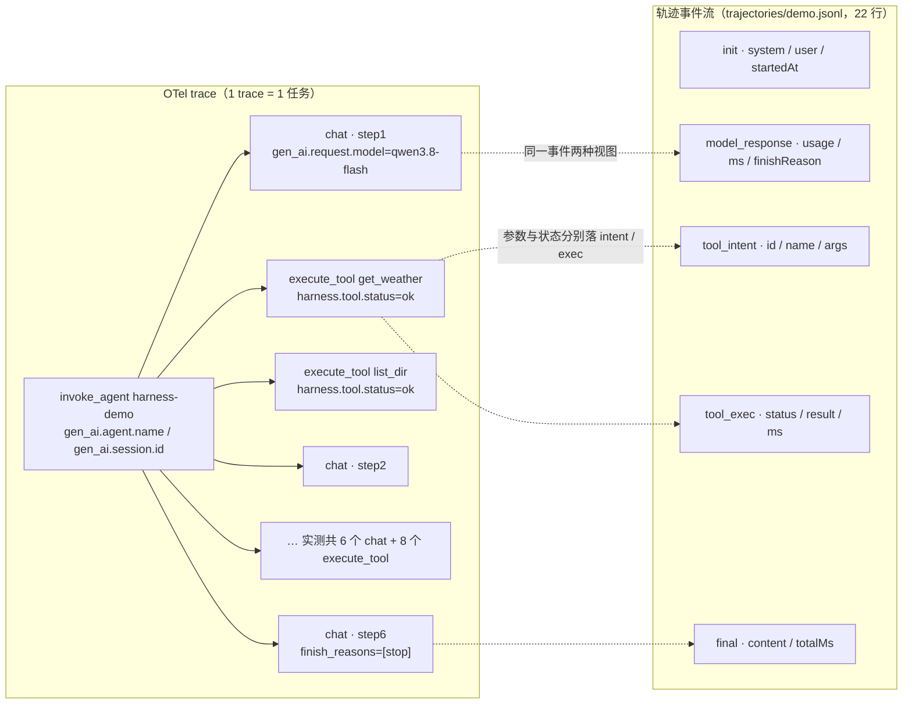
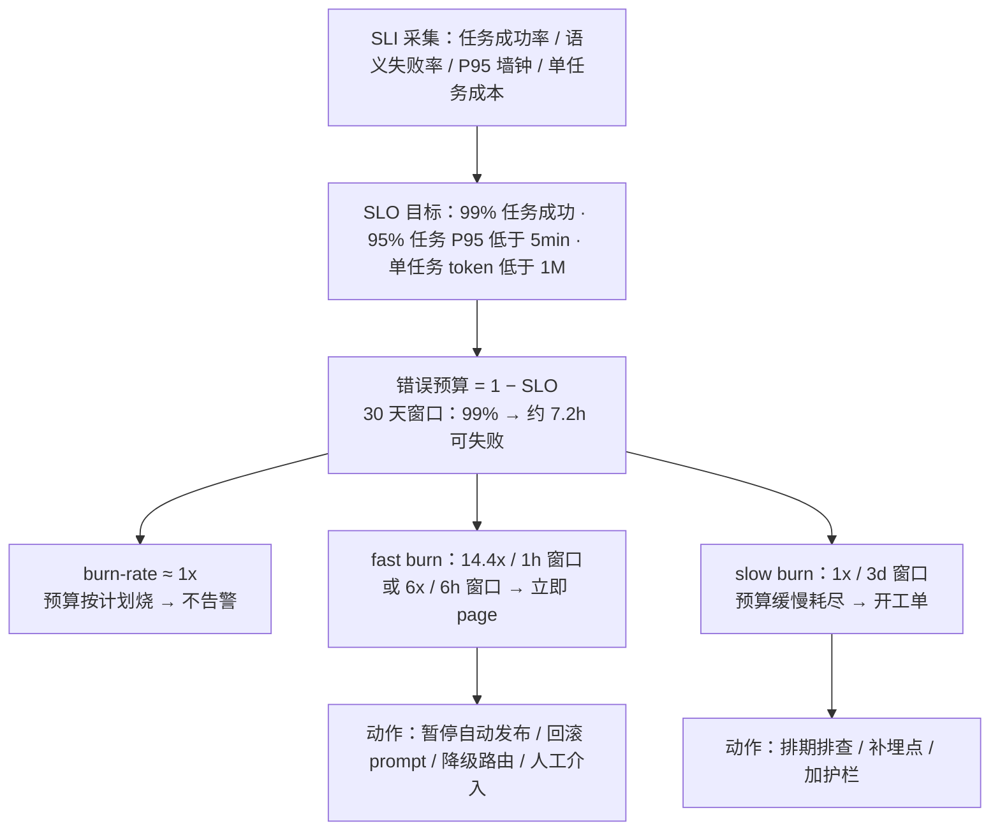
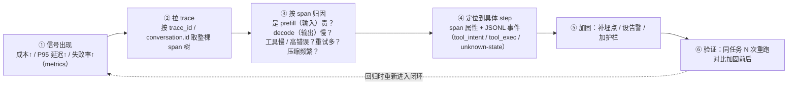

# 可观测(tracing / OTel GenAI / 成本归因)

> 优先级 P2（JD 显示是 2026 新热点，腾讯有专门岗——若目标平台向则提级）
> 状态：📐 讲义已展开，待提问演练（S2 OTel GenAI 埋点已在 harness-demo 实操）
> 前置：从零写 harness §⑥（JSONL 日志=harness 内置的轨迹源）+ 评测工程化（可观测=数据采集，评测=决策）
> 定位句：**可观测是评测的数据管道**——没有轨迹采得全，golden set/judge/飞轮（数据飞轮）全是无源之水
> 本课怎么读：S1-S2 是坐标系与格式（为什么 agent 观测不同、OTel GenAI 要报得出名字）；S3-S4 是数据模型与经营（span 树怎么建、成本怎么归因、SLO 怎么定）；S5 是诊断工作流；S6 是工具选型；**S7 实战走查**把一条真实轨迹从异常信号追到加固；**S8 常见错误与追问**是反向题库。练习题按"考察"列回查对应小节。

---

## 预备知识（这课的门槛，只讲「课程外」要会什么）

- **课程依赖（prereqs）**：`api-engineering`（上一课带入「成本归因 = 路由决策输入」的账本意识——可观测就是这套账本的**数据来源**）。
- **技能门槛**：会「trace / span / metric」三个 OTel 术语的粗概念即可（trace=一次任务、span=树里的一个节点、metric=时序数值）。
- **不需要提前会**：Prometheus / Grafana / Langfuse 的配置、OTel SDK 内部细节——一律不用。OTel GenAI 属性族 / span 树建模 / burn-rate 告警随 `harness-demo`（`npm run demo:otel:mock` / `npm run demo:otel:assert`）边跑边建。

---

## S1 为什么 agent 可观测 ≠ 微服务可观测

**这一节解决什么问题**：先把坐标系立起来。面试官问"你怎么做可观测"，如果答"上 Prometheus + Grafana"或"日志全量采"，说明还把 agent 当普通后端——普通后端的可观测回答"哪台机器慢了"，agent 的可观测要回答"这次任务为什么跑偏、钱花在哪一步、下次怎么更好"。前者是运维视角，后者是**数据管道视角**：观测的产出不只是告警，还有能回放、能对比、能喂评测的轨迹。

| 维度 | 微服务 | agent |
|---|---|---|
| 工作单元 | 请求（扁平调用链） | **轨迹**（agent→步→LLM 调用/工具调用，树形嵌套，深度不可预知） |
| 失败 | 错误码/超时 | 错误码**+语义失败**（调用全 200，答案全错） |
| 确定性 | 同输入同输出 | 非确定 → 观测的价值=**能重放、能对比两次运行** |
| 成本 | 通常不是观测维度 | **token 成本是一等指标**（和延迟、错误率并列） |
| 调试手段 | 日志+指标 | **轨迹回放**（整条 prompt+工具 I/O 重现）+ 轨迹对比（diff 两次运行） |

**怎么读这张表**：五行不是并列的五个功能，而是**同一个根因的五个投影**——根因是"agent 的工作单元是树形轨迹，且其正确性不能由状态码判定"。第 1 行（轨迹 vs 请求）决定数据模型必须是 span 树而不是扁平调用链；第 2 行（语义失败）决定"错误率"要扩成"语义失败率"（=评测工程化 judge 的在线输入端）；第 3 行（非确定）决定观测必须支持**重放与对比**，否则同一个问题无法复现；第 4 行（token=一等指标）决定成本是第一类信号而不是账单附件；第 5 行（轨迹回放）是把前四行落成可操作动作的手段。

**失败模式（没有这套坐标系长什么样）**：
- **只打日志不做 trace 关联**：一次任务几十行日志散在文件里，看不出哪次 LLM 调用属于哪个 step、哪次工具调用由哪个 step 触发——事后无法按 span 归因，只能人肉猜时间顺序。
- **把 token 当日志字符串存**：能 grep 到 `tokens=765`，但没法按模型/用户/step 聚合，S4 的四个归因问题一个都答不出。
- **采样率一刀切**：把异常轨迹和正常轨迹按同一比例采样，最该分析的长尾失败样本恰恰被比例丢掉。
- **用 HTTP 200 当成功**：调用全绿、答案全错，监控面板一片祥和，用户已经在投诉。

**反例（面试里真实的坏答案）**：候选人说"我们有 ELK，日志全量采"。面试官追问"给我看一次失败任务的完整时间线——哪一步开始偏、那一步花了多少 token、重试了几次"，他答不上来，因为日志是**按时间打散的文本**，没有任务级父子关系。正确答案是"一个 trace = 一个任务，trace 内 span 树承载步与调用，日志作为 span 的补充"。

三层数据各回答什么问题——它们是三把不同的尺子，不是三个能互相替代的产品：



**这图的一句话记法**：metrics 告诉你"出事了"（便宜、可长期留存、驱动告警），traces 告诉你"哪条任务、哪一步出事了"（任务级结构），logs 告诉你"那一刻的原始现场"。可观测工程的成熟度，很大程度上看你能不能**从 metrics 自动下钻到 trace，再从 trace 下钻到 log**——三者用同一套关联 ID（`trace_id` / `span_id` / `gen_ai.conversation.id`）串起来才有意义。**反例**：把三层各接一个平台、没有关联 ID，等于有了三本账却对不上。

**面试信号**：先说出"agent 的工作单元是轨迹、错误率包含语义失败、成本是一等指标"三条，再补一句"metrics 负责发现、traces 负责归因、logs 负责取证"——表明你按**问题类型**选数据层，而不是按工具品牌选。

---

## S2 OTel GenAI 语义约定（面试要能报名字）

**这一节解决什么问题**：把"我打点"升级成"我按厂商中立的格式打点"。这一节解决 N×M 问题：没有统一约定时，harness 对接 Langfuse 一套字段、对接 Phoenix 又一套字段，每换一个后端就重写一次埋点。OTel GenAI 语义约定就是把这套字段标准化，让"埋点"与"后端"解耦——埋一次，任意 OTel 后端可读。

OpenTelemetry 为 GenAI 定义了语义约定（`gen_ai.*` 属性族）。

**状态注（面试要能答"它稳定吗"）**：截至本讲义核实，GenAI 语义约定**已从主 semconv 仓库迁到独立仓库** `open-telemetry/semantic-conventions-genai`，官方文档状态标注为 **Development**（不是 stable）；核心 semantic conventions 当前处于 v1.44.0 线。所以准确说法不是"它是稳定契约"，而是"**属性名已是事实标准，但仍处 Development，稳定化时可能改名**"。LangSmith / Langfuse / Phoenix / Helicone 等都已向它收敛。面试说法："**Development ≠ 不能用**：它是唯一厂商中立的轨迹格式，早用的代价是 stable 化时的属性改名，不用的代价是每个平台一套适配（N×M）。"

<!-- TODO 核实: 本讲义已核实 GenAI semconv 迁至独立仓库 semantic-conventions-genai 且状态为 Development；旧的 "experimental / v1.39.0" 说法作废。官方未给出 stable 的具体时间线，若面试要引用"何时 stable"需再核官方 issue/roadmap。 -->

- **span 命名/操作类型**（`gen_ai.operation.name` 取值，已核实）：`chat` / `text_completion` / `embeddings` / `execute_tool` / `create_agent` / `invoke_agent`（新仓库另含 `generate_content` / `invoke_workflow` / `plan` / `retrieval` / `fetch_response` 等）
- **关键属性**（已核实存在；**注意新旧名差异**）：provider 用 **`gen_ai.provider.name`**（旧文常写 `gen_ai.system`）、`gen_ai.request.model` / `gen_ai.response.model`、`gen_ai.usage.input_tokens` / `gen_ai.usage.output_tokens`、`gen_ai.agent.name` / `gen_ai.agent.id`、**`gen_ai.conversation.id`**（会话/线程关联，旧文常写 `gen_ai.session.id`）、`gen_ai.tool.name` + `gen_ai.tool.call.id` / `gen_ai.tool.call.arguments` / `gen_ai.tool.call.result`、温度等请求参数
- **为什么重要（面试点）**：语义约定=**厂商中立的轨迹格式**——harness 按它埋点，后端接 Langfuse / Phoenix / Jaeger 任意一个，不用为每个平台重写。**"OTel 之于可观测，就是 MCP 之于工具接口"——都是把 N×M 降成 N+M**

**实操锚（harness-demo 已实现，复现命令 `npm run demo:otel`）**：`harness-demo/src/otel.ts`（SDK + console 导出，`OTEL_EXPORT_OTLP=1` 才追加 OTLP/HTTP）+ `src/agent.ts`（`invoke_agent`→`chat` / `execute_tool` span 树）+ `src/llm.ts`（流式 usage/model 回填）。`npm run demo:otel` 跑最小 agent 循环并在收尾打印 span 摘要（span 名 + 关键属性）。**验收标准**：收尾摘要显示 `收到 N 个 span（M 个 trace）`，每个 `chat` span 带 `gen_ai.usage.input_tokens` / `output_tokens`，每个 `execute_tool` span 带 `harness.tool.status`。**注意仓库内代码用的是旧属性名**：`gen_ai.system` 与 `gen_ai.session.id`（相对当前规范应为 `gen_ai.provider.name` 与 `gen_ai.conversation.id`）——这是本课埋点与最新约定的一处不一致，见 S8 与文末核实清单。**离线可重跑判据（U-23 收口，2026-10-12 实跑）**：`npm run demo:otel:mock` 用本地 mock 端点（无外网、无 LLM key）打印确定性 span 树，`npm run demo:otel:assert` 对其形态/计数断言、不符即非 0 退出；本次 mock 实测 **15 spans / 1 trace**（invoke_agent×1 + chat×6 + execute_tool×8，含 denied×1），历史活端点报告值「11 spans / 1 trace」仓内无可复跑日志、标**未验证**、不作判据（详见 从零写 harness §⑨）。

```ts
// harness-demo/src/otel.ts —— SDK：console 导出默认；OTEL_EXPORT_OTLP=1 才加 OTLP（默认关）
export const tracer = trace.getTracer("harness-demo");
export async function initOtel(opts: { console?: boolean } = {}): Promise<void> {
  if (provider) return;                                   // 幂等：不重复起 provider
  const processors: SpanProcessor[] = [new SimpleSpanProcessor(memoryExporter)];
  if (opts.console !== false) processors.unshift(new SimpleSpanProcessor(new ConsoleSpanExporter()));
  if (process.env.OTEL_EXPORT_OTLP === "1") { /* 动态 import OTLPTraceExporter，默认不加载 */ }
  provider = new BasicTracerProvider({ resource: resourceFromAttributes({ "service.name": "harness-demo" }), spanProcessors: processors });
  trace.setGlobalTracerProvider(provider);
}

// harness-demo/src/agent.ts —— span 树：invoke_agent 根 → chat / execute_tool 子 span（父子天然正确）
const agentSpan = tracer.startSpan("invoke_agent", {
  attributes: { "gen_ai.operation.name": "invoke_agent", "gen_ai.agent.name": "harness-demo", "gen_ai.session.id": o.session.id },
});
chatSpan.setAttribute("gen_ai.operation.name", "chat");
chatSpan.setAttribute("gen_ai.usage.input_tokens", r.usage.prompt_tokens);       // 流式 usage 回填
chatSpan.setAttribute("gen_ai.usage.output_tokens", r.usage.completion_tokens);
toolSpan = tracer.startSpan("execute_tool", {
  attributes: { "gen_ai.operation.name": "execute_tool", "gen_ai.tool.name": name,
                "gen_ai.tool.call.arguments": JSON.stringify(tc.arguments).slice(0, 500) }, // 参数摘要截断 500
});
toolSpan.setAttribute("harness.tool.status", status);   // ok / error / denied
```

**这段在讲什么**：一段埋点就把 S1–S3 的关键点都摊开了——① `invoke_agent` 是**根 span**（`1 trace = 1 任务`，S3 纪律 1），`chat` / `execute_tool` 作为子 span 由 tracer 自动挂亲；② `gen_ai.usage.input_tokens` 是流式调用在**收尾回填**的（S4 成本归因的原料）；③ 参数/结果都**截断 500 字符**（S2 原文「参数摘要」），全量对象只在 JSONL 事实源里（S2 对照图）。注意仓库用的是旧属性名 `gen_ai.session.id`（当前规范应为 `gen_ai.conversation.id`），这是 S8 #3「Development 阶段属性会改名」的现场实例。

**实跑判据（S2）**：`cd harness-demo && npm run demo:otel:mock`（离线无 key，收尾打印确定性 span 树）+ `npm run demo:otel:assert`（断言 15 spans/1 trace、invoke_agent×1 + chat×6 + execute_tool×8，不符即 exit 1）。这是「OTel GenAI 埋点真的跑起来了」的机器可核证据（clone 判据见 course-structure.ts 的 practicalOutput）。

**一次运行的两个视图**：同一批活动，既可看成 OTel span 树（运行时/后端视图），也可看成 JSONL 轨迹事件流（落盘事实源）。二者对照是理解本课的关键：



**怎么读这张对照图**：左边是"运行时可观测"（span 由 SDK 管理，父子关系天然正确，但 span 结束才导出），右边是"持久化事实源"（逐行 `appendFileSync`，进程被 kill 也不丢，可崩溃后重建）。两者的字段不是一一对应：span 的 `gen_ai.tool.call.arguments` 截断 500 字符，JSONL 的 `tool_intent.args` 是全量对象；span 的 `harness.tool.status` 有 `ok/error/denied`，JSONL 的 `tool_exec.status` 还多一个 `unknown-state`（⑦ 恢复用）。**面试点**：不要把 span 当唯一事实源——trace 后端可能采样、可能丢导出；可恢复系统的唯一事实源永远是本地持久日志。

**实测口径（务必分清 schema 与实测）**：`trajectories/demo.jsonl` 中真实出现的事件类型是 **`init` / `model_response` / `tool_intent` / `tool_exec` / `final`**（22 行：`init`×1、`model_response`×6、`tool_intent`×6、`tool_exec`×8、`final`×1）。`compaction` 与 `crash` **只在 `src/types.ts` 的 `TrajectoryEvent` schema 里定义、尚未出现在 demo 轨迹中**（分别由 `demo:compact` / `demo:crash` 模式单独触发）。另有一个容易看错的细节：`tool_exec` 比 `tool_intent` 多 2 条——`write_file` / `run_shell` 在策略判定为 `deny` / 审批未通过时，**先返回、未记 intent**，只留下 `status:"denied"` 的 `tool_exec`；所以"有 exec 无 intent"是拒绝路径，"有 intent 无 exec"才是崩溃未知状态（S7 会用到这个判据）。**不要把 schema 里定义的类型说成"实测出现"**。

---

## S3 span 建模：一棵轨迹树

**这一节解决什么问题**：OTel 给了属性词汇表，但"哪些调用放进同一个 trace、谁是谁的 parent"是设计决策——建错了，成本归因和回放都会散架。这一节的四条设计要点就是四道建模题，面试常从任意一条追问。

```
trace（=一个任务/一次会话）
└─ invoke_agent（主 agent）
   ├─ LLM call（step 1: tokens/模型/延迟/成本）
   ├─ execute_tool read_file（参数摘要/结果摘要/状态）
   ├─ LLM call（step 2）
   ├─ execute_tool bash（含退出码、耗时）
   ├─ invoke_agent（子 agent —— 子 trace 或同 trace 嵌套 span）
   └─ final（终态：完成/失败/超预算 + 原因分类）
```

设计要点：
1. **一个 trace = 一个用户可见的任务**（不是每个 LLM 调用一个 trace——粒度太碎，成本归因和回放都散架）
2. **LLM span 记全 prompt 与响应**（可回放的前提；大 payload 落对象存储，span 存指针）——注意：全量记录=隐私/合规边界，要有开关(沙箱与凭据的“审计”与这里的"回放"是同一份数据的两种用途）
3. **子 agent 传播**：orchestrator 派 worker 时传 parent span context（pi-agents-team 的 worker 会话=独立 trace，靠 task id 关联——多 agent 系统的 trace 边界问题，框架生态联动）
4. **重试是 child 不是新 trace**：同一逻辑调用的 3 次重试=1 个 span 内 3 个事件（或 3 个子 span 挂同父）——错误率统计才不会把重试数成失败数

**怎么读这四条纪律**：它们是**同一个根因的四个边界**——"可观测要能回答任务级问题，而任务级问题跨越多次调用"。纪律 1 定**粒度边界**（trace 认任务不认调用）；纪律 2 定**保真边界**（要能回放就得存 payload，但要为隐私设开关）；纪律 3 定**进程边界**（跨 agent 时 span context 要显式传播，不会自动续上）；纪律 4 定**语义边界**（重试是"同一次逻辑调用"，不是"三次调用"）。

**失败模式与反例**：
- **粒度太碎**：每个 SDK 调用一个 trace → 一次任务产生 40 个互不相关的 trace，成本归因只能得到"总账"，无法回答"哪一步烧钱"。
- **粒度太粗**：整个产品线一个 trace → 无法定位到具体用户/具体任务，回放失去意义。
- **payload 全丢**：span 只记 `model=qwen3.8-flash tokens=765`，不记 prompt → 回放时"当时的世界"重建不出来，只能看指标不能调试。
- **子 agent 断链**：worker 在自己的进程里新开 trace、不传 parent → orchestrator 视角下 worker 的工作是"黑洞"，成本无法汇总到主任务。
- **重试记成新 trace**：一次工具被拒重试 3 次 → 失败率统计里变成 3 次失败 + 1 次成功 = 75% 失败率，而真实逻辑调用成功率是 100%。

**面试点**："span 树的形状就是你对'什么是一个工作单元'的定义——定义错了，后面的成本归因、回放、告警全部建立在错误的分母上。"

---

## S4 指标经营：成本/token 归因 + SLO 与错误预算

**这一节解决什么问题**：可观测的产出要能变成决策——"这个月花超了要不要停机"、"失败率涨了要不要回滚"。前半节讲**成本归因**（把 token 从日志字段变成可聚合维度），后半节讲 **SLI/SLO/错误预算与 burn-rate 告警**（把"系统健康"变成可承诺、可消耗的预算）。共同思想是：**指标要按维度聚合，并绑定一个可执行的 action 阈值**——没有阈值的指标只是数字，不是决策输入。

### S4.1 成本/token 归因

**这一节解决什么问题**：token 是 agent 的第一类成本，也是最容易被记成"日志字段"而不是"metric 维度"的东西。归因的目标不是算总账，而是把账单切到能行动的最小单元（step / 工具 / 用户 / 模型）。

- 每 LLM span 带 token×单价 → trace 成本 = 求和 → 按**用户/功能/模型/任务类型**四维聚合
- 面试要能答的四个问题：**哪个功能最烧钱？哪个用户账单异常？哪次 prompt 改动让成本涨了？哪个模型的每美元效果最差？**（前三个=归因，第四个=归因×评测=API 与多模型路由的决策输入）
- 归因要能**下钻到 step / 工具**：同一个任务里，是 prefill（长 prompt）贵，还是 decode（长输出）贵，还是工具重试贵？没有 step 维度的归因只能得到"这个任务花了 7863 token"，无法回答"该压缩还是该换模型"。
- FinHot 锚点：吞吐事故期（#11）"每天烧多少钱、每篇成本多少"当时没有归因只能算总账——**这就是"成本工程缺归因"的活案例**

**失败模式**：只算总账（月度支出），无法解释涨跌来源；把 `total_tokens` 当唯一维度，不知道输入/输出单价比差 3-4×，压缩输入的杠杆被忽略；不按模型归因，换模型决策没有数据支撑。

### S4.2 SLO 与错误预算

**这一节解决什么问题**：把"系统健康"从形容词变成可承诺、可消耗的数值。SLI 是可测量的信号，SLO 是承诺的目标，错误预算 = 允许失败的那部分。它为告警和变更冻结提供了客观依据。

- **定义三件套**：**SLI**（可测信号，如"任务成功率 / 语义失败率 / P95 墙钟 / 单任务成本"）→ **SLO**（对内目标，如"99% 任务成功、95% 任务 P95 低于 5min、单任务低于 1M token"）→ **错误预算**（= 1 − SLO，如 99% 在 30 天窗口约 **7.2 小时**可失败）。
- **agent 的特例**：错误率的分子必须包含**语义失败**（judge 抽审不达标），否则"调用全成功"会让面板永远绿。SLO 里的"成功"要提前定义成可测的（评测工程化）。
- **burn-rate 告警阶梯**（多窗口多倍率，来自 Google SRE Workbook 的思路）：burn-rate = 当前错误率 / 允许错误率；阶梯避免"一有错就 page"或"烧光了才发现"。



**怎么读这张图**：错误预算是"这个月还能错多少"的额度。burn-rate 1x 表示按 SLO 允许的速度在烧，不告警；14.4x 表示**1 小时就烧掉月度预算的 2%**（照此速度 3 天烧光），必须在 minutes 级 page；6x / 6h 是中速燃烧（6 小时烧掉 5%）；1x / 3d 是慢速耗尽（3 天烧掉 10%），开单即可。**agent 语境**：SLO 低于 100% 是刻意的——如果要求零失败，任何变更都会被"再稳一点"绑架，迭代速度归零；错误预算的存在就是为了**用可控的失败换取可度量的迭代自由**。

**面试点**："先定义成功（SLO 的分子），再谈告警；没有 SLI/SLO 的告警是拍脑袋的阈值。"

---

## S5 调试工作流：回放 + 对比 + 自诊断闭环

**这一节解决什么问题**：把 trace 数据变成可复用的诊断动作。可观测的价值不在"存了 trace"，而在"出事时有一条固定的走查路径"——否则再全的数据，到了半夜排障也只能靠猜。

1. **回放**：从 trace 重建"当时的世界"（prompt 全文+工具结果）→ 换提示词/换模型**单变量重跑** → diff（沙箱与凭据 §S6 可复现性在这里变现：温度/seed 固定才能 diff 得干净）
2. **对比**：同一任务两版 harness 各跑 N 次 → 轨迹级 diff（步数/工具序列/成本/终态）
3. **告警**：错误率/成本/步数超 P95 → 告警（agent 的"错误率"包含语义失败：judge 抽审不达标率）
4. FinHot 映射：/tmp/finhot-backfill-direction.log（进度/ETA/失败分类）= **手工版可观测**；labeler 的 skipped 原因字段=终态原因分类的生产实例

**自诊断闭环**（信号→归因→动作→验证）：把它记成一条链条，而不是一堆工具：



**怎么读这个闭环**：第 ③ 步是核心分诊——**prefill 贵**（输入 token 涨）要压缩上下文或加缓存；**decode 慢**（输出 token 多、TTFB 正常但总时长长）要限制输出或换小模型；**工具慢/错**要治工具层；**重试多**要看退避与幂等；**压缩频繁**说明窗口策略有问题。第 ⑤ 步的"加固"必须是三件事里至少一件落到代码或配置：**埋点**（下次能自动看见）、**告警**（下次不用等人发现）、**护栏**（下次直接拦住），否则这次排障只是救火，不是改进。第 ⑥ 步验证是不可省的——没有对比就没有"变好了"的证据。

**失败模式**：只回放不对比（不知道改动是否真的改善）；只加固不定量验收（"感觉稳了"）；告警只报总失败率（分不清是模型、工具还是外部依赖）。

---

## S6 工具版图（2026-10 已核实）

**这一节解决什么问题**：面试问"你用什么 tracing 平台"时，考的不是你记得几个产品名，而是你的**选型顺序**。平台能力分三层：数据管道、评测闭环、合规部署。顺序错了，等于先买仪表盘再修发动机。

LangSmith / Langfuse / Braintrust / Phoenix（Arize）/ Helicone 等（2026-10 核实均为 OTel 原生接入）——面试只需定位级："托管 vs 自托管、是否 OTel 原生、是否带 judge/评测闭环（LangSmith/Braintrust 带，纯 tracing 的只管管道）"。**选型句：先看数据管道（OTel 兼容性），再看评测闭环，最后看合规（自托管）**。
**自建最小版**：从零写 harness §⑥ 的 JSONL 就是最小 trace 存储——"我理解为什么 OTel 值得用，也亲手建过最小版"= 双向证据。

**怎么用这段话**：先报选型顺序（管道 > 闭环 > 合规），再补一句"我自己的 harness-demo 里已经用 OTel GenAI 埋了一棵最小 span 树，同时保留 JSONL 作为可恢复的唯一事实源"——把平台理解和动手证据一起端上桌。**反例**：先说"我们用 Langfuse"，被追问"为什么不是 Phoenix"时答不出维度差异——说明是按品牌而非按需求选。

---

## S7 实战走查：从一条 trace 定位一次 agent 异常

**这一节解决什么问题**：把 S1-S6 串成一次真实排障。目标不是再讲一遍术语，而是练**从信号到加固的完整链路**，每一步都能说出"看哪个字段、期望值是多少、异常说明什么"。样本用 harness-demo 的真实产物 `trajectories/demo.jsonl`（`npm run demo:otel` 同源逻辑）——**数字全部来自这条真实轨迹**，异常假设部分会单独标注。

**样本事实（真实，来自 demo.jsonl）**：22 个事件；6 次 `model_response`；8 个 `tool_exec`（6 `ok` + 2 `denied`）；6 个 `tool_intent`；`final.totalMs = 26749`；累计 `usage` = **6736 in / 1127 out**（合计 7863 tokens）。各次 `model_response`：

| step（按顺序） | prompt_tokens | completion_tokens | ms | finishReason |
|---|---|---|---|---|
| 1 | 765 | 104 | 6528 | tool_calls |
| 2 | 875 | 68 | 1861 | tool_calls |
| 3 | 1051 | 67 | 1592 | tool_calls |
| 4 | 1173 | 257 | 4563 | tool_calls |
| 5 | 1383 | 160 | 4614 | tool_calls |
| 6 | 1489 | 471 | 7579 | stop |

**走查（假设：该任务 P95 延迟翻倍、成本告警触发）**：

1. **① 信号出现（metrics 层）**：告警规则"单任务 P95 墙钟 > 20s 或单任务 token > 7000"触发。此时只看得到"慢 + 贵"，看不到原因——metrics 只能告诉你"出事了"。
2. **② 拉 trace**：`npm run demo:otel` 收尾的 span 摘要会打印 `收到 N 个 span（M 个 trace）`；也可直接读 `trajectories/demo.jsonl`。按 `gen_ai.conversation.id`（代码里是 `gen_ai.session.id=demo`）拿到这一整棵 span 树。
3. **③ 按 span 归因（三类分诊）**：
   - **prefill 还是 decode？** 看 `chat` span 的 `gen_ai.usage.input_tokens` 增长曲线：step-1 = 765，step-6 = 1489，**输入 token 涨到近 2×**——prompt 随历史累积，prefill 成本在涨；但真正拉高单次墙钟的是 step-6 的 `output_tokens=471` 与 `ms=7579`（decode 慢）。**结论方向：既要压缩上下文（治 prefill），也要给终态输出限长（治 decode）。**
   - **工具？** `execute_tool` span 全部 `harness.tool.status=ok`（get_weather / list_dir 0ms，read_file 0-1ms）——**工具不是瓶颈**，排除。
   - **重试？** 6 个 `tool_intent` 与 6 个成功 `tool_exec` 一一对应，无重复 id——**没有重试放大**，排除。
4. **④ 定位到具体 step**：step-4 的 `model_response`（ms=4563，prompt_tokens=1173）一次性请求了 `write_file` + `run_shell` 两个高风险动作，**双双被拒**（`tool_exec.status="denied"`：write_file 审批未过，run_shell 命中 deny）；模型随后不得不用 step-5 的 read_file 重新核对现状。**慢的一部分来自"被拒 → 重新核对"的额外步骤**——这正是可观测才能看出来的"策略拒绝造成的隐性成本"。
5. **⑤ 加固（三选一地落到代码/配置）**：
   - **埋点**：给 `execute_tool` 增加 `harness.policy.decision` / `harness.policy.reason` 属性，让"被拒"在 trace 里可聚合（当前只有自定义的 `harness.tool.status`）。
   - **告警**：增加"denied 率 > X%"与"单 trace 累计 token > 预算"两条规则，而不是只看总失败率。
   - **护栏**：对"一次模型响应里同时请求多个高风险动作"做前置提示或串行化，减少无谓的拒绝-重试。
6. **⑥ 验证**：同任务重跑 N 次，对比加固前后的 span 数、denied 数、累计 token、`final.totalMs`——没有这组对比，不能声称"变好了"。

**字段速查（走查时照着看）**：

| 判断 | 看哪个字段 | 真实示例值 | 异常含义 |
|---|---|---|---|
| 输入成本 | `model_response.usage.prompt_tokens` / span 的 `gen_ai.usage.input_tokens` | 765 → 1489 | 上下文累积、prefill 变贵 |
| 输出成本 | `completion_tokens` / `gen_ai.usage.output_tokens` | step-6 = 471 | 终态长文本、decode 慢 |
| 单步延迟 | `model_response.ms` | step-6 = 7579 | 定位到慢在哪次调用 |
| 工具健康 | `tool_exec.status` / `harness.tool.status` | 6 ok + 2 denied | 工具慢/错/被拒 |
| 重试 | `tool_intent.id` 与 `tool_exec.id` 对照 | 6↔6，无重复 | 有重复=重试放大 |
| 崩溃未知态 | `intent` 有无配对 `exec` | 本例无 | 有 intent 无 exec = 崩溃点 |
| 终态 | `final.totalMs` / `final.content` | 26749 / 有总结 | 任务是否正常收尾 |

**反面对照 · FinHot 幽灵事故：没有可观测性时会怎样**。2026-10-09 的幽灵事故里，一个并行会话在错误的目录执行了"构建并启动"，生产 worker/api 被幽灵代码替换了 24 分钟——**因为当时没有 task 级 trace，只有零散日志，定位靠猜**：不知道是哪条会话、哪一步、哪个工具触发，只能等人肉比对容器创建时间。同一时期的 backfill 长任务（**1645 行**、~10% 失败）也只有一个 `/tmp/finhot-backfill-direction.log` 作为"手工版可观测"，失败分类靠人读文本。**如果当时有本课的 trace**：一次按 `conversation.id` 拉树就能看到"某会话 → 某 execute_tool(bash) → 某命令"，成本和耗时按 step 归因，"幽灵代码替换"会以"非预期路径的写/执行 span"形式直接暴露。这就是"**可观测是评测/安全/成本三条线的共同数据管道**"的生产注脚。

**面试信号**：走查时先报"信号 → trace → 分诊（prefill/decode/工具/重试）→ step → 加固 → 验证"的节奏，再用一个真实字段值收口（如"输入 token 从 765 涨到 1489，说明 prefill 在累积"）——比罗列工具名更有说服力。

---

## S8 常见错误与面试官追问

**这一节解决什么问题**：反向自查。上面各节讲"应该怎么做"，这里列"最常见的做错方式 + 面试官会怎么追"。每一条都是可背的对话骨架。

| # | 常见错误 | 修正 | 面试官追问 & 应答骨架 |
|---|---|---|---|
| 1 | **只打日志不做 trace 关联**：任务级问题答不出 | trace=任务、span 承载步与调用；log 挂 `trace_id` | "你怎么看一次失败任务的全貌？"→ 按 `trace_id` 拉 span 树，log 是 span 的现场补充 |
| 2 | **把 token 当日志字段而不是 metric 维度** | 每 span 记 token，按 用户/功能/模型/step 四维聚合成指标 | "哪个功能最烧钱？"→ 按 `gen_ai.usage.*` 聚合，能下钻到 step 与工具 |
| 3 | **把 OTel GenAI 当稳定契约** | 明确它仍是 **Development**（已迁独立仓库），用适配层隔离属性改名 | "semconv 改了你怎么办？"→ 埋点收敛到一个 adapter，改名只动一层 |
| 4 | **采样率一刀切丢掉异常样本** | 尾部采样 / 按失败与高成本优先保留；span 属性驱动采样决策 | "你怎么保证失败样本不被采掉？"→ tail-based sampling，error/超预算 trace 100% 保留 |
| 5 | **成本归因只算总账不算到 step/工具** | 归因粒度到 step 与工具，区分 prefill / decode / 重试 | "这次任务贵在哪？"→ 报输入/输出 token 与工具重试，而不是月度总额 |
| 6 | **用 HTTP 200 当成功** | 失败率分子含语义失败（judge 抽审不达标率） | "调用全成功为什么用户还投诉？"→ agent 的失败定义是任务级+语义级，不是传输级 |
| 7 | **span 只记元数据不记 payload** | prompt/工具 I/O 落 span 或对象存储指针，支持回放 | "怎么复现昨天那次 bad case？"→ 从 trace 重建当时世界，单变量重跑 |
| 8 | **全量 prompt 无隐私开关** | 分级：摘要 / 全文本地 / 全文上云，按敏感度与合规选 | "合规不让存 prompt 怎么办？"→ 三档折中（题库第 4 题同款） |
| 9 | **重试记成新 trace / 新失败** | 重试是同父下的 child 或 span 内事件，不计入失败率 | "3 次重试把失败率算成多少？"→ 逻辑调用成功率 100%，重试单列 |

**怎么用这张表**：面试里被追到某一点时，先承认错误模式（"这确实是常见坑"），再给修正（一两个具体机制），最后补一句"我自己的 harness-demo 是这么做的/我看到的生产反例是 FinHot 幽灵事故"——用证据收口。**没有证据的错误清单只是背课文**。

---

## 练习题库（后续提问用）

| # | 题目 | 考察 |
|---|---|---|
| 1 | 为什么"每个 LLM 调用一个 trace"是错的粒度？成本归因会怎么坏？ | S3 |
| 2 | 重试 3 次的工具调用，错误率指标怎么记才不被重试污染？ | S3 |
| 3 | 老板问"这个月 agent 功能花了多少"。列出你需要的四个维度+查询路径 | S4 |
| 4 | 轨迹里要存全量 prompt。合规团队反对。设计三档折中 | S3/S5 |
| 5 | 子 agent 跑在另一个进程/服务。trace 怎么不断？ | S3 多 agent |
| 6 | OTel GenAI 约定里 usage 属性缺失（provider 不报 token）。成本归因怎么办？ | S2+S4 |
| 7 | 语义失败（全 200 答案错）怎么进告警？和 评测工程化 judge 怎么分工？ | S1+S5 |
| 8 | 回放一次生产轨迹，换 prompt 重跑结果不同。排三个可疑的非确定源 | S5（沙箱与凭据 §S6 联动） |
| 9 | OTel GenAI 现在的稳定状态是什么？把 `gen_ai.system` / `gen_ai.session.id` 迁到当前约定，各要改成哪个属性名？ | S2 |
| 10 | SLI / SLO / 错误预算三者关系是什么？99% 的 30 天错误预算约多少？为什么 fast burn 用 14.4x / 1h？ | S4 SLO |
| 11 | 实战走查：同样 6 次 LLM 调用，输入 token 从 765 涨到 1489、step-6 输出 471。你怎么判断是 prefill 贵还是 decode 慢、分别给什么动作？ | S7/S4 |
| 12 | 实战走查：demo 轨迹里 8 个 `tool_exec` 但只有 6 个 `tool_intent`，多出的 2 个是什么？"有 intent 无 exec"又说明什么？ | S7/S3 |
| 13 | FinHot 幽灵事故如果当时有 task 级 trace，最先暴露问题的是哪类 span / 属性？为什么 log-only 会靠猜？ | S7+S1 |
| 14 | 面试官说"我们 OTel GenAI 埋点全上 stable 契约"。这句话哪里有问题？你会怎么设计属性改名的适配层？ | S8/S2 |

## 来源与锚点（2026-10 核实回填）

- **OTel GenAI**：状态=**Development**、GenAI 语义约定**已迁至独立仓库** `open-telemetry/semantic-conventions-genai`（主站 `opentelemetry.io/docs/specs/semconv/gen-ai/` 已标注 moved）；属性名核实自该仓库 `docs/registry/attributes/gen-ai.md` 与 `docs/gen-ai/*`（核心 semconv v1.44.0 线）：`gen_ai.provider.name`、`gen_ai.request.model` / `gen_ai.response.model`、`gen_ai.usage.input_tokens` / `gen_ai.usage.output_tokens`、`gen_ai.agent.name` / `gen_ai.agent.id`、`gen_ai.conversation.id`、`gen_ai.tool.name` / `gen_ai.tool.call.id` / `gen_ai.tool.call.arguments` / `gen_ai.tool.call.result`。**与旧讲义的差异**：旧文写 `experimental / v1.39.0`、`gen_ai.system`、`gen_ai.session.id`——应分别修正为 Development/独立仓库、`gen_ai.provider.name`、`gen_ai.conversation.id`（harness-demo 代码暂未改名，见 S2/S8）。
- **采用方**：LangSmith / Langfuse / Phoenix / Helicone 官方文档（2026-10 核实均为 OTel 原生接入）
- **burn-rate 告警阶梯**：Google SRE Workbook 多窗口多倍率燃烧率的思路（14.4x/1h 烧 2% 月度预算、6x/6h 烧 5%、1x/3d 烧 10%）
- **harness-demo 实测**：`harness-demo/src/otel.ts`（SDK + console 导出，`OTEL_EXPORT_OTLP=1` 才开 OTLP）、`src/agent.ts`（`invoke_agent`→`chat`/`execute_tool` span 树）、`src/llm.ts`（流式 usage/model 回填）、`trajectories/demo.jsonl`（22 事件：init×1 / model_response×6 / tool_intent×6 / tool_exec×8 / final×1）；复现 `npm run demo:otel`。`compaction` / `crash` 仅 schema 定义、未在该轨迹出现。
- **我的锚点**：从零写 harness §⑥ JSONL（最小 trace 存储）、FinHot backfill 日志（手工版可观测，#11/#35）、labeler 原因分类、pi-agents-team 多 agent trace 边界（日常在用）
- **接回**：评测工程化(采集→决策)、沙箱与凭据(审计=同一份数据)、API 与多模型路由(成本归因→路由)、数据飞轮(飞轮的输入端)
