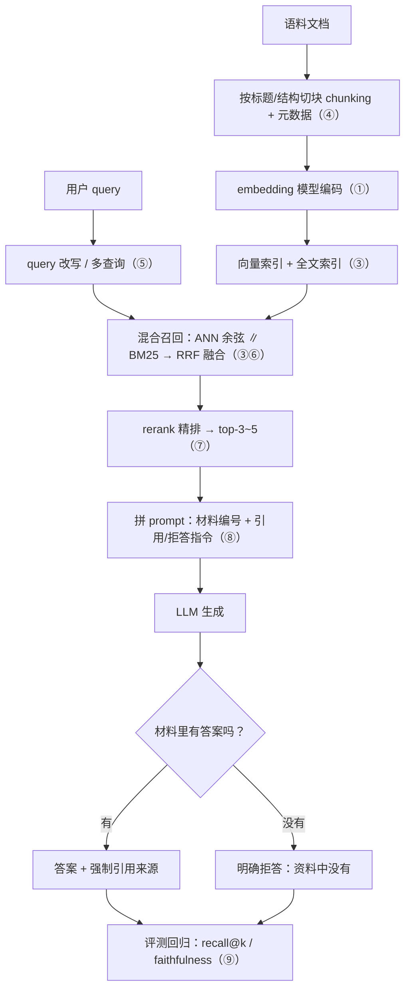
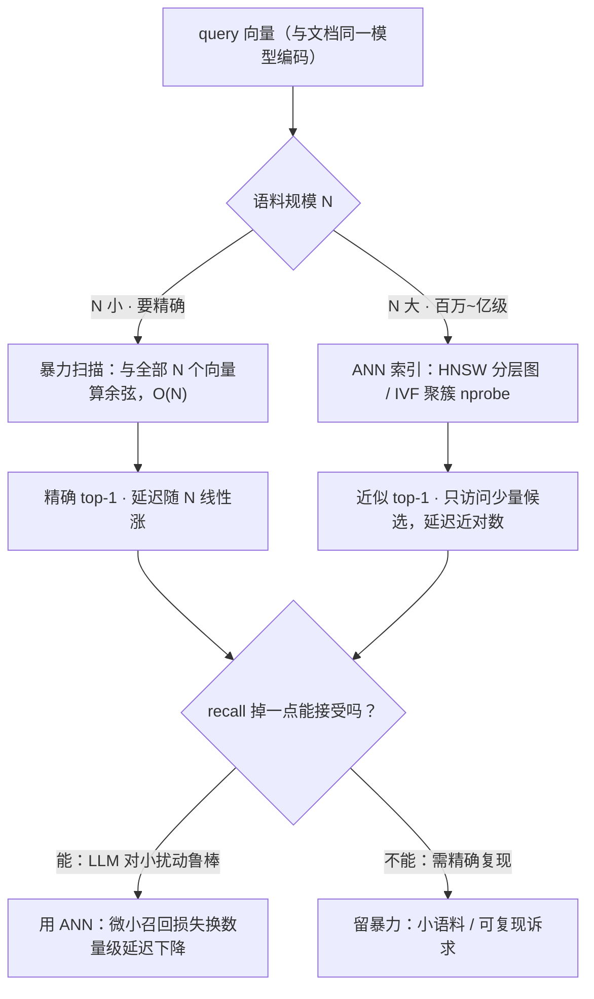
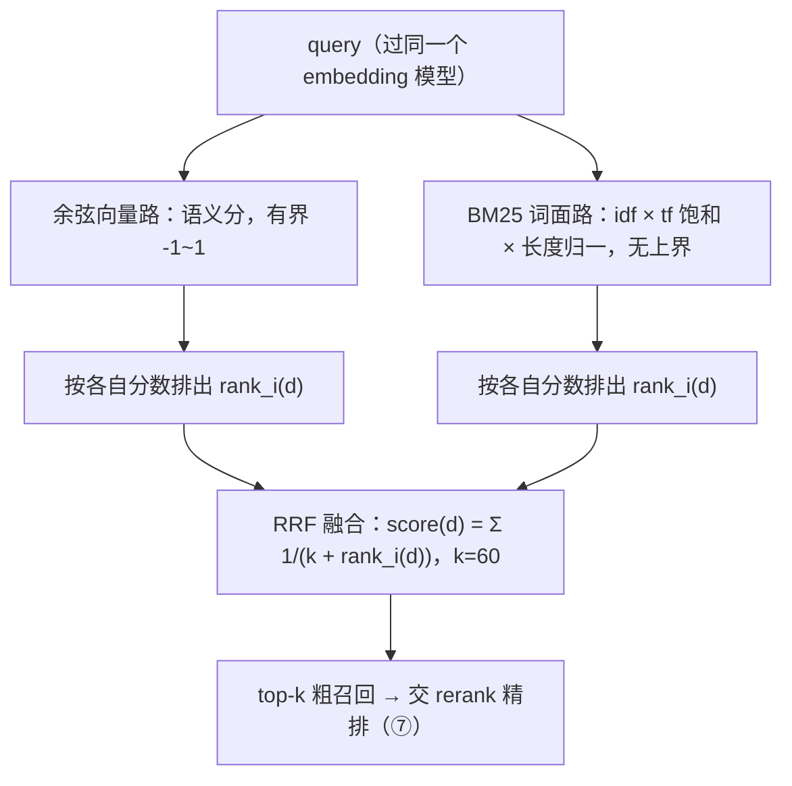
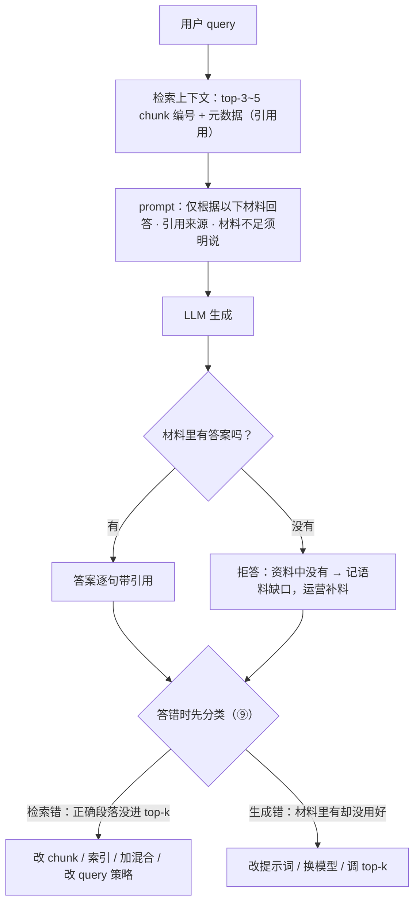

# RAG 与检索(完整教程)

> 课程日志 · 2026-10-10 开课 · 完整教程版（先讲完，后续再练习提问）
> 目标：**实战导向**——能讲清 embedding 机制、pipeline 每层为什么存在、应对"设计企业知识库问答"系统设计题
> 探测结论：从未写过向量检索代码；机制理解到"大意"层
> 节奏约定：沿用 Harness 架构——naive 版先行，每层 = "naive 在哪里坏 → 长出什么"

---

## 公理与 naive 起点（第 1-2 节）

### ① 语义是几何

**embedding 模型把文本映射成固定长度的向量，且让"语义相近的文本在向量空间中距离近"。**

实战要能答到的深度：

- **这个几何是学出来的，不是数学恒等式。** 训练方式（对比式学习）：给模型大量"文本-相似文本"正对、"文本-无关文本"负对，把正对拉近、负对推远。所以 embedding 模型的质量 = 这个几何的质量。
- **余弦相似度**：只看方向不看长度（`cos = (a·b)/(|a||b|)`）。embedding 空间里方向编码语义，长度信息噪声大，所以用余弦不用欧氏距离。
- **RAG 成立的枢纽：同一模型既编码文档又编码 query。** "怎么回滚 git 提交"和文档"reverting a commit with git reset"零词汇重叠，但在同一向量空间里会落得近——这就是语义检索"零重叠也能命中"的原因。
- 实战陷阱："embedding 理解语义吗？"——它是**相似度的几何近似**，不是理解。域外数据（罕见术语、新造概念、特定代码库）会退化；多语言需要支持该语言对的模型。

### ② naive RAG（一切的地基，先让它跑起来）

```
文档 → 整篇 embedding → 存向量
query → embedding → 与所有向量算余弦 → top-1 → 塞进提示词 → 让 LLM 回答
```

**它在小语料上真的能用。** 后面每一节都是它的一个死法长出来的一层。

先把全貌立在这儿——后面每一节都是往这条链上补一层（括号编号 = 本文节号）；naive 版只有 文档 → 整篇 embedding → 暴力余弦 → LLM 这一条。



---

## ③ 规模之死：O(N) → ANN 索引

**死法**：语料 10⁶~10⁸ 条时，每次查询暴力算 N 个余弦不可行。

**ANN（approximate nearest neighbor，近似最近邻）**：用索引结构换"近似"。两个主流：

| 结构 | 原理 | 特点 |
|---|---|---|
| **HNSW** | 分层可导航小世界图：上层稀疏（长跳，快速逼近区域）、下层稠密（精修）；查询从顶层一路往下走 | 内存占用大，召回高、延迟低，最常用 |
| **IVF** | 先聚簇（Voronoi 划分），查询只搜最近的 nprobe 个簇 | 可量化/落盘，省内存，调参多 |

**为什么"近似"可以接受**：典型经验损失是 recall@1 从 0.99 掉到 0.95 量级（HNSW/IVF 都是启发式索引，**没有召回下界**，实际损失随索引类型/参数/数据分布变化，只能实测——`efSearch` / `nprobe` 就是那个旋钮），你交给 LLM 的那条 top-1 几乎不变；而且 LLM 对检索的小扰动有鲁棒性。这就是 ANN 的核心交易：**用经验上很小、可实测的召回损失换数量级的延迟下降。**



要点：HNSW 参数（M=每节点边数、efConstruction=建图时搜索宽度、efSearch=查询时搜索宽度——recall/速度旋钮）；量化（PQ/SQ，每维存更少 bit 换内存）；"你的向量库选型"——**pgvector（Postgres 的向量扩展：需安装并 `CREATE EXTENSION vector`，提供 HNSW/IVFFlat 索引）是你的锚点：FinHot 生产就是 Postgres，pgvector 等于同一套基础设施加向量能力**，中小规模完全够用，不必上专用向量库。

---

## ④ 粒度之死：整篇 embedding 是语义糊

**死法**：20 页的 spec 整篇 embedding = 一篇 20 页文档的平均语义——问其中某一节，向量对不上（**检索粒度失配**）；就算检索到了，20 页也塞不进提示词，且绝大多数是噪声。

**切块（chunking）**：

- 典型大小 200-800 token（起点，不是真理）；重叠 10-20%（边界连续性：答案跨块时不至于全丢）
- **结构感知切块 > 固定窗口**：按标题/章节切（markdown 的 `#`、代码的函数边界），语义边界远好于任意 512 字符一刀
- **parent-child / small-to-big**：小块负责检索（粒度细、命中准），命中后返回它的**父级大块**给 LLM（答案需要的上下文）
- **元数据随块存**：文档 id、章节、时间戳——检索时可过滤（"只看 2025 之后的"），生成时做引用

要点："chunk size 怎么选？"——**不靠猜，靠量**：拿真实问题测"答案所在段落是否进了 top-k"（检索 recall@k），改 chunk 策略看指标。这是把"调参"变成"评测驱动"的标准答法。

---

## ⑤ query 侧：同一个模型，两种分布

**query 也过同一个 embedding 模型**——但它和文档是两种分布：短、口语、带意图；文档长、正式、陈述。这叫 **query-document 分布差**，是纯向量检索精排不稳的隐藏原因。

三个标准手段：

1. **query 改写**：LLM 把用户原话改写成检索导向的表述（拆实体、补术语）
2. **多查询**：一个问题拆成多个子查询，各自检索再合并（配合 MMR 去冗余保多样）
3. **HyDE**（Hypothetical Document Embeddings）：先让 LLM 对问题**生成一个假设性答案**，用假设答案去检索——假设答案和文档是同分布的（都是"陈述性长文本"），比 query 更接近文档的几何。代价：多一次 LLM 调用

体现深度点：这里开始 **RAG 就长出了 agent 的味道**（查询规划 = 模型决定怎么查）——和第 ⑨ 节的 agentic 检索是同一光谱。

---

## ⑥ 精确匹配之死：向量检索会漏"词"

**死法**：`Error 0x80070005`、零件号、罕见人名、内部代号——embedding 空间里罕见 token 的信号弱（训练语料里见得少，几何没学好），**向量检索会漏精确词**。

**BM25**（经典词面检索）：基于词频/文档频率的概率检索函数，**精确词命中是它的绝对主场**。

反过来，**纯 BM25 的死法**：同义改写——"怎么撤销提交" vs 文档 "reverting a commit"——词汇重叠低，BM25 打不出分，**向量检索主场**。

**混合检索 = 两条路都走，用 RRF 融合**：

```
score(d) = Σ over each list: 1 / (k + rank_i(d))     # k 典型 60
```



**Reciprocal Rank Fusion** 只用排名不用分数——天然免疫"余弦 ∈ [-1,1] 和 BM25 无界"的量纲问题。简单、稳健、是工业默认基线（Elasticsearch/OpenSearch 的原生玩法；Postgres 里 tsvector + pgvector 也能做）。

要点："什么时候只用一条路？"——开放语义问答偏 dense；目录/ID/错误码查询偏 lexical；拿不准就 RRF。

---

## ⑦ 噪声之死：top-50 里真正相关的在第 17 位

**死法**：检索层（bi-encoder：query 和文档**分开**编码）为了可预建索引必须分开编码，精度有天花板。召回 50 条里，排序噪声大——真正相关的排第 3 还是第 17，不稳定。而塞进提示词的只有 top-3~5，排序直接决定答案质量。

**两段式架构**（RAG 的标准形态）：

```
全量语料 → [第一段：ANN + BM25 粗召回] top-20~50（毫秒级）
        → [第二段：rerank 精排] top-3~5
        → LLM
```

**rerank = cross-encoder**：把 **(query, passage) 拼在一起**过模型，直接输出相关性分数。联合编码远准于分开编码的相似度——但每条都要过一次模型，O(N) 成本，**只能跑在 top-k 上，不能全量**。

实战必问题 "bi-encoder vs cross-encoder"：
- bi-encoder：分开编码 → 文档向量可**预建索引**（第一段必须是它）；快、可规模
- cross-encoder：联合编码 → 更准、不能预建（每对都要现算）→ 只做精排
- 中间还有 late interaction（如 ColBERT 的 token 级匹配），知道存在即可

架构直觉（接回 Harness 架构）：**便宜的粗筛 + 贵的精修**——和"即时检索 + 深度阅读"、"摘要 + 按需展开"是同一个工程模式在检索里的投影。

---

## ⑧ 生成侧：检索只对了一半

检索回来的只是**材料**，答案还要生成。三个要点：

1. **带引用的上下文拼装**：材料编号 `[1][2]`，指令"仅根据以下材料回答，引用来源；材料不足时明确说'资料中没有'。**允许拒答**"——不允许拒答的系统必然幻觉，而且幻觉得很可信
2. **失败分两类（评测的核心，下节展开）**：
   - 检索错：材料里没有答案（或材料是错的）
   - 生成错：材料里有答案，模型没用好/用歪了
   两类修复手段完全不同（改检索 vs 改提示词/换模型），**不能定位就不能修**
3. **"窗口有 1M 了，还要 RAG 吗？"（高频习题）**：
   - 2023 年 RAG 的理由是"窗口不够"——今天这个理由弱了，但不是没有了
   - 真正的理由：**成本**（每 query 只付相关 token，全量塞是 100× 费用 × 延迟）、**注意力质量**（Harness 架构的 context rot：token 越多回忆越差，噪声稀释信号）、**时效**（更新语料 = 重建索引，不动模型）、**权限**（只索引用户可见的部分，检索时过滤）
   - 小语料（< 窗口）+ 低 QPS + 低延迟不敏感 → 硬塞也合理，RAG 不是教条



---

## ⑨ RAG 评测：怎么知道它工作，坏了怎么定位

**第一步永远是故障分类**：答错 → 先看"正确段落进了 top-k 没有"：
- 没进 → 检索问题（改 chunk/换索引/加混合检索/改 query 策略）
- 进了但没答对 → 生成问题（改提示词/换模型/调 top-k）

**评测体系**（实战要能画出这张图）：

| 层 | 指标 | 一句话 |
|---|---|---|
| 检索层 | recall@k | 正确答案所在块有没有进 top-k |
| 检索层 | MRR | 第一个正确结果排第几（倒数） |
| 检索层 | nDCG | 位置加权的相关性（越靠前越值钱） |
| 端到端 | faithfulness | 答案是否只基于检索材料（防幻觉） |
| 端到端 | answer relevance | 答案是否回答了问题 |
| 端到端 | context precision/recall | 检索材料里相关/不相关的比例 |

- **golden set 从真实日志来**（真实用户问题 + 人工标正确段落/答案），不靠编造的问题
- 开放题的自动评测：**LLM-as-judge**（带 rubric 的裁判提示词）+ 抽样人工复核（裁判也会错）
- **回归**：chunk 策略/提示词/模型任何变更 → 先跑 golden set 再上线
- **你的锚点**：FinHot 的 labeler（T+5 异步打标签、pending/labeled/skipped 状态机）就是这个架构——"我建过**离线评测闭环**：生产 LLM 输出落台账，异步标注，按状态机推进，指标驱动迭代"。实战直接这么讲

---

## ⑩ 替代品：什么时候 RAG 是错工具（高频加分项）

| 方案 | 适用 | 不适用 |
|---|---|---|
| **Agentic 检索**（just-in-time）：给 agent grep/glob/read，让它自己探索文件系统（Harness 架构 §5：Claude Code 模式） | 语料是文件结构、问题需多步探索、agent 能自己验证读到的东西、延迟/成本可接受 | 高 QPS 低延迟、非文本语料、无法迭代探索 |
| **长上下文硬塞** | 小语料、低 QPS、要求绝对完整 | 大语料、高成本敏感、注意力稀释 |
| **微调**（把知识烘进权重） | 稳定、窄域、高频的知识 | 语料频繁更新（要重训）、长尾知识、需要溯源 |

**RAG 的本质**：把知识**外置**——更新知识 = 更新索引，不动模型。这是它相对微调的根本优势，也是实战中"RAG vs 微调"的标准答案。

**决策树**（系统设计题用）：延迟要求？语料规模/更新频率？结构（文件/数据库/网页）？要溯源吗？权限边界？→ 每个答案都指向一个方案，RAG 只是棋盘上的一格。

---

## ⑪ 系统设计题答题骨架："设计一个企业知识库问答系统"

1. **先澄清**：语料是什么（类型/规模/更新频率）？查询 SLA（延迟/成本/QPS）？用户（权限边界）？——不澄清就设计 = 扣分
2. **摄入**：解析（PDF/markdown/代码）→ 结构感知切块 + 元数据 → embedding → 索引（pgvector/HNSW 起步，规模大了再谈专用库）+ 全文索引（BM25）；增量更新管道
3. **检索**：混合（BM25 + dense + RRF）→ rerank → top-3~5；query 改写按需
4. **生成**：引用 + 允许拒答；低置信度（rerank 分数阈值）→ 转人工
5. **权限**：索引带 user/tenant 元数据，**查询时过滤**（不是生成后过滤）
6. **评测**：golden set 从日志来，检索层 + 端到端指标，变更先跑评测
7. **失败与运维**：全链路日志（query → 检索结果 → 答案 → 用户反馈），反哺 golden set；缓存（相同 query）；模型路由（简单问题小模型）

经典追问应对：
- "文档更新了索引怎么办？" → 增量 upsert（删旧块向量 + 插新块），不是全量重建
- "用户问语料外的东西？" → 拒答 + 记录（语料缺口信号 → 运营补料）
- "怎么证明它变好了/变坏了？" → golden set 回归，指标名报出来

---

## ⑫ 实操计划（下一步，单独开做）

在 `learn-agent-harness/` 里从零写一个**可运行的最小 RAG**（~200 行，纯内存，不用数据库）：

```
corpus（几篇真实文档）
  → chunker（按标题切 + 元数据）
  → in-memory 向量索引（余弦暴力——语料小，正好能看见 O(N)）
  → 简易 BM25
  → RRF 融合
  → rerank 位（接口留好，先 stub 成"重排=保序"）
  → 生成（调现有模型代理，带引用 + 拒答指令）
  → 一个 10 题的 golden set 跑 recall@k
```

学完理论后你说开始，我就带着你写——这是你讲解时能指着的"我从零写过 RAG pipeline，包括评测"。

---

## 附：来源与锚点

- 经典/稳定知识（无版本敏感）：HNSW/IVF、RRF（Cormack 2009, k=60）、BM25、bi/cross-encoder、recall@k/MRR/nDCG、RAGAS 式指标、HyDE（Gao et al. 2022）
- 接回 Harness 架构：⑤ query 改写→agent 化光谱；⑦ 粗筛+精修模式；⑧ context rot；⑩ agentic 检索 = 第五节 just-in-time
- 你的生产锚点：FinHot（Postgres→pgvector 选型故事；labeler→离线评测闭环故事）
- 实战陷阱清单：embedding≠理解；ANN 近似可接受的原因；窗口大≠不用 RAG；RAG vs 微调的本质（知识外置）

---

## 13 · 实操复盘：从零写一个最小 RAG（2026-10-10 深夜 / 10-11 凌晨）

> §12 计划已执行。作品 = `learn-agent-harness/rag-demo/`（16 个 src 文件，零依赖，tsx 直跑）。
> 语料 = 课程笔记自己（rag.md + agent-harness.md + handoff.md → 125 chunks）。
> 偏离计划：代理没有 embedding 模型（/v1/embeddings 实测 503）→ Embedder 接口 + hash 实现（FNV-1a → 768 维 → L2 归一）。刻意的教学选择：可复现、向量可打印、同义盲区变实证。换真语义模型 = 再实现接口 ~10 行。

**pipeline**：corpus → chunker（heading 边界 + 500 字符兜底，挂 headingPath）→ tokenizer（拉丁整词 + CJK bigram）→ HashEmbedder → 暴力余弦 ∥ BM25（k1=1.5, b=0.75）→ RRF 融合（k=60）→ rerank 插槽（直通）→ 生成（强制引用 + 强制拒答，qwen3.8-flash-next）

**三个实证发现**：
1. **定价 = 检索质量**（S2→S3）：cosine 给所有 token 统一定价 $1 → "什么"（df 78/85，idf 0.09；2026-10-10 快照，当时为 132-chunk 语料；2026-10-19 去面试化删题库节后为 123-chunk；同日修复轮改 handoff.md §四后语料 125-chunk，df 未复算）噪声让塞满噪声词的 chunk 压过真正的解释 chunk（目标 #15）。换 BM25 价目表（IDF × tf 饱和 × 长度归一）→ 目标回 #1（11.7）。`explain()` 发票机制把每个 token 的收费打出来。
2. **没有一路全面占优**：Q1（噪声词重灾）BM25 赢、Q3（话题聚簇）cosine 赢 → RRF 按 rank 融合（唯一无量纲公共货币）；`perListRanks` 列让"一路失明、另一路救回"可见。
3. **bigram 代价两次显形**："上下文" 三字词拆成 上下 + 下文（靠碎片命中）；垃圾碎片 "么要" df=2 → 被当稀有信号定价 0.83。真实系统 = 正经分词器（jieba）或语义 embedding——tokenizer 和 Embedder 都是模块，pipeline 不动。

**golden set（10 题：8 范围内 + 2 范围外）**：recall@3 = 0.31 / recall@5 = 0.44 / recall@10 = 0.50（PASS 3/8，2026-10-12 锚点式 golden set 复测；**2026-10-19 两度复跑 `npm run demo:eval`（去面试化删语料后 / 修复轮改 handoff.md §四后语料 123→125 chunks），三值与 PASS 数均不变、gold 锚点 16/16 全命中——锚点式 gold set 对笔记编辑不漂，这条本身是设计验证**）。

> **数字口径（重要）**：旧版宣称的 recall@3=1.00 / @5=0.94 出自 2026-10-10 的「行号指针」golden set——gold 用 `lines: [28,31]` 指向笔记行号，笔记一编辑指针就漂、指错位置还**静默打 0.00**（同一次排序内 recall@k 单调不减，@3=1.00 与 @5=0.94 本就不可能同现，当年即为不同运行的拼接值）。2026-10-12 已把 gold 改为**文本锚点**（每题一个 distinctive 子串，运行时解析到 chunk），任一锚点匹配不到即 FAIL 退出。当前漏题定位到机制层：Q2（IDF 对数）是**语料缺口**——语料没有 IDF/对数的解释段；Q7/Q8（compact / paraphrase）是 compact 段检索短板。

> **评测耦合警告**：本文件是 demo:eval 语料成员（corpus = rag.md + agent-harness.md + handoff.md），划改会扰动本节数字（W0-A 实测 132↔133 chunks、recall@5 0.44↔0.38、recall@10 0.50↔0.56 漂移）。凡划改必须重跑 `cd rag-demo && npm run demo:eval` 核对本节，不符以实跑为准或调整新文案回稳；§13 引述的探针问题原文是稳住排序的关键，严禁改动。
**5 题 FAIL 的机制归因**（2026-10-12 复测）：Q2（IDF 对数）= 语料缺口（语料没有 IDF/对数的解释段，两路都漏）；Q7（compact）= compact 段检索短板（漏 handoff.md#12：cosine#45 / bm25#12）；Q8（paraphrase 探针"系统怎么防止上下文溢出？"）= 表面形式盲区（漏 agent-harness.md#9：cosine#11 / bm25#13；handoff.md#12：cosine#122 / bm25#112）；Q1（k1 饱和）= 排序短板（rag.md#25 两路都在 top-10 外：cosine#73 / bm25#12）；Q3（headingPath）= 两路极端分裂（bm25 #1 vs cosine #54-60）。共同根因：词法路只能走表面形式重叠多远——**完全 paraphrase = 完全漏，这就是语义模型存在的理由**；Q2 还多一层教训：检索器修不了语料缺口。

**拒答轨**："苹果的 CEO 是谁？" → 模型输出"材料不足" ✓（RAG 的失败模式不是不知道，是自信地编；拒答指令是第一道防线）。

**命令**：
```bash
cd learn-agent-harness/rag-demo
npm run demo:retrieval  # S2 向量路
npm run demo:bm25       # S3 BM25 对比 + 发票
npm run demo:rag        # S4 端到端（含生成，3 次 LLM 调用）
npm run demo:eval       # S5 golden set + recall@k
```

**计划里没做的 4 题**（③ ANN / ④ rechunk / ⑥ re-embed / ⑦ 增量索引）：全是规模化故事，留给 沙箱与凭据 / 生产上下文。
**工程观察**：语料是 Obsidian 活文档（实操中文件被外部保存过两次），索引是快照、语料会漂移 → 生产的增量 re-embed 问题。

---

> 2026-10-19：原「S1 五道确认题（课后自测）」已随练习题库整体移除，站点不再含任何题目。
