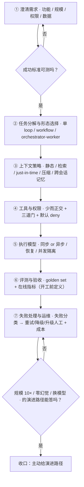
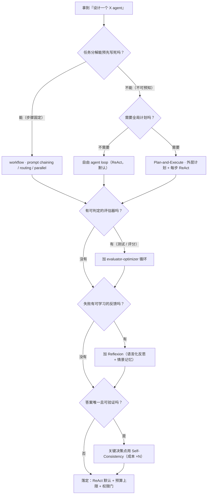
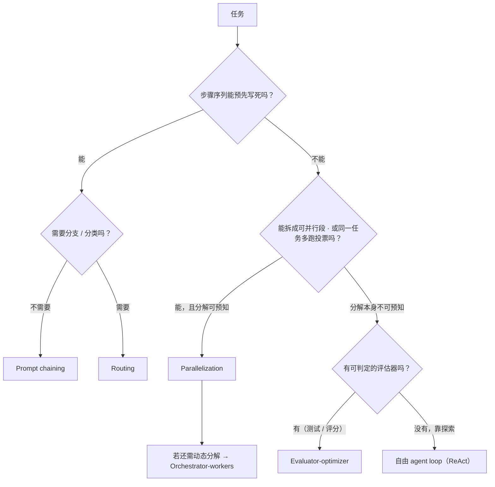
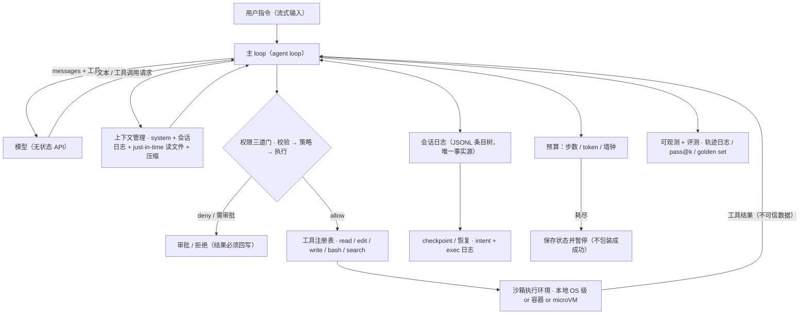

# C 课 · Agent 系统设计模板

> 优先级 P0 · 状态：⏳ 讲义已展开（2026-10-11 补入 S8 范式速查 → 实战走查 + 图示 + 范式出处），待提问演练
> 前置：A（harness-demo）+ B（rag-demo）——本課把它们收口成"设计能力"
> 目标：30 分钟结构化答"设计一个 X agent"，并且每个模块能指着自己的作品或生产故事
> 用法：S1-S2 是开场坐标系与答题骨架；S3-S8 是可拆装的模块库；S9 是一道题的完整口述走查（对着它练节奏）；练习题库按 S 编号回查

---

## S1 为什么 agent 系统设计 ≠ CRUD 系统设计

**这一节解决什么问题**：先把坐标系立起来。面试官在系统设计轮最怕听到"建一张表、加一个 API、写个循环调模型"——那说明候选人把 agent 当成普通后端，把模型当成一个 RPC。四个根本差异是整套设计的地基：先说它们，后面每一层的存在才有落点。

四个根本差异（开场白，先把坐标系立起来）：

| 差异 | 后果（设计时必须回答的） |
|---|---|
| **模型是"不可靠的非确定性组件"** | 不能靠 code review 保证行为 → 需要**评测**（不只是测试）+ 权限/沙箱兜底 |
| **失败单位 = 整条轨迹**，不是单次请求 | 单步可能对、整体跑偏 → 轨迹级日志/观测/评测 |
| **成本按 token 计，且随步数放大** | 每加一层（多次 LLM 调用）都是 3-10× 成本、多智能体整体约 **15×** → 成本是一等设计约束 |
| **输入面 = 世界**（读到的文件/网页/工具结果都可能含注入） | 权限边界必须独立于提示词（harness 课第七节） |

**怎么用这张表**：它不是让你背四条，而是让你在每一层设计里回答一个对应的问题——"这一层的失败模式是什么？谁负责兜底？"。差异 1 指向评测层与权限层；差异 2 指向轨迹日志与可观测；差异 3 指向模型路由与预算；差异 4 指向沙箱与凭据。

**反例（面试里真实会出现的坏答案）**：候选人上来就画"前端 → API → 数据库 → LLM"，把模型当一个 RPC。面试官追问"模型返回了 tool call，但参数非法怎么办"，他答"在 prompt 里让它别乱传"——这就是把确定性校验寄希望于概率组件，等于宣布自己没做过生产。正确答案是执行层的三道门（校验 → 权限 → 执行），拒绝也是合法结果、必须回写。

**面试信号**：先说这四条，再画架构——表明你知道自己在设计"概率系统"而不是"确定性系统"。可以配一个具体数字增强说服力：agent 约 4× chat token、多智能体约 15×，token 用量能解释约 80% 的性能方差（industry-2026.md §一.2 / §四.4）。

---

## S2 通用答题骨架（七步，任何 X 都套）

**这一节解决什么问题**：把"设计一个 X agent"这种开放题变成可复用的流程。七步不是流程表演，而是把 S1 的前提落成工程动作：先澄清（把不可测的"成功"变成可测的指标），再选形态，再定上下文/工具/执行，最后把验收与失败处理写进设计本身。

1. **澄清需求**（2-3 分钟，不澄清就设计=扣分）
   - 功能：任务类型？单轮还是多步？成功标准是什么（可测的）？
   - 规模：QPS？延迟 SLA？日成本预算？
   - 用户与权限：谁能用？agent 能碰什么（文件系统/网络/外部 API）？
   - 数据：语料/知识在哪？更新频率？要溯源吗？
2. **任务分解与形态选择**（S3 的模式表）：单 agent 自由 loop？固定 workflow？orchestrator-worker？
3. **上下文策略**：哪些知识进提示词——静态（system/规范）/ 检索（RAG）/ just-in-time（agent 自己读文件）；长会话压缩；跨会话记忆（要不要）
4. **工具与权限**：工具面设计（少而正交）；三道门（校验/策略/执行，A③⑤）；沙箱（E 课）；默认 deny
5. **执行模型**：同步还是异步/后台长任务？崩溃恢复（journal/checkpoint，G 课）？并发隔离？
6. **评测与验收**：离线 golden set（B⑨）+ 在线指标；**验收标准在开工前定义**
7. **失败处理与运维**：失败分类（模型/工具/外部/策略）→ 重试/降级/升级人工；可观测（D 课）；成本控制（J 课）

七步的可视化（注意第 6 步是"回环"——评测不过就退回改上下文或形态，不是线性往下走）：



**答题节奏**：1 澄清 → 2-3 形态（说清为什么不选另一种）→ 4-5 画一张图（拓扑：用户 → 编排 → 工具/检索 → 外部世界，标出权限边界）→ 6-7 评测与失败 → 最后主动给"如果规模 10× / 如果要求零幻觉 / 如果换模型"的演进路径。

### "像 agent engineer 一样思考"决策树

拿到任何"设计一个 X agent"，脑子里先走这棵树。它的价值不是替你选范式，而是逼你在**澄清阶段**就把"任务能不能预定义、失败有没有反馈"问出来——这两个答案决定了后面 80% 的架构。



**2026 新主线 · 两个必答题模块 [2026现行]**（答题时主动带沙箱与评测闭环，比只画 loop 高半档）：
- **沙箱隔离**：每会话独立沙箱/microVM——容器共享内核=安全威胁，云 agent 需 hypervisor 级隔离（整机快照应对 CI/评审的异步空档）；**凭据结构性不可触及**——凭据放 vault、agent 永不可触 token。参考实现：Cognition 云 agent（hypervisor 工程 1 年+）与 Anthropic Managed Agents（2026.4，把 session/harness/sandbox 像操作系统虚拟化硬件那样抽象成稳定接口）。https://cognition.ai/blog/what-we-learned-building-cloud-agents + https://www.anthropic.com/engineering/managed-agents
- **评测闭环**：**逐轨迹 eval + 失败归因**——agent 成功率由错误恢复决定，迭代速度由失败归因能力决定；可重放事件日志 + 逐轨迹 eval + 控制台逐步观察=资深团队与 demo 团队的本质差距（来源：industry-2026.md §四"可观测→可改进闭环"，该条素材无外部 URL；内部锚点 H 课评测 / D 课可观测）

---

## S3 形态选型：五种规范模式（Anthropic "Building effective agents" 分类）

**这一节解决什么问题**：同一个需求，选 workflow 还是 agent，决定了成本、可控性与失败面。这是系统设计轮的分水岭——面试官往往在这里判断你"会不会为自由度付费"。这一节的表按**拓扑**给五种规范模式 + 自由 loop；判断原则只有一句：能用 workflow 就不用 agent。

| 模式 | 结构 | 适用 | 代价 |
|---|---|---|---|
| **Prompt chaining** | 固定序列 A→B→C，中间可加 gate | 任务能拆成确定性子步骤 | 不灵活，分支难 |
| **Routing** | 分类器把请求分给专门链路 | 明显的几类任务（简单/复杂、意图分类） | 分类错=全错 |
| **Parallelization** | 分段并发 + 聚合（或同一任务多跑投票） | 可拆段、要一致性（self-consistency） | 成本 ×N |
| **Orchestrator-workers** | 主 agent 动态分解、派子任务、汇总 | 任务分解本身不可预知（coding agent 主形态） | 编排成本、子任务质量方差 |
| **Evaluator-optimizer** | 生成→评估→改，循环 | 有可判定的评估器（测试通过/评分） | 收敛性无保证、烧 token |
| **自由 agent loop** | 模型自决工具调用直到完成 | 探索型任务（Claude Code / Codex 主形态） | 步数与成本不可控 → 预算+停止条件 |

**怎么读这张表**：前五行是"拓扑已定"，最后一行是"拓扑交给模型"。它们不是互斥菜单——真实系统常常是"外层 routing 分链路，链路内自由 loop，关键决策点 evaluator-optimizer"。

选型的判断流程：



**核心判断句（面试加分）**："workflow 是预定义的代码路径，agent 是模型自决路径。能用 workflow 就不用 agent——agent 的自由度是成本，不是特性。"（自由度只在任务分解不可预知时才值得付）

**反例**：把"设计客服 agent"做成 orchestrator-worker，3 个子 agent 各自检索再汇总。面试官问"你的任务分解在编译期能定吗"，答案是能（意图分类是固定几类）——那就该用 routing + 固定链路，多 agent 纯属给成本加一个约 15× 的乘数。

多 agent 的常见误区（harness 课第八节，设计题里当"为什么不"用）：
- 多 agent ≠ 更强，是**上下文隔离 + 并行**两个动机，不是"聪明"
- 子 agent 之间传摘要不传全量（token 经济学）；orchestrator 只调度不干活

---

## S4 演练一：设计一个 coding agent（你的主场，背到能画）

**这一节解决什么问题**：这是目标岗位（Codex Core / Claude Code 类）的主战场。要求是背到能画——一张拓扑图 + 八个模块各自的设计要点 + 每个要点能指着自己的作品（harness-demo / sandbox-demo / FinHot）说出证据。面试官追问时，你要能在 30 秒内从图上的任意一个模块下钻到"我具体做了什么、代价是什么"。

```
用户指令 ──▶ [主 loop] ──▶ 工具三面 ──▶ 沙箱执行环境
              │  上下文：system + 会话日志 + 按需读文件(just-in-time)
              │  预算：步数/token 双上限 + 压缩
              ▼
        会话日志(JSONL, 唯一事实源)
        权限门(默认 deny) + 工具注册表(校验)
```

上面的 ASCII 图保留作"最小骨架"；下面是同一套系统的 **mermaid 架构/数据流图**，多了恢复、预算、可观测三条支线——面试时按这张讲更完整：



逐模块 + 自己的证据：

| 模块 | 设计要点 | 我的证据 |
|---|---|---|
| Loop | 模型出请求、程序落实；无工具调用=结束 | harness-demo ② |
| 工具面 | 少而正交：read/edit/write/bash/search；描述=模型读的 API 文档（ACI） | harness-demo ③ |
| 权限 | 三道门；默认 deny；写操作审批；路径范围 | harness-demo ⑤ + sandbox-demo（E） |
| 上下文 | just-in-time 检索（agent 自己 grep/read，不用 RAG 预建索引——语料是仓库，B⑩ 决策树）；长会话压缩 | B⑩ + harness-demo ⑧ |
| 恢复 | intent/exec 日志；非只读不盲重放 | harness-demo ⑥⑦ |
| 执行隔离 | 本地=OS 级（macOS Seatbelt / Linux bubblewrap+seccomp，Landlock 为 legacy）或容器；云=microVM（E 课 S3） | E 课 + FinHot 幽灵事故 |
| 评测 | SWE-bench 类 pass@k（任务级）+ 轨迹级（多余操作/重复调用）+ 回归 golden set（C 改动先跑） | H 课 |
| 停止 | 预算耗尽→报告进度；连续失败→升级人工；用户随时可停 | A⑧ |

**这张表怎么背**：不要背 8 行文字，背"删掉这一层会失去什么保证"（harness 课 10.2 的复习法）——删掉权限层，一次 injection 就是生产事故；删掉恢复层，崩溃后盲目重放会重复伤害；删掉评测层，会把"模型说完成了"当验收。

经典追问与应对：
- "和直接用 Claude Code 有什么区别？" → 我在讲**机制层**：任何 coding agent 都是这几层的组合；差异在每层的选择（沙箱粒度/权限默认值/压缩策略），选型依据我逐条说了
- "怎么防止它改坏生产？" → 权限（默认 deny+审批）+ 沙箱（路径/网络 scope）+ 工作区隔离（git worktree，FinHot 实践）+ 恢复（可回滚）——**四层独立，任何一层单独都不够**（幽灵事故=只有提示词约束没有执行边界）
- "模型被注入怎么办？" → 注入改变的是模型意图，改不了权限层；所以危险动作必须过**确定性**的门（harness 课 7.2：提示词控制意图、策略控制行为）

---

## S5 演练二：设计一个金融分析批处理 agent（FinHot 本体，差异化故事）

**这一节解决什么问题**：大多数候选人只有"同步问答"经验，没有"批量、异步、结果延迟才可知"的形态。这一节把 FinHot 的生产事实翻译成设计语言——讲它，等于把"我处理过奖励延迟到达的评测系统"这个稀缺故事摆上桌。

与 S4 的差异：**批量、异步、结果延迟才可知**——这是大多数候选人没做过的形态。

```
采集(多源) → 预筛(cheap model) → 分析(6 次模型调用: prefilter/score×2/understand/structure/direction)
   → 落台账(状态机: pending/labeled/skipped, 反事实 published=false)
   → T+5 异步打标签(labeler, 延迟结果) → 指标(方向准确率 vs baseline) → 提示词迭代
```

设计要点 + 面试讲法：
- **成本分级**：预筛用便宜模型挡掉 80% 不值得分析的（J 课路由的真实案例：6 次调用结构本身就是路由）
- **状态机而非一次性**：每篇文章一行台账，任何时刻可查"处理到哪、为什么停"；failed 可重试不重做（幂等按 source_id）
- **延迟奖励**：金融分析的对错要 T+5 才知道 → labeler 是**异步评测器**，858 条 skipped 是设计内（neutral/none/空 scope/direction failed 不可评）——"我设计过奖励延迟到达的评测系统"
- **部分成功**：backfill 1645 行、~10% 失败（超时为主）→ 失败分类、断点续跑、部分成功可见（G 课）
- **反事实设计**：published=false 的记录保留"没发布的判断"——评测需要全量样本，不能只评上线的（K 课）

**这张图的讲法**：把"6 次调用"讲成"计划冻死的 workflow"（S8）——它买到的是成本可预测、可审计，放弃的是对不可预知任务的适应；当失败归因显示"计划本身选错了分析路径"频繁出现时，就是解冻（引入 replanner / 自由 loop）的信号。成本公式可以直接写出来给面试官看：$C_{task} = \sum_{i=1}^{6} (tokens_i \times price_i)$，其中 prefilter 走便宜模型，这一项就是路由省下的钱。

---

## S6 演练三：设计一个企业客服/知识库问答 agent（收口 B 课 ⑪）

**这一节解决什么问题**：把 B 课的 RAG 骨架接上 agent 的工具与权限。重点不是重讲检索，而是说清"问答"与"办事"的边界——一旦 agent 能执行动作（退票、改地址），失败面就从"答错"升级为"做错"。

B⑪ 已有完整骨架（澄清→摄入→检索→生成→权限→评测→失败运维），这里只补 agent 化的三处升级：

1. **从"问答"到"办事"**：检索回答 → 还要能执行动作（查订单、退票）→ 引入工具面 + 权限（动作=高风险，审批或规则白名单）
2. **升级路径**：低置信（rerank 分数阈值/拒答）→ 转人工；**agent 的失败出口是"人"，不是"编一个"**
3. **多轮 + 会话状态**：意图澄清循环、跨轮上下文（会话内）、用户偏好（跨会话，F 课）

追问应对沿用 B⑪（文档更新→增量 upsert；语料外→拒答+记录；证明变好→golden set 回归）。

**一个必须能答的追问**："退票工具调用参数是 `refund_amount: 0`，但语义是全额退——在哪一层拦？" 答案：不在生成侧猜语义，而在**执行层**做参数语义校验（金额为 0 与订单金额不符即拒绝）+ 高风险动作审批。这是 S1 差异 1 在业务动作上的投影。

---

## S7 通用追问库（任何设计题都可能被追）

**这一节解决什么问题**：面试官追你的方式通常不是问新知识，而是拿一个维度（成本、规模、延迟、安全）把你逼到边界。这一节把每个维度的标准应对骨架写成可背的结构——回答时先报"我会从哪几个手段下手"，再展开其中一个，不要只报一个词。

| 追问 | 标准应对骨架 |
|---|---|
| 怎么证明它变好了/坏了？ | golden set 回归 + 在线 A/B；指标先报名字（pass@k / recall@k / 人工升级率） |
| 成本怎么控？ | 模型分级路由 + prompt caching + 步数/ token 预算 + 缓存相同子问题（J/D） |
| 模型要换掉怎么办？ | 工具协议与 harness 解耦（模型=可替换组件）；换模型=跑评测回归（A 课模型侦察故事：step-5 不支持 tool calling→降级） |
| 规模 10× 怎么办？ | 检索换 ANN（B③）、执行换沙箱池、评测换采样+分层、状态外置（DB 队列） |
| 零幻觉要求怎么答？ | 强制引用+拒答（B⑧）+ 生成后校验（结构化断言）+ 高风险动作走确定性规则不经模型 |
| 多人/多租户？ | 权限=查询时过滤（B⑪）、会话隔离、沙箱池按租户、成本按租户归因（D） |
| 实时要求（<2s）？ | 流式（A④）+ 小模型先行 + 预取；长任务转异步+进度通知 |
| GUI agent（computer use）的权限与观察怎么处理？ [2026现行] | **观察**=截屏+可访问性树（像素级/语义级两通道，都会进上下文=都是注入通道）；**权限**=动作白名单+风险分级（与工具风险分级同一原则：只读/写、可逆性、财务影响，分级触发暂停/升级人工，I 课 S4.4 同构）；高风险动作必须过确定性门，不信任模型意图（来源：industry-2026.md §五 computer use 信号） |

**怎么用这张表**：它是"维度 × 手段"的矩阵。真正的答法是先定位面试官在测哪个维度（他一问成本，后面十有八九会追预算和归因），再给出"三个手段 + 一个我实际用过的证据"。没有证据的手段不要报——报了会被追到穿。

---

## S8 推理范式速查（ReAct / Plan-and-Execute / Reflexion / Self-Consistency / ToT）

> 🔶4 补入（2026-10-11）。S3 按**拓扑**分（谁和谁说话），本节按**推理策略**分（怎么想）——两维正交：S3 的任何拓扑里都可以装本节的任何范式。

**这一节解决什么问题**：当面试官问"你的 agent 用什么推理范式"，他其实在问"你知不知道自己为哪种不确定性付费"。这一节把五种范式的机制、成本、适用条件排成一张表，配套一个 30 秒选型流程。

| 范式 | 机制一句话 | 成本 | 什么时候用 | 代表作/我的锚点 |
|---|---|---|---|---|
| **ReAct** | Thought→Action→Observation 交错，一步走一步看 | 逐步延迟；误差累积；上下文膨胀 | **默认选择**：环境反馈快、任务分解不可预知 | Yao et al. 2022（ICLR'23）；**harness-demo / pi / Claude Code 本体就是 ReAct 形态** |
| **Plan-and-Execute** | planner 先出完整计划 → executor 逐步执行 → 失败 replanner 重规划 | 计划过期（环境变化后计划作废） | 全局视角重要的多步任务 | ReWOO（推理与动作解耦，防上下文膨胀）/ BabyAGI；**极端形态=固定 workflow（FinHot 6 次调用：计划编译期就冻死）** |
| **Reflexion** | 失败→自我反思生成语言化反思→存 episodic memory→下次尝试时带入 | 需要"可试错"任务+成功信号明确 | 有重试价值的任务（代码/规划/博弈） | Shinn et al. 2023；"语言化强化学习"（不更新权重）=K 课轨迹反馈 × F 课情景记忆的交集 |
| **Self-Consistency** | 高温多采推理路径→对**最终答案**多数表决 | 成本 ×N | 答案唯一且可验证（数学/选择/打标） | Wang et al. 2022；**FinHot 双模型评分=跨模型版自洽**（L 课 S2） |
| **ToT** | 对推理状态做搜索：扩展分支→评估中间状态→回溯（beam/BFS） | 需要**可评估的中间状态**；不剪枝则指数 | 中间状态可评估的任务（谜题/规划/推理游戏） | Yao et al. 2023（NeurIPS 2023） |

**选型四问（30 秒版）**：① 答案可验证且唯一吗？→ Self-Consistency 值得付 N 倍成本；② 需要全局计划吗？→ Plan-and-Execute（计划冻死的程度=workflow 化程度）；③ 中间状态可评估吗？→ ToT；④ 失败有可学习反馈吗？→ Reflexion；都不满足→**ReAct（默认，不是兜底）**。

**面试点**："范式不互斥，真实系统是叠的：外层 Plan-and-Execute 出骨架、每步内部 ReAct、失败后 Reflexion、关键决策点 Self-Consistency。设计题问的不是'用哪个范式'，是'**哪一步用哪个范式、成本谁来付**'——自由度是成本，不是特性（S3 核心判断句的范式版）。"

**反例**：对"客服 FAQ 分类"上 ToT——中间状态无法评估、答案也不唯一，纯烧 token。范式选错的典型症状是"成本涨了但成功率没动"。

---

## S9 实战走查：30 分钟口述稿——给 100 人并发的 coding agent 后端做架构

> 这一节是"把 S2-S8 串成一次真实答题"的完整演示。目标不是再讲一遍知识点，而是练**节奏**：什么时候澄清、什么时候画图、什么时候主动给取舍、什么时候把追问接住。选 coding agent（S4 主场）因为它最贴近目标岗位。
> 口述稿按时间轴分四段，方括号里是"面试官在听什么"。里面的数字是**设计假设**（面试时要先跟面试官对齐），不是既成事实；凡来自本项目生产或 industry-2026 的，已标注来源。

### 0-3 分钟 · 澄清需求（不澄清就设计 = 扣分）

开场先不画图，用 5 个问题把边界钉死，然后复述一遍自己的理解请对方确认：

1. **任务类型与成功标准**："是单轮改一处代码，还是多步改一个仓库并跑测试？成功标准是什么——PR 被 merge 率，还是 SWE-bench 式任务解决率？"（假设对方答：多步、真实仓库、成功=PR merge）
2. **并发口径**："100 人并发是指 100 个同时在线会话，还是 100 QPS 的请求？"（假设：100 个并发会话，每个会话跑 5-30 分钟）
3. **延迟 SLA**："首字节反馈要多久（体感），单任务墙钟上限多少？"（假设：首 token < 3s，单任务上限 30 分钟）
4. **权限与数据**："agent 能碰哪些仓库、能不能跑测试、能不能开 PR、绝对不能碰什么？仓库有多大？"（假设：只能碰 git 仓库的副本，能跑测试，能开 PR；不能碰生产与凭据；monorepo 约 10⁵ 文件）
5. **成本预算**："单任务 token 预算和日成本上限是多少？"（假设：单任务 1M token 硬上限）

复述："所以我理解的是：一个 100 并发会话的异步 coding agent 后端，每会话 5-30 分钟，能读写仓库副本、跑测试、开 PR，绝不能触生产与凭据，首 token 3 秒内，单任务成本封顶。对吗？"

[面试官在听什么：你有没有把"概率系统"和"生产约束"当一等公民——澄清里出现的权限/成本/延迟，后面都要有对应模块。]

### 3-8 分钟 · 分层（先给拓扑，再讲每层）

先画一张分层图（S4 那张 mermaid 的扩展版），然后按层讲"这层解决什么问题"：

| 层 | 组件（具体名字） | 解决什么 |
|---|---|---|
| 接入层 | API gateway + SSE 流式 | 100 会话的鉴权、配额、进度推送 |
| 编排层 | 每会话一个 agent loop（有状态 Agent） | 模型出请求、程序执行、结果回写 |
| 模型层 | 模型路由（主力模型 + 便宜模型做预筛/摘要） | 成本分级；模型=可替换组件 |
| 工具层 | read / edit / write / bash / grep / git，工具注册表 + JSON schema 校验 | 少而正交；ACI |
| 权限层 | 三道门 + vault + 短时凭据 + 网络 egress allowlist | 模型意图 ≠ 动作发生 |
| 执行隔离层 | 每会话 microVM（预热池） | 100 个互不信任的代码在同一台机器上跑 |
| 状态层 | 事件日志（JSONL 条目树）+ checkpoint + DB 队列 | 可恢复、可审计、可分支 |
| 可观测/评测层 | OTel trace + 逐轨迹 eval + 成本归因 | 失败归因决定迭代速度 |
| 控制面 | 配额、限流、审计、kill switch | 运营与合规 |

[面试官在听什么：分层的顺序是否体现"安全边界独立于提示词"，以及有没有把执行隔离和状态单独成层。]

### 8-18 分钟 · 关键取舍（含被否方案与原因）

这一段是拿分主战场。每个取舍按"选了什么 → 为什么 → 否了什么 → 否掉的原因 → 代价"讲。

**取舍 1：执行隔离用 microVM，不用共享内核容器。**
- 选：每会话一个 microVM（Firecracker 类，冷启动秒级）。
- 为什么：100 个并发会话跑的是**互不信任的代码**（用户提交的仓库 + 模型生成的代码），容器共享内核 = 一次逃逸全炸。Cognition 的云 agent 团队为此做了 1 年多的 hypervisor 工程，明说"容器共享内核=安全威胁"。
- 否掉的方案：纯 Docker 容器（便宜、启动快）——安全边界不够；若只是内部可信用户、单租户，容器可以接受。
- 代价：启动延迟、每会话内存开销、运维复杂度；用预热池 + 整机快照缓解（SDLC 有等 CI/评审的异步空档，快照能在空档期冻结）。

**取舍 2：写操作单线程，读操作可并行。**
- 选：同一工作区的**写**只允许一条轨迹在写；检索/阅读类子 agent 可以并行。
- 为什么：每个行动携带隐式决策，两个并行写者必然产出风格/边界冲突的碎片（Cognition "Don't Build Multi-Agents" → 2026 修正为"多智能体出智力、写操作保持单线程"）。
- 否掉的方案：orchestrator 派多个 worker 并行改同一个仓库——冲突不可合并，且决策不一致。
- 代价：写路径墙钟变长；用"读并行 + 写串行 + 评审零共享上下文"补偿（Cognition 发现评审 agent 与编码 agent 零共享上下文时效果最好）。

**取舍 3：上下文走 just-in-time 检索，不预建全仓库 RAG 索引。**
- 选：system 里给目录结构与规范，agent 自己 grep/glob/read。
- 为什么：仓库是活的（每次会话可能在不同 commit），预建索引会过期；just-in-time 用"轻量标识符 + 按需拉取"绕开索引过期（B⑩ 决策树）。
- 否掉的方案：全仓库 embedding 索引——索引过期 + 每会话重索引成本 + 召回粒度失配。
- 代价：运行时探索慢、可能绕死胡同 → 需要目录信号 + 步数预算引导。

**取舍 4：异步 job + SSE 进度，不用同步长连接。**
- 选：提交任务 → 返回 job id → 后台跑 → SSE 推进度/日志 → 完成后回写。
- 为什么：单任务 5-30 分钟，同步 HTTP 会超时、断线即丢会话。
- 否掉的方案：同步长轮询——连接资源占用高 + 客户端断线重连后状态难恢复。
- 代价：需要 job 队列、状态机、断点续跑（G 课）。

**取舍 5：凭据结构性不可触及。**
- 选：凭据放 vault，agent 进程永远拿不到 token；需要访问外部时由代理代签（MCP 代理模式）。
- 为什么：注入只能改变模型意图，改不了权限层；但一旦 agent 手里有长期 token，注入就等于凭据泄露。
- 否掉的方案：把 token 注入沙箱环境变量——最方便，也最危险。
- 代价：代理层复杂度；某些需要直连的 API 要改造成走代理。

**取舍 6：模型分级路由 + 硬预算。**
- 选：主力模型做推理与编辑，便宜模型做预筛/摘要/分类；步数、token、墙钟三上限。
- 为什么：agent 约 4× chat token、多智能体约 15×，token 用量解释约 80% 的性能方差——成本是架构约束，不是运维细节。
- 否掉的方案：全部用最强模型——质量可能略高但成本不可持续。
- 代价：路由错会把难任务交给弱模型 → 用"置信度 + 升级"补偿。

[面试官在听什么：你有没有"否掉的方案"，以及否掉的理由是不是可验证的工程事实，而不是"我觉得"。]

### 18-30 分钟 · 面试官追问与应答

**追问 1："100 并发到 1000 并发，你先改哪三处？"**
先报瓶颈：单会话平均 40-80 次模型调用、5-30 分钟 → 100 并发峰值对模型 API 约 30 QPS 量级，1000 并发约 300 QPS，瓶颈在模型配额与沙箱供给。三处：① 沙箱预热池按水位扩缩（约 20% buffer），冷启动用整机快照；② 模型调用加队列 + 退避 + 降级路由（难任务保留主力，简单步骤降级）；③ 状态外置成 DB 队列 + 分区，编排层无状态可水平扩。评测从全量改采样 + 分层。

**追问 2："怎么保证不同会话不互相污染？"**
四层独立：① 每会话独立 microVM；② 每会话独立 git worktree / 仓库副本（子代理共享同一文件系统，并行写必须靠 worktree 隔离）；③ 凭据按会话短时签发；④ 会话日志按会话隔离，审计可追。FinHot 的并行会话污染事故（compose 幽灵树被删）就是缺这四层的反面教材。

**追问 3："agent 被 prompt injection 了怎么办？"**
注入改变的是模型意图，改不了权限层。危险动作必须过**确定性**的门：默认 deny、写操作审批、路径范围、网络 egress allowlist、凭据不可触。提示词只控制意图，策略控制行为（harness 课 7.2）。

**追问 4："怎么证明它变好了？"**
指标先报名字：任务级 pass@k（SWE-bench 类）、轨迹级（多余操作数、重复调用率）、回归 golden set（改动前先跑）。失败归因是核心——可重放事件日志 + 逐轨迹 eval + 控制台逐步观察。FinHot labeler 就是这个闭环的离线版（T+5 异步评测、状态机）。

**追问 5："模型换代了怎么办？"**
工具协议与 harness 解耦，模型是可替换组件；换模型 = 跑评测回归。Anthropic 的教训：为 Sonnet 4.5 打的补丁在 Opus 4.5 上成了死重——要为"尚未写出的程序"设计稳定接口（Managed Agents）。

**追问 6："和直接用 Claude Code 有什么区别？"**
我在讲机制层：任何 coding agent 都是这几层的组合；差异在每层的选择（沙箱粒度/权限默认值/压缩策略）。选型依据我逐条说了（S4 经典追问）。

**追问 7："成本怎么控到不亏？"**
模型分级路由 + prompt caching + 步数/token 预算 + 缓存相同子问题 + 硬预算耗尽即暂停（不把未完成包装成成功）。单任务成本封顶，超了就暂停报告进度。

### 收尾（主动给演进路径）

"如果规模 10×，我改沙箱池/队列/状态；如果要求零幻觉，高风险动作走确定性规则不经模型；如果换模型，跑评测回归。这三条是我设计时预留的接口。"

---

## 练习题库（后续提问用）

> 前 10 题对应 S1-S8；11-14 是新增，覆盖 S9 实战走查与 S2 决策树。提问时按"考察"列回查对应小节。

| # | 题目 | 考察 |
|---|---|---|
| 1 | "设计一个 coding agent"——只许画一张图+讲三个关键取舍，3 分钟版本怎么讲？ | S4 |
| 2 | 客服 agent 里，模型对"退票"工具调用给出参数 `refund_amount: 0` 但语义是"全额退"。在哪一层拦截？ | S6+权限 |
| 3 | FinHot 批处理如果从 2000 篇/日涨到 10 万篇/日，先改哪三处？ | S5+规模 |
| 4 | 老板要求"agent 永远不要编"。给出三层具体机制（不是提示词）。 | S7 零幻觉 |
| 5 | 你的 orchestrator-worker 里，子 agent 返回的摘要互相矛盾。设计里怎么处理？ | S3 |
| 6 | 为什么"能用 workflow 就不用 agent"？反例：什么任务必须 agent？ | S3 |
| 7 | SWE-bench pass@k 里 k 的作用？为什么 pass@1 更值得优化？ | S4 评测 |
| 8 | 设计题里面试官说"延迟必须 <500ms"。你的 agent 架构哪些模块直接出局？ | S7 实时 |
| 9 | coding agent 为什么至今以 ReAct 为主、Plan-and-Execute 做外层？Plan-first 在 coding 场景的致命伤是什么？ | S8 |
| 10 | FinHot 6 次调用是"计划冻死"的极端。冻死买到了什么、放弃了什么？什么信号出现就该解冻（workflow 改 agent）？ | S8+S5 |
| 11 | 实战走查：100 并发 coding agent，面试官追问"为什么必须 microVM 而不是共享内核容器"——一句话说清安全边界，并给一个可以接受容器的场景。 | S9+沙箱 |
| 12 | 实战走查：同一仓库上 orchestrator 派三个 worker 并行改代码会出什么问题？写操作单线程的代价用什么补偿？ | S9+S3 |
| 13 | 实战走查：100→1000 并发，先报瓶颈再给三处改动。 | S9+S7 规模 |
| 14 | S2 决策树：拿到"设计一个 X agent"，前 3 分钟只许问 5 个问题，问哪五个？为什么"成功标准可测"要排在第一问？ | S2 |

## 来源与锚点

### 模式与骨架

- 模式分类：Anthropic "Building effective agents"（workflow vs agent、五种 workflow 模式）——harness 课第八节已核验引用
- 2026 主线（沙箱隔离 + 评测闭环）：industry-2026.md §一（Cognition 云 agent 基建 / Anthropic Managed Agents）、§四（可观测→可改进闭环）——本课 S2 的直接来源
- 收口：S4=harness 课第十节总装 + A 课全 10 节；S5=FinHot 生产（台账/labeler/backfill/幽灵事故，见 #35 记忆）；S6=B 课 ⑪

### 推理范式出处（对应 S8）

| 范式 | 论文 | 作者+年份 | 一句话结论 |
|---|---|---|---|
| ReAct | 《ReAct: Synergizing Reasoning and Acting in Language Models》arXiv:2210.03629 | Yao et al. 2022（ICLR 2023） | 让模型把"思考轨迹"与"动作"交错生成，用环境反馈修正计划；在 HotpotQA / ALFWorld / WebShop 上优于纯推理或纯动作基线 |
| Plan-and-Execute | 模式名来自工程实践，非单篇论文；代表实现 ReWOO《ReWOO: Decoupling Reasoning from Observations for Efficient Augmented Language Models》arXiv:2305.18323 | Xu et al. 2023；BabyAGI 为 Nakajima 2023 开源项目（无论文） | ReWOO 把计划与观察解耦：先出带变量占位的计划，再用观察结果替换占位，减少重复上下文、降低 token |
| Reflexion | 《Reflexion: Language Agents with Verbal Reinforcement Learning》arXiv:2303.11366 | Shinn et al. 2023（NeurIPS 2023） | 把失败反馈转成语言化反思、存入情景记忆并在下次尝试时带入——不更新权重也能从失败中改进 |
| Self-Consistency | 《Self-Consistency Improves Chain of Thought Reasoning in Language Models》arXiv:2203.11171 | Wang et al. 2022（ICLR 2023） | 高温采样多条推理路径，对最终答案多数表决，在算术/常识推理上稳定优于贪心 CoT |
| ToT | 《Tree of Thoughts: Deliberate Problem Solving with Large Language Models》arXiv:2305.10601 | Yao et al. 2023 | 把推理当搜索：扩展候选"思维"、评估中间状态、回溯/束搜索；在 Game of 24、创意写作、mini crosswords 上有增益 |

<!-- 已核实（2026-10-11 一手源）：ToT 正式发表为 NeurIPS 2023（原记 ICLR'24 oral 有误）；ReWOO（arXiv:2305.18323）为 arXiv 预印本、无正式会议/期刊收录，引用时只写 arXiv 号。 -->
> 补充：提示词层面可引 Plan-and-Solve Prompting（Wang et al., **ACL 2023**, arXiv:2305.04091），但它是 zero-shot CoT 的提示法、**不含 planner/executor 循环**——不要拿它当 Plan-and-Execute 架构的论文锚点（该架构本身属工程实践，学术锚点用 ReWOO）。

### 其他锚点

- 成本数字：agent ≈ 4× chat token、多智能体 ≈ 15×、token 用量解释约 80% 性能方差 —— industry-2026.md §一.2 + §四.4
- RRF：Cormack et al. 2009（k=60）——B 课 ⑥ 已引用
- 本文件为开课版完整讲义（S1-S9）；后续提问演练中暴露的卡壳点，回填到对应 S 节
